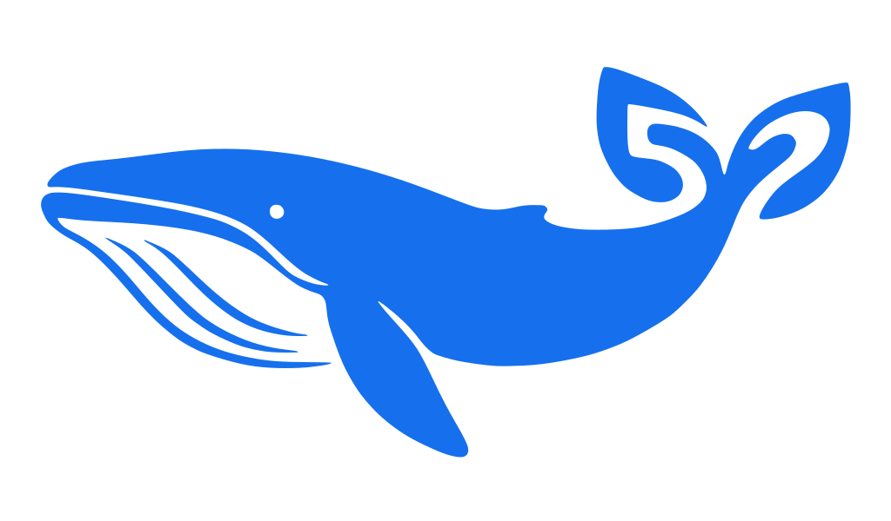
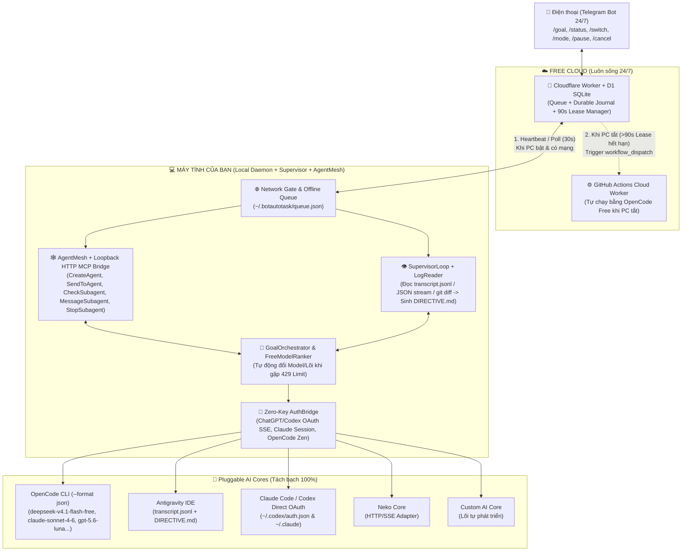

<div align="center">



# ⚡ BotAutoTask

**Bộ điều phối Agent Đa Lõi (Pluggable Multi-Core Orchestrator) — Tự săn Model Free tốt nhất, Tự vượt Rate Limit, Tự chạy khi có mạng & Hoạt động 24/7 cả khi tắt máy.**

Giao một mục tiêu (Target Goal). Hệ thống tự chọn lõi AI miễn phí mạnh nhất, tự bàn giao công việc qua Sổ cái bền vững (Durable Journal) khi đứt mạng hoặc hết quota, và báo cáo trực tiếp về điện thoại của bạn.

[Cài đặt 1 dòng](#-cài-đặt-nhanh-one-line-install) · [Bắt đầu nhanh](#-bắt-đầu-nhanh-quick-start) · [Kiến trúc](#-kiến-trúc-hệ-thống) · [Thay lõi AI tùy chỉnh](#-cắm--thay-thế-lõi-ai-pluggable-harnesses) · [Triển khai Cloud & Telegram 24/7](#-triển-khai-lõi-cloud-free-247--telegram-bot) · [Tài liệu Spec](docs/feature/README.md)

[](LICENSE)
[](package.json)
[-brightgreen.svg)](dist/botautotask.mjs)
[](src/harnesses)

</div>

---

## 🌟 Giải quyết bài toán gì?

Khi chạy các tác vụ lập trình hoặc tự động hóa dài hơi bằng AI Agent trên máy cá nhân, bạn thường gặp 4 rào cản lớn:
1. **Dính Rate Limit / Hết Quota giữa chừng (`HTTP 429`):** Một Agent đang làm dở bước 3/5 thì hết lượt dùng miễn phí, phải ngồi canh để đổi tool hoặc đổi model thủ công.
2. **Không biết Model Free nào đang mạnh và rảnh nhất:** Các model miễn phí trên `opencode` (`deepseek-v4.1-flash-free`, `gpt-luna`, `grok-code`, `big-pickle`) hay OpenRouter (`*:free`) thay đổi liên tục.
3. **Mất mạng hoặc phải tắt máy / gập laptop đi ra ngoài:** Khi tắt máy hoặc rớt mạng, tiến trình đang chạy bị đứt gãy hoàn toàn.
4. **Phụ thuộc cứng vào một Runtime duy nhất:** Khó thay thế lõi hiện tại (ví dụ: thay `neko-core` bằng một lõi AI tự phát triển mới).

**BotAutoTask** giải quyết trọn vẹn cả 4 vấn đề trên bằng kiến trúc **Hexagonal Pluggable Core** kết hợp **Durable SQL Leases** (lấy cảm hứng từ [CopilotKit/OpenMuse](https://github.com/CopilotKit/openmuse)) và **Multi-Bot Journal/Receipts** (lấy cảm hứng từ [meiiie/neko-bot](https://github.com/meiiie/neko-bot)).

---

## 📊 Bảng Tính Năng (Feature Matrix)

| Bề mặt (Surface) | Khả năng hoạt động trong phiên bản hiện tại |
| :--- | :--- |
| **🔍 Dynamic Free-Model Ranker** | Tự động quét `opencode models`, OpenRouter Free Catalog (`pricing = 0`), và danh sách ưu tiên để chấm điểm & chọn các model miễn phí tốt nhất (`deepseek-v4.1-flash-free`, `gpt-luna`, `gemini-2.5-pro`, `qwen-2.5-coder:free`...). |
| **🔄 Auto Rate-Limit Failover** | Tự động bắt các mã lỗi `429`, `rate_limit`, `quota exceeded`, `credit balance too low`. Khi chạm limit, tự tạo Git Checkpoint, đưa model đó vào `cooldown` 30 phút và **chuyển ngay sang model/lõi tiếp theo** trong cùng bước chạy. |
| **📓 Durable Journal & Handover** | Mỗi bước hoàn thành đều ghi lại `StepReceipt` (lõi đã dùng, model, tóm tắt kết quả, mã Git commit). Lõi sau đọc Journal của lõi trước để làm tiếp, tuyệt đối không làm lại từ đầu. |
| **🔌 Pluggable AI Harnesses** | Tách biệt hoàn toàn bộ điều phối khỏi các công cụ AI. Hỗ trợ sẵn `opencode`, `antigravity` (`agy`), `claude`, `codex`, `neko-core`, và `custom-cmd` (cắm lõi tự phát triển qua JSON mà không cần sửa code). |
| **🌐 Network Gate & Wake Timer** | Tự động ngủ chờ khi mất mạng và chạy tiếp ngay khi có mạng. Tích hợp Windows Task Scheduler (`WakeToRun` + `RunOnlyIfNetworkAvailable`) để đánh thức máy từ chế độ Sleep/Hibernate. |
| **☁️ Cloud-Core & Offline Worker** | Lõi điều phối trên **Cloudflare Workers + D1 (Free 24/7)**. Khi PC tắt nguồn hoàn toàn quá 90 giây (Lease hết hạn), tự động kích hoạt **GitHub Actions Cloud Worker** kéo nhánh Git về chạy tiếp. |
| **📱 Telegram Mobile Control** | Điều khiển 24/7 từ điện thoại kể cả khi PC tắt: giao mục tiêu (`/goal`), xem tiến độ (`/status`), ép đổi lõi/model (`/switch`), chuyển chế độ chạy (`/mode local\|cloud\|auto`). |
| **📦 Single-File Zero-Dep Bundle** | Đóng gói toàn bộ mã nguồn thành **1 file độc lập duy nhất** (`dist/botautotask.mjs` ~260 KB, 0 thư viện ngoài) và biên dịch ra `.exe` độc lập qua GitHub Actions. |

---

## 🚀 Cài đặt nhanh (One-Line Install)

Giống như `opencode`, bạn có thể cài đặt `botautotask` thành lệnh toàn cục (Global CLI) chỉ với 1 dòng lệnh:

### Windows (PowerShell)
```powershell
# Cài trực tiếp từ bản build trên máy:
powershell -ExecutionPolicy Bypass -File "D:\BotAutoTask\install.ps1"

# Hoặc tải thẳng từ GitHub Repository của bạn (sau khi push):
irm https://raw.githubusercontent.com/huongmh14/BotAutoTask-/dev/install.ps1 | iex
```

### Linux / macOS / WSL
```bash
curl -fsSL https://raw.githubusercontent.com/huongmh14/BotAutoTask-/dev/install.sh | bash
```

### Chạy trực tiếp 1 File Duy Nhất (Không cần cài đặt)
Bạn có thể copy duy nhất file [`dist/botautotask.mjs`](dist/botautotask.mjs) sang bất kỳ máy nào có Node.js $\ge 20$ hoặc Bun và chạy thẳng:
```powershell
node botautotask.mjs models
```

---

## ⚡ Bắt đầu nhanh (Quick Start)

Sau khi cài đặt, lệnh `botautotask` có thể gọi từ bất kỳ thư mục nào trên Terminal:

### 1. Kiểm tra các Lõi AI hiện có trên máy
```powershell
botautotask cores
```
*Ví dụ kết quả:*
```text
=== Registered Pluggable AI Cores (Harnesses) ===
- opencode        : READY (Available)
- antigravity     : READY (Available)
- claude          : OFFLINE / NOT INSTALLED
- codex           : OFFLINE / NOT INSTALLED
- neko-core       : OFFLINE / NOT INSTALLED
```

### 2. Quét & Xếp hạng các Model Miễn Phí tốt nhất ngay lúc này
```powershell
botautotask models
```
*Ví dụ kết quả:*
```text
=== Best Available Free / Idle Models (Ranked) ===
- [opencode] opencode/deepseek-v4.1-flash-free          (score: 1610)
- [opencode] opencode/gpt-luna                          (score: 1300)
- [opencode] opencode/grok-code                         (score: 940)
- [opencode] opencode/big-pickle                        (score: 900)
- [opencode] google/gemini-2.5-pro                      (score: 870)
- [opencode] google/gemini-2.5-flash                    (score: 800)
- [antigravity] agy-default                             (score: 620)
```

### 3. Giao mục tiêu (Target Goal) và chạy ngay
```powershell
# Tự động chọn model free điểm cao nhất; nếu dính limit tự động nhảy sang model/lõi kế tiếp:
botautotask run "Tối ưu hóa module X và viết unit test" --path "D:\my-project" --check "npm test"

# Hoặc chỉ định ưu tiên một lõi/model cụ thể:
botautotask run "Sửa lỗi đăng nhập" --path "D:\my-project" --core "opencode:gpt-luna"
```

### 4. Đọc Log trực tiếp từ Antigravity IDE (`transcript.jsonl`)
```powershell
# Tự động tìm và trích xuất bước chạy mới nhất (tool calls, lỗi, kết quả) của Antigravity IDE:
botautotask logs
```

### 5. Chạy Vòng lặp Giám sát Tự động (Supervisor $\leftrightarrow$ IDE Worker — Chiến lược 1 + 2 + 4)
Agent của Bot đóng vai **Supervisor** (dùng model free nhẹ), giao việc cho **IDE Worker** (`opencode --format json` hoặc `antigravity`), tự đọc log (`transcript.jsonl` + JSON stream + `git diff` + kết quả test), chấm điểm và tự sinh chỉ thị bước tiếp theo vào `.botautotask/DIRECTIVE.md`:
```powershell
botautotask supervise "Hoàn thiện tính năng X và đảm bảo pass toàn bộ test" --path "D:\my-project" --check "npm test"
```

### 6. Chế độ GrokBot + Neko-Bot: Đăng nhập 0-API-Key & Mạng lưới Đa Agent Tự Điều Khiển (`team` / `steer`)
Không cần mua API key rời — chỉ cần đăng nhập sẵn vào `codex` (`~/.codex/auth.json` ChatGPT OAuth), `claude` (`~/.claude/.credentials.json`), `opencode` hoặc `Antigravity`:
```powershell
# 1. Kiểm tra trạng thái đăng nhập Local OAuth (Zero-API-Key):
botautotask auth

# 2. Xem danh sách biệt đội Agent (lead, coder, reviewer...):
botautotask agents

# 3. Giao mục tiêu cho Biệt đội Đa Agent (Lead tự tạo/nhắn tin điều khiển Coder & Reviewer qua Loopback MCP Bridge):
botautotask team "Thiết kế và code module X, giao coder viết code và reviewer kiểm tra" --path "D:\my-project"

# 4. Bơm chỉ thị khẩn cấp (Priority Steer) trực tiếp từ bạn vào bất kỳ Agent nào đang chạy mà không mất ngữ cảnh:
botautotask steer coder "Không dùng thư viện ngoài, chỉ dùng node:crypto"
```

### 7. Đưa mục tiêu vào Hàng đợi Bền vững (Chờ có mạng / Bật máy tự chạy)
```powershell
botautotask submit "Refactor toàn bộ thư mục api/" --path "D:\my-project"
```

---

## 🏗️ Kiến trúc Hệ thống



### Cấu trúc Thư mục Mã nguồn

| Đường dẫn | Vai trò |
| :--- | :--- |
| [`dist/botautotask.mjs`](dist/botautotask.mjs) | **File thực thi độc lập duy nhất** (đã đóng gói toàn bộ mã nguồn, 0 dependency). |
| [`config/default-config.json`](config/default-config.json) | Cấu hình thứ tự ưu tiên model free, thời gian cooldown, bật/tắt hoặc thêm lõi AI mới. |
| [`src/core/auth-bridge.js`](src/core/auth-bridge.js) | **Cầu nối Đăng nhập 0-API-Key** (kiểu GrokBot + Neko-Bot): đọc trực tiếp phiên đăng nhập `~/.codex/auth.json` (tự refresh OAuth & gọi thẳng `chatgpt.com/backend-api/codex/responses`), `~/.claude`, và OpenCode. |
| [`src/core/agent-mesh.js`](src/core/agent-mesh.js) | **Mạng lưới Đa Agent (`AgentMesh`) & Loopback HTTP MCP Server**: cho phép các Agent tự tạo đồng đội (`CreateAgent`), giao việc (`SendToAgent`), kiểm tra (`CheckSubagent`) và bẻ lái giữa chừng (`MessageSubagent`). |
| [`src/core/model-discovery.js`](src/core/model-discovery.js) | Bộ quét động và chấm điểm xếp hạng các model miễn phí (`FreeModelRanker`). |
| [`src/core/log-reader.js`](src/core/log-reader.js) | Bộ đọc log thời gian thực từ `transcript.jsonl` của Antigravity, luồng `--format json` của OpenCode và cầu nối `.botautotask/DIRECTIVE.md`. |
| [`src/core/supervisor.js`](src/core/supervisor.js) | Vòng lặp **Supervisor $\leftrightarrow$ Worker IDE** (`SupervisorLoop`): đọc log + `git status/diff` + test, tự chấm điểm và ra chỉ thị sửa lỗi tiếp theo. |
| [`src/core/rate-limit-detector.js`](src/core/rate-limit-detector.js) | Bộ nhận diện lỗi `429 / Quota / Usage Limit` trên mọi CLI. |
| [`src/core/harness-registry.js`](src/core/harness-registry.js) | Sổ đăng ký trung gian (`HarnessRegistry`) giúp cắm/rút các lõi AI độc lập. |
| [`src/core/orchestrator.js`](src/core/orchestrator.js) | Vòng lặp điều phối mục tiêu, tạo Git checkpoint, ghi Journal và tự động đổi lõi. |
| [`src/harnesses/`](src/harnesses) | **Thư mục chứa các Adapter lõi AI** (`opencode`, `antigravity`, `claude-codex`, `neko-core`, `custom-cmd`). |
| [`src/daemon/`](src/daemon) | Bộ kiểm tra mạng (`network-monitor.js`), tiến trình chạy ngầm (`local-daemon.js`) và giao diện dòng lệnh (`cli.js`). |
| [`cloud-core/`](cloud-core) | Mã nguồn **Cloudflare Worker + D1 SQLite** (`worker.js`, `schema.sql`, `wrangler.toml`). |
| [`.github/workflows/`](.github/workflows) | Gồm `botautotask-worker.yml` (Cloud Worker chạy khi tắt máy) và `release.yml` (biên dịch file `.exe`). |

---

## 🔌 Cắm & Thay thế Lõi AI (Pluggable Harnesses)

Hệ thống được thiết kế để bạn **có thể thay thế `neko-core` hoặc cắm bất kỳ lõi AI tự phát triển nào trong tương lai** mà không cần chạm vào code điều phối.

### Cách 1: Thêm/Thay Lõi bằng cấu hình JSON (Không cần viết code JS)
Mở file [`config/default-config.json`](config/default-config.json) (hoặc `~/.botautotask/config.json`):
1. Để tắt một lõi cũ (ví dụ `neko-core`), đổi `"enabled": false`.
2. Để cắm lõi AI mới do bạn tự phát triển, thêm vào mảng `"customHarnesses"`:

```json
{
  "harnesses": {
    "neko-core": { "enabled": false }
  },
  "customHarnesses": [
    {
      "id": "my-new-core",
      "enabled": true,
      "models": ["my-model-v1-free", "my-model-v2-fast"],
      "checkCommand": "my-ai-cli --version",
      "commandTemplate": "my-ai-cli run --model {{model}} --prompt-file {{prompt_file}} --cwd {{workspace}}"
    }
  ]
}
```
Trong đó:
* `{{model}}`: Tên model được bộ xếp hạng truyền vào.
* `{{prompt_file}}`: Đường dẫn tới file text chứa sẵn Mục tiêu + Lịch sử Journal của các bước trước.
* `{{workspace}}`: Thư mục dự án đang làm việc.

### Cách 2: Viết Adapter chuyên biệt trong `src/harnesses/`
Nếu lõi mới giao tiếp qua giao thức riêng (WebSocket, gRPC, HTTP SSE), bạn chỉ cần tạo 1 file trong `src/harnesses/` cài đặt 3 phương thức:
```javascript
export class MyCustomHarness {
  constructor() {
    this.id = 'my-custom-core';
  }
  async isAvailable() { return true; }
  async discoverModels() {
    return [{ harnessId: this.id, modelId: 'custom-v1-free', isFree: true }];
  }
  async executeStep({ goal, journal, workspaceDir, modelId }) {
    // Thực thi và trả về chuẩn StepReceipt:
    return {
      outcome: 'STEP_DONE', // hoặc 'GOAL_COMPLETED' | 'RATE_LIMITED' | 'ERROR'
      summary: 'Tóm tắt công việc đã hoàn thành ở bước này',
      harnessId: this.id,
      modelId
    };
  }
}
```
Sau đó chạy `node scripts/build-single-file.js` để đóng gói lại file `dist/botautotask.mjs`.

---

## 💻 Cài đặt Tự Chạy Khi Có Mạng & Đánh Thức Máy (Windows)

Để máy tính tự động chạy tiếp hàng đợi ngay khi có mạng hoặc tự thức dậy từ chế độ **Sleep / Hibernate** theo chu kỳ:

```powershell
powershell -ExecutionPolicy Bypass -File "D:\BotAutoTask\scripts\register-windows-task.ps1"
```
Script này đăng ký tác vụ `BotAutoTask-Daemon` vào **Windows Task Scheduler** với các cờ:
* `RunOnlyIfNetworkAvailable`: Chỉ chạy khi có kết nối Internet.
* `WakeToRun`: Tự động đánh thức PC từ trạng thái Sleep/Hibernate để giải quyết mục tiêu.
* `StartWhenAvailable`: Chạy bù ngay lập tức khi bạn vừa bật máy lên.

---

## ☁️ Triển khai Lõi Cloud Free 24/7 & Telegram Bot

Đặt **Control Plane** trên **Cloudflare Workers + D1 (Miễn phí 100%)** giúp Telegram Bot của bạn luôn phản hồi 24/7 kể cả khi máy tính ở nhà đã rút điện.

### Bước 1: Tạo Database D1 và Deploy Cloudflare Worker (Tự động 1 lệnh hoặc Thủ công)
```powershell
# Cách 1 (Khuyến nghị — SPEC-PROVISION): Tự động dựng D1 + sinh wrangler.generated.toml + nạp schema + deploy Worker:
npm run cloud:setup

# Cách 2 (Thủ công):
cd D:\BotAutoTask\cloud-core

# 1. Tạo database SQLite trên Cloudflare D1
npx wrangler d1 create botautotask-db
# -> Điền `database_id` vào file `cloud-core/wrangler.generated.toml` (copy từ `wrangler.toml`, giữ nguyên placeholder trong `wrangler.toml`)

# 2. Khởi tạo bảng goals và journal_entries
npx wrangler d1 execute botautotask-db --file=./schema.sql --remote

# 3. Cài đặt các biến môi trường bảo mật
npx wrangler secret put TELEGRAM_BOT_TOKEN        # Token lấy từ @BotFather
npx wrangler secret put TELEGRAM_ALLOWED_CHAT_ID  # Chat ID Telegram cá nhân của bạn
npx wrangler secret put BOTAUTOTASK_API_TOKEN     # Mật khẩu tự chọn để kết nối PC <-> Cloud
npx wrangler secret put GITHUB_PAT                # (Tùy chọn) GitHub Token để kích hoạt Cloud Worker khi PC tắt

# 4. Deploy lên Cloudflare
npx wrangler deploy --config wrangler.generated.toml
```

### Bước 2: Gắn Webhook cho Telegram Bot
```powershell
Invoke-WebRequest -Uri "https://api.telegram.org/bot<TELEGRAM_BOT_TOKEN>/setWebhook?url=https://botautotask-cloud-core.<your-subdomain>.workers.dev/webhook/telegram"
```

### Bước 3: Các lệnh điều khiển từ Điện thoại (Telegram)
* `/goal <mô tả mục tiêu> [--repo owner/repo] [--path D:\project] [--core opencode:gpt-luna] [--check "npm test"]` — Giao mục tiêu mới từ điện thoại.
* `/status` — Xem mục tiêu đang chạy ở đâu (`local-pc` hay `gh-actions`), đang dùng model nào, bước thứ mấy, và 3 dòng lịch sử Journal mới nhất.
* `/switch <harness:model>` — Ép đổi lõi/model ngay lập tức (VD: `/switch opencode:deepseek-v4.1-flash-free` hoặc `/switch antigravity`).
* `/mode <auto|local|cloud>` — Chuyển chế độ ưu tiên chạy trên máy nhà, chỉ chạy trên Cloud, hoặc tự động failover.
* `/pause` · `/resume` · `/cancel` — Tạm dừng, tiếp tục hoặc hủy mục tiêu.

---

## 🧪 Kiểm thử & Đóng gói (Development & Build)

Dự án sử dụng trình chạy test gốc của Node.js (`node:test`), không cần cài đặt thêm bất kỳ package nào:

```powershell
# Chạy toàn bộ bộ kiểm thử (Model Ranking, Rate-Limit Failover, Hot-swap Core, Cloud Lease)
npm test

# Đóng gói lại toàn bộ mã nguồn thành 1 file độc lập duy nhất (dist/botautotask.mjs)
node scripts/build-single-file.js
```

---

## 📄 Giấy phép (License)

Phát hành dưới giấy phép **MIT License**. Bạn có thể tự do chỉnh sửa, đóng gói lại và tích hợp các lõi AI riêng của mình.
