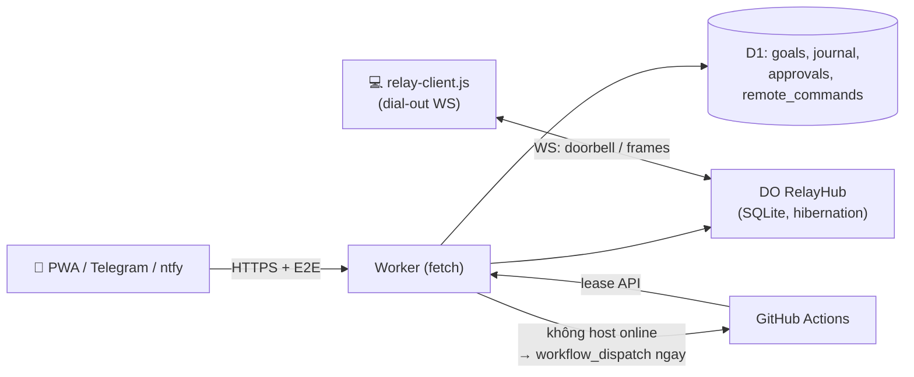

# Spec 02 — Điều Khiển Từ Điện Thoại & Cloud 24/7 (Cloudflare Worker + D1 + Durable Object Relay)

| Mục | Giá trị |
|---|---|
| Trạng thái | 📝 Spec v2 · phần auth fail-closed ✅ đã sửa · provisioning ✅ (Spec 06) |
| Module dự kiến | `cloud-core/relay.js` (DO `RelayHub`), `cloud-core/migrations/0002_*.sql`, `src/daemon/relay-client.js`, `src/daemon/mobile-notify.js` |
| Ràng buộc | Cloudflare free plan (SQLite Durable Object), Node built-in (`WebSocket` global Node ≥22, fallback long-poll) |

## 1. Mục tiêu
- Điện thoại điều khiển đội agent **khi PC bật** (lệnh tới PC < 1s) và **khi PC tắt** (tự chuyển GitHub Actions ngay, không chờ cron 2 phút).
- Không mở cổng inbound trên PC, không cần Tailscale.
- Cloud không đọc được nội dung hội thoại (E2E).

## 2. Cơ sở nghiên cứu → cải tiến
| Quan sát | Nguồn | Áp dụng |
|---|---|---|
| Host **dial-out** WebSocket tới Worker của chính người dùng; DO hibernation ngủ giữa các tin (free plan); token trong subprotocol `t.<token>` | Neko relay v2–v5 (`worker.js:256-275`) | DO `RelayHub`, PC dial-out `/relay/ws` |
| Hàng đợi bền khi host offline (≤100 job, quá → 429), xả khi host nối lại | Neko `/send`, `flushQueueTo` | Lệnh gửi khi PC đang khởi động không mất |
| `/interrupt` (nút Stop trên điện thoại), `/control` approval **không bao giờ xếp hàng**, offline → 409 | Neko | Approval cũ không bị áp dụng muộn |
| E2E AES-256-GCM, key PBKDF2 từ secret nằm trong **URL fragment** `#k=`; strict mode cấm plaintext sau ghép cặp; `kid` phát hiện sai khoá | Neko `relay-crypto.ts`, security review | `node:crypto` (host) ↔ WebCrypto (browser) |
| Push chỉ là **"chuông cửa"**, dữ liệu lấy qua `poll({ackIds})` → giao ít nhất một lần; safety poll 30s; backoff full-jitter 1→60s; `rehello` khi capability đổi | GrokBot `local-exec-daemon` (report §3) | `relay-client.js`: WS báo có việc → pull + ack; watchdog 35s |
| Lease SELECT-rồi-UPDATE cho phép 2 worker cùng nhận goal | Đối chiếu Neko `INSERT OR IGNORE`/CAS | **Bug hiện tại** → CAS + `lease_epoch` |
| Webhook chỉ kiểm chat_id | Đối chiếu Neko ratelimits | Secret header Telegram + `[[ratelimits]]` |

## 3. Kiến trúc


### 3.1 Định tuyến lệnh từ điện thoại
1. Worker nhận lệnh (PWA `/relay/send`, Telegram webhook, ntfy) → ghi `remote_commands` (D1) + chuyển cho DO.
2. DO: có socket host? → đẩy frame `doorbell`; không → giữ trong queue (≤100).
3. Worker kiểm `/relay/alive`: nếu **không host nào online trong 30s** và goal `execution_mode ∈ {auto, cloud}` → `workflow_dispatch` GitHub Actions **ngay lập tức** (thay cho cron).
4. Cron 2 phút vẫn giữ làm lưới an toàn (lease hết hạn giữa chừng).

### 3.2 Endpoint mới (Worker)
| Endpoint | Auth | Mô tả |
|---|---|---|
| `GET /` | public | PWA (HTML Spec 01, chế độ cloud) |
| `GET /healthz` | public | `{version}` — không lộ dữ liệu |
| `POST /relay/register` | Bearer | first-token-wins, lưu `kid` |
| `GET /relay/ws` | subprotocol `t.<token>` | PC dial-out |
| `POST /relay/send` | Bearer | `{nonce, sealed}` → `{id}`; queue nếu offline |
| `GET /relay/result?id&seen` | Bearer | long-poll 25s theo `seq` |
| `POST /relay/interrupt` | Bearer | dừng turn đang chạy |
| `POST /relay/control` | Bearer | approval; offline → 409, không queue |
| `GET /relay/alive` | Bearer | `{online, kid, lastSeenMs}` |
| `POST /relay/revoke` | Bearer | đóng socket + xoá state DO |

### 3.3 Schema D1 — `migrations/0002_lease_relay.sql`
```sql
ALTER TABLE goals ADD COLUMN lease_epoch INTEGER DEFAULT 0;
ALTER TABLE goals ADD COLUMN turn_state TEXT DEFAULT 'idle';      -- idle|running|interrupted
ALTER TABLE goals ADD COLUMN permission_mode TEXT DEFAULT 'default';
CREATE UNIQUE INDEX IF NOT EXISTS ux_journal_step ON journal_entries(goal_id, step_number);
CREATE TABLE IF NOT EXISTS remote_commands (
  id TEXT PRIMARY KEY,               -- = nonce từ client (idempotent)
  goal_id TEXT, target_id TEXT,
  command_type TEXT NOT NULL CHECK (command_type IN ('STEER','INTERRUPT','QUEUE','SWITCH_CORE','STOP_AGENT','TEAM_GOAL')),
  payload TEXT NOT NULL,             -- ciphertext khi qua relay
  status TEXT NOT NULL DEFAULT 'PENDING' CHECK (status IN ('PENDING','DELIVERED','ACKED','EXPIRED')),
  created_at INTEGER NOT NULL
);
CREATE TABLE IF NOT EXISTS approvals (
  id TEXT PRIMARY KEY, goal_id TEXT NOT NULL, tool TEXT NOT NULL, preview TEXT NOT NULL,
  state TEXT NOT NULL DEFAULT 'PENDING' CHECK (state IN ('PENDING','APPROVED','DENIED','EXPIRED')),
  decided_by TEXT, created_at INTEGER NOT NULL, expires_at INTEGER NOT NULL
);
```

### 3.4 Lease nguyên tử (sửa bug)
```sql
UPDATE goals SET lease_owner=?1, lease_expires_at=?2, lease_epoch=lease_epoch+1, updated_at=?3
WHERE id=?4 AND (lease_expires_at < ?3 OR lease_owner = ?1);
-- meta.changes === 1 mới được nhận; trả lease_epoch cho worker
```
`/api/lease/step` và `/heartbeat` bắt buộc `{lease_owner, lease_epoch}` khớp, không thì 409 (worker cũ bị "fence"). Journal `INSERT OR IGNORE` nhờ unique index → gửi lại an toàn.

### 3.5 PC client (`src/daemon/relay-client.js`)
- Kết nối `wss://<worker>/relay/ws` (Node ≥22 `WebSocket`; Node 20 → long-poll `/relay/result`).
- Nhận `doorbell` → `pull({ackIds})`; ack gửi kèm lần pull sau (at-least-once, xử lý idempotent theo `remote_commands.id`).
- Backoff full-jitter 1→60s; watchdog 35s không frame → reconnect; 401 → dừng hẳn và báo người dùng.
- Mỗi lệnh: giải mã → `mesh.sendToAgent({delivery})` / `stopAgent` / đổi core; kết quả partial throttle 600ms gửi lại (sealed).

### 3.6 Ghép cặp điện thoại
`botautotask pair` → sinh `pairingId`, `token`, `secret` (128-bit mỗi cái) lưu `~/.botautotask/relay.json` (ghi atomic), in **QR + link** `https://<worker>/#p=<pairingId>&t=<token>&k=<secret>`. Fragment không bao giờ gửi lên server. `botautotask pair --rotate` = `revoke` trước rồi lưu khoá mới.

### 3.7 Kênh thông báo
| Kênh | Vai trò | Ghi chú |
|---|---|---|
| PWA | điều khiển đầy đủ | Spec 01 chế độ cloud |
| ntfy.sh | push rung + lệnh nhanh | topic ngẫu nhiên ≥128-bit (topic là bí mật duy nhất); **không gửi nội dung code**, chỉ tiêu đề + link PWA |
| Telegram | tuỳ chọn | `setWebhook` với `secret_token`; Worker kiểm header `X-Telegram-Bot-Api-Secret-Token` + chat_id; lệnh `/pause /cancel /switch` chỉ tác động **goal chỉ định** (mặc định goal mới nhất) |

## 4. Bảo mật
- ✅ Auth fail-closed + constant-time (`isAuthorized`, đã sửa).
- Body ≤1MB đọc stream; frame WS lớn → close 1009; `[[ratelimits]]` 30 req/60s cho webhook/relay.
- Strict E2E: sau ghép cặp, payload không sealed bị từ chối.
- Không log body/payload trong Worker.

## 5. Tiêu chí chấp nhận
- [ ] PC online: lệnh từ điện thoại tới agent < 1s; Stop trên điện thoại dừng turn < 2s.
- [ ] PC offline: GitHub Actions được dispatch ≤ 30s sau khi gửi goal (không chờ cron).
- [ ] Hai worker cùng acquire → đúng một thắng; worker epoch cũ ghi step → 409.
- [ ] Gửi lại cùng step / cùng nonce không tạo bản ghi đôi.
- [ ] Approval gửi khi PC offline → 409, không bị áp dụng sau.
- [ ] Payload trong D1/DO chỉ là ciphertext.

## 6. Test tối thiểu
`tests/relay-hub.test.js` (double `MemoryStorage` + `SocketDouble`, như Neko — không cần miniflare): queue khi offline, flush khi online, control 409, revoke. `tests/lease-cas.test.js`: mô phỏng D1 bằng SQL builder stub kiểm điều kiện `changes===1` và fencing.
