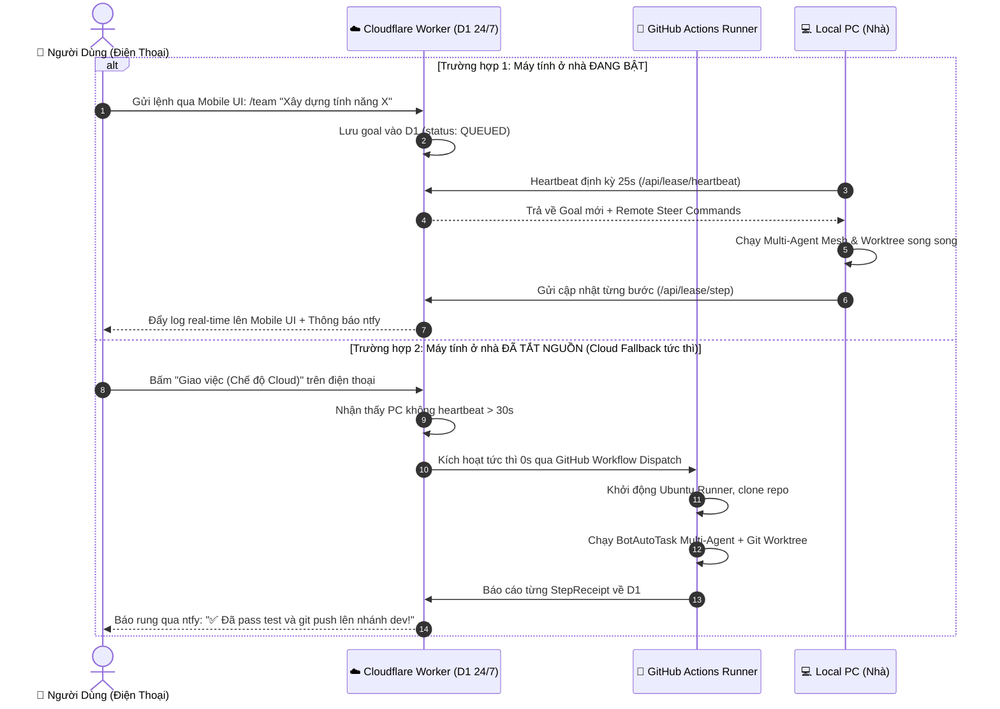

# Đặc Tả Tính Năng: Điều Khiển Độc Lập 100% Từ Điện Thoại & Cloudflare D1 24/7

## 1. Bài Toán & Triết Lý Thiết Kế
Người dùng muốn có khả năng **TẮT HOÀN TOÀN MÁY TÍNH Ở NHÀ**, chỉ cầm điện thoại di động ra ngoài nhưng vẫn mở được bảng điều khiển, giao việc cho đội Agent, bấm nút Steer bẻ lái và hệ thống tự động chạy code, test và push lên GitHub trên Cloud.

### So Sánh Kênh Điều Khiển Mobile
| Kênh Điều Khiển | Cách hoạt động | Ưu điểm đối với BotAutoTask | Nhược điểm |
| :--- | :--- | :--- | :--- |
| **Mobile PWA (Cloudflare Worker 24/7)** | Mở link Worker trên trình duyệt điện thoại | Có đầy đủ giao diện trực quan, khung chat, nút Steer, đổi model, 0 cần cài app bên thứ 3. | Cần mở màn hình để tương tác. |
| **ntfy.sh (App iOS/Android)** | Cài app `ntfy` miễn phí $\rightarrow$ theo dõi tên kênh (topic) tự đặt | **0 cần đăng ký tài khoản, 0 cần API Key**, thông báo rung tức thì, nhắn lệnh 2 chiều qua HTTP POST, không bao giờ bị chặn mạng tại Việt Nam. | Giao diện dạng thông báo / dòng text. |
| **Telegram Bot** | Webhook qua Cloudflare Worker | Quen thuộc với nhiều người dùng. | Tại Việt Nam đôi khi bị chặn mạng hoặc phải dùng VPN, cần tạo bot qua `@BotFather`. |
| **Discord Webhook/Bot** | Webhook vào Discord Server | Không bị chặn mạng, chia kênh/thread cho từng Agent rất rõ ràng. | Cần tạo bot token trên Discord Developer Portal. |

=> **Chiến lược v2.0:** Tích hợp **bộ đôi tối ưu**: **Mobile PWA trên Cloudflare Worker** (để có đầy đủ nút bấm điều khiển đồ hoạ) + **`ntfy.sh`** (để rung chuông báo hoàn thành & nhận lệnh nhanh không cần API Key) và giữ tuỳ chọn mở rộng cho Telegram/Discord.

---

## 2. Kiến Trúc Đồng Bộ Giữa Cloud 24/7 và Local PC



---

## 3. Cấu Trúc Cơ Sở Dữ Liệu Cloudflare D1 (`cloud-core/schema.sql`)

Bổ sung bảng `remote_commands` và `experience_library` để hỗ trợ điều khiển từ xa và lưu trữ tri thức:

```sql
-- Quản lý mục tiêu (Goal)
CREATE TABLE IF NOT EXISTS goals (
  id TEXT PRIMARY KEY,
  title TEXT NOT NULL,
  target_prompt TEXT NOT NULL,
  repo_path TEXT,
  repo_url TEXT,
  branch TEXT DEFAULT 'dev',
  acceptance_cmd TEXT,
  execution_mode TEXT DEFAULT 'auto', -- 'local', 'cloud', 'auto'
  preferred_core TEXT DEFAULT 'auto',
  status TEXT DEFAULT 'QUEUED',        -- 'QUEUED', 'RUNNING_LOCAL', 'RUNNING_CLOUD', 'COMPLETED', 'PAUSED'
  current_step INTEGER DEFAULT 0,
  max_steps INTEGER DEFAULT 15,
  lease_owner TEXT,                   -- 'local-pc' hoặc 'gh-actions'
  lease_expires_at INTEGER DEFAULT 0,
  created_at INTEGER NOT NULL,
  updated_at INTEGER NOT NULL
);

-- Nhật ký từng bước thực thi (Journal)
CREATE TABLE IF NOT EXISTS journal_entries (
  id INTEGER PRIMARY KEY AUTOINCREMENT,
  goal_id TEXT NOT NULL,
  step_number INTEGER NOT NULL,
  worker_id TEXT NOT NULL,
  core_used TEXT NOT NULL,
  model_used TEXT NOT NULL,
  outcome TEXT NOT NULL,
  summary TEXT NOT NULL,
  git_commit TEXT,
  created_at INTEGER NOT NULL,
  FOREIGN KEY (goal_id) REFERENCES goals(id)
);

-- Hàng đợi lệnh điều khiển từ xa (Bẻ lái Steer, Đổi Core từ điện thoại)
CREATE TABLE IF NOT EXISTS remote_commands (
  id INTEGER PRIMARY KEY AUTOINCREMENT,
  command_type TEXT NOT NULL,          -- 'STEER', 'SWITCH_CORE', 'STOP_AGENT', 'TEAM_GOAL'
  target_id TEXT,                     -- 'coder-1', 'lead', hoặc 'all'
  payload TEXT NOT NULL,              -- Nội dung chỉ thị
  status TEXT DEFAULT 'PENDING',       -- 'PENDING', 'DELIVERED', 'EXECUTED'
  created_at INTEGER NOT NULL
);

-- Thư viện kinh nghiệm tích luỹ từ Harness²
CREATE TABLE IF NOT EXISTS experience_library (
  id INTEGER PRIMARY KEY AUTOINCREMENT,
  domain TEXT NOT NULL,
  task_slug TEXT NOT NULL,
  cue TEXT NOT NULL,
  lesson TEXT NOT NULL,
  evidence TEXT NOT NULL,
  skill_content TEXT,
  created_at INTEGER NOT NULL
);
```

---

## 4. Đặc Tả Module `src/daemon/mobile-notify.js`
Cung cấp class `MobileNotifier` tích hợp đa kênh:
- `notify(title, message, { priority, url, tags })`:
  - Gửi POST request tới `https://ntfy.sh/<topic>` với header `Title`, `Priority: high`, `Click: <url>`.
  - Nếu có cấu hình `TELEGRAM_BOT_TOKEN`, gửi kèm qua Telegram API `sendMessage`.
  - Nếu có cấu hình `DISCORD_WEBHOOK_URL`, bắn tin nhắn kèm embed qua Discord.
- `pollNtfyCommands(onCommand)`: Lắng nghe luồng SSE từ `https://ntfy.sh/<topic>/sse` để nhận lệnh điều khiển nhanh trực tiếp từ điện thoại gửi về PC.
