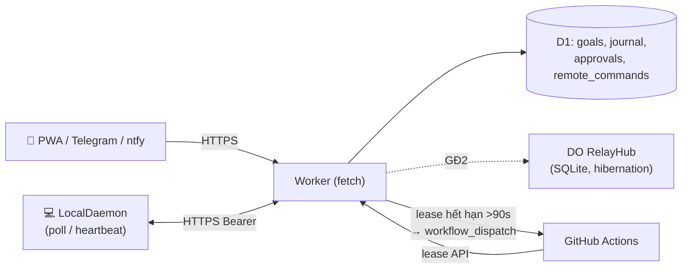

# SPEC-CLOUD (Spec 02) — Điều Khiển Từ Điện Thoại & Cloud 24/7 (Cloudflare Worker + D1 + Durable Object Relay)

| Thuộc tính | Giá trị |
|---|---|
| ID | `SPEC-CLOUD` |
| Trạng thái | `As-built` (Worker + D1 + Lease CAS + Telegram + ntfy + GH Actions fallback) · `Draft` (DO `RelayHub` E2E WebSocket) |
| Giai đoạn | 1 (D1/Lease/Telegram) · 2 (DO Relay E2E) |
| Phụ thuộc (`Depends on`) | `SPEC-CORE`, `SPEC-SEC` |
| Quyết định liên quan | `D-05`, `D-06`, `D-07`, `D-09` |
| Module triển khai | `cloud-core/worker.js`, `cloud-core/schema.sql`, `cloud-core/migrations/0002_lease_relay.sql`, `src/daemon/local-daemon.js`, `src/daemon/mobile-notify.js` |
| Ràng buộc | Cloudflare free plan (D1 SQLite + Cron 2 phút), Node built-in `fetch` |

## 1. Mục tiêu & Phạm vi

### 1.1 Mục tiêu
- Điện thoại điều khiển đội agent **khi PC bật** và **khi PC tắt** (tự động chuyển sang GitHub Actions Cloud Worker khi lease hết hạn).
- Không mở cổng inbound trên PC, không cần cài VPN/Tailscale.
- Ngăn chặn tuyệt đối 2 worker (Local PC và GitHub Actions) chạy trùng một Goal nhờ cơ chế **Atomic Lease CAS + `lease_epoch` Fencing**.

### 1.2 Phạm vi
- **Trong phạm vi:**
  - Cloudflare Worker (`cloud-core/worker.js`) và cơ sở dữ liệu D1 (`goals`, `journal_entries`, `remote_commands`, `approvals`).
  - Chiếm giữ và gia hạn Lease nguyên tử (CAS) kèm kiểm tra `lease_epoch` (`409 Conflict` khi worker cũ bị fence).
  - Webhook Telegram (`/goal`, `/status`, `/switch`, `/mode`, `/pause`, `/resume`, `/cancel`) gắn với `goal_id` cụ thể (`D-07`) và thông báo đẩy `ntfy`.
  - Thiết kế mở rộng GĐ2 cho Durable Object `RelayHub` (WebSocket dial-out + mã hoá E2E).
- **Ngoài phạm vi:**
  - Tự động tạo tài nguyên Cloudflare trên trình duyệt (thuộc [`SPEC-PROVISION`](06-cloudflare-auto-provision.md)).
  - Chạy trực tiếp tiến trình CLI AI bên trong Cloudflare Worker (Worker chỉ điều phối và gọi GitHub Actions `workflow_dispatch`).

## 2. Cơ sở nghiên cứu → cải tiến
| Quan sát | Nguồn | Áp dụng |
|---|---|---|
| Host **dial-out** WebSocket tới Worker của chính người dùng; DO hibernation ngủ giữa các tin (free plan); token trong subprotocol `t.<token>` | Neko relay v2–v5 (`worker.js:256-275`) | DO `RelayHub`, PC dial-out `/relay/ws` (GĐ2) |
| Hàng đợi bền khi host offline (≤100 job, quá → 429), xả khi host nối lại | Neko `/send`, `flushQueueTo` | Bảng `remote_commands` trong D1 + xả khi daemon poll |
| `/interrupt` (nút Stop trên điện thoại), `/control` approval **không bao giờ xếp hàng**, offline → 409 | Neko | Approval cũ không bị áp dụng muộn |
| E2E AES-256-GCM, key PBKDF2 từ secret nằm trong **URL fragment** `#k=`; strict mode cấm plaintext sau ghép cặp; `kid` phát hiện sai khoá | Neko `relay-crypto.ts`, security review | `node:crypto` (host) ↔ WebCrypto (browser) (GĐ2) |
| Push chỉ là **"chuông cửa"**, dữ liệu lấy qua `poll({ackIds})` → giao ít nhất một lần; safety poll 30s; backoff full-jitter 1→60s; `rehello` khi capability đổi | GrokBot `local-exec-daemon` (report §3) | `LocalDaemon` / `relay-client.js`: poll + ack idempotent theo `remote_commands.id` |
| Lease SELECT-rồi-UPDATE cho phép 2 worker cùng nhận goal | Đối chiếu Neko `INSERT OR IGNORE`/CAS | **Đã sửa** → CAS + `lease_epoch` + `ux_journal_step` |
| Webhook chỉ kiểm chat_id | Đối chiếu Neko ratelimits | Kiểm tra `TELEGRAM_ALLOWED_CHAT_ID` + Bearer auth fail-closed |

## 3. Kiến trúc


### 3.1 Định tuyến lệnh từ điện thoại
1. Worker nhận lệnh (Telegram webhook `/goal`, `/pause`, `/switch`, hoặc API `/api/goals`) → ghi D1 (`goals`, `remote_commands`).
2. Khi PC bật: `LocalDaemon` poll `/api/lease/acquire`, nhận Goal, gửi `/api/lease/heartbeat` mỗi 30s và `/api/lease/step` sau mỗi step.
3. Khi PC tắt (hoặc mất mạng > 90s): `lease_expires_at < nowMs`, Cron trigger (hoặc kiểm tra tức thời) gọi `shouldTriggerCloudFallback()` → bắn `workflow_dispatch` sang GitHub Actions.

### 3.2 Endpoint trên Cloud Worker (`cloud-core/worker.js`)
| Endpoint | Auth | Trạng thái | Mô tả |
|---|---|---|---|
| `GET /` | Bearer (hoặc HTML Dashboard) | `As-built` | Trả JSON `{ service, status: "healthy" }` hoặc giao diện Cloud Dashboard |
| `POST /webhook/telegram` | `TELEGRAM_ALLOWED_CHAT_ID` | `As-built` | Xử lý `/goal`, `/status`, `/switch`, `/mode`, `/pause`, `/resume`, `/cancel` |
| `GET /api/state` | Bearer | `As-built` | Trả tổng quan `goals`, `recentJournal`, `pendingCommands` cho Cloud Dashboard |
| `GET /api/goals` | Bearer | `As-built` | Danh sách tối đa 20 goals mới nhất |
| `POST /api/goals` | Bearer | `As-built` | Tạo Goal mới trong D1 |
| `POST /api/goals/action` | Bearer | `As-built` | Điều khiển Goal từ Cloud Dashboard (`pause`, `resume`, `cancel`, `switch_core`, `set_mode`, `retry_step`) |
| `POST /api/lease/acquire` | Bearer | `As-built` | Chiếm giữ Lease nguyên tử (CAS), tăng `lease_epoch` |
| `POST /api/lease/heartbeat` | Bearer | `As-built` | Gia hạn Lease; sai `lease_owner` hoặc `lease_epoch` → `409` |
| `POST /api/lease/step` | Bearer | `As-built` | Ghi `journal_entries` (`INSERT OR IGNORE`) + cập nhật `goals.status`; sai epoch → `409` |
| `POST /relay/*`, `GET /relay/ws` | Bearer / subprotocol | `Draft (GĐ2)` | Durable Object `RelayHub` WebSocket dial-out & E2E |

### 3.3 Schema D1 — `cloud-core/schema.sql` & `migrations/0002_lease_relay.sql`
```sql
ALTER TABLE goals ADD COLUMN lease_epoch INTEGER DEFAULT 0;
ALTER TABLE goals ADD COLUMN turn_state TEXT DEFAULT 'idle';      -- idle|running|interrupted
ALTER TABLE goals ADD COLUMN permission_mode TEXT DEFAULT 'default';
CREATE UNIQUE INDEX IF NOT EXISTS ux_journal_step ON journal_entries(goal_id, step_number);
CREATE TABLE IF NOT EXISTS remote_commands (
  id TEXT PRIMARY KEY,               -- = nonce từ client (idempotent)
  goal_id TEXT, target_id TEXT,
  command_type TEXT NOT NULL CHECK (command_type IN ('STEER','INTERRUPT','QUEUE','SWITCH_CORE','STOP_AGENT','TEAM_GOAL')),
  payload TEXT NOT NULL,
  status TEXT NOT NULL DEFAULT 'PENDING' CHECK (status IN ('PENDING','DELIVERED','ACKED','EXPIRED')),
  created_at INTEGER NOT NULL
);
CREATE TABLE IF NOT EXISTS approvals (
  id TEXT PRIMARY KEY, goal_id TEXT NOT NULL, tool TEXT NOT NULL, preview TEXT NOT NULL,
  state TEXT NOT NULL DEFAULT 'PENDING' CHECK (state IN ('PENDING','APPROVED','DENIED','EXPIRED')),
  decided_by TEXT, created_at INTEGER NOT NULL, expires_at INTEGER NOT NULL
);
```

### 3.4 Lease nguyên tử (`As-built`)
```sql
UPDATE goals SET status = ?1, lease_owner = ?2, lease_expires_at = ?3, lease_epoch = lease_epoch + 1, updated_at = ?4
WHERE id = ?5 AND (lease_expires_at < ?4 OR lease_owner = ?2);
-- meta.changes === 1 mới được nhận; trả lease_epoch cho worker
```
`/api/lease/step` và `/api/lease/heartbeat` bắt buộc `{lease_owner, lease_epoch}` khớp với bản ghi hiện tại trong D1, nếu không trả HTTP `409 Conflict` (worker cũ bị fence). `journal_entries` dùng `INSERT OR IGNORE` kết hợp unique index `ux_journal_step(goal_id, step_number)` nên retry mạng không bao giờ tạo dòng journal trùng.

### 3.5 PC client — `src/daemon/relay-client.js` (`Draft GĐ2`)
- Kết nối `wss://<worker>/relay/ws` với subprotocol `["botautotask-relay.v1", "t.<BOTAUTOTASK_API_TOKEN>"]`; tự động nối lại theo backoff full-jitter `1s → 60s`.
- Safety poll `/relay/poll` mỗi `30s` kể cả khi WebSocket đang mở; mọi lệnh thực thi xong gửi `ackIds` về Worker để đánh dấu `ACKED` lũy đẳng.

### 3.6 Ghép cặp điện thoại & Mã hoá E2E (`Draft GĐ2`)
- Chạy `botautotask pair` sinh khoá bí mật `relaySecret` (32 bytes base64url) lưu tại `~/.botautotask/relay.json` và in mã QR dẫn tới `https://<worker>/#k=<relaySecret>`.
- Khoá `#k=` nằm ở URL fragment nên trình duyệt không bao giờ gửi khoá này lên Cloudflare Worker; payload lệnh nhạy cảm được mã hoá `AES-256-GCM` đầu-cuối giữa điện thoại và PC.

### 3.7 Kênh thông báo (`As-built` & `Draft GĐ2`)
| Kênh | Hướng | Trạng thái | Ghi chú |
|---|---|---|---|
| **PWA qua Worker/Relay** | 2 chiều + xem stream | `As-built` (Cloud Dashboard) / `Draft` (DO Relay) | Kênh chính trên điện thoại |
| **Telegram webhook** | 2 chiều (`/goal`, `/status`, `/switch`, `/mode`, `/pause`, `/resume`, `/cancel`) | `As-built` | Kiểm tra `TELEGRAM_ALLOWED_CHAT_ID` |
| **ntfy** | 1 chiều (push thông báo) | `As-built` (`src/daemon/mobile-notify.js`) | Gửi tiêu đề, `Priority`, `Tags` khi Goal đổi trạng thái |

## 4. Kế thừa Pack & Yêu cầu chuẩn EARS (`CLOUD-Rnn`)

### 4.1 Kế thừa từ Pack (`PK-API`, `PK-AUTH`, `PK-DB`, `PK-JOB`)

| REQ dự án | Kế thừa từ Pack | Tham số / Giá trị áp dụng tại BotAutoTask |
|---|---|---|
| `CLOUD-R01` | `PK-AUTH-R02`, `PK-AUTH-R06` | Xác thực `BOTAUTOTASK_API_TOKEN` bằng SHA-256 constant-time (`isAuthorized`), thiếu token trên Worker thì từ chối mọi request (`401`) |
| `CLOUD-R02` | `PK-JOB-R04`, `PK-DB-R02` | `{lock-ttl-ms} = 90000` (90 giây), chiếm giữ nguyên tử bằng `UPDATE ... WHERE (lease_expires_at < ? OR lease_owner = ?)` + `lease_epoch` |
| `CLOUD-R03` | `PK-JOB-R01`, `PK-DB-R05` | Unique index `ux_journal_step(goal_id, step_number)` + `INSERT OR IGNORE` đảm bảo ghi step lũy đẳng |
| `CLOUD-R05` | `PK-AGENT-R03`, `D-07` | Mọi lệnh điều khiển (`/pause`, `/cancel`, `/switch`) gắn với `goal_id` cụ thể (mặc định chỉ tác động 1 goal mới nhất khi không truyền `--id`) |

### 4.2 Bảng Yêu cầu (EARS)

| ID | Mức | Yêu cầu (EARS) | Bằng chứng (`As-built` / `Draft`) |
|---|---|---|---|
| `CLOUD-R01` | MUST | Mọi request tới `/api/*` trên Cloud Worker MUST đi qua `isAuthorized(authHeader, env.BOTAUTOTASK_API_TOKEN)`; nếu `BOTAUTOTASK_API_TOKEN` chưa cấu hình hoặc không khớp, hệ thống MUST trả HTTP `401`. | `cloud-core/worker.js:50-62, 500-505`, `tests/worker-auth.test.js` |
| `CLOUD-R02` | MUST | Khi hai worker đồng thời gọi `POST /api/lease/acquire` cho cùng một Goal, hệ thống MUST cập nhật nguyên tử (CAS) để chỉ đúng 1 worker nhận được lease kèm `lease_epoch` mới tăng thêm `1`. | `cloud-core/worker.js:518-560`, `tests/lease-cas.test.js` |
| `CLOUD-R03` | MUST | Khi worker gọi `POST /api/lease/heartbeat` hoặc `POST /api/lease/step` với `lease_owner` hoặc `lease_epoch` không khớp giá trị hiện tại trong D1, Worker MUST từ chối với HTTP `409` (`LEASE_CONFLICT`) và không ghi đè trạng thái Goal. | `cloud-core/worker.js:562-635`, `tests/lease-cas.test.js` |
| `CLOUD-R04` | MUST | Khi worker gửi lại cùng một `(goal_id, step_number)` vào `/api/lease/step` do retry mạng, D1 MUST bỏ qua bản ghi trùng nhờ `INSERT OR IGNORE` trên `ux_journal_step` mà không sinh lỗi 500. | `cloud-core/schema.sql:37`, `cloud-core/worker.js:595-610`, `tests/lease-cas.test.js` |
| `CLOUD-R05` | MUST | Khi người dùng gửi lệnh Telegram (`/goal`, `/switch`, `/mode`, `/pause`, `/resume`, `/cancel`), `parseTelegramCommand()` MUST bóc tách đúng lệnh, tham số và cờ `--id` để chỉ tác động lên đúng Goal mục tiêu (`D-07`). | `cloud-core/worker.js:9-32, 395-490`, `tests/cloud-and-daemon.test.js` |
| `CLOUD-R06` | MUST | Trong chu kỳ Cron (hoặc kiểm tra fallback), nếu một Goal có `status ∈ {'QUEUED', 'RUNNING_LOCAL'}`, `execution_mode ∈ {'auto', 'cloud'}`, có `repo_url` và `lease_expires_at < nowMs`, `shouldTriggerCloudFallback()` MUST trả `true` để kích hoạt GitHub Actions. | `cloud-core/worker.js:37-44`, `tests/cloud-and-daemon.test.js` |
| `CLOUD-R07` | SHOULD | Khi Goal bắt đầu, chuyển bước, gặp rate-limit hoặc hoàn tất, `sendMobileNotification()` SHOULD tạo thông báo gồm đầy đủ `{ title, priority, tags, body }` (chứa tên Goal + trạng thái/model) và gửi qua `ntfy` nếu người dùng đã cấu hình `NTFY_TOPIC`. | `src/daemon/mobile-notify.js`, `tests/mobile-notify.test.js` |
| `CLOUD-R08` | SHOULD (GĐ2) | Khi triển khai Durable Object `RelayHub`, hệ thống SHOULD hỗ trợ PC dial-out WebSocket `/relay/ws` và mã hoá đầu-cuối `AES-256-GCM` với khoá nằm trong URL fragment `#k=`. | `Draft (GĐ2)` — mục §3.2, §3.5, §3.6 |

## 5. Yêu cầu phi chức năng (NFR)

| Khía cạnh | Yêu cầu (số liệu) hoặc `N/A — lý do` |
|---|---|
| Hiệu năng | Các thao tác D1 Lease CAS (`acquire`, `heartbeat`, `step`) chỉ tốn tối đa `1–2` câu lệnh SQL mỗi request. |
| Bảo mật | Xác thực constant-time SHA-256; không bao giờ log `BOTAUTOTASK_API_TOKEN`, `TELEGRAM_BOT_TOKEN` hoặc `GITHUB_PAT` (`PK-AUTH-R07`). |
| Giới hạn / rate limit | Thời hạn mỗi Lease là `90 giây` (`90000 ms`); danh sách `GET /api/goals` giới hạn `LIMIT 20` (`PK-DB-R04`). |
| Khả dụng / khôi phục | Khi PC tắt nguồn quá `90 giây`, Cron mỗi `2 phút` tự động chuyển giao Goal sang GitHub Actions Cloud Worker. |
| Quan sát (log, metric, audit) | Bảng `journal_entries` lưu vết đầy đủ `worker_id`, `core_used`, `model_used`, `outcome`, `git_commit` cho từng `step_number`. |
| i18n | Thông báo Telegram, `ntfy` và Cloud Dashboard hỗ trợ tiếng Việt UTF-8. |
| a11y | Cloud Dashboard HTML sử dụng độ tương phản màu chuẩn dark theme và semantic HTML. |
| Trạng thái UI | Cloud Dashboard hiển thị pill màu ngữ nghĩa cho từng trạng thái (`COMPLETED` xanh, `COMPLETED_UNVERIFIED` vàng, `FAILED` đỏ). |

## 6. Trường hợp biên (Edge Cases)

- Hai worker (`pc-1` và `gha-1`) gọi `/api/lease/acquire` cùng một mili-giây khi lease vừa hết hạn → chỉ 1 worker nhận `acquired: true` (`meta.changes === 1`), worker kia nhận `acquired: false` (`CLOUD-AC01`).
- Worker `pc-1` bị treo mạng 100 giây (lease đã bị `gha-1` chiếm với `lease_epoch = 2`), sau đó `pc-1` tỉnh dậy gửi `/api/lease/step` với `lease_epoch = 1` → bị từ chối với HTTP `409` (`CLOUD-AC02`).
- Goal ở chế độ `execution_mode = 'local'` hoặc không có `repo_url` khi lease hết hạn → `shouldTriggerCloudFallback()` trả `false`, không gọi GitHub Actions (`CLOUD-AC03`).
- Người dùng gửi `/pause` không kèm `--id` → chỉ tạm dừng 1 Goal đang chạy mới nhất (`LIMIT 1`), không dừng toàn bộ các Goal trong bảng (`CLOUD-R05`, `D-07`).

## 7. Điều kiện nghiệm thu (`AC`)

- [x] **CLOUD-AC01** *(integration)* — **Cho** một Goal đang `QUEUED` trong D1, **khi** hai worker cùng gọi `/api/lease/acquire`, **thì** chỉ đúng 1 worker chiếm được lease và `lease_epoch` tăng từ `0` lên `1`. *(Test: `tests/lease-cas.test.js`)*
- [x] **CLOUD-AC02** *(integration)* — **Cho** một Goal đang ở `lease_epoch = 2`, **khi** worker cũ gửi `/api/lease/heartbeat` hoặc `/api/lease/step` với `lease_epoch = 1`, hoặc khi worker hợp lệ gửi lại cùng `(goal_id, step_number)` lần thứ 2, **thì** worker cũ bị từ chối với HTTP `409` còn bản ghi step trùng của worker hợp lệ được xử lý lũy đẳng (`INSERT OR IGNORE`, chỉ có 1 dòng trong `journal_entries`). *(Test: `tests/lease-cas.test.js`)*
- [x] **CLOUD-AC03** *(unit)* — **Cho** các lệnh Telegram (`/goal`, `/switch`, `/mode`) và các trạng thái Goal khác nhau, **khi** gọi `parseTelegramCommand()` và `shouldTriggerCloudFallback()`, **thì** parser tách đúng cờ/tham số và chỉ kích hoạt Cloud fallback khi lease hết hạn trên Goal `auto`/`cloud` có `repo_url`. *(Test: `tests/cloud-and-daemon.test.js`)*
- [x] **CLOUD-AC04** *(unit)* — **Cho** cấu hình `ntfy` với các sự kiện `started`, `step`, `rate_limited`, `completed`, **khi** gọi `formatGoalNotification()` và `sendMobileNotification()`, **thì** tạo đúng tiêu đề/priority và gọi `fetch` tới đúng URL topic. *(Test: `tests/mobile-notify.test.js`)*

## 8. Kiểm tra end-to-end

```powershell
node --test tests/lease-cas.test.js tests/cloud-and-daemon.test.js tests/mobile-notify.test.js tests/worker-auth.test.js
```

## 9. Làm rõ & Câu hỏi mở

- **Làm rõ (2026-10-20):** Phần D1 Lease CAS (`lease_epoch`), unique index `ux_journal_step`, xác thực `isAuthorized` fail-closed và trạng thái `COMPLETED_UNVERIFIED` đã triển khai xong và có test xanh. Phần Durable Object `RelayHub` WebSocket E2E được đánh dấu rõ là `Draft (GĐ2)`.
- **Câu hỏi mở:** Không có.
