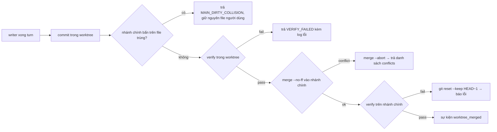

# SPEC-MESH (Spec 03) — Agent Mesh v2 & Song Song Hoá Git Worktree per Agent

| Thuộc tính | Giá trị |
|---|---|
| ID | `SPEC-MESH` |
| Trạng thái | `As-built` (Đã triển khai kèm bản vá an toàn tại [`SPEC-SAFE`](08-mesh-safety-attention-ui.md)) |
| Giai đoạn | 1 |
| Phụ thuộc (`Depends on`) | `SPEC-CORE`, `SPEC-VERIFY` |
| Quyết định liên quan | `D-01`, `D-04`, `D-09` |
| Module triển khai | `src/core/agent-mesh.js`, `src/core/worktree-manager.js`, `src/core/atomic-write.js` |

## 1. Mục tiêu & Phạm vi

### 1.1 Mục tiêu
1. Nhiều agent **ghi code song song** không đè file nhau (mỗi `writer` một `git worktree` riêng).
2. Điều khiển subagent tinh tế như GrokBot: gửi (`send`), ngắt (`interrupt`), xếp hàng (`queue`), chờ có timeout (`CheckSubagent`).
3. Không bao giờ làm mất thay đổi chưa commit trên nhánh chính của người dùng khi merge (`MAIN_DIRTY_COLLISION`).
4. Cung cấp cả Loopback HTTP MCP Server lẫn bộ parser thẻ inline `[AGENT_TOOL_CALL]` để mọi CLI core đều tham gia được vào Mesh.

### 1.2 Phạm vi
- **Trong phạm vi:**
  - `AgentMesh` (quản lý roster `lead`, `coder`, `reviewer`, Loopback HTTP MCP Server trên `127.0.0.1:0`, thực thi 9 công cụ điều phối subagent).
  - `WorktreeManager` (`ensure`, `commit`, `verify`, `diff`, `merge`, `cleanup`) quản lý `.botautotask/worktrees/<agentId>`.
  - Giới hạn chiều sâu và số lượng subagent (`maxDepth = 3`, `maxPerRoot = 8`, `maxRunning = 32`) và chống lặp vòng (`Loop Guard`).
- **Ngoài phạm vi:**
  - Điều phối phân tán giữa nhiều máy vật lý qua mạng P2P (BotAutoTask chạy Mesh trên cùng một workspace repo).

## 2. Đính chính hồ sơ
Tài liệu cũ ghi "Loopback MCP bridge kiểu GrokBot". REA GrokBot **0.71.2** cho thấy client **không có** routed loopback MCP bridge — logic `CreateAgent/SendToAgent/...` chạy trên server của họ, client chỉ có enum + proto (`research/grokbot-findings.md` §1). Bridge loopback của BotAutoTask là **thiết kế riêng**, giữ nguyên; ta lấy từ GrokBot phần **schema & ngữ nghĩa** điều khiển subagent.

## 3. Cơ sở nghiên cứu → cải tiến
| Quan sát | Nguồn | Áp dụng |
|---|---|---|
| 3 chế độ giao tin: `USER_SENT_TO_SUBAGENT`, `USER_INTERRUPTED_SUBAGENT`, `USER_QUEUED_TO_SUBAGENT` | GrokBot §1 | `SendToAgent.delivery: "send"\|"interrupt"\|"queue"` (thay cho cờ `priority` mơ hồ) |
| `SubagentAwait{timeout_ms}` → `complete\|still_running\|not_found\|error`; `ForceBackgroundSubagent` | GrokBot §1 | `CheckSubagent{agent_id, timeout_ms}` cùng 4 kết quả; tool `BackgroundSubagent` |
| Lineage headers `x-parent-request-id`, `x-root-parent-request-id`, `x-parent-agent-tool-call-id`, lọc `\r\n`; `maxRunning` mặc định 32 | GrokBot §1 | Mỗi lời gọi mang `{rootId, parentId, parentToolCallId}`; giới hạn `maxDepth=3` **và** `maxPerRoot=8` **và** `maxRunning=32` |
| Hook `SubagentStop` trả `followup_message/additional_context` cho agent cha | GrokBot §1 | Hook tuỳ chọn trong config, chạy khi agent con xong |
| `CreateAgentArgs.fork_from/fork_turns/base_branch` | GrokBot proto | `CreateAgent.base_branch` → điểm tạo worktree; `fork_from` → copy N turn transcript |
| Writer chạy tuần tự vì chung một worktree; chỉ read-only mới song song | Neko `ARCHITECTURE.md:134-138` | Đây là chỗ BotAutoTask **vượt** Neko: writer song song nhờ worktree riêng; reader (`reviewer`) song song không cần worktree |
| Handoff schema khoá cố định, ≤16KiB, provenance `unverified`, ghi bất biến `wx`+`link`; chưa có ack | Neko `session-handoff.ts` | `botautotask.handoff/v1` + **ack bằng rename** `pending/→accepted/` (exactly-once) |
| `turnState` + "outcome unknown — inspect before retry" | Neko `agent.ts:1336-1364` | Turn đang chạy khi crash → `UNKNOWN`, agent phải `git status` trước khi làm tiếp |
| Ghi state nguyên tử: temp `wx` → fsync → rename + `.bak` | Neko + GrokBot §5 | `atomic-write.js` dùng chung cho `mesh-state.json`, `queue.json`, `relay.json` |
| Cùng call lặp 3 lần → chặn | Neko loop guard + reason-network | Cửa sổ trượt 10 phút: chặn khi cùng nội dung lặp 3 lần hoặc ≥ 12 tin trong 10 phút ([`SPEC-SAFE`](08-mesh-safety-attention-ui.md)) |

## 4. Thiết kế

### 4.1 Tool MCP (bản v2)
| Tool | Tham số chính | Ghi chú |
|---|---|---|
| `CreateAgent` | `id, name, description, preferred_core, role:"writer"\|"reader", base_branch?, fork_from?` | writer ⇒ cấp worktree khi chạy turn đầu |
| `ListAgents` | — | kèm `isRunning, stale, worktree, lineage, finishedAtMs, doing` |
| `SendToAgent` | `target_id, message, delivery, wait=true, nonce?` | `interrupt` ⇒ abort cây tiến trình CLI rồi chạy tin mới; `queue` ⇒ `pendingFollowUps`, tự chạy khi turn kết thúc |
| `DelegateParallel` | `tasks:[{target_id, message}]` | writer: mỗi task một worktree, `Promise.allSettled`; tôn trọng `maxRunning` |
| `CheckSubagent` | `agent_id, timeout_ms=0` | `complete{final_message, tool_call_count, transcript_path}` \| `still_running` \| `not_found` \| `error` |
| `BackgroundSubagent` | `agent_id` | trả quyền điều khiển cho cha ngay, con chạy tiếp |
| `MessageSubagent` | `agent_id, message` | alias `SendToAgent{delivery:"queue"}` — giữ tương thích |
| `StopSubagent` | `agent_id` | abort + đánh dấu `aborted` |
| `MergeAgentWorktree` | `agent_id, verify_cmd?` | Nếu agent gọi → tạo `awaiting_review` qua Approval Gate ([`SPEC-SAFE`](08-mesh-safety-attention-ui.md)); nếu commander gọi → merge trực tiếp |

### 4.2 `WorktreeManager`
```js
ensure(agentId, baseRef='HEAD')   // .botautotask/worktrees/<id>, branch botautotask/agent-<id>; không phải repo git → trả workspaceDir (fallback) + cảnh báo
commit(agentId, message)          // add -A + commit nếu có thay đổi → {committed, sha, diffStat}
verify(agentId, cmd)              // chạy cmd trong worktree, timeout 5 phút, kill cây khi quá hạn
diff(agentId, {maxBytes=200000})  // git diff HEAD...<branch>, cắt nếu vượt maxBytes
merge(agentId, {verifyCmd})       // kiểm MAIN_DIRTY_COLLISION → verify → git merge --no-ff; conflict → git merge --abort, trả {conflicts:[files]}
cleanup()                         // git worktree remove --force + git worktree prune
```
- Tên `agentId` đã qua `slugifyId` (chỉ `[a-z0-9-]`) → an toàn khi ghép path/branch; vẫn kiểm `resolve(path).startsWith(worktreesRoot)`.
- Path bảo vệ (từ chối ghi): `.git/hooks`, `.git/config`, `.botautotask/*.json`.
- Merge tuần tự; `ceiling:` merge xung đột ngữ nghĩa không có conflict git được chặn bởi `verify` sau merge ở nhánh chính (`git reset --keep HEAD~1` nếu fail).

### 4.3 Luồng merge


## 5. Kế thừa Pack & Yêu cầu chuẩn EARS (`MESH-Rnn`)

### 5.1 Kế thừa từ Pack (`PK-AGENT`, `PK-JOB`)

| REQ dự án | Kế thừa từ Pack | Tham số / Giá trị áp dụng tại BotAutoTask |
|---|---|---|
| `MESH-R01` | `PK-AGENT-R02` | `role: "writer"` chạy trong `.botautotask/worktrees/<id>` riêng; `role: "reader"` (`reviewer`) không tạo worktree |
| `MESH-R03` | `PK-AGENT-R03` | `maxDepth = 3`, `maxPerRoot = 8`, `maxRunning = 32`; cửa sổ chống lặp `12 tin / 10 phút` hoặc `3 tin trùng hash` |
| `MESH-R04` | `PK-AGENT-R04` | Mọi tin nhắn giữa các agent được đóng khung `<peer-message>` qua `framePeerMessage()` (`SPEC-SAFE-R04`) |

### 5.2 Bảng Yêu cầu (EARS)

| ID | Mức | Yêu cầu (EARS) | Bằng chứng (`As-built`) |
|---|---|---|---|
| `MESH-R01` | MUST | Khi một agent có `role: 'writer'` thực thi trong một repository Git hợp lệ, `WorktreeManager.ensure()` MUST tạo và cô lập thư mục làm việc tại `.botautotask/worktrees/<agentId>` trên nhánh `botautotask/agent-<agentId>`; nếu thư mục không phải là repo Git thì MUST fallback an toàn về `workspaceDir` mà không ném lỗi. | `src/core/worktree-manager.js:45-115`, `tests/worktree-manager.test.js` |
| `MESH-R02` | MUST | Khi gọi `SendToAgent` với `delivery: "send" \| "interrupt" \| "queue"` và `wait: false`, `AgentMesh` MUST xử lý đúng ngữ nghĩa từng chế độ và trả về trạng thái trung thực (`interrupted`, `queued_busy`, hoặc `queued_idle`). | `src/core/agent-mesh.js:530-698`, `tests/agent-mesh-v2.test.js` |
| `MESH-R03` | MUST | Nếu một lời gọi `SendToAgent` từ agent (không phải `commander`/`telegram`) gửi cùng một nội dung lần thứ `3` hoặc gửi từ `>= 12` tin nhắn trở lên cho cùng một người nhận trong cửa sổ trượt `10 phút`, `AgentMesh` MUST từ chối lời gọi với thông báo chặn vòng lặp. | `src/core/agent-mesh.js:574-605`, `tests/agent-mesh-v2.test.js` |
| `MESH-R04` | MUST | Khi gọi `WorktreeManager.merge(agentId)`, nếu phát hiện xung đột Git (`CONFLICT`), hệ thống MUST tự động chạy `git merge --abort` để trả nhánh chính về trạng thái sạch và trả về `{ success: false, reason: 'MERGE_CONFLICT', conflicts }`. | `src/core/worktree-manager.js:237-320`, `tests/worktree-manager.test.js` |
| `MESH-R05` | MUST | `AgentMesh` MUST cung cấp đồng thời cả máy chủ Loopback HTTP MCP (`POST /mcp` với `tools/list`, `tools/call`) và bộ phân tích thẻ văn bản `[AGENT_TOOL_CALL]...[/AGENT_TOOL_CALL]` để tương thích với mọi CLI core. | `src/core/agent-mesh.js:188-204, 1150-1285`, `tests/agent-mesh-and-auth.test.js` |

## 6. Yêu cầu phi chức năng (NFR)

| Khía cạnh | Yêu cầu (số liệu) hoặc `N/A — lý do` |
|---|---|
| Hiệu năng | Khởi tạo Loopback HTTP MCP Server trên port `0` hoàn tất `< 20 ms`; chạy song song các writer bằng `Promise.allSettled`. |
| Bảo mật | Lọc sạch `agentId` qua `slugifyId` (`[a-z0-9-]`) và kiểm tra `resolve(path).startsWith(worktreesRoot)` để chống Path Traversal. |
| Giới hạn / rate limit | `maxDepth = 3`, `maxPerRoot = 8`, `maxRunning = 32`; cửa sổ Loop Guard `10 phút` (`600000 ms`), tối đa `12` tin/cặp hoặc `3` tin trùng hash. |
| Khả dụng / khôi phục | Lưu trạng thái `mesh-state.json` nguyên tử qua `atomic-write.js`; tự động dọn worktree bằng `cleanup()`. |
| Quan sát (log, metric, audit) | Phát sự kiện real-time qua EventBus (`agent_status`, `agent_message`, `tool_call`, `worktree_merged`) cho Web UI. |
| i18n | Hỗ trợ nội dung tin nhắn và hướng dẫn tiếng Việt / tiếng Anh UTF-8. |
| a11y | `N/A — module điều phối Mesh ở tầng core`. |
| Trạng thái UI | `N/A — trạng thái roster hiển thị qua SPEC-UI và SPEC-SAFE`. |

## 7. Trường hợp biên (Edge Cases)

- Hai `writer` sửa cùng một dòng trong cùng một file trên 2 worktree khác nhau → writer 1 merge thành công, writer 2 merge báo `MERGE_CONFLICT` kèm tên file và nhánh chính hoàn toàn sạch sau `merge --abort` (`MESH-AC01`).
- Thư mục dự án chưa `git init` → `WorktreeManager.ensure()` trả `isFallback: true` và dùng trực tiếp `workspaceDir` (`MESH-AC02`).
- Agent gửi lặp cùng một tin nhắn 3 lần liên tiếp hoặc gửi 12 tin khác nhau trong 10 phút → bị chặn ở lần thứ 3 / lần thứ 13; sau 10 phút cửa sổ trượt tự mở lại; `commander` không bao giờ bị chặn (`MESH-AC03`).
- Người dùng đang sửa dở file `a.txt` trên nhánh chính (chưa commit) và agent cũng sửa `a.txt` → `merge()` trả `MAIN_DIRTY_COLLISION` và không xoá nội dung của người dùng (`SPEC-SAFE-AC02`).

## 8. Điều kiện nghiệm thu (`AC`)

- [x] **MESH-AC01** *(integration)* — **Cho** một repo Git tạm và 2 agent `writer` chạy trên 2 worktree riêng, **khi** cả hai sửa các file độc lập hoặc cùng sửa 1 file gây xung đột rồi gọi `merge()`, **thì** trường hợp độc lập merge sạch vào nhánh chính, còn trường hợp xung đột tự động `merge --abort` và trả danh sách `conflicts`. *(Test: `tests/worktree-manager.test.js`)*
- [x] **MESH-AC02** *(unit/integration)* — **Cho** một thư mục tạm không phải là repo Git, **khi** gọi `WorktreeManager.ensure()`, **thì** hệ thống trả về `isFallback: true` trỏ về thư mục gốc mà không ném lỗi. *(Test: `tests/worktree-manager.test.js`)*
- [x] **MESH-AC03** *(integration)* — **Cho** `AgentMesh` v2 đang chạy, **khi** gọi `sendToAgent` với các chế độ `send`, `interrupt`, `queue` và thử gửi lặp quá 3 lần cùng nội dung hoặc quá 12 lần trong 10 phút, **thì** trả đúng trạng thái giao tin và chặn đúng vòng lặp của agent trong khi miễn trừ cho `commander`. *(Test: `tests/agent-mesh-v2.test.js`)*
- [x] **MESH-AC04** *(integration)* — **Cho** Loopback HTTP MCP Server của `AgentMesh`, **khi** gửi JSON-RPC `tools/list` và `tools/call` (`CreateAgent`, `SendToAgent`), **thì** server trả đúng danh sách công cụ và điều phối thành công lượt chạy của subagent. *(Test: `tests/agent-mesh-and-auth.test.js`)*

## 9. Kiểm tra end-to-end

```powershell
node --test tests/worktree-manager.test.js tests/agent-mesh-v2.test.js tests/agent-mesh-and-auth.test.js
```

## 10. Làm rõ & Câu hỏi mở

- **Làm rõ (2026-10-20):** Các bản vá an toàn cho Mesh (bảo vệ file bẩn `MAIN_DIRTY_COLLISION`, đóng khung `<peer-message>`, cửa sổ trượt 10 phút và cổng duyệt `MergeAgentWorktree`) được đặc tả chi tiết thêm tại [`SPEC-SAFE` (`08-mesh-safety-attention-ui.md`)](08-mesh-safety-attention-ui.md).
- **Câu hỏi mở:** Không có.
