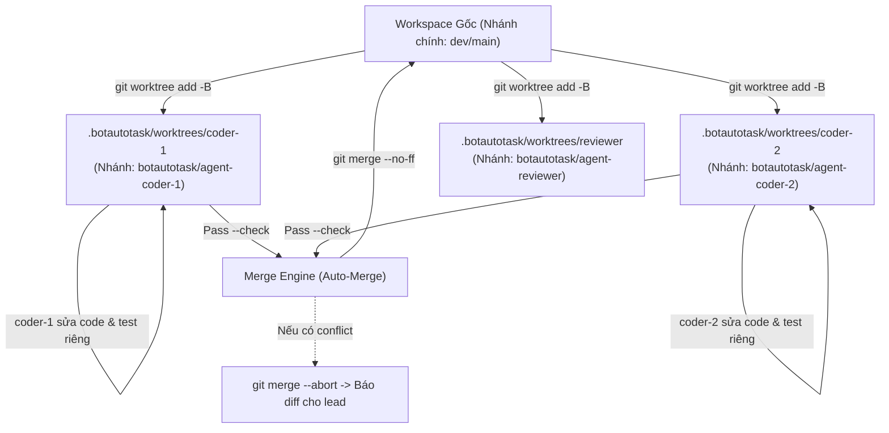

# Đặc Tả Tính Năng: Song Song Hoá Git Worktree Per Agent & Auto-Merge

## 1. Vấn Đề Khi Chạy Đa Agent Trên Một Thư Mục
Trong phiên bản cũ của `AgentMesh`, mọi Agent (`coder-1`, `coder-2`, `reviewer`) đều dùng chung đường dẫn `workspaceDir`. Điều này dẫn tới các rủi ro:
1. **Xung đột file (File Collisions):** Khi `coder-1` đang sửa file A và `coder-2` cũng sửa file A hoặc các file liên quan, các sửa đổi sẽ đè lên nhau gây lỗi cú pháp.
2. **Nghẽn Commit (Dirty Working Tree):** Lệnh `git commit` của Agent này có thể vô tình cuốn theo các file dở dang của Agent khác.
3. **Không thể chạy song song thực sự:** Hệ thống buộc phải chạy tuần tự từng Agent một (`for (const agent of agents) await runTurn()`), làm lãng phí thời gian và không tận dụng được sức mạnh đa luồng.

---

## 2. Giải Pháp: `WorktreeManager` (`src/core/worktree-manager.js`)

Mỗi Agent hoạt động trong một thư mục Git Worktree hoàn toàn độc lập, gắn liền với một nhánh git riêng biệt:
- **Đường dẫn Worktree:** `<workspaceDir>/.botautotask/worktrees/<agentId>`
- **Tên nhánh Git:** `botautotask/agent-<agentId>` (nhánh khởi tạo từ `HEAD` của nhánh chính hiện tại).



---

## 3. Các Phương Thức Cốt Lõi Của `WorktreeManager`

```javascript
export class WorktreeManager {
  constructor({ workspaceDir }) {
    this.workspaceDir = workspaceDir;
    this.worktreesRoot = join(workspaceDir, '.botautotask', 'worktrees');
  }

  /**
   * Đảm bảo worktree cho một Agent đã sẵn sàng.
   * Nếu thư mục chưa phải là Git repo thì fallback an toàn về workspaceDir gốc.
   */
  async ensureAgentWorktree(agentId, baseRef = 'HEAD') { ... }

  /**
   * Commit mọi thay đổi chưa lưu trong worktree của Agent.
   * Trả về: { committed: boolean, commitSha: string, diffStat: string }
   */
  async commitWorktreeChanges(agentId, message) { ... }

  /**
   * Chạy lệnh kiểm thử chấp nhận (acceptanceCmd, ví dụ 'npm test')
   * trực tiếp bên trong thư mục worktree của Agent trước khi merge.
   */
  async verifyWorktree(agentId, acceptanceCmd) { ... }

  /**
   * Tự động merge nhánh của Agent về workspace chính:
   * 1. Chạy verifyWorktree, nếu fail thì không merge.
   * 2. Thực hiện 'git merge --no-ff botautotask/agent-<agentId>'.
   * 3. Nếu xảy ra Conflict: tự động 'git merge --abort' để giữ sạch nhánh chính,
   *    đồng thời trả về danh sách file conflict để lead phân xử.
   */
  async mergeAgentWorktree(agentId, { acceptanceCmd = null, cleanup = false } = {}) { ... }

  /**
   * Dọn dẹp an toàn các worktree tạm thời sau khi hoàn thành goal.
   */
  async cleanupWorktrees() { ... }
}
```

---

## 4. Công Cụ MCP Mới Trong `AgentMesh`

Để `lead` và `reviewer` tận dụng được Git Worktree, 2 công cụ MCP mới được bổ sung vào bộ công cụ điều phối:

1. **`DelegateParallel`:**
   - **Mục đích:** Giao nhiều đầu việc chạy song song đồng thời (`Promise.all`) cho nhiều Agent (`coder-1`, `coder-2`...).
   - **Input Schema:**
     ```json
     {
       "tasks": [
         { "target_id": "coder-1", "message": "Xây dựng module auth trong src/auth.js" },
         { "target_id": "coder-2", "message": "Xây dựng module cache trong src/cache.js" }
       ]
     }
     ```
   - **Hành vi:** Cấp phát Git Worktree riêng cho từng Agent, kích hoạt các Agent chạy đồng thời, thu thập kết quả và trả về cho `lead` tổng hợp.

2. **`MergeAgentWorktree`:**
   - **Mục đích:** Cho phép `lead` hoặc `reviewer` kiểm tra kết quả kiểm thử và tích hợp nhánh của một Agent về nhánh chính.
   - **Input Schema:**
     ```json
     {
       "agent_id": "coder-1",
       "acceptance_cmd": "npm test"
     }
     ```
   - **Hành vi:** Chạy test, merge nhánh `--no-ff` nếu pass, trả về commit SHA hoặc báo lỗi xung đột nếu có conflict.
