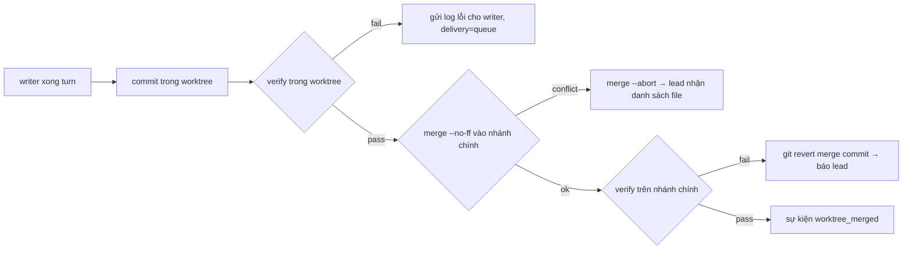

# Spec 03 — Agent Mesh v2 & Song Song Hoá Git Worktree per Agent

| Mục | Giá trị |
|---|---|
| Trạng thái | 📝 Spec v2 (cải tiến theo GrokBot subagent schema + Neko handoff/durability) |
| Module | `src/core/agent-mesh.js` (nâng cấp), `src/core/worktree-manager.js`, `src/core/handoff-store.js`, `src/core/atomic-write.js` |

## 1. Mục tiêu
1. Nhiều agent **ghi code song song** không đè file nhau (mỗi writer một git worktree).
2. Điều khiển subagent tinh tế như GrokBot: gửi / ngắt / xếp hàng, chờ có timeout, đẩy xuống nền.
3. Không bao giờ chạy lại mù một bước có thể đã thay đổi workspace (resume an toàn).
4. Lead tự merge khi test pass; xung đột thì trả về cho agent sửa.

## 2. Đính chính hồ sơ
Tài liệu cũ ghi "Loopback MCP bridge kiểu GrokBot". REA GrokBot **0.71.2** cho thấy client **không có** routed loopback MCP bridge — logic `CreateAgent/SendToAgent/...` chạy trên server của họ, client chỉ có enum + proto (`research/grokbot-findings.md` §1). Bridge loopback của BotAutoTask là **thiết kế riêng**, giữ nguyên; ta lấy từ GrokBot phần **schema & ngữ nghĩa** điều khiển subagent.

## 3. Cơ sở nghiên cứu → cải tiến
| Quan sát | Nguồn | Áp dụng |
|---|---|---|
| 3 chế độ giao tin: `USER_SENT_TO_SUBAGENT`, `USER_INTERRUPTED_SUBAGENT`, `USER_QUEUED_TO_SUBAGENT` | GrokBot §1 | `SendToAgent.delivery: "send"\|"interrupt"\|"queue"` (thay cho cờ `priority` mơ hồ) |
| `SubagentAwait{timeout_ms}` → `complete\|still_running\|not_found\|error`; `ForceBackgroundSubagent` | GrokBot §1 | `CheckSubagent{agent_id, timeout_ms}` cùng 4 kết quả; tool `BackgroundSubagent` |
| Lineage headers `x-parent-request-id`, `x-root-parent-request-id`, `x-parent-agent-tool-call-id`, lọc `\r\n`; `maxRunning` mặc định 32 | GrokBot §1 | Mỗi lời gọi mang `{rootId, parentId, parentToolCallId}`; giới hạn `maxDepth=3` **và** `maxPerRoot=8` **và** `maxRunning=32` |
| Hook `SubagentStop` trả `followup_message/additional_context` cho agent cha | GrokBot §1 | Hook tuỳ chọn trong config, chạy khi agent con xong |
| `CreateAgentArgs.fork_from/fork_turns/base_branch` | GrokBot proto | `CreateAgent.base_branch` → điểm tạo worktree; `fork_from` → copy N turn transcript |
| Writer chạy tuần tự vì chung một worktree; chỉ read-only mới song song | Neko `ARCHITECTURE.md:134-138` | Đây là chỗ BotAutoTask **vượt** Neko: writer song song nhờ worktree riêng; reader (`reviewer`) song song không cần worktree |
| Handoff schema khoá cố định, ≤16KiB, provenance `unverified`, ghi bất biến `wx`+`link`; chưa có ack | Neko `session-handoff.ts` | `botautotask.handoff/v1` + **ack bằng rename** `pending/→accepted/` (exactly-once) |
| `turnState` + "outcome unknown — inspect before retry" | Neko `agent.ts:1336-1364` | Turn đang chạy khi crash → `UNKNOWN`, agent phải `git status` trước khi làm tiếp |
| Ghi state nguyên tử: temp `wx` → fsync → rename + `.bak` | Neko + GrokBot §5 | `atomic-write.js` dùng chung cho `mesh-state.json`, `queue.json`, `relay.json` |
| Cùng call lặp 3 lần → chặn | Neko loop guard | Mesh từ chối `SendToAgent` cùng `(target, sha256(message))` lần thứ 3 trong một root |

## 4. Thiết kế

### 4.1 Tool MCP (bản v2)
| Tool | Tham số chính | Ghi chú |
|---|---|---|
| `CreateAgent` | `id, name, description, preferred_core, role:"writer"\|"reader", base_branch?, fork_from?` | writer ⇒ cấp worktree khi chạy turn đầu |
| `ListAgents` | — | kèm `isRunning, stale, worktree, lineage` |
| `SendToAgent` | `target_id, message, delivery, wait=true, nonce?` | `interrupt` ⇒ abort cây tiến trình CLI (SIGTERM → 1s → SIGKILL / `taskkill /T /F`) rồi chạy tin mới; `queue` ⇒ `pendingFollowUps`, tự chạy khi turn kết thúc |
| `DelegateParallel` | `tasks:[{target_id, message}]` | writer: mỗi task một worktree, `Promise.allSettled`; tôn trọng `maxRunning` |
| `CheckSubagent` | `agent_id, timeout_ms=0` | `complete{final_message, tool_call_count, transcript_path}` \| `still_running` \| `not_found` \| `error` |
| `BackgroundSubagent` | `agent_id` | trả quyền điều khiển cho cha ngay, con chạy tiếp |
| `MessageSubagent` | `agent_id, message` | alias `SendToAgent{delivery:"queue"}` — giữ tương thích |
| `StopSubagent` | `agent_id` | abort + đánh dấu `aborted` |
| `MergeAgentWorktree` | `agent_id, acceptance_cmd?` | xem 4.3 |

### 4.2 `WorktreeManager`
```js
ensure(agentId, baseRef='HEAD')   // .botautotask/worktrees/<id>, branch botautotask/agent-<id>; không phải repo git → trả workspaceDir (fallback) + cảnh báo
commit(agentId, message)          // add -A + commit nếu có thay đổi → {committed, sha, diffStat}
verify(agentId, cmd)              // chạy cmd trong worktree, timeout 5 phút, kill cây khi quá hạn
merge(agentId, {cmd})             // verify → `git merge --no-ff`; conflict → `git merge --abort`, trả {conflicts:[files]}
cleanup()                          // `git worktree remove --force` + `git worktree prune`
```
- Tên `agentId` đã qua `slugifyId` (chỉ `[a-z0-9-]`) → an toàn khi ghép path/branch; vẫn kiểm `resolve(path).startsWith(worktreesRoot)`.
- Path bảo vệ (từ chối ghi): `.git/hooks`, `.git/config`, `.botautotask/*.json` (học từ danh sách bảo vệ của GrokBot).
- Merge tuần tự (một lock); ponytail: merge xung đột ngữ nghĩa không có conflict git vẫn có thể lọt — được chặn bởi `verify` sau merge ở nhánh chính.

### 4.3 Luồng merge


### 4.4 Handoff store
`.botautotask/handoffs/pending/<uuid>.json` — khoá cố định `{schema, id, createdAt, from:{agentId, harnessId, model}, to, kind:"summary"|"steer", summary(≤16KiB), provenance:"unverified", lineage}`. Người nhận `rename` sang `accepted/` (chỉ một tiến trình thắng). Entry hỏng được báo lý do, không làm crash.

## 5. Tiêu chí chấp nhận
- [ ] 2 writer sửa cùng file ở 2 worktree song song; merge lần hai báo conflict, nhánh chính sạch (`git status` rỗng).
- [ ] `delivery:"interrupt"` dừng tiến trình CLI con trong ≤2s (Windows + POSIX).
- [ ] `CheckSubagent{timeout_ms:500}` với agent đang chạy trả `still_running`.
- [ ] Vượt `maxRunning`/`maxPerRoot` → lỗi rõ ràng, không treo.
- [ ] Kill tiến trình giữa turn rồi khởi động lại → turn đó `UNKNOWN`, không chạy lại prompt.
- [ ] Lặp cùng tin lần 3 → bị từ chối.

## 6. Test tối thiểu
`tests/worktree-manager.test.js`: tạo repo tạm (`git init` trong `os.tmpdir()`), 2 worktree, merge sạch + merge conflict + fallback không-phải-repo. `tests/agent-mesh-v2.test.js`: harness giả kiểm delivery modes, lineage limits, loop guard.
