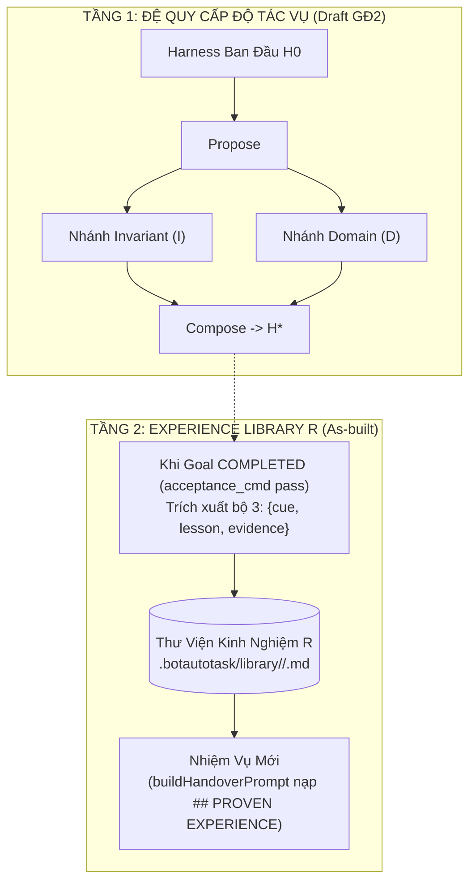

# SPEC-H2 (Spec 04) — Tích Hợp Google Research Harness² & Thư Viện Kinh Nghiệm

| Thuộc tính | Giá trị |
|---|---|
| ID | `SPEC-H2` |
| Trạng thái | `As-built` (Path Validation, Autotriggers, Experience Library R nối vào runtime) · `Draft` (Propose–Probe–Compose 2 tầng) |
| Giai đoạn | 1 (Experience Library & Surface Validation) · 2 (Propose–Probe–Compose) |
| Phụ thuộc (`Depends on`) | `SPEC-CORE` |
| Quyết định liên quan | `D-01`, `D-09` |
| Module triển khai | `src/core/harness2-engine.js`, `src/core/types.js`, `src/core/orchestrator.js`, `src/core/agent-mesh.js` |

> [!WARNING]
> Một số mô tả lý thuyết ban đầu ở §2–3 dưới đây khác với mã nguồn `google-research/harness2` gốc (worktree, D1, layout thư viện, ngữ nghĩa Compose). Xem bảng đính chính chính thức và phạm vi đã triển khai thực tế tại [`SPEC-SAFE` §D0 (`08-mesh-safety-attention-ui.md`)](08-mesh-safety-attention-ui.md#d0-đính-chính-spec-04).

## 1. Mục tiêu & Phạm vi

### 1.1 Bối cảnh & Mục tiêu
Dựa trên nghiên cứu [**Harness²: Recursive Agent Harnessing for an Open World** (arXiv:2610.14224)](https://github.com/google-research/harness2), `SPEC-H2` trang bị cho `BotAutoTask` khả năng:
1. Tự động trích xuất và tái sử dụng các bài học đã được kiểm chứng thực tế (**Experience Library R**: `{cue, lesson, evidence}`) giữa các phiên chạy mà không cần sửa trọng số model.
2. Tự động sinh dòng kích hoạt kỹ năng (`generateAutotriggers`) và kiểm tra an toàn đường dẫn (`validatePath`) chống thoát thư mục.

### 1.2 Phạm vi
- **Trong phạm vi (`As-built`):**
  - `Harness2Engine.validatePath(relPath)`: kiểm tra từng phân đoạn đường dẫn, chặn tuyệt đối `..` và đường dẫn tuyệt đối trên cả POSIX (`/`) và Windows (`\`).
  - `Harness2Engine.generateAutotriggers(skills)`: sinh chỉ thị `When <description>, load the <name> skill.`.
  - `Harness2Engine.saveExperience()` & `loadExperiences()`: lưu/nạp bộ ba `{cue, lesson, evidence}` nguyên tử theo từng `domain` tại `.botautotask/library/<domain>/` và tự động bơm vào `buildHandoverPrompt()` khi chạy Goal/Mesh.
- **Ngoài phạm vi (hoặc `Draft` GĐ2):**
  - Chu trình `Propose – Probe – Compose` đầy đủ với ngân sách `4k` rollouts (tốn nhiều quota model, để ở trạng thái `Draft` theo nguyên tắc YAGNI trong [`SPEC-SAFE` §D0](08-mesh-safety-attention-ui.md)).

---

## 2. Cây 8 Thành Phần Có Thể Tự Biên Tập ($c_1 \dots c_8$ Surface Tree — Mô hình tham chiếu)

Trong `harness2/core/tree.py`, toàn bộ môi trường bao quanh model được chuẩn hoá thành 8 thành phần:

| Ký hiệu | Thành phần | Vị trí file trong OpenCode | Vị trí file trong Codex | Vai trò kiến trúc |
| :---: | :--- | :--- | :--- | :--- |
| **$c_1$** | **System Prompt** | `systemprompt.md` | `AGENTS.md` | Chỉ thị gốc, nhân cách và mục tiêu cơ bản. |
| **$c_2$** | **Guardrails** | `guardrails.md` | `AGENTS.md` | Quy tắc an toàn, ràng buộc cấm kỵ, và dòng tự động kích hoạt skill (`autotrigger`). |
| **$c_3$** | **Long-Term Memory** | `LongTermMEMORY.md` | `LongTermMEMORY.md` | Bộ nhớ bền vững lưu trạng thái project qua các phiên. |
| **$c_4$** | **Tool Guidance** | `tool_descriptions/` | `tool_guidance.md` | Hướng dẫn cách gọi tool chính xác, tránh hallucination tham số. |
| **$c_5$** | **Subagents** | `sub_agents/<name>/AGENT.md` | `sub_agents/<name>/AGENT.md` | Định nghĩa các vai trò agent chuyên trách được gọi độc lập. |
| **$c_6$** | **On-Demand Skills** | `skills/<name>/SKILL.md` | `.agents/skills/<name>/SKILL.md` | Kỹ năng giải quyết bài toán theo nhu cầu kèm script phụ trợ. |
| **$c_7$** | **Verification Scripts** | `scripts/verify_*.js` / `.py` | `scripts/verify_*.py` | **Script kiểm chứng độc lập** (mở lại file kết quả để đối soát thay vì tin lời model). |
| **$c_8$** | **Lifecycle Hooks/Plugins** | `plugin/<name>.ts` | `.codex/hooks.json` | Bắt sự kiện `PostToolUse`, chặn bước nếu bài test thất bại. |

---

## 3. Chu Trình Đệ Quy 2 Tầng & Experience Library R



Mỗi bài học lưu trữ trong `.botautotask/library/<domain>/<name>.md` bắt buộc có đủ 3 thành phần:
```markdown
# EXPERIENCE ENTRY: csv-audit
- **Cue:** Excel files with formula sums
- **Lesson:** Opening workbook directly verifies written formulas
- **Evidence:** Saved file was tested with verify_workbook.py and caught empty sum
```

---

## 4. Yêu cầu chuẩn EARS (`H2-Rnn`) & Kế thừa Pack

### 4.1 Kế thừa từ Pack (`PK-AGENT`)

| REQ dự án | Kế thừa từ Pack | Tham số / Giá trị áp dụng tại BotAutoTask |
|---|---|---|
| `H2-R01` | `PK-AGENT-R01` | Chặn mọi đường dẫn thoát thư mục (`..`) hoặc đường dẫn tuyệt đối trước khi ghi vào `.botautotask/library/` |
| `H2-R03` | `PK-AGENT-R03` | Giới hạn dung lượng kinh nghiệm nạp vào prompt `maxChars = 4000` ký tự để bảo vệ context window |

### 4.2 Bảng Yêu cầu (EARS)

| ID | Mức | Yêu cầu (EARS) | Bằng chứng (`As-built`) |
|---|---|---|---|
| `H2-R01` | MUST | Khi kiểm tra đường dẫn tương đối qua `Harness2Engine.validatePath(relPath)`, hệ thống MUST tách theo cả `/` và `\`, và MUST trả về `false` nếu đường dẫn rỗng, là đường dẫn tuyệt đối (`/`, `C:\`), hoặc có bất kỳ phân đoạn nào bằng `..` (kể cả `a/../../x`). | `src/core/harness2-engine.js:12-32`, `tests/policy-and-contract.test.js` |
| `H2-R02` | MUST | Khi gọi `saveExperience({ domain, name, cue, lesson, evidence })`, nếu thiếu bất kỳ trường nào trong `{name, cue, lesson, evidence}` thì hệ thống MUST trả về `{ saved: false }` (không ném lỗi); nếu hợp lệ thì MUST chuẩn hoá `name` về chữ thường (`[a-z0-9-_]`) và ghi nguyên tử vào `.botautotask/library/<domain>/<name>.md`. | `src/core/harness2-engine.js:48-85`, `tests/policy-and-contract.test.js` |
| `H2-R03` | MUST | Khi gọi `loadExperiences(domain, { maxChars = 4000 })`, hệ thống MUST sắp xếp các bài học theo thời gian sửa đổi mới nhất trước (`mtimeMs` giảm dần) và cắt dừng ngay khi tổng số ký tự chạm trần `maxChars`. | `src/core/harness2-engine.js:87-128`, `tests/policy-and-contract.test.js` |
| `H2-R04` | MUST | Khi một Goal kết thúc với trạng thái `COMPLETED` (đã vượt qua `acceptance_cmd`), `GoalOrchestrator` MUST tự động lưu một mục kinh nghiệm kèm bằng chứng lệnh kiểm tra, và MUST NOT lưu nếu trạng thái là `COMPLETED_UNVERIFIED`. | `src/core/orchestrator.js:155-172`, `src/core/types.js:49-65`, `tests/orchestrator-failover.test.js` |

## 5. Yêu cầu phi chức năng (NFR)

| Khía cạnh | Yêu cầu (số liệu) hoặc `N/A — lý do` |
|---|---|
| Hiệu năng | Đọc và lọc thư viện kinh nghiệm từ đĩa hoàn tất `< 10 ms`. |
| Bảo mật | Chặn 100% chuỗi Path Traversal (`../`, `a/../../x`, `a\..\..\x`, `C:\Windows`). |
| Giới hạn / rate limit | Tổng độ dài chuỗi kinh nghiệm bơm vào prompt mỗi lượt chạy `≤ 4000` ký tự (`maxChars = 4000`). |
| Khả dụng / khôi phục | Nếu thư mục `.botautotask/library/<domain>` chưa tồn tại, `loadExperiences()` trả mảng rỗng `[]` không lỗi. |
| Quan sát (log, metric, audit) | Có thể xem danh sách kinh nghiệm trực tiếp qua `GET /api/experience?domain=` trên Web UI. |
| i18n | Nội dung `cue`, `lesson`, `evidence` hỗ trợ đầy đủ tiếng Việt / tiếng Anh UTF-8. |
| a11y | `N/A — engine xử lý dữ liệu kinh nghiệm`. |
| Trạng thái UI | Tab Experience trên Web UI hiển thị danh sách bài học hoặc trạng thái trống khi chưa có dữ liệu. |

## 6. Trường hợp biên (Edge Cases)

- Đường dẫn lồng `a/../../escape.txt` hoặc `a\..\..\escape.txt` → `validatePath()` trả `false` (`H2-AC01`).
- Gọi `saveExperience()` không có tham số hoặc thiếu trường `evidence` → trả `{ saved: false }`, không crash (`H2-AC02`).
- Một bài học đơn lẻ dài hơn `maxChars` (`maxChars = 10`) → trả về đúng 1 bài học mới nhất đã được cắt gọn kèm `...[truncated]` (`H2-AC03`).

## 7. Điều kiện nghiệm thu (`AC`)

- [x] **H2-AC01** *(unit)* — **Cho** các đường dẫn hợp lệ (`skills/cleaner/SKILL.md`) và không hợp lệ (`../escape.txt`, `a/../../x`, `a\..\..\x`, `/etc/passwd`, `C:\Windows\system32`, `""`, `null`), **khi** gọi `engine.validatePath()`, **thì** chỉ đường dẫn tương đối an toàn trả `true`, mọi trường hợp còn lại trả `false`. *(Test: `tests/policy-and-contract.test.js`)*
- [x] **H2-AC02** *(unit)* — **Cho** danh sách skill và các bộ dữ liệu kinh nghiệm đủ/thiếu trường, **khi** gọi `generateAutotriggers()` và `saveExperience()`, **thì** sinh đúng câu autotrigger, lưu thành công file chữ thường khi đủ `{cue, lesson, evidence}` và trả `{ saved: false }` khi thiếu trường. *(Test: `tests/policy-and-contract.test.js`)*
- [x] **H2-AC03** *(unit/integration)* — **Cho** 2 mục kinh nghiệm được lưu ở các thời điểm khác nhau và giới hạn `maxChars`, **khi** gọi `loadExperiences()` và `buildHandoverPrompt()`, **thì** mục mới nhất được xếp đầu tiên, tôn trọng trần `maxChars` và hiển thị dưới tiêu đề `## PROVEN EXPERIENCE`. *(Test: `tests/policy-and-contract.test.js`, `tests/orchestrator-failover.test.js`)*

## 8. Kiểm tra end-to-end

```powershell
node --test tests/policy-and-contract.test.js tests/orchestrator-failover.test.js
```

## 9. Làm rõ & Câu hỏi mở

- **Làm rõ (2026-10-20):** Đã đính chính sự khác biệt giữa mô hình lý thuyết của bài báo Harness² và mã nguồn thực tế trong [`SPEC-SAFE` §D0](08-mesh-safety-attention-ui.md); chỉ giữ phần Experience Library R, Autotriggers và Path Validation trong runtime để tránh phức tạp thừa (YAGNI).
- **Câu hỏi mở:** Không có.
