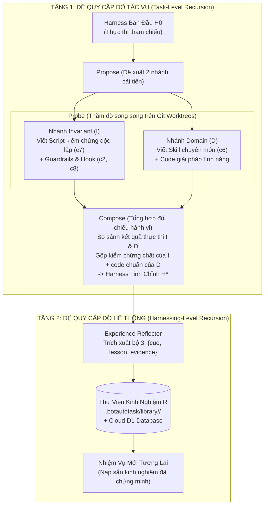

# Đặc Tả Kỹ Thuật: Tích Hợp Google Research Harness²

## 1. Bối Cảnh Nghiên Cứu: `google-research/harness2`
Dựa trên công trình nghiên cứu [**Harness²: Recursive Agent Harnessing for an Open World** (arXiv:2610.14224)](https://github.com/google-research/harness2) phát hành bởi **Google Cloud AI Research**, hệ thống agent có thể tự hoàn thiện và tự nâng cấp năng lực giải quyết tác vụ mà **không cần chỉnh sửa trọng số model (Fixed Model Weights)** và **không cần có sẵn bộ kiểm tra chuẩn mực (No Ground-Truth Verifier Required)**.

Trong `BotAutoTask`, chúng ta áp dụng toàn bộ các cấu trúc dữ liệu và giải thuật cốt lõi này để biến Biệt đội Đa Agent thành một hệ thống **Tự Đệ Quy & Tự Tiến Hoá**.

---

## 2. Cây 8 Thành Phần Có Thể Tự Biên Tập ($c_1 \dots c_8$ Surface Tree)

Trong `harness2/core/tree.py`, toàn bộ môi trường bao quanh model được chuẩn hoá thành 8 thành phần, được tham số hoá qua cấu trúc `SurfaceSpec`:

| Ký hiệu | Thành phần | Vị trí file trong OpenCode | Vị trí file trong Codex | Vai trò kiến trúc |
| :---: | :--- | :--- | :--- | :--- |
| **$c_1$** | **System Prompt** | `systemprompt.md` | `AGENTS.md` | Chỉ thị gốc, nhân cách và mục tiêu cơ bản. |
| **$c_2$** | **Guardrails** | `guardrails.md` | `AGENTS.md` | Quy tắc an toàn, ràng buộc cấm kỵ, và dòng tự động kích hoạt skill (`autotrigger`). |
| **$c_3$** | **Long-Term Memory** | `LongTermMEMORY.md` | `LongTermMEMORY.md` | Bộ nhớ bền vững lưu trạng thái project qua các phiên. |
| **$c_4$** | **Tool Guidance** | `tool_descriptions/` | `tool_guidance.md` | Hướng dẫn cách gọi tool chính xác, tránh hallucination tham số. |
| **$c_5$** | **Subagents** | `sub_agents/<name>/AGENT.md` | `sub_agents/<name>/AGENT.md` | Định nghĩa các vai trò agent chuyên trách được gọi độc lập. |
| **$c_6$** | **On-Demand Skills** | `skills/<name>/SKILL.md` | `.agents/skills/<name>/SKILL.md` | Kỹ năng giải quyết bài toán theo nhu cầu kèm script phụ trợ. |
| **$c_7$** | **Verification Scripts** | `scripts/verify_*.js` / `.py` | `scripts/verify_*.py` | **Script kiểm chứng độc lập** (ví dụ: mở lại file kết quả đọc lại để đối soát thay vì tin lời model). |
| **$c_8$** | **Lifecycle Hooks/Plugins** | `plugin/<name>.ts` | `.codex/hooks.json` | **Đòn bẩy nằm BÊN TRONG vòng lặp tool**: bắt sự kiện `PostToolUse`, chặn bước nếu bài test thất bại. |

### Cơ chế Auto-Trigger (`autotrigger`)
Một lỗi rất phổ biến ở các hệ thống agent là: Agent tự tạo ra Skill mới ($c_6$) nhưng quên ghi chú vào Prompt khi nào cần gọi. Thuật toán `autotrigger()` trong `harness2` tự động quét cây thư mục:
- Nếu phát hiện skill `skills/csv-cleaner/SKILL.md` có mô tả `Cleans messy CSV rows`.
- Hệ thống tự động bổ sung vào `guardrails.md` dòng:
  `- When Cleans messy CSV rows, load the csv-cleaner skill.`

---

## 3. Chu Trình Đệ Quy 2 Tầng (Two-Level Recursion)



### 3.1. Tầng 1: Propose – Probe – Compose (Không cần Ground-Truth Verifier)
- Khi giải quyết một nhiệm vụ phức tạp, thay vì bắt model làm một mạch, hệ thống chia làm 2 nhánh thăm dò trên 2 Git Worktree:
  - **Worktree 1 (Invariant Probe):** Tập trung vào việc "Làm thế nào để phát hiện lỗi?". Tạo ra các script độc lập $c_7$ để kiểm tra tính toàn vẹn của sản phẩm đầu ra.
  - **Worktree 2 (Domain Probe):** Tập trung vào việc "Giải quyết bài toán như thế nào?". Tạo ra các helper và logic code.
- **Composer:** Đối chiếu hành vi giữa 2 worktree, nếu sản phẩm của Domain Probe vượt qua được bài test nghiêm ngặt của Invariant Probe, giải pháp được chấp nhận và merge về nhánh chính.

### 3.2. Tầng 2: Experience Library R (`harness2/core/library.py`)
Mỗi bài học lưu trữ bắt buộc phải có đủ 3 thành phần:
```markdown
# EXPERIENCE ENTRY: subscription_credit_reconciliation
- **Cue:** Bảng tính Excel có chứa các công thức tính tổng hoặc dòng Total trang trí.
- **Lesson:** Một lệnh lưu file thành công không chứng minh file đó đọc lại được. Luôn viết script mở lại workbook để đối soát tổng.
- **Evidence:** Ở lần chạy H0, công thức SUM bị trống khi mở lại; ở nhánh Invariant, script verify_workbook.py đã phát hiện và sửa bằng cách ghi giá trị computed.
```
Toàn bộ cây thư mục `harness/` thành công kèm các file `EXPERIENCE.md` được lưu trữ theo domain trong `.botautotask/library/<domain>/` và đồng bộ lên **Cloudflare D1**, cho phép các phiên làm việc tiếp theo tự động kế thừa.

---

## 4. Tích Hợp Vào Mã Nguồn BotAutoTask (`src/core/harness2-engine.js`)
Module `Harness2Engine` trong `BotAutoTask`:
1. Quản lý đọc, kiểm tra hợp lệ (`validate`), và ghi cây thành phần `SurfaceTree`.
2. Kiểm tra trần token `always_on_max` (mặc định 24,000 ký tự cho OpenCode, 8,000 cho Codex) để không làm cạn kiệt context window của model.
3. Điều phối các lượt chạy `Propose – Probe – Compose` kết hợp với `WorktreeManager`.
4. Cung cấp API đọc/ghi thư viện kinh nghiệm cho cả Local PC và Cloudflare Worker D1.

---

## 5. Cải tiến v2 (sau khi đối chiếu GrokBot + Neko)

| Cải tiến | Nguồn | Chi tiết |
|---|---|---|
| **Ngân sách cố định theo `k`** | `harness2/core/ledger.py` | Mỗi task: R = 4k rollouts (k base + 2k probe + k final), P = 3k phiên cải tiến (k INV + k DOM + k compose). Ghi vào `journal_entries` để Cloud/PWA hiển thị chi phí; vượt ngân sách → dừng, không âm thầm chạy tiếp |
| **Probe Invariant = validator độc lập** | Neko completion-supervisor | Nhánh $I$ chạy trên **core khác** worker, chỉ đọc + bash foreground; implementer chỉ nhận *gap* mức outcome, không nhận nội dung test (chống "học thuộc" test) — xem Spec 05 |
| **Retry proposal không hợp lệ đúng 1 lần** rồi kế thừa harness hiện tại | `harness2/core/recursion.py` (`STAGE_ATTEMPTS=2`) | Tránh vòng lặp tốn token khi model free sinh cây $c_1..c_8$ sai định dạng |
| **Validate cây trước khi nhận** | `harness2/core/tree.py` (`normalize_rel`, `is_allowed`) | Từ chối path thoát thư mục (`..`, tuyệt đối), file ngoài surface, `always_on` vượt trần (24k OpenCode / 8k Codex) |
| **Thư viện kinh nghiệm theo domain, task trong domain chạy tuần tự** | `harness2/core/library.py`, `EXPERIMENTS.md` | Domain khác nhau chạy song song (worktree), cùng domain tuần tự để entry sau đọc được entry trước |
| **Không có kinh nghiệm thì không ghi** | `library.has_experience` | Entry thiếu `cue/lesson/evidence` bị loại |

### Tiêu chí chấp nhận
- [ ] `--k 1` tạo đúng 4 rollout + 3 phiên, ghi ledger.
- [ ] Cây đề xuất có path `../x` hoặc vượt trần `always_on` bị từ chối và retry đúng 1 lần.
- [ ] Entry thư viện thiếu trường bị loại; entry hợp lệ đồng bộ lên D1 bảng `experience_library`.
