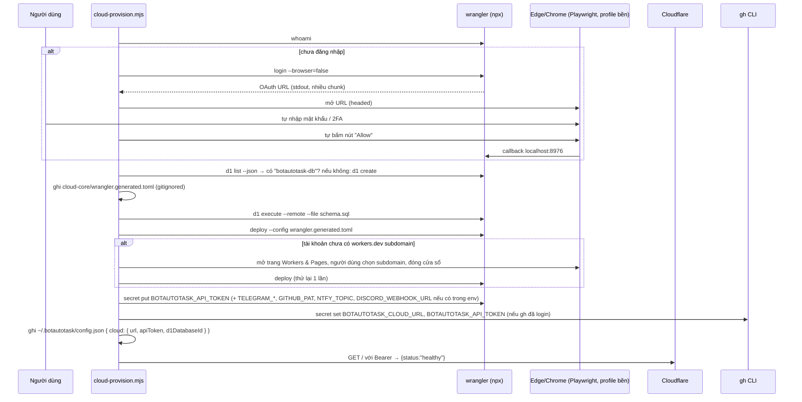

# Spec 06 — Tự Động Tạo Cloud Cloudflare bằng Playwright + Wrangler

| Mục | Giá trị |
|---|---|
| Trạng thái | ✅ **Đã triển khai** — `scripts/cloud-provision.mjs`, `npm run cloud:setup` |
| Test | `tests/cloud-provision.test.js`, `tests/worker-auth.test.js`, `npm run cloud:setup:dry` |
| Phụ thuộc | `playwright-core` (devDependency, dùng Edge/Chrome có sẵn — không tải browser), `wrangler` qua `npx` (không cài vào project) |

## 1. Mục tiêu
Một lệnh duy nhất dựng toàn bộ Cloud Core 24/7 cho người dùng **không cần thao tác dashboard bằng tay**:
Cloudflare login → D1 database → schema → deploy Worker → secrets → GitHub Actions secrets → lưu cấu hình cho daemon → health check.

## 2. Non-goals
- **Không** tự gõ mật khẩu / 2FA / captcha. Người dùng tự đăng nhập trong cửa sổ trình duyệt; script không bao giờ đọc hay lưu credential Cloudflare.
- **Không** điều khiển dashboard để tạo tài nguyên. Mọi thao tác ghi đi qua `wrangler` (API ổn định, idempotent). Dashboard đổi selector thường xuyên — tự động hoá chúng là nguồn lỗi.

## 3. Cơ sở nghiên cứu
- **Neko Core** (`cloudflare/relay/DEPLOY.md`, `cloudflare/feedback`): deploy bằng `npx wrangler`, auth bằng `wrangler login` hoặc `CLOUDFLARE_API_TOKEN`; smoke test sau deploy; *cấm log body*; script phải idempotent. → áp dụng nguyên tắc, viết lại bằng Node.
- **Thử nghiệm thực tế trên máy này:**
  - `wrangler login --browser=false` in URL `https://dash.cloudflare.com/oauth2/auth?...` (PKCE S256, scope rất dài) và **URL bị cắt qua nhiều chunk stdout** → parser phải đọc buffer tích luỹ và chỉ chấp nhận URL khi có ký tự kết thúc (đã sửa + test).
  - Playwright headless vào `dash.cloudflare.com` nhận trang challenge "Just a moment..." → bắt buộc chạy **headed** với **profile bền** để người dùng vượt challenge một lần.

## 4. Luồng thực thi



## 5. Giao diện dòng lệnh
```powershell
npm run cloud:setup:dry                       # xem trước, không thay đổi gì
npm run cloud:setup                           # chạy thật
$env:TELEGRAM_BOT_TOKEN="..."; npm run cloud:setup   # kèm secret tuỳ chọn
$env:CLOUDFLARE_API_TOKEN="..."; npm run cloud:setup # CI/không có browser: bỏ qua Playwright
```

## 6. Thiết kế chi tiết
| Thành phần | Quyết định | Lý do |
|---|---|---|
| Browser | `chromium.launchPersistentContext(~/.botautotask/cf-browser-profile, {channel:'msedge'→'chrome', headless:false})` | Không tải Chromium; giữ phiên Cloudflare cho lần sau; vượt bot-challenge |
| Consent | `page.getByRole('button', {name:/^(allow\|authorize)$/i})`, chờ tối đa 10 phút | Selector theo vai trò/nhãn bền hơn CSS; cho người dùng đủ thời gian 2FA |
| Spawn wrangler trên Windows | `node <npm>/bin/npx-cli.js` thay vì `shell:true` | Tránh DEP0190 / nối chuỗi tham số qua shell |
| Cấu hình D1 | `wrangler.generated.toml` sinh từ `wrangler.toml` + id thật | Không commit id cá nhân; `wrangler.toml` giữ placeholder |
| API token Worker | `crypto.randomUUID()`, **tái sử dụng** nếu đã có trong `~/.botautotask/config.json` | Chạy lại không làm daemon/GitHub mất đồng bộ |
| Daemon | `LocalDaemon` đọc `config.cloud.url/apiToken` khi không có env | Setup xong là daemon tự kết nối |
| Idempotent | D1 tìm trước khi tạo; schema `CREATE IF NOT EXISTS`; deploy/secret ghi đè | Chạy lại an toàn |

## 7. Bảo mật
- Auth Worker **fail-closed** + so sánh constant-time (`isAuthorized` trong `cloud-core/worker.js`) — trước đây thiếu token thì API mở hoàn toàn (phát hiện khi đối chiếu Neko relay).
- Secret truyền qua **stdin** của `wrangler secret put` / `gh secret set`, không qua argv (không lộ trong process list).
- Không in token ra log. Profile browser nằm trong `~/.botautotask/` của người dùng.

## 8. Tiêu chí chấp nhận
- [x] `npm run cloud:setup:dry` chạy hết các bước, không thay đổi tài nguyên.
- [x] Parser xử lý: URL OAuth qua nhiều chunk, D1 id định dạng TOML cũ và JSON mới, URL `*.workers.dev`, thông báo thiếu subdomain.
- [x] `renderGeneratedConfig` từ chối id không phải UUID (chống chèn TOML).
- [x] Playwright khởi chạy Edge thật trên máy này.
- [x] Chạy thật trên tài khoản người dùng (`https://botautotask-cloud-core.huonghoang789hp.workers.dev`) — health check trả `healthy`.

## 9. Giới hạn đã biết (ponytail)
- Onboarding workers.dev subdomain là *bán tự động* (người dùng chọn tên) — dashboard đổi giao diện thường xuyên; nâng cấp: gọi API `PUT /accounts/:id/workers/subdomain` khi đã có token.
- Schema đang là một file `schema.sql`; khi thêm bảng (Spec 02) chuyển sang `migrations/` + `wrangler d1 migrations apply`.
