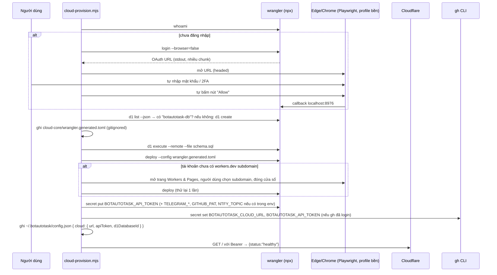

# SPEC-PROVISION (Spec 06) — Tự Động Tạo Cloud Cloudflare bằng Playwright + Wrangler

| Thuộc tính | Giá trị |
|---|---|
| ID | `SPEC-PROVISION` |
| Trạng thái | `Done` (`As-built` — `scripts/cloud-provision.mjs`, `npm run cloud:setup`) |
| Giai đoạn | 1 |
| Phụ thuộc (`Depends on`) | `SPEC-CLOUD` |
| Quyết định liên quan | `D-01`, `D-05`, `D-06`, `D-09` |
| Module triển khai | `scripts/cloud-provision.mjs` |
| Test chứng minh | `tests/cloud-provision.test.js`, `tests/worker-auth.test.js`, `npm run cloud:setup:dry` |

## 1. Mục tiêu & Phạm vi

### 1.1 Mục tiêu
Một lệnh duy nhất dựng toàn bộ Cloud Core 24/7 cho người dùng **không cần thao tác dashboard bằng tay**:
Cloudflare login → D1 database → schema → deploy Worker → secrets → GitHub Actions secrets → lưu cấu hình cho daemon → health check.

### 1.2 Phạm vi (Trong phạm vi & Ngoài phạm vi)
- **Trong phạm vi:**
  - Kịch bản tự động hoá `scripts/cloud-provision.mjs` (`--dry-run` và chạy thật).
  - Bóc tách URL OAuth từ `wrangler login --browser=false` qua nhiều chunk stdout và mở trình duyệt Edge/Chrome có sẵn bằng `playwright-core`.
  - Tạo D1 `botautotask-db` lũy đẳng, sinh `cloud-core/wrangler.generated.toml` (kiểm tra UUID chặt chẽ), nạp `schema.sql`, đẩy secrets qua `stdin` và kiểm tra `/health`.
- **Ngoài phạm vi (Non-goals):**
  - **Không** tự gõ mật khẩu / 2FA / captcha. Người dùng tự đăng nhập trong cửa sổ trình duyệt; script không bao giờ đọc hay lưu credential Cloudflare.
  - **Không** điều khiển dashboard bằng CSS selector để tạo tài nguyên D1/Worker. Mọi thao tác ghi đi qua `wrangler` CLI ổn định.

## 2. Cơ sở nghiên cứu
- **Neko Core** (`cloudflare/relay/DEPLOY.md`, `cloudflare/feedback`): deploy bằng `npx wrangler`, auth bằng `wrangler login` hoặc `CLOUDFLARE_API_TOKEN`; smoke test sau deploy; *cấm log body*; script phải idempotent.
- **Thử nghiệm thực tế trên máy Windows:**
  - `wrangler login --browser=false` in URL `https://dash.cloudflare.com/oauth2/auth?...` (PKCE S256, scope rất dài) và **URL bị cắt qua nhiều chunk stdout** → parser phải đọc buffer tích luỹ và chỉ chấp nhận URL khi có ký tự kết thúc (đã sửa + test).
  - Playwright headless vào `dash.cloudflare.com` nhận trang challenge "Just a moment..." → bắt buộc chạy **headed** với **profile bền** để người dùng vượt challenge một lần.

## 3. Luồng thực thi



## 4. Giao diện dòng lệnh
```powershell
npm run cloud:setup:dry                       # xem trước, không thay đổi gì
npm run cloud:setup                           # chạy thật
$env:TELEGRAM_BOT_TOKEN="..."; npm run cloud:setup   # kèm secret tuỳ chọn
$env:CLOUDFLARE_API_TOKEN="..."; npm run cloud:setup # CI/không có browser: bỏ qua Playwright
```

## 5. Thiết kế chi tiết
| Thành phần | Quyết định | Lý do |
|---|---|---|
| Browser | `chromium.launchPersistentContext(~/.botautotask/cf-browser-profile, {channel:'msedge'→'chrome', headless:false})` | Không tải Chromium; giữ phiên Cloudflare cho lần sau; vượt bot-challenge |
| Consent | `page.getByRole('button', {name:/^(allow\|authorize)$/i})`, chờ tối đa 10 phút | Selector theo vai trò/nhãn bền hơn CSS (`PK-FE-R06`) |
| Spawn wrangler trên Windows | `node <npm>/bin/npx-cli.js` thay vì `shell:true` | Tránh DEP0190 / nối chuỗi tham số qua shell |
| Cấu hình D1 | `wrangler.generated.toml` sinh từ `wrangler.toml` + id thật | Không commit id cá nhân; `wrangler.toml` giữ placeholder |
| API token Worker | `crypto.randomUUID()`, **tái sử dụng** nếu đã có trong `~/.botautotask/config.json` | Chạy lại không làm daemon/GitHub mất đồng bộ |
| Idempotent | D1 tìm trước khi tạo; schema `CREATE IF NOT EXISTS`; deploy/secret ghi đè | Chạy lại an toàn (`PK-DB-R02`) |

## 6. Kế thừa Pack & Yêu cầu chuẩn EARS (`PROV-Rnn`)

### 6.1 Kế thừa từ Pack (`PK-AUTH`, `PK-DB`, `PK-FE`)

| REQ dự án | Kế thừa từ Pack | Tham số / Giá trị áp dụng tại BotAutoTask |
|---|---|---|
| `PROV-R02` | `PK-DB-R02` | `{migrate-cmd} = wrangler d1 execute botautotask-db --remote --file=./schema.sql` chạy lũy đẳng |
| `PROV-R03` | `PK-AUTH-R07` | Truyền secret qua `stdin` của `wrangler secret put` / `gh secret set`, cấm truyền qua `argv` hoặc in ra log |
| `PROV-R04` | `PK-FE-R06` | Dùng `page.getByRole('button', { name: /^(allow\|authorize)$/i })` thay cho CSS selector dễ gãy |

### 6.2 Bảng Yêu cầu (EARS)

| ID | Mức | Yêu cầu (EARS) | Bằng chứng (`As-built`) |
|---|---|---|---|
| `PROV-R01` | MUST | Khi phân tích luồng stdout từ `wrangler login`, `wrangler d1 create/list` và `wrangler deploy`, các hàm parser (`extractOAuthUrl`, `extractD1DatabaseId`, `extractWorkerUrl`, `needsWorkersDevSubdomain`) MUST trích xuất chính xác OAuth URL (kể cả khi bị cắt qua nhiều chunk), `database_id` (cả định dạng TOML cũ lẫn JSON mới), URL `https://*.workers.dev` và lỗi thiếu subdomain. | `scripts/cloud-provision.mjs:15-63`, `tests/cloud-provision.test.js` |
| `PROV-R02` | MUST | Khi sinh `wrangler.generated.toml` qua `renderGeneratedConfig()`, hệ thống MUST kiểm tra `databaseId` khớp định dạng UUID chuẩn; nếu không phải UUID hợp lệ thì MUST ném lỗi để chống chèn cấu hình TOML độc hại. | `scripts/cloud-provision.mjs:65-68`, `tests/cloud-provision.test.js` |
| `PROV-R03` | MUST | Khi cập nhật `~/.botautotask/config.json` qua `mergeCloudConfig()`, hệ thống MUST giữ nguyên toàn bộ các trường cấu hình sẵn có của người dùng (`harnesses`, `priorityModels`, `ntfy`) và tái sử dụng `cloud.apiToken` nếu đã tồn tại. | `scripts/cloud-provision.mjs:69-82`, `tests/cloud-provision.test.js` |
| `PROV-R04` | MUST | Khi chạy với cờ `--dry-run` (`npm run cloud:setup:dry`), script MUST kiểm tra điều kiện môi trường, in kế hoạch thực thi và thoát với exit code `0` mà không tạo/sửa bất kỳ tài nguyên Cloudflare hay file `~/.botautotask/config.json` thật nào (`C19`). | `scripts/cloud-provision.mjs:245-279`, `tests/cloud-provision.test.js` |

## 7. Yêu cầu phi chức năng (NFR)

| Khía cạnh | Yêu cầu (số liệu) hoặc `N/A — lý do` |
|---|---|
| Hiệu năng | Chế độ `--dry-run` hoàn tất `< 2 giây`; thời gian chờ người dùng nhập 2FA tối đa `10 phút`. |
| Bảo mật | Không truyền secret qua tham số dòng lệnh (`argv`); lưu profile trình duyệt tại `~/.botautotask/cf-browser-profile` ngoài repo. |
| Giới hạn / rate limit | Tự động thử lại `wrangler deploy` đúng `1` lần sau khi người dùng đăng ký `workers.dev` subdomain. |
| Khả dụng / khôi phục | Chạy lại `npm run cloud:setup` nhiều lần liên tiếp hoàn toàn lũy đẳng, không tạo trùng D1 database và không làm mất `BOTAUTOTASK_API_TOKEN` đang dùng. |
| Quan sát (log, metric, audit) | Kết thúc quá trình cài đặt bằng bước gọi `GET /` kèm Bearer token tới Worker thật và kiểm tra kết quả `{ status: "healthy" }` (`C19`). |
| i18n | Thông báo hướng dẫn trên terminal bằng tiếng Việt rõ ràng. |
| a11y | `N/A — công cụ CLI tự động hoá hạ tầng`. |
| Trạng thái UI | `N/A — chỉ mở cửa sổ trình duyệt Cloudflare OAuth khi cần`. |

## 8. Trường hợp biên (Edge Cases)

- `databaseId` truyền vào `renderGeneratedConfig()` chứa dấu nháy kép hoặc xuống dòng (`"bad-id\n[vars]"`) → ném lỗi `Invalid D1 database UUID` ngay lập tức (`PROV-AC02`).
- Tài khoản Cloudflare mới tạo chưa đăng ký subdomain `*.workers.dev` → `needsWorkersDevSubdomain()` nhận diện đúng mã lỗi `10063` / thông báo subdomain để mở trang onboarding cho người dùng (`PROV-AC01`).
- Người dùng đã có sẵn `cloud.apiToken` và `priorityModels` trong `~/.botautotask/config.json` → `mergeCloudConfig()` bảo toàn cả hai (`PROV-AC02`).

## 9. Điều kiện nghiệm thu (`AC`)

- [x] **PROV-AC01** *(unit)* — **Cho** các mẫu stdout thực tế của `wrangler` (OAuth URL bị cắt đôi, D1 ID dạng TOML/JSON, URL `*.workers.dev`, lỗi thiếu subdomain), **khi** gọi các hàm parser trong `cloud-provision.mjs`, **thì** trích xuất chính xác 100% giá trị. *(Test: `tests/cloud-provision.test.js`)*
- [x] **PROV-AC02** *(unit)* — **Cho** file `wrangler.toml` mẫu và cấu hình người dùng hiện có, **khi** gọi `renderGeneratedConfig()` (với UUID hợp lệ và chuỗi giả mạo) cùng `mergeCloudConfig()`, **thì** UUID hợp lệ được điền đúng, chuỗi giả mạo bị từ chối, và cấu hình cũ của người dùng không bị mất khoá nào. *(Test: `tests/cloud-provision.test.js`)*
- [x] **PROV-AC03** *(integration)* — **Cho** môi trường phát triển local, **khi** chạy `npm run cloud:setup:dry`, **thì** lệnh in đầy đủ các bước dự kiến và trả exit code `0` mà không tạo/sửa tài nguyên Cloudflare hay `~/.botautotask/config.json`. *(Test: `npm run cloud:setup:dry`)*
- [~] **PROV-AC04** *(e2e)* — **Cho** tài khoản Cloudflare thực tế, **khi** chạy `npm run cloud:setup`, **thì** tạo/tìm D1 `botautotask-db`, nạp `schema.sql`, deploy Worker và gọi `GET /` trả `{ status: "healthy" }`. *(Lý do `[~]`: cần phiên đăng nhập Cloudflare OAuth/2FA trực tiếp của người dùng; cách đóng: chạy `npm run cloud:setup` trên máy chủ cá nhân và xác nhận dòng `[✓] Health check passed`)*

## 10. Kiểm tra end-to-end

```powershell
node --test tests/cloud-provision.test.js
npm run cloud:setup:dry
```

## 11. Giới hạn đã biết (`ceiling:`) & Câu hỏi mở

- `ceiling:` Onboarding `workers.dev` subdomain lần đầu là bán tự động (người dùng chọn tên trên trình duyệt); đường nâng cấp: gọi Cloudflare REST API `PUT /accounts/:id/workers/subdomain` khi người dùng cung cấp API token có quyền Account.
- **Câu hỏi mở:** Không có.
