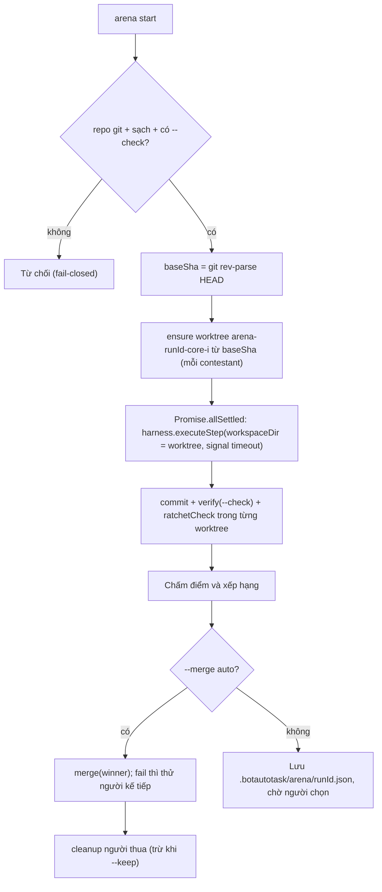

# SPEC-ARENA (Spec 07) — Arena Fan-Out, Multi-Account Pool, Ratchet Guard, Awake Lease

| Thuộc tính | Giá trị |
|---|---|
| ID | `SPEC-ARENA` |
| Trạng thái | `Draft` (Riêng mục §3.5 sửa lỗi auto-pass `COMPLETED_UNVERIFIED` đã triển khai trong [`SPEC-SAFE`](08-mesh-safety-attention-ui.md)) |
| Giai đoạn | 2 |
| Phụ thuộc (`Depends on`) | `SPEC-CORE`, `SPEC-MESH`, `SPEC-VERIFY`, `SPEC-SAFE` |
| Quyết định liên quan | `D-01`, `D-02`, `D-06`, `D-09` |
| Nguồn cảm hứng | [`stablyai/orca` v1.4.214](https://github.com/stablyai/orca) — xem [`research/orca-findings.md`](research/orca-findings.md) |

> [!IMPORTANT]
> Theo luật `C03` (Quyền của AI theo trạng thái Spec), các phần `Arena Fan-Out` (§1), `Multi-Account Pool` (§2), `ratchetCheck` (§3.1–3.4) và `Awake Lease` (§4) đang ở trạng thái **`Draft`**. Agent **không được tự ý viết code triển khai** khi người dùng chưa duyệt chuyển sang `Ready`.

## 0. Hiện trạng code (đã đọc trước khi viết spec)

| Sự thật | Vị trí | Hệ quả cho spec |
|---|---|---|
| `WorktreeManager` có sẵn `ensure/commit/verify/merge/cleanup` | `src/core/worktree-manager.js` | Arena **tái dùng 100%**, không viết worktree mới |
| `merge()` kiểm `MAIN_DIRTY_COLLISION` → verify trong worktree → merge `--no-ff` → verify trên main → `reset --keep HEAD~1` nếu fail | `worktree-manager.js` | Arena chỉ gọi `merge(winnerId, { verifyCmd })` |
| `runCliProcess` đã nhận `env` và `signal` | `src/core/spawn-cli.js` | Account pool chỉ cần truyền `env`; Arena timeout dùng `AbortSignal` |
| `getCodexAuthPath()` đọc `process.env.CODEX_HOME` **toàn cục** | `src/core/auth-bridge.js` | Phải thêm tham số `codexHome` (không được mutate `process.env` khi chạy song song) |
| Cooldown chỉ theo khoá `harness:model`, lưu **in-memory** | `src/core/model-discovery.js` | Account pool cần chiều thứ 3 (account) + lưu đĩa |
| ✅ **Bug auto-pass đã sửa ở Spec 08 A2**: không có `acceptance_cmd` → `COMPLETED_UNVERIFIED` | `src/core/orchestrator.js`, `src/core/supervisor.js` | Đã hoàn tất trong `SPEC-SAFE` |
| Ghi file nguyên tử có sẵn | `src/core/atomic-write.js` | Dùng cho mọi file state mới |

---

## 1. Arena Fan-Out — 1 nhiệm vụ, N lõi, chọn người thắng tự động

### 1.1 Mục tiêu & Phạm vi
- **Mục tiêu:** Giao cùng một task cho 2–4 lõi AI chạy **song song** trên các worktree riêng; người thắng được chọn bằng **tiêu chí khách quan, xác định (deterministic)** — không dùng LLM chấm điểm.
- **Trong phạm vi:** `Arena Fan-Out` (§1), `Multi-Account OAuth Pool` (§2), `Ratchet Guard` (§3), `Awake Lease` (§4).
- **Ngoài phạm vi:** Universal Agent Hook Listener kiểu Orca, Design Mode (chọn DOM bằng Electron/CDP), tách daemon `orcad` riêng, hoặc dùng LLM-as-judge để chấm điểm Arena.

### 1.2 Giao diện dự kiến
```powershell
botautotask arena "Thêm cache LRU cho query_engine" `
  --cores codex,opencode,claude `   # 2..4 contestant; lặp lõi được: opencode,opencode
  --check "python -m pytest -q" `   # BẮT BUỘC — không có check thì không có trọng tài
  --path "D:\proj" `
  --merge auto|manual `             # mặc định: manual
  --timeout 20m `                   # mỗi contestant
  --keep                            # giữ worktree của người thua để xem lại

botautotask arena list                       # các lượt arena + trạng thái
botautotask arena show <runId>               # bảng điểm + diffstat
botautotask arena merge <runId> <contestant> # merge thủ công
```

### 1.3 Luồng


### 1.4 Quy tắc chấm điểm (deterministic)
**Loại** (disqualified) nếu bất kỳ điều nào đúng:
1. `outcome` ∈ {`RATE_LIMITED`, `ERROR`} hoặc hết `--timeout`.
2. Không có diff (`commit()` trả `CLEAN_WORKING_TREE`).
3. `--check` fail trong worktree.
4. `ratchetCheck` có vi phạm mức `block` (mục 3).

**Xếp hạng** người còn lại theo thứ tự ưu tiên:
1. Số cảnh báo ratchet mức `warn` — ít hơn thắng.
2. Tổng dòng thay đổi (`git diff --numstat baseSha..HEAD`, added + deleted) — nhỏ hơn thắng.
3. Thời gian chạy — nhanh hơn thắng.
4. Hoà → theo thứ tự trong `--cores`.

```js
// ceiling: "diff nhỏ nhất qua được check" là heuristic — có thể thưởng cho bản làm ít việc nhất
// nếu --check yếu. Trần: chất lượng --check. Nâng cấp: thêm hidden tests hoặc mutation score.
```

---

## 2. Multi-Account OAuth Pool — xoay vòng tài khoản trước khi hạ cấp model

### 2.1 Mục tiêu
Khi tài khoản Codex/Claude A dính 429/quota, thử **tài khoản B cùng hãng** trước khi `ranker` chuyển sang lõi/model khác. Mặc định tắt (pool rỗng = hành vi cũ).

### 2.2 Cơ chế cô lập (không cần copy token thủ công)
- Codex: `CODEX_HOME=<dir>` → `<dir>/auth.json`
- Claude Code: `CLAUDE_CONFIG_DIR=<dir>`
- Mỗi tài khoản = 1 thư mục `~/.botautotask/accounts/<provider>/<label>/`. Tài khoản `default` = thư mục mặc định của CLI (`~/.codex`, `~/.claude`), không copy.

---

## 3. Ratchet Guard — chặn AI "ăn gian" để qua bài kiểm tra

| Id | Mức | Phát hiện trên dòng thêm (`+`) của `git diff <baseSha>..HEAD` |
|---|---|---|
| `R0` | `block` | Agent sửa `.botautotask/ratchet.json` hoặc `CONSTRAINTS.md` (`C23`) |
| `R1` | `block` | Thêm suppression: `@ts-ignore`, `@ts-nocheck`, `@ts-expect-error`, `eslint-disable`, `# type: ignore`, `# noqa`, `# pylint: disable`, `//nolint`, `#[allow(`, `@SuppressWarnings` |
| `R2` | `block` | Thêm skip test: `.skip(`, `xit(`, `xdescribe(`, `@pytest.mark.skip`, `@unittest.skip`, `t.Skip(`, `#[ignore]` |
| `R3` | `block` | Xoá file test (`git diff --name-status` = `D`) khớp `(^\|/)(tests?\|__tests__\|spec)/`, `.test.`, `.spec.`, `_test.`, `test_*.py` |
| `R4` | `warn` | Trong file test bị sửa: số dòng `assert`/`expect(` bị xoá > số được thêm |
| `R5` | `warn` | File vượt `maxFileLines` (mặc định 800) mà trước đó chưa vượt, hoặc đã vượt và còn tăng thêm |

---

## 4. Awake Lease — giữ máy không Sleep khi đang chạy

Khi có ≥ 1 goal/agent/arena đang chạy, chặn OS tự Sleep do idle bằng tiến trình con native (`SetThreadExecutionState(0x80000001)` trên Windows, `caffeinate -i -w <pid>` trên macOS, `systemd-inhibit` trên Linux); đếm tham chiếu (`refcount`) về `0` thì nhả ngay.

---

## 5. Kế thừa Pack & Yêu cầu chuẩn EARS (`ARENA-Rnn` — `Draft`)

### 5.1 Kế thừa từ Pack (`PK-AGENT`, `PK-AUTH`, `C23`)

| REQ dự án | Kế thừa từ Pack / Core | Tham số / Giá trị áp dụng tại BotAutoTask |
|---|---|---|
| `ARENA-R01` | `PK-AGENT-R02` | Mỗi contestant chạy trên một `git worktree` cô lập (`arena-<runId>-<core>-<i>`), tối đa `4` contestants |
| `ARENA-R02` | `PK-AUTH-R07` | Cô lập tài khoản qua `CODEX_HOME` / `CLAUDE_CONFIG_DIR` truyền vào `env` của tiến trình con, không mutate `process.env` toàn cục, không log token |
| `ARENA-R03` | `C23` (Floor Guard) | `ratchetCheck()` chặn cứng các dòng diff thêm suppression (`R1`), skip test (`R2`), xoá file test (`R3`) hoặc tự sửa file cấu hình ratchet (`R0`) |

### 5.2 Bảng Yêu cầu (EARS — `Draft`)

| ID | Mức | Yêu cầu (EARS) |
|---|---|---|
| `ARENA-R01` | MUST (GĐ2) | Khi khởi chạy `botautotask arena`, nếu thư mục không phải là repo Git sạch hoặc thiếu cờ `--check`, hệ thống MUST từ chối thực thi ngay lập tức (fail-closed). |
| `ARENA-R02` | MUST (GĐ2) | Khi chấm điểm các contestant bằng `scoreContestants()`, hệ thống MUST loại bỏ mọi contestant bị lỗi/timeout, không có diff, trượt `--check` hoặc vi phạm `ratchetCheck` mức `block`, sau đó xếp hạng phần còn lại theo thứ tự: ít `warn` hơn → ít dòng diff hơn → thời gian chạy ngắn hơn → thứ tự khai báo trong `--cores`. |
| `ARENA-R03` | MUST (GĐ2) | Khi cấu hình Multi-Account Pool có nhiều tài khoản cho cùng một Harness (`codex` hoặc `claude`), nếu tài khoản hiện tại gặp `RATE_LIMITED`, `GoalOrchestrator` MUST chuyển sang tài khoản khả dụng kế tiếp trong pool trước khi đánh dấu cooldown cho model trên `FreeModelRanker`. |
| `ARENA-R04` | MUST (GĐ2) | Khi quét `git diff` qua `scanDiff()`, hệ thống MUST phát hiện chính xác các dòng được thêm (`+`) chứa cờ suppression (`R1`) hoặc `.skip` (`R2`) và các file test bị xoá (`R3`), nhưng MUST NOT báo lỗi nếu dòng chứa `@ts-ignore` là dòng bị xoá (`-`). |
| `ARENA-R05` | SHOULD (GĐ2) | Khi `acquireAwake()` được gọi nhiều lần đồng thời, hệ thống SHOULD chỉ khởi chạy duy nhất `1` tiến trình giữ thức và chỉ kết thúc tiến trình đó khi hàm `release()` đã được gọi đủ số lần tương ứng (`refcount === 0`). |

## 6. Yêu cầu phi chức năng (NFR)

| Khía cạnh | Yêu cầu (số liệu) hoặc `N/A — lý do` |
|---|---|
| Hiệu năng | Hàm thuần `scoreContestants()` và `scanDiff()` xử lý diff `10.000 dòng` trong `< 20 ms`. |
| Bảo mật | Không bao giờ sửa `process.env` toàn cục khi chạy song song nhiều tài khoản; không đồng bộ thư mục `~/.botautotask/accounts/` lên Cloud. |
| Giới hạn / rate limit | Tối đa `4` contestants mỗi lượt Arena; timeout mặc định `20 phút` (`1200000 ms`) mỗi contestant. |
| Khả dụng / khôi phục | Tiến trình giữ thức trên Windows tự thoát nếu tiến trình Node cha bị kill đột ngột (nhờ vòng lặp kiểm tra `Get-Process -Id <nodePid>`). |
| Quan sát (log, metric, audit) | Lưu bảng điểm chi tiết vào `.botautotask/arena/<runId>.json` qua `atomic-write.js`. |
| i18n | Hỗ trợ thông báo CLI và Web UI bằng tiếng Việt UTF-8. |
| a11y | `N/A — tính năng điều phối và chấm điểm`. |
| Trạng thái UI | Bảng điểm Arena hiển thị rõ trạng thái `running`, `scored`, `merged`, `disqualified`. |

## 7. Trường hợp biên (Edge Cases)

- Dòng bị xoá (`- // @ts-ignore`) trong `git diff` → `scanDiff()` không tính là vi phạm `R1` (`ARENA-AC03`).
- Hai contestant có cùng số `warn = 0` và cùng `linesChanged = 25` → người chạy nhanh hơn (`durationMs` nhỏ hơn) thắng; nếu bằng nhau nữa thì theo thứ tự trong `--cores` (`ARENA-AC01`).
- Gọi `release()` của Awake Lease 2 lần liên tiếp cho cùng 1 handle → lần thứ 2 là no-op (idempotent), không làm giảm lệch `refcount` của tác vụ khác đang chạy (`ARENA-AC04`).

## 8. Điều kiện nghiệm thu (`AC` — dự kiến cho GĐ2)

- [ ] **ARENA-AC01** *(unit)* — **Cho** môi trường khởi chạy Arena (repo bẩn/thiếu `--check` so với repo sạch có `--check`) và danh sách 4 contestants giả lập (1 lỗi `--check`, 1 dính ratchet `block`, 2 hợp lệ khác nhau về số dòng diff và thời gian), **khi** kiểm tra điều kiện đầu vào và gọi `scoreContestants()`, **thì** môi trường bẩn/thiếu `--check` bị từ chối ngay (fail-closed), 2 contestant lỗi bị loại và 2 contestant hợp lệ được xếp hạng đúng thứ tự ưu tiên.
- [ ] **ARENA-AC02** *(unit)* — **Cho** `AccountPool` có 2 tài khoản `default` và `work2`, **khi** `default` trả `RATE_LIMITED`, **thì** orchestrator thử lại ngay step đó với `work2` và giữ nguyên trạng thái sau khi đọc lại từ đĩa.
- [ ] **ARENA-AC03** *(unit)* — **Cho** chuỗi unified diff mẫu có thêm `@ts-ignore`, thêm `.skip(`, xoá file `tests/a.test.js` và xoá một dòng `@ts-ignore` cũ, **khi** gọi `scanDiff()`, **thì** bắt đúng `R1`, `R2`, `R3` ở các dòng thêm/xoá file và bỏ qua dòng `@ts-ignore` bị xoá.
- [ ] **ARENA-AC04** *(unit)* — **Cho** `acquireAwake()` với hàm `spawn` giả, **khi** acquire 2 lần rồi release lần lượt, **thì** `spawn` chỉ gọi 1 lần và tiến trình con chỉ bị kill sau lần release thứ 2.

## 9. Kiểm tra end-to-end (khi triển khai GĐ2)

```powershell
node --test tests/arena.test.js tests/account-pool.test.js tests/ratchet.test.js tests/awake-lease.test.js
```

## 10. Làm rõ & Câu hỏi mở

- **Làm rõ (2026-10-20):** Phần sửa lỗi auto-pass (`COMPLETED_UNVERIFIED` ở mục §3.5) đã được tách ra làm trước và hoàn thành trong [`SPEC-SAFE` (`08-mesh-safety-attention-ui.md`)](08-mesh-safety-attention-ui.md). Các mục còn lại giữ trạng thái `Draft` cho Giai đoạn 2.
- **Câu hỏi mở:** Không có.
