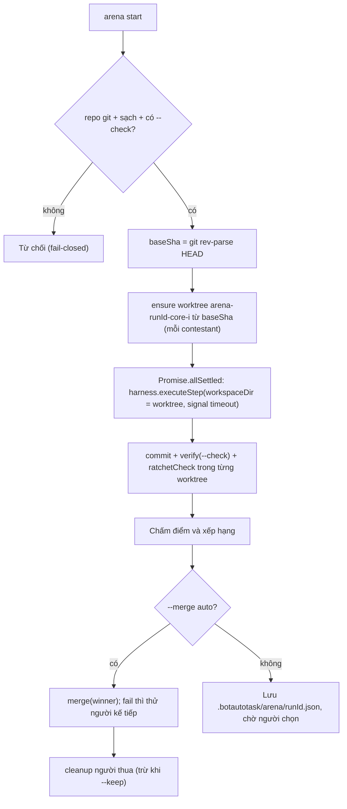

# Spec 07 — Arena Fan-Out, Multi-Account Pool, Ratchet Guard, Awake Lease

> Nguồn cảm hứng: [`stablyai/orca` v1.4.214](https://github.com/stablyai/orca) — xem [orca-findings.md](research/orca-findings.md).
> Nguyên tắc: **zero runtime dependency**, tái dùng module sẵn có, không thêm abstraction thừa.
> Trạng thái: 📝 Spec (chưa triển khai).

## 0. Hiện trạng code (đã đọc trước khi viết spec)

| Sự thật | Vị trí | Hệ quả cho spec |
|---|---|---|
| `WorktreeManager` có sẵn `ensure/commit/verify/merge/cleanup` | `src/core/worktree-manager.js` | Arena **tái dùng 100%**, không viết worktree mới |
| `merge()` tự verify trong worktree → merge `--no-ff` → verify trên main → `reset --hard HEAD~1` nếu fail | `worktree-manager.js:179-238` | Arena chỉ gọi `merge(winnerId, { verifyCmd })` |
| `runCliProcess` đã nhận `env` và `signal` | `src/core/spawn-cli.js:117-120` | Account pool chỉ cần truyền `env`; Arena timeout dùng `AbortSignal` |
| `getCodexAuthPath()` đọc `process.env.CODEX_HOME` **toàn cục** | `src/core/auth-bridge.js:16-17` | Phải thêm tham số `codexHome` (không được mutate `process.env` khi chạy song song) |
| Cooldown chỉ theo khoá `harness:model`, lưu **in-memory** | `src/core/model-discovery.js:24-42` | Account pool cần chiều thứ 3 (account) + lưu đĩa |
| ⚠️ `CompletionContract` **chưa được gọi ở đâu** trong runtime | `grep CompletionContract src/` | Ratchet phải đi kèm việc nối contract vào orchestrator |
| ⚠️ **Bug auto-pass**: không có `acceptance_cmd` → `{ ok: true }` | `src/core/orchestrator.js:42-43` | Sửa trong mục 3 (fail-closed → `outcome_unverified`) |
| Ghi file nguyên tử có sẵn | `src/core/atomic-write.js` | Dùng cho mọi file state mới |

---

## 1. Arena Fan-Out — 1 nhiệm vụ, N lõi, chọn người thắng tự động

### 1.1 Mục tiêu
Giao cùng một task cho 2–4 lõi AI chạy **song song** trên các worktree riêng; người thắng được chọn bằng **tiêu chí khách quan, xác định (deterministic)** — không dùng LLM chấm điểm.
Khác Orca: Orca bắt người dùng nhìn diff để chọn; BotAutoTask tự chấm và tự merge (vẫn có chế độ manual).

### 1.2 Giao diện
```powershell
botautotask arena "Thêm cache LRU cho query_engine" `
  --cores codex,opencode,claude `   # 2..4 contestant; lặp lõi được: opencode,opencode
  --check "python -m pytest -q" `   # BẮT BUỘC — không có check thì không có trọng tài
  --path "D:\proj" `
  --merge auto|manual `             # mặc định: manual
  --timeout 20m `                   # mỗi contestant
  --keep                            # giữ worktree của người thua để xem lại

botautotask arena list                       # các lượt arena + trạng thái
botautotask arena show <runId>               # bảng điểm + diffstat
botautotask arena merge <runId> <contestant> # merge thủ công
```
Web UI (`src/daemon/web-ui.js`): `POST /api/arena` (cùng tham số), `GET /api/arena/:runId`, `POST /api/arena/:runId/merge`. Dùng chung auth `#k=` hiện có.

### 1.3 Luồng


### 1.4 Quy tắc chấm điểm (deterministic)
**Loại** (disqualified) nếu bất kỳ điều nào đúng:
1. `outcome` ∈ {`RATE_LIMITED`, `ERROR`} hoặc hết `--timeout`. *(Arena không failover — mục đích là so sánh.)*
2. Không có diff (`commit()` trả `CLEAN_WORKING_TREE`).
3. `--check` fail trong worktree.
4. `ratchetCheck` có vi phạm mức `block` (mục 3).

**Xếp hạng** người còn lại theo thứ tự ưu tiên:
1. Số cảnh báo ratchet mức `warn` — ít hơn thắng.
2. Tổng dòng thay đổi (`git diff --numstat baseSha..HEAD`, added + deleted) — nhỏ hơn thắng.
3. Thời gian chạy — nhanh hơn thắng.
4. Hoà → theo thứ tự trong `--cores`.

```js
// ponytail: "diff nhỏ nhất qua được check" là heuristic — có thể thưởng cho bản làm ít việc nhất
// nếu --check yếu. Trần: chất lượng --check. Nâng cấp: thêm hidden tests hoặc mutation score.
```

### 1.5 Trạng thái lưu
`.botautotask/arena/<runId>.json` (ghi qua `atomic-write.js`; `.botautotask/` đã nằm trong `.git/info/exclude`):
```json
{
  "runId": "a7f3", "task": "...", "check": "python -m pytest -q", "baseSha": "6871932",
  "status": "running|scored|merged|failed",
  "contestants": [
    { "id": "arena-a7f3-codex-1", "core": "codex", "model": "codex-default",
      "branch": "botautotask/agent-arena-a7f3-codex-1",
      "outcome": "STEP_DONE", "checkPassed": true, "ratchet": { "block": [], "warn": [] },
      "linesChanged": 84, "durationMs": 312000, "disqualified": null, "rank": 1 }
  ],
  "winner": "arena-a7f3-codex-1", "mergeSha": "..."
}
```

### 1.6 Ràng buộc & an toàn
- Tối đa 4 contestant (RAM + quota). Id contestant = `arena-<runId>-<core>-<i>` → không đụng worktree cũ (`ensure()` tái dùng thư mục nếu đã tồn tại, `worktree-manager.js:94`).
- Repo bẩn → từ chối (merge sẽ mơ hồ). Không phải git repo → từ chối.
- Mỗi contestant chỉ ghi trong worktree của mình; `merge` luôn chạy tuần tự.
- Tiến trình bị kill giữa chừng: `arena list` hiển thị `running` quá `timeout` là `stale`; `arena cleanup <runId>` gọi `WorktreeManager.cleanup(id)`.

### 1.7 File thay đổi
| File | Thay đổi |
|---|---|
| `src/core/arena.js` (mới, ~150 dòng) | `runArena(opts)`, `scoreContestants(list)` (hàm thuần, dễ test), `mergeArena(runId, id)` |
| `src/daemon/cli.js` | nhánh `subcommand === 'arena'` |
| `src/daemon/web-ui.js` | 3 route `/api/arena*` |
| `src/ui/dashboard-html.js` | nút "Arena" trên ô Quick-Mission + bảng điểm |

### 1.8 Kiểm thử chấp nhận
- `test/arena.test.js`: `scoreContestants` với dữ liệu giả — loại đúng 4 trường hợp, xếp hạng đúng 4 tiêu chí, hoà theo thứ tự `--cores`.
- Tích hợp: repo tạm + 2 harness `custom-cmd` (một sửa file đúng, một làm test fail) → winner = harness 1, merge thành công, worktree harness 2 bị dọn.

---

## 2. Multi-Account OAuth Pool — xoay vòng tài khoản trước khi hạ cấp model

### 2.1 Mục tiêu
Khi tài khoản Codex/Claude A dính 429/quota, thử **tài khoản B cùng hãng** trước khi `ranker` chuyển sang lõi/model khác.

> [!WARNING]
> Dùng nhiều tài khoản để vượt giới hạn có thể vi phạm điều khoản của nhà cung cấp. Tính năng **mặc định tắt** (pool rỗng = hành vi cũ); người dùng tự chịu trách nhiệm khi thêm tài khoản.

### 2.2 Cơ chế cô lập (không cần copy token thủ công)
Cả hai CLI đều hỗ trợ thư mục cấu hình qua biến môi trường:
- Codex: `CODEX_HOME=<dir>` → `<dir>/auth.json`
- Claude Code: `CLAUDE_CONFIG_DIR=<dir>`

Mỗi tài khoản = 1 thư mục `~/.botautotask/accounts/<provider>/<label>/`. Tài khoản `default` = thư mục mặc định của CLI (`~/.codex`, `~/.claude`), không copy.

### 2.3 Giao diện
```powershell
botautotask accounts add codex work2     # chạy `codex login` với CODEX_HOME=~/.botautotask/accounts/codex/work2
botautotask accounts add claude alt      # chạy `claude /login` với CLAUDE_CONFIG_DIR=...
botautotask accounts list                # provider | label | signed-in | cooldown đến
botautotask accounts remove codex work2  # xoá thư mục + mục registry
```

### 2.4 Dữ liệu
- `~/.botautotask/accounts.json` (registry, atomic-write): `{ "codex": ["default", "work2"], "claude": ["default"] }` — thứ tự = thứ tự ưu tiên.
- `~/.botautotask/accounts-state.json`: `{ "codex:work2": { "cooldownUntil": 1792500000000 } }` — **lưu đĩa** để daemon khởi động lại không đâm lại vào tài khoản đang bị giới hạn.

### 2.5 Tích hợp (thay đổi tối thiểu)
1. `auth-bridge.js`: `getCodexAuthPath(codexHome?)`, `loadCodexCredentials({ codexHome })`, `refreshCodexCredentials` ghi lại đúng `auth.json` của tài khoản đó. Mặc định giữ nguyên hành vi cũ.
2. `claude-codex-harness.js`: `executeStep({ ..., account })` → `runCliProcess(bin, args, { env: { ...process.env, CODEX_HOME | CLAUDE_CONFIG_DIR: account.home } })`; direct mode truyền `codexHome`. **Không bao giờ** sửa `process.env` (Arena chạy song song).
3. `orchestrator.js` vòng `for (const candidate of candidates)` (`:80`): thêm vòng trong `for (const account of pool.available(harness.id))` — harness không hỗ trợ pool (`opencode`, `antigravity`, `custom-cmd`) trả `[null]` nên không đổi hành vi.
   - `RATE_LIMITED` → `pool.markCooldown(harness.id, account)` rồi `continue` sang account kế.
   - Hết account khả dụng → mới gọi `ranker.markCooldown(harness.id, modelId)` như cũ (`:111`).
4. Journal entry thêm trường `account: "work2"` (chỉ label, **không** token).

### 2.6 Bảo mật
- Token chỉ nằm trong thư mục tài khoản dưới user profile; không log, không gửi lên Cloud Worker / D1, không đưa vào `sync-to-bundle.ps1`.
- `accounts list` chỉ đọc `exp` của token để hiện "signed-in", không in nội dung.

### 2.7 Kiểm thử chấp nhận
- `test/account-pool.test.js`: `available()` bỏ account đang cooldown, cooldown hết hạn thì quay lại, state đọc lại từ đĩa sau khi tạo instance mới.
- Orchestrator với harness giả: account 1 trả `RATE_LIMITED` → cùng step chạy lại với account 2, `ranker.markCooldown` **không** bị gọi.

---

## 3. Ratchet Guard — chặn AI "ăn gian" để qua bài kiểm tra

### 3.1 Mục tiêu
Sau mỗi goal/contestant, quét `git diff <baseSha>..HEAD` và chặn các hành vi hạ chuẩn: tắt cảnh báo, skip test, xoá test, file phình to. Đồng thời **sửa bug auto-pass** và **nối `CompletionContract` vào runtime**.

### 3.2 Luật (chỉ xét dòng được **thêm** `+` trừ khi ghi khác)
| Id | Mức | Phát hiện |
|---|---|---|
| R0 | block | Agent sửa `.botautotask/ratchet.json` (agent không được tự hạ chuẩn) |
| R1 | block | Thêm suppression: `@ts-ignore`, `@ts-nocheck`, `@ts-expect-error`, `eslint-disable`, `# type: ignore`, `# noqa`, `# pylint: disable`, `//nolint`, `#[allow(`, `@SuppressWarnings` |
| R2 | block | Thêm skip test: `.skip(`, `xit(`, `xdescribe(`, `@pytest.mark.skip`, `@unittest.skip`, `t.Skip(`, `#[ignore]` |
| R3 | block | Xoá file test (`git diff --name-status` = `D`) khớp `(^\|/)(tests?\|__tests__\|spec)/`, `.test.`, `.spec.`, `_test.`, `test_*.py` |
| R4 | warn | Trong file test bị sửa: số dòng `assert`/`expect(` bị xoá > số được thêm |
| R5 | warn | File vượt `maxFileLines` (mặc định 800) mà trước đó chưa vượt, hoặc đã vượt và còn tăng thêm |

### 3.3 Cấu hình do **người** commit
`.botautotask/ratchet.json` (tuỳ chọn; thiếu thì dùng mặc định):
```json
{ "maxFileLines": 800, "allow": [{ "rule": "R1", "path": "src/legacy/**" }] }
```
> Lưu ý: `.botautotask/` đang bị exclude khỏi git (`worktree-manager.js:30-40`). Vì vậy ratchet đọc file này từ **repo gốc** (`repoPath`), không đọc từ worktree của agent → agent không thể sửa nó trong worktree để lách. R0 vẫn giữ để phòng goal chạy trực tiếp trên repo gốc.

### 3.4 API
Thêm vào `src/core/completion-contract.js` (không tạo file mới):
```js
export function ratchetCheck({ repoPath, cwd = repoPath, baseRef, headRef = 'HEAD' })
// → { block: [{ rule, file, line, text }], warn: [...] }
```
Hàm thuần `scanDiff(unifiedDiffText, nameStatusText, config)` tách riêng để test không cần git.

### 3.5 Nối vào runtime + sửa auto-pass
`orchestrator.js`:
1. Đầu `runGoal`: ghi `goal.base_sha = git rev-parse HEAD` (nếu là git repo).
2. `_verifyAcceptance` (`:42-43`): không có `acceptance_cmd` → trả `{ ok: false, verdict: 'outcome_unverified' }` thay vì `ok: true`. Goal kết thúc với status `COMPLETED_UNVERIFIED` (UI hiện màu vàng, không phải xanh).
3. Khi `GOAL_COMPLETED` và acceptance pass → chạy `ratchetCheck(base_sha..HEAD)`:
   - có `block` → ghi journal `core_used: 'ratchet'` kèm danh sách vi phạm, **không** kết thúc goal, bước tiếp theo nhận vi phạm trong prompt để tự sửa.
   - dùng `CompletionContract.recordStepGap(ruleIds, mutationEpoch)` → `SWAP_CORE` / `STALLED` như thiết kế sẵn (`completion-contract.js:57-69`).
4. `agent-mesh.js` tool `MergeAgentWorktree` (`:726`) chạy `ratchetCheck` trước `merge`; Arena dùng ở bước chấm điểm.

### 3.6 Kiểm thử chấp nhận
- `test/ratchet.test.js` với diff mẫu: mỗi luật R1–R5 một case dương + một case âm; `allow` tắt đúng luật theo glob; dòng bị **xoá** chứa `@ts-ignore` không bị tính.
- Orchestrator: goal không có `acceptance_cmd` → status `COMPLETED_UNVERIFIED` (test hồi quy cho bug auto-pass).

---

## 4. Awake Lease — giữ máy không Sleep khi đang chạy

### 4.1 Mục tiêu
Khi có ≥1 goal/agent/arena đang chạy, chặn OS tự Sleep do idle; nhả ngay khi tất cả xong. Không chặn gập màn hình / Sleep thủ công (đó là ý người dùng; khi đó cơ chế bàn giao Cloud 90s hiện có tiếp quản).

### 4.2 Cơ chế native, zero dependency
| OS | Lệnh con giữ khoá | Tự chết khi Node chết |
|---|---|---|
| Windows | `powershell -NoProfile -Command` gọi `SetThreadExecutionState(0x80000001)` (ES_CONTINUOUS \| ES_SYSTEM_REQUIRED) qua `Add-Type`, rồi vòng `Start-Sleep 30` | Vòng lặp kiểm `Get-Process -Id <nodePid>`; mất → thoát |
| macOS | `caffeinate -i -w <nodePid>` | Có sẵn qua `-w` |
| Linux | `systemd-inhibit --what=idle --why=BotAutoTask sleep infinity` | Kill khi release; nếu Node crash → ghi chú `ponytail:` (cần `prctl PDEATHSIG`, ngoài phạm vi) |

Không có lệnh (VD: Linux không systemd) → log 1 cảnh báo, chạy tiếp bình thường.

### 4.3 API (đếm tham chiếu)
`src/core/awake-lease.js` (~60 dòng):
```js
export function acquireAwake(reason) // → release(); lần acquire đầu tiên spawn tiến trình con
// release() idempotent; refcount về 0 → kill tiến trình con
```
Điểm gọi: `orchestrator.runGoal` (try/finally), `arena.runArena` (try/finally), `agent-mesh` khi agent chuyển `RUNNING` ↔ `IDLE`.
Tắt được qua `~/.botautotask/config.json`: `{ "awake": false }`.

### 4.4 Kiểm thử chấp nhận
- `test/awake-lease.test.js` với `spawn` được inject: 2 lần acquire → spawn 1 lần; release 1 lần → chưa kill; release lần 2 → kill; release lần 3 → không lỗi.
- Thủ công (Windows): chạy goal dài, `powercfg /requests` thấy mục `SYSTEM` từ `powershell.exe`; goal xong thì mục biến mất.

---

## 5. Thứ tự triển khai đề xuất

| # | Việc | Lý do thứ tự | Ước lượng |
|---|---|---|---|
| 1 | **Ratchet + sửa auto-pass + nối CompletionContract** | Sửa bug thật; Arena cần ratchet để chấm điểm | nhỏ–vừa |
| 2 | **Awake Lease** | Độc lập, nhỏ, có ích ngay cho goal dài | nhỏ |
| 3 | **Arena Fan-Out** | Phụ thuộc #1 | vừa |
| 4 | **Account Pool** | Đụng auth-bridge + orchestrator; cần tài khoản thật để thử | vừa |

Mỗi bước: 1 commit riêng trên `dev`, `npm test` phải pass, kiểm chứng thực tế trên `D:\2026-HK1\Deep Learning\grapgRagVDLVN`.

## 6. Ngoài phạm vi (YAGNI, ghi lại để không làm nhầm)
- Universal Agent Hook Listener kiểu Orca — đã có `transcript.jsonl` reader + MCP mesh; chỉ làm khi thấy thiếu tín hiệu cụ thể.
- Design Mode (chọn DOM trong trình duyệt nhúng) — cần Electron/CDP; không hợp zero-dependency.
- Tách daemon kiểu `orcad` + RPC catalog — Web UI + Cloud Worker hiện đủ dùng.
- LLM-as-judge cho Arena — trái nguyên tắc chấm điểm xác định.
