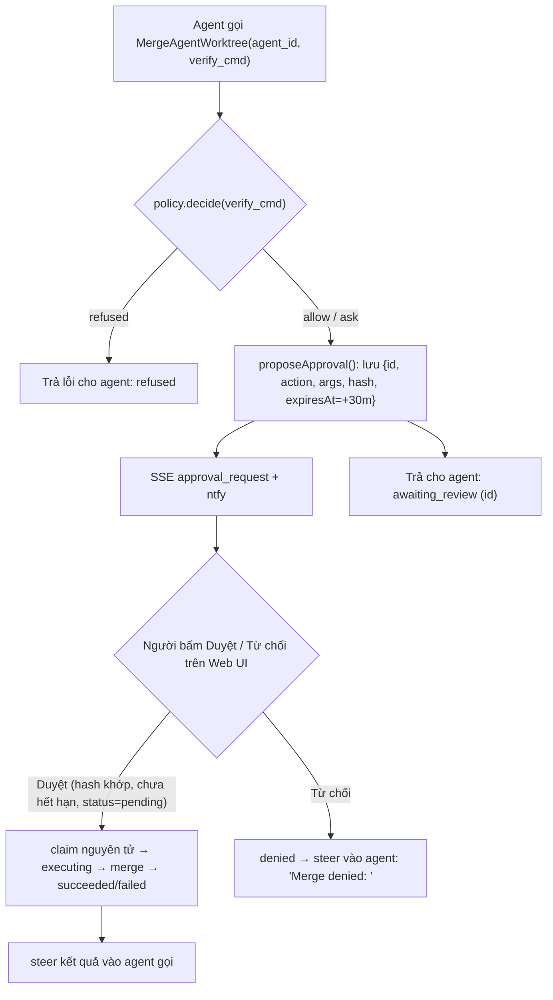

# SPEC-SAFE (Spec 08) — Mesh Safety, Approval Gate, Experience Library & Attention UI

| Thuộc tính | Giá trị |
|---|---|
| ID | `SPEC-SAFE` |
| Trạng thái | `Done` (`As-built` — triển khai xong 2026-10-20, 38/38 tests pass) |
| Giai đoạn | 1 |
| Phụ thuộc (`Depends on`) | `SPEC-UI`, `SPEC-MESH`, `SPEC-VERIFY`, `SPEC-H2` |
| Quyết định liên quan | `D-04`, `D-06`, `D-08`, `D-09` |
| Module triển khai | `src/core/agent-mesh.js`, `src/core/worktree-manager.js`, `src/core/orchestrator.js`, `src/core/supervisor.js`, `src/core/harness2-engine.js`, `src/core/types.js`, `src/daemon/web-ui.js`, `src/ui/dashboard-html.js`, `cloud-core/worker.js` |
| Nguồn nghiên cứu | `reason-machines/reason-network` · `stablyai/orca` · `google-research/harness2` · `CopilotKit/openmuse` |

## 0. Hiện trạng code & Các lỗi đã khắc phục

| # | Phát hiện trước khi sửa | Vị trí | Trạng thái |
|---|---|---|---|
| F1 | **SSE luôn bị 401**: dashboard gọi `/api/events?k=…`, server chỉ nhận `?token=` | `dashboard-html.js` vs `web-ui.js` | ✅ Đã sửa (`A0`) |
| F2 | **Merge xoá việc chưa commit của người dùng**: chạy `git checkout -- f` + `git clean -f -- f` trên repo chính và `reset --hard HEAD~1` khi fail | `worktree-manager.js` | ✅ Đã sửa (`A1` — `MAIN_DIRTY_COLLISION` + `reset --keep`) |
| F3 | **Auto-pass**: goal không có `acceptance_cmd` → `{ ok: true }` → báo `COMPLETED` dù chưa kiểm chứng | `orchestrator.js`, `supervisor.js` | ✅ Đã sửa (`A2` — `COMPLETED_UNVERIFIED`) |
| F4 | **Loop guard không bao giờ quên**: đếm trọn đời process làm chặn nhầm lệnh hợp lệ lặp qua nhiều phiên | `agent-mesh.js` | ✅ Đã sửa (`B2` — cửa sổ trượt 10 phút) |
| F5 | **Prompt injection giữa agent**: tin peer nối thẳng không đóng khung, không giới hạn kích thước | `agent-mesh.js` | ✅ Đã sửa (`B1` — `framePeerMessage`) |
| F6 | **Agent tự merge vào main với lệnh shell tuỳ ý**: không qua `policy.decide()` và không hỏi người dùng | `agent-mesh.js` | ✅ Đã sửa (`C1–C3` — Approval Gate) |
| F7 | `Harness2Engine` chưa được nối vào vòng lặp runtime | `harness2-engine.js`, `orchestrator.js` | ✅ Đã sửa (`D1–D2`) |
| F8 | Dashboard giật scroll khi đọc tin cũ, thiếu phân nhóm cần chú ý và thiếu xem diff trước khi merge | `dashboard-html.js` | ✅ Đã sửa (`C4`, `E1–E5`) |

---

## 1. Mục tiêu & Phạm vi

- **Trong phạm vi:**
  - Khắc phục 3 lỗi nền tảng (`F1` SSE auth `?k=`, `F2` bảo vệ dữ liệu chưa commit khi merge worktree, `F3` chặn auto-pass bằng `COMPLETED_UNVERIFIED`).
  - Bảo vệ liên lạc đa agent (`framePeerMessage`, cửa sổ trượt 10 phút, trạng thái giao tin trung thực `interrupted` / `queued_busy` / `queued_idle`).
  - Cổng duyệt `Approval Gate` gắn mã băm `sha256(action+args)` cho `MergeAgentWorktree` và modal xem `git diff` + gửi nhận xét theo dòng trước khi merge.
  - Nối `Harness2Engine` Experience Library vào `GoalOrchestrator` và `AgentMesh`.
  - Nâng cấp giao diện Attention UI (4 nhóm `attention / working / done / idle`, thông báo trình duyệt có cooldown 5s, cuộn thông minh, chip tool call thu gọn, `Ctrl+K` Command Palette).
- **Ngoài phạm vi (YAGNI):**
  - Mạng P2P `iroh`, chữ ký số roster (`reason-network`).
  - Chu trình `Propose–Probe–Compose` đầy đủ (`harness2`).
  - Windows Toast qua WinRT native (đã có Web Notification + `ntfy` + Telegram).

---

## Phần A — Sửa lỗi nền tảng

### A0. SSE auth (`F1`)
- `web-ui.js` `_isAuthorized`: nhận cả `k` và `token` (cùng header `Authorization`); so sánh bằng `crypto.timingSafeEqual` (độ dài khác → `false`).

### A1. Merge an toàn, không mất dữ liệu (`F2`)
`worktree-manager.js#merge`:
1. Tính `changedFiles`, kiểm tra `git status --porcelain -- <changedFiles>` trên repo chính; **nếu có bất kỳ dòng nào** → trả `{ success: false, reason: 'MAIN_DIRTY_COLLISION', files }` và **không đụng vào file của người dùng**.
2. Revert sau khi verify trên main fail: dùng `git reset --keep HEAD~1` thay cho `reset --hard HEAD~1`.

### A2. Bỏ auto-pass (`F3`)
- `_verifyAcceptance` (`orchestrator.js`) và `supervisor.js`: thiếu `acceptance_cmd` → `{ ok: true, verified: false }` → kết thúc ở trạng thái `COMPLETED_UNVERIFIED`.
- `cloud-core/worker.js`: hiển thị pill màu vàng (`warn`) cho `COMPLETED_UNVERIFIED` và chấp nhận trạng thái này từ daemon.

---

## Phần B — An toàn Mesh (từ `reason-network`)

### B1. Đóng khung tin peer + defang + giới hạn kích thước (`F5`)
```js
export function framePeerMessage({ fromId, id, kind = 'message', body }) // → string
```
- Cắt `body` ở `64 KB` (thêm `…[truncated]`).
- Defang: biến `<peer-message` / `</peer-message` trong body thành `‹peer-message` / `‹/peer-message` và tiền tố `> ` cho mọi dòng body để vô hiệu hoá các heading giả (`# CURRENT DIRECTIVE`, `# URGENT STEERING`).
- `fromId === 'commander'` (người dùng) **không** bị bọc.

### B2. Chặn vòng lặp theo cửa sổ trượt (`F4`)
- Lưu mảng `{ t, h }` theo từng cặp `"from->to"`, lọc bỏ mục cũ hơn `10 phút` (`600000 ms`).
- Chặn nếu có `>= 12` tin nhắn trong 10 phút hoặc `>= 3` tin có cùng mã băm `h` trong 10 phút.
- Miễn trừ cho `commander` và `telegram`.
- `// ceiling: in-memory, mất khi restart; đủ cho 1 tiến trình daemon. Nâng cấp: lưu vào mesh-state.json nếu cần.`

### B3. Trả trạng thái giao tin thật (`F9`)
Khi `wait: false`: trả `status: 'interrupted'` (khi ngắt agent đang chạy), `'queued_busy'` (khi target đang chạy), hoặc `'queued_idle'` (khi target đang rảnh).

---

## Phần C — Approval Gate & Xem Diff trước khi Merge



---

## Phần D — Experience Library thật (từ `harness2`)

### D0. Đính chính Spec 04
| Spec 04 nói | Thực tế mã nguồn `harness2` |
|---|---|
| Probe chạy trên 2 git worktree | Probe là thư mục staged riêng, không dùng git (`core/recursion.py:368-543`) — worktree là thiết kế riêng của BotAutoTask |
| Thư viện đồng bộ Cloud D1 | Chỉ lưu đĩa cục bộ (`core/library.py:15-19`) |
| Layout `.botautotask/library/<domain>/<name>.md` | `<root>/<run-tag>/<mode>/<domain>/INDEX.md` + `harnesses/<task>/{harness/, EXPERIENCE.md}` |
| Compose = Domain qua test của Invariant | Compose là phiên LLM gộp cây; chọn bằng selection mù (`core/selection.py:268`) |

### D1 & D2. Sửa `harness2-engine.js` và nối vào Runtime
- `validatePath` tách theo cả `/` và `\`, chặn `a/../../x`.
- Khi `GoalOrchestrator` đạt `COMPLETED` (hoặc `AgentMesh` merge thành công có `verify_cmd`), tự động gọi `saveExperience()`. Trước khi chạy Goal/Turn, nạp `loadExperiences()` vào khối `## PROVEN EXPERIENCE` của prompt.
- `// ceiling: lesson lấy từ summary bước cuối, không gọi thêm LLM chưng cất. Nâng cấp: dùng 1 lời gọi model nhẹ trích xuất cue/lesson/evidence.`

---

## Phần E — Attention UI (`src/ui/dashboard-html.js`)

- **E1. Roster theo mức cần chú ý:** `attention` (có approval `pending` hoặc `error`) > `working` (`running`) > `done` (`finishedAtMs > lastSeen[id]`) > `idle`.
- **E2. Thông báo trình duyệt + badge tiêu đề:** Cooldown `5 giây` theo khoá `agentId+status`; cập nhật `document.title = '(N) BotAutoTask'`.
- **E3. Cuộn thông minh:** Chỉ tự cuộn xuống đáy khi người dùng đang đứng cách đáy `< 80px`; ngược lại hiện nút nổi `↓ N tin mới`.
- **E4. Tool call dạng chip thu gọn:** Chuyển `[Tool <Name> -> {...}]` thành `<details class="tool-chip">`.
- **E5. `Ctrl+K` Command Palette:** Hộp thoại `role="dialog"`, `aria-modal="true"`, lọc nhanh agent và lệnh điều khiển bằng bàn phím (`↑`/`↓`/`Enter`/`Esc`, `Alt+1..9`).

---

## 6. Kế thừa Pack & Yêu cầu chuẩn EARS (`SAFE-Rnn`)

### 6.1 Kế thừa từ Pack (`PK-API`, `PK-AUTH`, `PK-FE`, `PK-AGENT`)

| REQ dự án | Kế thừa từ Pack | Tham số / Giá trị áp dụng tại BotAutoTask |
|---|---|---|
| `SAFE-R01` | `PK-AUTH-R02` | So sánh `?k=` / `?token=` / `Authorization` bằng `crypto.timingSafeEqual` |
| `SAFE-R04` | `PK-AGENT-R04` | Đóng khung `<peer-message>` và cắt ở `64 KB` để chống Prompt Injection chéo |
| `SAFE-R06` | `PK-AGENT-R01`, `PK-AUTH-R05` | Kiểm tra `verify_cmd` qua `policy.decide()`; gắn `hash = sha256(action+args)` và hạn `30 phút` cho yêu cầu duyệt merge |
| `SAFE-R08` | `PK-FE-R01`, `PK-FE-R03` | Phân nhóm Attention Roster, hộp thoại `Ctrl+K` và Diff Modal tuân thủ điều khiển bàn phím và `aria-modal` |

### 6.2 Bảng Yêu cầu (EARS)

| ID | Mức | Yêu cầu (EARS) | Bằng chứng (`As-built`) |
|---|---|---|---|
| `SAFE-R01` | MUST | Khi client kết nối `GET /api/events?k=<token>`, `LocalWebUiServer` MUST chấp nhận tham số `k` tương đương `token` và so sánh constant-time bằng `crypto.timingSafeEqual`. | `src/daemon/web-ui.js:48-75`, `tests/web-ui.test.js` |
| `SAFE-R02` | MUST | Trước khi `WorktreeManager.merge()` gộp nhánh của agent vào nhánh chính, hệ thống MUST kiểm tra `git status --porcelain` trên các file bị thay đổi; nếu nhánh chính đang có thay đổi chưa commit trên bất kỳ file trùng nào thì MUST dừng ngay, trả về `{ success: false, reason: 'MAIN_DIRTY_COLLISION', files }` và giữ nguyên file của người dùng. | `src/core/worktree-manager.js:237-265`, `tests/worktree-manager.test.js` |
| `SAFE-R03` | MUST | Khi một Goal hoàn tất bước cuối với `GOAL_COMPLETED` nhưng không có `acceptance_cmd`, cả `GoalOrchestrator` lẫn `SupervisorLoop` MUST trả về trạng thái `COMPLETED_UNVERIFIED` thay vì `COMPLETED`. | `src/core/orchestrator.js:40-55, 150-165`, `src/core/supervisor.js:187-201`, `tests/orchestrator-failover.test.js`, `tests/supervisor-and-logs.test.js` |
| `SAFE-R04` | MUST | Mọi tin nhắn từ một agent gửi tới agent khác qua `framePeerMessage()` MUST được giới hạn ở `64 KB`, đóng khung trong `<peer-message>` và trích dẫn `> ` mọi dòng để vô hiệu hoá thẻ đóng giả và tiêu đề điều khiển giả. | `src/core/agent-mesh.js:45-95`, `tests/agent-mesh-v2.test.js` |
| `SAFE-R05` | MUST | Bộ chặn lặp (`Loop Guard`) trong `AgentMesh` MUST hoạt động theo cửa sổ trượt `10 phút` (tối đa `12` tin mỗi cặp hoặc `3` tin trùng hash) và MUST miễn trừ cho người dùng (`commander`, `telegram`). | `src/core/agent-mesh.js:574-605`, `tests/agent-mesh-v2.test.js` |
| `SAFE-R06` | MUST | Khi một agent (`callerAgentId !== 'commander'`) gọi `MergeAgentWorktree`, hệ thống MUST kiểm tra `verify_cmd` qua `policy.decide()` (từ chối ngay nếu `refused`), tạo bản ghi `pending` kèm `hash = sha256(action+args)` và thời hạn `30 phút`, và chỉ thực thi merge đúng `1` lần khi người dùng bấm duyệt với `hash` khớp. | `src/core/agent-mesh.js:345-410, 1055-1075`, `tests/agent-mesh-and-auth.test.js` |
| `SAFE-R07` | MUST | Khi gọi `GET /api/agents/:id/diff`, hệ thống MUST trả về nội dung `git diff HEAD...<branch>` của worktree agent đó (giới hạn `maxBytes = 200000` kèm cờ `truncated`) để người dùng xem trước khi duyệt merge. | `src/core/worktree-manager.js:195-235`, `src/daemon/web-ui.js:225-245`, `tests/web-ui.test.js` |

## 7. Yêu cầu phi chức năng (NFR)

| Khía cạnh | Yêu cầu (số liệu) hoặc `N/A — lý do` |
|---|---|
| Hiệu năng | `framePeerMessage()` và kiểm tra cửa sổ trượt Loop Guard chạy `< 1 ms`; `diff()` giới hạn `200 KB` để không làm đơ trình duyệt khi render diff lớn. |
| Bảo mật | Chống mất dữ liệu người dùng (`MAIN_DIRTY_COLLISION`); chống TOCTOU khi duyệt merge bằng `hash` SHA-256; chống chạy lệnh cấm trong `verify_cmd`. |
| Giới hạn / rate limit | Tin peer `≤ 64 KB`; diff preview `≤ 200 KB`; thời hạn approval `30 phút`; cooldown thông báo trình duyệt `5 giây`. |
| Khả dụng / khôi phục | Các bản ghi `approvals` được lưu trong `mesh-state.json` qua `atomic-write.js`; khi khởi động lại, các mục quá hạn tự động chuyển sang `expired`. |
| Quan sát (log, metric, audit) | Hiển thị rõ số lượng agent cần chú ý (`attention`) trên tiêu đề tab trình duyệt `(N) BotAutoTask` và thanh sidebar. |
| i18n | Giao diện, thẻ duyệt merge và thông báo hỗ trợ tiếng Việt có dấu đầy đủ. |
| a11y | Hộp thoại `Ctrl+K` và Diff Review Modal có `role="dialog"`, `aria-modal="true"`, điều khiển trọn vẹn bằng bàn phím (`PK-FE-R03`). |
| Trạng thái UI | Thẻ Approval hiển thị rõ trạng thái `pending`, `executing`, `succeeded`, `failed`, `denied`, `expired` và khoá nút sau khi bấm (`PK-FE-R04`). |

## 8. Trường hợp biên (Edge Cases)

- Người dùng sửa file `a.txt` trên nhánh `main` (chưa commit) trùng với file `coder` vừa sửa trong worktree → `merge()` trả `MAIN_DIRTY_COLLISION` và nội dung `a.txt` của người dùng được giữ nguyên 100% (`SAFE-AC01`).
- Agent `coder` gọi `MergeAgentWorktree` với `verify_cmd: "rm -rf /"` → `policy.decide()` chặn ngay (`status: 'refused'`), không tạo bản ghi chờ duyệt (`SAFE-AC03`).
- Người dùng bấm nút **Duyệt** 2 lần liên tiếp trên cùng một thẻ approval → lần 1 thực thi merge (`succeeded`), lần 2 trả `already_decided`, không chạy merge lần hai (`SAFE-AC03`).
- `commander` (người dùng trên UI/CLI) chủ động bấm nút Merge trực tiếp → bỏ qua cổng tạo approval chờ và thực thi merge ngay (`SAFE-AC03`).

## 9. Điều kiện nghiệm thu (`AC`)

- [x] **SAFE-AC01** *(integration)* — **Cho** một repo Git có file `a.txt` đang sửa dở (chưa commit) trên nhánh chính và agent `coder` cũng sửa `a.txt` trong worktree, **khi** gọi `WorktreeManager.merge('coder')`, **thì** hàm trả về `{ success: false, reason: 'MAIN_DIRTY_COLLISION', files: ['a.txt'] }` và nội dung file `a.txt` trên nhánh chính không bị mất. *(Test: `tests/worktree-manager.test.js`)*
- [x] **SAFE-AC02** *(integration)* — **Cho** `GoalOrchestrator` và `SupervisorLoop` chạy một Goal không có `acceptance_cmd` so với có `acceptance_cmd` pass, **khi** model trả `GOAL_COMPLETED`, **thì** trường hợp thiếu check trả `COMPLETED_UNVERIFIED` (không lưu Experience Library) còn trường hợp có check pass trả `COMPLETED` (và lưu Experience Library). *(Test: `tests/orchestrator-failover.test.js`, `tests/supervisor-and-logs.test.js`)*
- [x] **SAFE-AC03** *(integration)* — **Cho** agent `coder` gọi `MergeAgentWorktree`, **khi** kiểm tra các trường hợp: (1) `verify_cmd` là `rm -rf /`, (2) lệnh hợp lệ tạo `awaiting_review`, (3) duyệt sai `hash`, (4) duyệt đúng `hash`, (5) duyệt lại lần 2, và (6) `commander` gọi trực tiếp, **thì** tất cả đều xử lý đúng theo thiết kế C1–C3. *(Test: `tests/agent-mesh-and-auth.test.js`)*
- [x] **SAFE-AC04** *(unit/integration)* — **Cho** `framePeerMessage()` và `AgentMesh` Loop Guard cửa sổ trượt 10 phút, **khi** chèn thẻ đóng/heading giả hoặc gửi 12 tin trong 10 phút rồi gửi tiếp ở phút thứ 11, **thì** tin độc hại bị quote an toàn, tin thứ 13 trong 10 phút bị chặn và tin ở phút thứ 11 đi qua bình thường. *(Test: `tests/agent-mesh-v2.test.js`)*
- [x] **SAFE-AC05** *(integration)* — **Cho** `LocalWebUiServer` đang chạy kèm `AgentMesh`, **khi** kết nối `GET /api/events?k=<token>`, gọi `GET /api/agents/coder/diff`, `POST /api/approvals/:id/decide` và `GET /api/experience`, **thì** tất cả trả HTTP `200` với đúng dữ liệu SSE frame, diff preview, kết quả quyết định approval và danh sách kinh nghiệm. *(Test: `tests/web-ui.test.js`)*

## 10. Kiểm tra end-to-end

```powershell
npm test
```

## 11. Làm rõ & Câu hỏi mở

- **Làm rõ (2026-10-20):** Toàn bộ 10 hạng mục của Spec 08 (`A0–A2`, `B1–B3`, `C1–C4`, `D1–D2`, `E1–E5`) đã được triển khai, đóng gói vào `dist/botautotask.mjs` và kiểm chứng với `38/38` bài test xanh.
- **Câu hỏi mở:** Không có.
