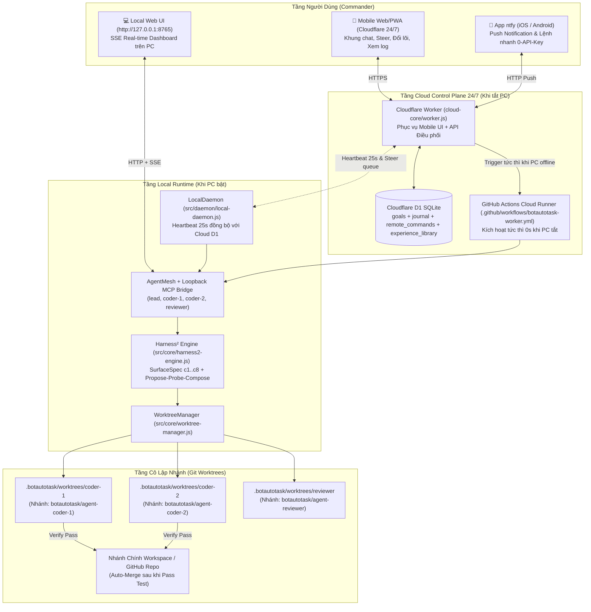

# BotAutoTask v2.0 — Feature Specifications & Architectural Blueprint

Thư mục này tài liệu hoá toàn bộ các nghiên cứu, đặc tả kỹ thuật và kế hoạch kiến trúc cho các tính năng trọng điểm của **BotAutoTask v2.0**, bao gồm Giao diện Điều khiển Trực quan Web/Mobile, Điều khiển Độc lập 100% từ Điện thoại qua Cloudflare D1 24/7, Cơ chế Song song hoá Git Worktree, và Sự tích hợp hệ thống đệ quy tự tiến hoá từ **Google Research Harness²** (`google-research/harness2`).

---

## Danh Mục Tính Năng

```
docs/feature/
├── README.md                      # Tổng quan kiến trúc v2.0 & sơ đồ kết nối hệ thống
├── 01-web-mobile-ui.md            # Giao diện Điều khiển Trực quan (Local & Mobile Web/PWA)
├── 02-mobile-cloud-control.md     # Điều khiển Độc lập 100% từ Điện thoại & Cloud D1 24/7
├── 03-git-worktree-parallel.md    # Song song hoá Git Worktree per Agent & Auto-Merge
└── 04-harness2-integration.md     # Tích hợp Google Research Harness² (c1..c8 & Propose-Probe-Compose)
```

---

## Kiến Trúc Tổng Thể v2.0



---

## 4 Trụ Cột Phát Triển

1. **[01-web-mobile-ui.md](01-web-mobile-ui.md):**
   - Thiết kế Single-Page Dashboard Dark UI (Zero External Dependencies) dùng chung cho cả Local Server (`127.0.0.1:8765`) và Cloudflare Worker 24/7.
   - Luồng sự kiện Server-Sent Events (SSE) stream trực tiếp cuộc hội thoại giữa `lead`, `coder-1`, `coder-2`, `reviewer`.
   - Nút bấm **⚡ Priority Steer**, dropdown đổi lõi **Claude / Codex / OpenCode / Antigravity**, và tail log thời gian thực.

2. **[02-mobile-cloud-control.md](02-mobile-cloud-control.md):**
   - Vận hành 100% từ điện thoại ngay cả khi **máy tính ở nhà tắt hoàn toàn**.
   - Cloudflare D1 lưu trữ trạng thái hàng đợi lệnh từ xa (`remote_commands`) và kích hoạt GitHub Actions tức thì (0 giây chờ).
   - Kênh thông báo đẩy & nhận lệnh di động 2 chiều qua **`ntfy.sh`** (miễn phí, không cần đăng ký tài khoản hay tạo Bot) kết hợp tuỳ chọn Telegram/Discord.

3. **[03-git-worktree-parallel.md](03-git-worktree-parallel.md):**
   - Module `WorktreeManager` tạo môi trường file độc lập tại `.botautotask/worktrees/<agentId>` cho mỗi Agent.
   - Công cụ MCP `DelegateParallel` kích hoạt nhiều Agent chạy song song (`Promise.all`) không xung đột git commit.
   - Công cụ MCP `MergeAgentWorktree` tự động chạy bộ test `--check`, nếu pass thì merge sạch về nhánh chính, nếu conflict thì trả diff về cho Agent xử lý.

4. **[04-harness2-integration.md](04-harness2-integration.md):**
   - Hiện thực hoá các nguyên lý từ nghiên cứu `google-research/harness2` (*Harness²: Recursive Agent Harnessing for an Open World*).
   - Cây 8 thành phần $c_1 \dots c_8$ (`SurfaceSpec`) trên substrate OpenCode và Codex.
   - Chu trình đệ quy `Propose – Probe – Compose` phân tách kiểm chứng tổng quát (Invariant) và lời giải chuyên môn (Domain).
   - Thư viện kinh nghiệm tích luỹ `Experience Library R` ({cue, lesson, evidence}) giúp Agent tự thông minh hơn sau mỗi task.
