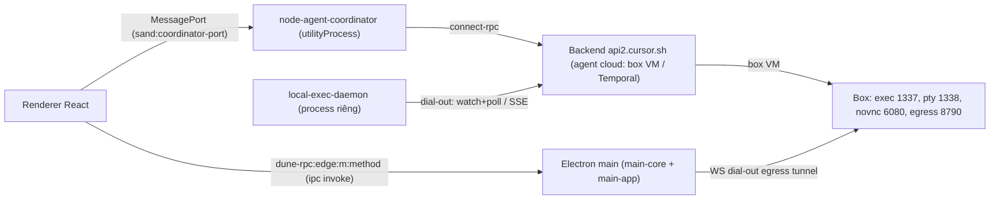

# Grok Bot 0.71.2 — Phân tích ngược tính năng (cho BotAutoTask)

> Phương pháp: chỉ phân tích tĩnh. Chưa chạy app, không sửa file cài đặt, không đọc token.
> - `app.asar` (sha256 `68a8c906…b955`) được giải nén chỉ-đọc vào `…\a4b8178b…\scratch\grokbot\` bằng script Node built-in (`extract-asar.js`). Các file `.unpacked` bị bỏ qua.
> - Bằng chứng ghi theo dạng `file:dòng@offset-ký-tự`. Bundle đã minify, mỗi file chỉ vài dòng rất dài nên offset là thứ định vị chính xác. Gốc `D = scratch\grokbot\dist`.
> - **[V]** = đã đọc thấy trong code. **[I]** = suy luận từ tên/ngữ cảnh. **[N]** = tìm có giới hạn mà không thấy (không chứng minh là không tồn tại).
> - Evidence REA: fuses `ev_04c76a50…` (RunAsNode off, NodeOptions off, `--inspect` off, ASAR integrity on, OnlyLoadAppFromAsar on), JS graph `ev_51c3a17f…` (summary `ev_c41515d7…`).

## 0. Kiến trúc tổng thể (quan trọng nhất)

Grok Bot là một app của Cursor/anysphere: `package.json` có `name:"sand"`, author SpaceXAI, ~45 package `@anysphere/*`. Đây là **client mỏng**: **agent chạy trên cloud**, còn desktop chỉ làm 4 việc: UI, cung cấp tool trên máy local, làm relay mạng, và giữ phiên đăng nhập.

- [V] Có 2 kiểu đặt agent:
  - `"box"`: VM trên cloud, có cổng 1337/1338/6080/8790…, xem `main-app.cjs:213@1899700`.
  - `"temporal"`: chạy bằng Temporal workflow. Hằng `$E="box",HE="temporal"` ở `node-agent-coordinator/main.cjs:38@~103000`.
- [V] Phản hồi gửi tin có các giá trị `ACCEPTED_BOX`, `ACCEPTED_TEMPORAL`, `DUPLICATE`, `REFUSED` (`main-app.cjs:577@~2296500`, hàm `$et`).
- **Hệ quả:** các tool CreateAgent/SendToAgent/… chạy **phía server**. Client chỉ giữ enum tên tool và schema proto.

---

## 1. Multi-agent / Subagent

| Hạng mục | Cơ chế trong Grok Bot | Bằng chứng | Mức |
|---|---|---|---|
| Danh sách tool | Enum ~120 tool. Nhóm multi-agent: `CreateAgent, SendToAgent, CheckSubagent, MessageSubagent, StopSubagent, WakeParent, ReadAgentActivity, CloudAgent, ListMachines, UpdateAgent, CreateTask`. Mảng `rgt=[Computer,Read,Screenshot,Shell,Skill]` có lẽ là nhóm tool chạy trên máy local. | `electron-main/main-core.cjs:20@266957–270400` | V (vai trò của `rgt` là I) |
| Nơi thực thi | Renderer không có code xử lý các tool đó; tên tool chỉ xuất hiện trong enum. Agent loop chạy trên server. | Đếm chuỗi `MessageSubagent`/`WakeParent`: chỉ có trong main-core/daemon enum | V (bằng phép đếm) / I |
| Tham số CreateAgent | `CreateAgentArgs{prompt,name?,model?,base_branch?,machine_type?,worker_id?,pool?,labels,environment_id?,repo_url?,tracked_task_keys,fork_from?,fork_turns?}`. Kết quả `{agent_id,message}` hoặc `{error, placement_approval_state}`. | `electron-main/proto.cjs` (chuỗi `"CreateAgentArgs|…"`) | V |
| Tham số SendToAgent | `SendToAgentArgs{agent_id,message,delivery,title,model?,tracked_task_keys}`. Kết quả `{worker_bc_id,delivered_as,recipient{kind,id,display_name}}`. | `proto.cjs` | V |
| Subagent cục bộ (agent-exec) | `SubagentArgs{subagent_type,model_id,prompt,readonly,resume_agent_id?,run_in_background?,interrupt?,fork_agent_id?,parent_conversation_id,root_parent_conversation_id,direct_meta_parent_child_subagent?,environment(LOCAL/CLOUD),cloud_base_branch?}` | `proto.cjs`; `local-exec-daemon/main.cjs:629` | V |
| Await / background | `SubagentAwaitArgs{agent_id,timeout_ms}` trả về `complete{transcript_path,tool_call_count,final_message}`, `still_running`, `not_found` hoặc `error`. `ForceBackgroundSubagentArgs{tool_call_id}` đẩy subagent đang chạy xuống nền. Lý do chạy nền: `AGENT_REQUEST`, `USER_REQUEST`, `QUEUED_FOLLOW_UP`. | `proto.cjs:3@140899` (enum `SubagentBackgroundReason`) | V |
| Kiến trúc executor | Mỗi tool là một executor có tên, gồm các cặp `subagent-executor`/`subagent-await-executor`/`force-background-subagent-executor`. Có các executor kiểm tra trước: `shell-allowlist-precheck`, `mcp-allowlist-precheck`, `web-fetch-allowlist-precheck`, `smart-mode-classifier`. | `local-exec-daemon/main.cjs:634@2257042`, `@2275518` | V |
| Hook vòng đời | `SubagentStartRequestQuery{subagent_id,type,task,parent_conversation_id,is_parallel_worker,git_branch,model…}`. `SubagentStopRequestQuery{status,duration_ms,summary,message_count,tool_call_count,modified_files[],loop_count,…}`, và **response `{followup_message?, additional_context?}`**: hook có thể bơm thêm follow-up cho cha. | `proto.cjs`, `local-exec-daemon/main.cjs:629@2212070` | V |
| Header định danh agent | `h_e()` đặt các header `x-parent-request-id`, `x-root-parent-request-id`, `x-parent-agent-tool-call-id` và `x-direct-meta-parent-child-subagent:true`. Giá trị được loại bỏ `\r\n` (chống header injection). | `electron-main/main-app.cjs:8@265909` | V |
| Bridge MCP loopback "routed" / secret path | **Không thấy** trong client. HTTP server local duy nhất là dev-control `127.0.0.1` (chỉ bật khi `SAND_DEV_CAPABILITY=1`), OAuth loopback và feed update của Squirrel. | grep `createServer`: `main-app.cjs:561@2084129` | N |
| Giới hạn song song | Feature flag `local_subagent_limits:{maxRunning:32}`. Schema có trong client, nhưng code dùng flag này không có trong bundle Grok Bot (là code dùng chung với Cursor). | `main-app.cjs:91@1208931`, `@1248268` | V (khai báo) / I (nơi dùng) |
| Giới hạn độ sâu đệ quy | Không có hằng depth nào. Thay vào đó có lineage `root_parent_conversation_id` và `CloudSubagentParentReference{parent_agent_id,parent_tool_call_id,parent_spawn_kind,…}` để server tự thi hành. | `proto.cjs` | N / I |
| Steer / interrupt / queue | Enum `SimulatedMsgReason` có `USER_SENT_TO_SUBAGENT(9)`, `USER_INTERRUPTED_SUBAGENT(10)`, `USER_QUEUED_TO_SUBAGENT(11)`, tức 3 kiểu giao tin cho subagent: gửi ngay, ngắt rồi gửi, xếp hàng. `SubagentArgs.interrupt`. Nút Stop gọi `interruptAgentRun` (chi tiết ở §2). UI chat văn bản không có chế độ "steer" riêng. | `proto.cjs:3@493011`; `renderer/assets/chunk-view-CpiWcrx9.js:2@30960` | V |
| Trạng thái sống của agent | `GrokBotAgentLiveStatus{isRunning,isComposingMessage,isRetrying,activity,awaiting,updated_at_ms,stale_after_ms,has_running_subagents,surface_task_id}`. Coordinator đặt **stale timer**: không có cập nhật trong `staleAfterMs` (mặc định `K0=9e4`, tức 90 giây) thì reset về idle. Có ingest theo snapshot và theo delta. | `node-agent-coordinator/main.cjs:38@108338–111800` (hàm `_v`, `X0`) | V |
| Kênh đăng ký (subscription keys) | `roster`, `transcript:<agentId>[\0<sessionId>]`, `group:<id>`, `task:<id>:<parentSession>`. Tiền tố id subagent: `sand-subagent-`. | `node-agent-coordinator/main.cjs:38@~103000` | V |
| Lưu trạng thái | Phần lớn nằm phía server: agent store, sync có tombstone (`ListAgentStoreDirectory…{tombstone_mode,watermark,if_version_equal}`), `/cursor/stores/user/canvases`. Local chỉ có `%APPDATA%\Grok Bot\sand-client-persistence\<base32>.blob`, `desktop-status.json` và `.grokbot/settings.json`. | `proto.cjs`; liệt kê thư mục | V |
| Git worktree / sandbox | **Không** có cơ chế tạo worktree cho từng subagent trong client. Chỉ có guard: không cho search sang `.cursor/worktrees` khác (`"You cannot search other worktrees…"`). Sandbox shell: policy `insecure_none / workspace_readonly / workspace_readwrite`, merge theo thứ tự `teamAdmin ?? perRepo ?? perUser ?? insecure_none`. Danh sách path cấm ghi `Mg`: `.git/hooks`, `.git/config`, `.cursor/**/mcp.json`, `permissions.json`, `.vscode`, `.claude/*.json`, cert hệ thống… | `local-exec-daemon/main.cjs:22@938021`, `58@1163105–1171500`, `603@1221203` | V |

---

## 2. UI điều khiển và luồng sự kiện

| Hạng mục | Cơ chế | Bằng chứng | Mức |
|---|---|---|---|
| Topology | Main `utilityProcess.fork(node-agent-coordinator)` rồi tạo `MessageChannelMain`. Renderer gọi `invoke("sand:coordinator-port-request")` và nhận port qua `"sand:coordinator-port"`. Preload expose `window.coordinatorPort.claim({onPort})`. Main có thể đưa lại port khi reconnect (`adoptPort`/`revoke`). | `main-app.cjs:569@2195549`, `557@2044486`, `557@2004437`; `electron-preload/preload.cjs:31@107879` | V |
| Giao thức qua port | Bắt tay `{kind:"lifecycle",phase:"hello"/"ready",protocolVersion}`, lệch version thì `shutdown(protocol-error)`. Yêu cầu `{kind:"request",requestId:"r-n",method,args}`, trả lời `{kind:"reply",requestId,outcome}`. **`{kind:"cancel",requestId}`** gửi khi AbortSignal kích hoạt. Sự kiện đẩy `{kind:"event",family,payload}`. Hàng đợi trước khi có port tối đa 256 (`O3e`). Mỗi method có bảng kiểu reply `record / record-or-null / void`. | `renderer/assets/index.eager-app-*.js:156@1720200–1722700`, `3@284563` | V |
| Các family sự kiện | `agents, agent-upserted, agent-activity, transcript, outline, subagents, async-tasks, cloud-agent-update, server-turn-failed, mcp-servers-updated, server-roster-changed, focus-agent, host-settings…` | `index.eager-app:156@1693000–1697500` | V |
| IPC phía desktop ("edges") | `dune-rpc:<edge>:m:<method>`, `dune-rpc:<edge>:e:<event>`, `dune-rpc:<edge>:probe`. Kết quả `{ok,value}` hoặc `{ok:false,failure:{code,detail}}`. contextBridge expose: `desktop{main,boot,environment,local}`, `coordinatorPort`, `sandRenderTrace`, `desktopMount`. | `preload.cjs:2@9670`, `2@86278`, `31@107694` | V |
| Nhóm method của coordinator | `transcript`, `send`, `widgets`, `approvals`, `roster` (gồm `createAgent, createGroup, setGroupMembers, kickstartAgent, interruptAgentRun, startFreshConversation, rollBackConversation`), `subagents` (`getSubagents, getAsyncTasks`), `cloud_agents` (`stopCloudAgent`), `mcp`, `skills`, `automations` | `index.eager-app:3@291586` | V |
| Interrupt | Nút xác nhận 2 lần (cửa sổ 3 giây). Gọi `interruptAgentRun` cho **từng** `runningSessionIds` bằng `Promise.allSettled`. Backend `InterruptGrokBotAgentRun{agent_id,reason:"user_interrupt",session_id?}` trả về `{had_active_run}`. | `chunk-view-CpiWcrx9.js:2@30960`; `main-app.cjs:577@2297122` | V |
| Gửi tin idempotent | `sendPrompt{agentId,clientNonce,prompt,richText,replyToId,isFork,attachmentPaths,sessionId,machineId,taskId,traceparent,composedAtMs,mcpConfigJson}`. Dùng `clientNonce` làm messageId, server dedupe (`DUPLICATE`). Journal trạng thái `queued → prepared → dispatching → accepted-awaiting-echo`, ack `acked/failed/timeout/queued_offline`. Có `promptAcceptanceStatus` để hỏi lại. | `main-app.cjs:577@~2296500`; `node-agent-coordinator/main.cjs:38@99111` | V |
| Ánh xạ lỗi | ConnectError được đổi sang các loại: `Unavailable/ResourceExhausted → network`, `DeadlineExceeded → timeout`, `Unauthenticated/PermissionDenied → access_denied`, `Internal/Unknown/DataLoss → http_5xx`, `Unimplemented → unimplemented`. | `main-app.cjs:577@~2295000` | V |
| Chọn model | Chat không có model picker; model gắn theo bot phía server. Chỉ có `computerUseModel{modelId,maxMode,parameters}`. Validator chặn tham số cho "routed model" (`routed_model_parameters`). | `node-agent-coordinator/main.cjs:42@698331`; `main-app.cjs:145@1277843` | V |
| Hiển thị tool call / duyệt quyền | Các loại entry transcript: `permission_request, approval_required, local_tool_permission, virtual_card_approval, connector_connect, secret_request, user_form, widget_*, sent_agent_message, received_agent_message`. Quyền tool local có `allow-once` / `always`. Hình dạng tool call: `{id,name,argumentsJson,atMs,result{json,atMs}}`. | `index.eager-app:18@803200`, `18@809299`; `chunk-view-CRQyu5Nm.js:2@15071` | V |
| Nhiều bot | Sidebar roster có pin, section, ẩn, đánh dấu chưa đọc. Một bot có thể có nhiều `runningSessionIds`. Có group room `createGroup({memberAgentIds,humanMemberUserIds})`. | `index.eager-app:156@1460042` | V |

---

## 3. Điều khiển từ xa / mobile

| Setting / tính năng | Cơ chế | Bằng chứng | Mức |
|---|---|---|---|
| `egressTunnelEnabled` (mặc định false) | Mạng nhà người dùng làm cổng ra internet cho box. Desktop **dial-out** WS tới cổng 8790 của box với `Bearer`. Header `x-sand-egress-attach: claim/if-free`, `x-sand-egress-client`, `x-sand-egress-if-match: <gen>`. Mỗi box chỉ một desktop gắn vào (close 4001 = bị thay thế, 409 = đang bận). Frame nhị phân `[kind u8][streamId u32BE]`: OPEN gồm `port u16 + host`, DATA tối đa 1 MiB, CLOSE. **SSRF guard** chặn private / loopback / link-local / CGNAT / multicast / IPv4-mapped. Backoff 2→30s, watchdog 45s, stale 25s. Không qua relay riêng; kết nối thẳng tới URL box. | `main-app.cjs:213@1900879–1906500` (class `XG`) | V |
| `webauthnProxyEnabled` (mặc định true) | Chuyển tiếp passkey từ trình duyệt trong box về authenticator của máy (Windows Hello / Touch ID). Path trong box `/run/sand-webauthn-proxy/credential`. Trang ceremony `/grok-bot/passkey/#token=…&challenge_id=…` hết hạn sau 5 phút. Có binary native `dist/native/sand-webauthn-signer.exe`. | `main-app.cjs:213@1899883`, `213@1841558`; REA `ev_51c3a17f` | V (luồng relay là I) |
| `messagesEnabled` (mặc định false) | iMessage, chỉ trên macOS. Worker copy `~/Library/Messages/chat.db` rồi mở **read-only** bằng `node:sqlite`. Gate chặn các action `messages` / `send-imessage` khi setting tắt. Có allowlist từng người nhận. Setting lưu cho từng machine phía server (`UpdateSandMachineMessagesEnabled`). | `local-exec-daemon/messages-worker.cjs:3@29767`; `local-exec-daemon/main.cjs:625@1927854`; `main-app.cjs:85@1006263` | V |
| `mcpBoxServers` | Danh sách định danh MCP server chạy **trong box cloud**: `listBoxMcpServers({serverIdentifiers})` + `pushBoxSecrets`. | `main-app.cjs:85@963902`, `593@2599555` | V / I |
| local-exec-daemon (tool từ xa chạy trên PC) | **Hai vòng dial-out, không mở cổng inbound.** (1) connect-rpc `watchGrokBotUserComputerRequests` làm "chuông cửa" (heartbeat kèm `pendingRequestCount`), kết hợp `poll({ackIds,limit:64})` (ack đi kèm lần poll sau, tức at-least-once) và `submit…Responses`, cộng safety poll 30s. (2) SSE `GET /local-exec/requests` + `POST /local-exec/responses` theo lô `{providerId,frames}`. Frame yêu cầu: `Exec`, `Upload`, `Download`, `LocalToolCall{tool_id,input_json,approval_id}`, `MessagesOp`, `Cancel`, `RetireApproval`. File trả về chia chunk. Lý do ngắt kết nối: `stall/silent/unauthorized/network-change`. Khi hello thay đổi (quyền, tool) thì `rehello()`. Backoff 1→60s full jitter. | `local-exec-daemon/main.cjs:758@2897169`, `768@3372906–3396287`, `766@3184800` | V |
| Mobile | Không có QR hay pairing trực tiếp. Machine đăng ký vào tài khoản (`ListSandMachines{machineId,label,connected,messagesEnabled,mobileLocalTools[]}`). Điện thoại điều khiển PC **qua backend cloud** cùng tài khoản; request đi theo kênh watch/poll ở trên. Có feature flag `sand_mobile_version_support`. | `proto.cjs:3@690864`; `main-app.cjs:91` | V (luồng mobile là I) |
| Deep link | `setAsDefaultProtocolClient` + `open-url` / `second-instance`, scheme `grokbot://`. | `main-core.cjs:25@299733` | V |

---

## 4. Đăng nhập không cần API key

| Hạng mục | Cơ chế | Bằng chứng | Mức |
|---|---|---|---|
| Tài khoản | Tài khoản **Cursor** (websiteUrl `https://cursor.com`), không phải X/xAI. | `main-app.cjs:52@~706300` | V |
| Luồng | Kiểu device-code cộng PKCE. verifier = 32 byte ngẫu nhiên, challenge = `base64url(sha256)`. Mở trình duyệt tới `/loginDeepControl?challenge&uuid&mode=login&redirectTarget=sand`, sau đó poll `{backend}/auth/poll?uuid&verifier`: tối đa 150 lần, `delay=min(1s·1.2^n,10s)`, 404 = đang chờ, 3 lỗi liên tiếp thì bỏ. Không dùng loopback hay deep link cho lần login chính. | `main-app.cjs:52@701691`, `@703299`, `@707058` | V |
| Lưu trữ | `userData/sand-secrets.json`, mỗi giá trị `safeStorage.encryptString` (DPAPI trên Windows). Prefix scope `scoped:v1:<sha256(sub)>`. Nếu không có OS encryption thì giữ trong RAM, không ghi plaintext. File chmod 0600. | `main-core.cjs:140@636209`, `136@550803` | V (không đọc nội dung file) |
| Refresh | Refresh khi `exp - now < 5 phút`, gọi `POST /oauth/token` với `grant_type=refresh_token`. **Single-flight** `Map<refreshToken,flight>`, deadline 20s, tạm dừng backoff 5→60s có jitter. `authOperationEpoch` loại bỏ kết quả cũ sau khi logout hoặc đổi account. Khi gặp 401 thì chạy recovery. | `main-core.cjs:136@550803`; `main-app.cjs:52@777837`, `@745131` | V |
| Header inference | `authorization: Bearer`, `x-cursor-team-id`, `x-cursor-checksum` (từ machineId), `x-ghost-mode`, cùng các header lineage. `x-inference-authentication-jwt` là JWT proxy cho workload cloud, bị bỏ qua nếu rỗng hoặc bắt đầu bằng `$`. | `main-app.cjs:8@275193–276062` | V |
| OAuth cho MCP | Đích callback được mã hoá vào hậu tố `state` (`.t` + `gb` / `gw` / `gd<port>` / `xa`). Loopback `localhost:8787` có port dự phòng `[18787,28787,31787]`. Header `x-cursor-mcp-oauth-relayed-loopback`. Đổi token phía backend (`backendOnlyTokenExchange`, client secret không về desktop). Có hỗ trợ Client-ID-Metadata-Document và RFC 7591 DCR. | `main-app.cjs:4@10834`, `145@1346001–1359812` | V |

---

## 5. Auto-update khi idle, computer-use gate, mô hình quyền, tính năng khác

| Hạng mục | Cơ chế | Bằng chứng | Mức |
|---|---|---|---|
| Auto-update khi idle | Kiểm tra mỗi giờ ± 5 phút jitter. Chỉ cài khi **đủ tất cả** điều kiện: setting bật, đã stage bản cập nhật, màn hình khoá, `getSystemIdleTime() >= 600s`, và `probeHostIdle()` (daemon không bận). `stillReady()` được kiểm tra lại sau các probe async. Drain: poll `inflightCount` mỗi 500ms trong một ngân sách thời gian. Có "apply marker" bền vững, blocklist phiên bản hỏng, và xác nhận lại với feed (quá 60s là stale) trước khi relaunch. macOS: Squirrel đọc feed từ server localhost do app tự dựng. Windows: NSIS chạy khi quit. | `main-app.cjs:593@2532670`, `@2533686`, `@2560279`, `@2581998`; `main-core.cjs:136@517329` | V |
| Computer-use gate | `local-computer-use-gate.json {isOn}` do main ghi từ Statsig gate `sand_enable_local_cua`. Daemon đọc theo kiểu **fail-closed**: thiếu hoặc hỏng file thì coi là off. Đây là kill-switch do server điều khiển, không phải setting của người dùng. Máy này đang `false`. | `main-app.cjs:561@2090381`; `local-exec-daemon/main.cjs:625@1926867`, `@3395128` | V |
| Mô hình quyền | Mức `never < ask < always`, hiệu lực = `min(choice, ceiling)`. Nhóm action: **global** (run-command, read/write-file, list-dir…), **setting** (read-messages), **subject** (send-imessage, use-app, mặc định cho action lạ), **call** (run-phone-tool). Hàm thuần `qQ` trả về `allow / ask / refused`. Chế độ `serverAuthoritative`: chỉ chấp nhận approval từ server. Approval id **dùng một lần** (file `local-tool-retirements.json`). Có `local-tool-standing-grants.v1.json` theo accountScope. Với run-command, resource bị ép là `terminalsFolder`. `CustomSubagentPermissionMode`: `DEFAULT / READONLY / AGENT_ONLY`. | `local-exec-daemon/main.cjs:625@1917520`, `@1927273`, `626@1939700–1940900`; `proto.cjs:3@140899` | V |
| Bootstrap / độ bền | V8 code cache (`vm.Script cachedData`, giữ 2 bản mới nhất). Atomic write: khoá FIFO theo path, temp `O_EXCL|O_NOFOLLOW`, rồi `fsync`, rồi `rename`. `invariant()` loại bỏ message khi chạy production. `errorCode()` lần theo chuỗi `.cause`. Khởi động 2 pha `main-core → remainderDue → main-app`. | `electron-main/main.cjs` (toàn file) | V |
| Data root | Marker `.grokbot-data-root-v1` ghi bằng flag `wx`, mode 0600. Danh sách file được phép là cố định. Thư mục là symlink bị coi là unsafe. Kiểm tra PID sống bằng `kill(pid,0)` (EPERM vẫn tính là sống) kèm kiểm tra command line để chống PID bị tái sử dụng. | `main-core.cjs:136@559307` | V |
| Single instance | `requestSingleInstanceLock()`, chỉ khi app đã đóng gói. | `main-core.cjs:165@858947` | V |
| Supervisor / lease | `local-exec-supervisor.json`, `local-exec-update-lease.json` (TTL 15 phút), truyền FD kế thừa qua `SAND_LOCAL_EXEC_INHERITED_FDS` để cập nhật không gián đoạn. | `local-exec-daemon/main.cjs:624@1907006`; `main-core X1` | V / I |

---

## 6. Đề xuất áp dụng cho BotAutoTask (Node built-in, theo thứ tự ưu tiên)

BotAutoTask hiện có `src/core/agent-mesh.js` với 6 tool liên-agent và `maxDepth=3` (`runAgentTurn`, dòng 391). Các đề xuất bám vào code đó:

1. **3 chế độ giao tin cho `SendToAgent`/`MessageSubagent`**: thêm tham số `delivery: "send" | "interrupt" | "queue"`, tương ứng `USER_SENT / INTERRUPTED / QUEUED_TO_SUBAGENT`.
   - `interrupt`: gọi `AbortController.abort()` cho tiến trình CLI đang chạy (dùng sẵn `spawn-cli.js`; kill theo cây SIGTERM, 1s sau SIGKILL như hàm `zs`), rồi gửi tin mới.
   - `queue`: đẩy vào mảng `pendingFollowUps` và tự chạy khi turn hiện tại kết thúc (`QUEUED_FOLLOW_UP`).
2. **Lineage thay cho chỉ dùng depth**: mỗi lời gọi mang `{rootId, parentId, parentToolCallId}`. Giữ `maxDepth`, nhưng chặn thêm theo `rootId` (tổng số agent mỗi root) và `maxRunning` toàn cục (mặc định 32 như Grok, tuỳ chỉnh qua config). Nếu đi qua HTTP loopback thì truyền bằng header `x-parent-request-id`, `x-root-parent-request-id`, `x-parent-agent-tool-call-id` và **lọc bỏ `\r\n`**.
3. **`CheckSubagent` theo mẫu await có timeout**: `{agent_id, timeout_ms}` trả về `complete{final_message, tool_call_count, transcript_path} | still_running{transcript_path} | not_found | error`. Thêm `ForceBackground` để đẩy subagent đang chạy xuống nền.
4. **Live status kèm stale timer**: mỗi agent có `{isRunning, runningSessionIds, currentActivity, updatedAtMs, staleAfterMs=90000}`. Hết hạn mà không có heartbeat thì tự về idle và phát sự kiện `agent-activity`. Áp dụng cho `supervisor.js` / `log-reader.js`.
5. **Hook `SubagentStop` có thể trả follow-up**: khi subagent xong, chạy hook (lệnh shell hoặc hàm) nhận `{status, summary, modified_files, tool_call_count, loop_count}` và có thể trả `{followup_message, additional_context}` để bơm lại cho agent cha.
6. **Giao thức frame cho dashboard / worker** (qua stdio JSONL hoặc `http` + SSE): `hello/ready{protocolVersion}`, `request{requestId}`, `reply{outcome}`, `cancel{requestId}`, `event{family,payload}`, hàng đợi trước kết nối tối đa 256. Nối `cancel` với `AbortController`.
7. **Gửi idempotent**: mỗi prompt có `clientNonce = crypto.randomUUID()`, journal `queued → dispatching → accepted → acked|failed|timeout`. Khi failover do 429 (`rate-limit-detector.js`) thì gửi lại **cùng nonce**; core nhận trùng nonce sẽ bỏ qua.
8. **Hàm quyền thuần** `decide({action, choice, ceiling, approvals, retired, grants}) → allow|ask|refused`. Nhóm action global/subject/setting, approval dùng một lần, standing grants lưu trong file JSON. Mỗi subagent có `permission_mode: default|readonly|agent_only`. Kèm **file kill-switch** `{isOn}` fail-closed cho các tool nguy hiểm.
9. **Sandbox nhẹ không cần dependency**: mỗi subagent ghi file chạy trong `git worktree add .botautotask/worktrees/<id>` (gọi `child_process.execFile('git', …)`). Đây là đề xuất của BotAutoTask, **Grok không làm** điều này ở client. Chặn ghi vào danh sách path bảo vệ giống `Mg` (`.git/hooks`, `.git/config`, `mcp.json`, `permissions.json`, config agent).
10. **Worker dial-out** cho `cloud-core` và mobile: worker local mở `fetch` SSE tới relay (Cloudflare / GitHub fallback có sẵn) và POST kết quả theo lô. Chỉ dùng push làm "chuông cửa", còn `poll({ackIds})` mới là nguồn chính. Có watchdog 35s, backoff full-jitter 1→60s với `wake()`, và `rehello` khi capability đổi. Không cần mở cổng inbound.
11. **Hạ tầng độ bền**:
    - `atomicWrite` (temp `wx` → `fsync` → `rename` + khoá theo path) cho mọi file state;
    - marker data-root chặn việc `rm` nhầm thư mục;
    - kiểm tra PID bằng `kill(pid,0)`;
    - token refresh single-flight cộng epoch trong `auth-bridge.js`; bí mật lưu bằng DPAPI qua PowerShell `ProtectedData`, nếu không có thì chỉ giữ trong RAM;
    - auto-update / restart daemon chỉ khi `inflightCount===0` và máy idle, có apply marker chống lặp vô hạn.

## 7. Checklist câu hỏi

| # | Trạng thái |
|---|---|
| 1 Multi-agent | **Trả lời một phần.** Schema, header, giới hạn và lineage đã xác minh. Logic thực thi CreateAgent/SendToAgent nằm trên server, không có trong artifact. Bridge MCP loopback "routed" + secret path: **không tồn tại trong client** (tìm có giới hạn). |
| 2 UI | **Đã trả lời.** UI chat không có model picker hay chế độ steer riêng. |
| 3 Remote/mobile | **Đã trả lời.** Luồng mobile là suy luận (qua backend). Các bound hibernation của box chưa truy. |
| 4 Login | **Đã trả lời** ở mức cơ chế, không trích bí mật. |
| 5 Update/gate/quyền | **Đã trả lời.** |
