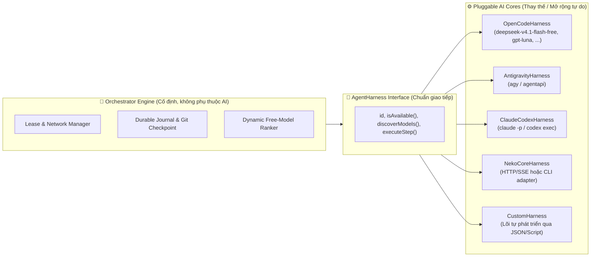

# BotAutoTask — Pluggable Multi-Core & Free-Model Orchestrator Spec

- **Date:** 2026-10-19
- **Project Path:** `D:\BotAutoTask`
- **Status:** `As-built` — Đặc tả REQ/AC chính thức hiện nằm tại [`docs/feature/00-core-orchestrator.md`](../../feature/00-core-orchestrator.md) (`SPEC-CORE`) và [`docs/feature/README.md`](../../feature/README.md)
- **Inspiration:** [CopilotKit/OpenMuse](https://github.com/CopilotKit/openmuse) (Durable SQL Leases) + [meiiie/neko-bot](https://github.com/meiiie/neko-bot) (Neko Core Runtime, Journal & Receipts)

---

## 1. Mục tiêu Cốt lõi

Xây dựng hệ thống **`BotAutoTask`** tại `D:\BotAutoTask` (kèm Agent Skill đồng bộ toàn cục) với 4 trụ cột:
1. **Kiến trúc Lõi Tách Bạch (Pluggable `AgentHarness` Architecture):**
   - Tách rời hoàn toàn **Bộ điều phối (Orchestrator / Lease / Journal / Telegram)** khỏi **Lõi AI thực thi (`AgentHarness`)**.
   - Bất kỳ lõi nào (`opencode`, `agy`/Antigravity, `claude`, `codex`, `neko-core`, hoặc **lõi AI tự phát triển sau này**) đều giao tiếp qua một chuẩn `AgentHarness` duy nhất. Muốn thay thế Neko Core hay thêm lõi mới chỉ cần cắm thêm 1 file adapter trong `src/harnesses/` hoặc khai báo `customHarnesses` trong `config/default-config.json`.
2. **Tự động Săn & Xếp hạng Model Miễn phí Tốt nhất (`FreeModelDiscovery`):**
   - Tự động quét danh sách model từ `opencode models`, OpenRouter Free API (`pricing.prompt == "0"`), và cấu hình ưu tiên để chọn các model miễn phí/idle mạnh nhất hiện tại (ví dụ: `deepseek-v4.1-flash-free`, `gpt-luna`, `gemini-2.5-pro`, `deepseek-r1:free`, `qwen-2.5-coder:free`, ...).
   - Khi một model/lõi bị dính Rate Limit (`429`) hoặc hết quota, tự động lưu checkpoint vào Journal và trượt sang model/lõi tốt nhất tiếp theo.
3. **Tự chạy khi có mạng & Hoạt động cả khi tắt máy (Cloud-Core + Hybrid Worker):**
   - **Cloud Control Plane (`cloud-core/`):** Chạy 24/7 miễn phí trên **Cloudflare Workers + D1 SQLite**. Giữ hàng đợi Goal, Sổ cái Journal, và quản lý Lease (90 giây).
   - **Local Daemon (`src/daemon/`):** Chạy trên PC qua **Windows Task Scheduler** (cờ `RunOnlyIfNetworkAvailable` + `WakeToRun` đánh thức máy từ Sleep/Hibernate).
   - **Cloud Worker (`.github/workflows/botautotask-worker.yml`):** Khi PC tắt nguồn hoàn toàn (Lease hết hạn >90s), Cloudflare Worker tự động gọi GitHub Actions để kéo nhánh Git về và dùng các model free trên `opencode` chạy tiếp cho đến khi đạt target.
4. **Điều khiển qua Telegram Bot 24/7:**
   - Nhận lệnh từ điện thoại mọi lúc: `/goal`, `/status`, `/models` (xem các model free tốt nhất đang sẵn sàng), `/switch <harness:model>`, `/mode <auto|local|cloud>`, `/pause`, `/resume`, `/cancel`.

---

## 2. Kiến trúc Tách Bạch Lõi (Hexagonal Harness Contract)



### Hợp đồng giao tiếp của một Lõi (`src/core/types.js`)
Mọi lõi AI chỉ cần thực thi 3 hàm:
- `checkHealth()`: Kiểm tra CLI/runtime có tồn tại và đang rảnh (idle) trên máy không.
- `discoverModels()`: Tự động trả về danh sách các model miễn phí/khả dụng của lõi đó kèm điểm ưu tiên (`tierScore`).
- `runStep({ goal, journal, workspaceDir, model })`: Thực thi 1 bước tiến tới mục tiêu và trả về chuẩn `StepReceipt`:
  ```json
  {
    "outcome": "STEP_DONE | GOAL_COMPLETED | RATE_LIMITED | ERROR",
    "summary": "Đã sửa xong hàm X và chạy pass unit test",
    "harnessId": "opencode",
    "modelId": "deepseek-v4.1-flash-free",
    "rawExitCode": 0
  }
  ```

---

## 3. Cơ chế Tự động Chọn Model Free Tốt nhất (`src/core/model-discovery.js`)

Thay vì gán cứng 1 model, `FreeModelRanker` kết hợp 3 nguồn:
1. **Danh sách Ưu tiên Đỉnh cao (Priority Patterns):**
   - Khớp ưu tiên số 1 với các từ khóa model do bạn chỉ định trong `config/default-config.json`:
     - `deepseek*v4*flash*free` / `deepseek*free`
     - `gpt-luna*` / `*luna*`
     - `opencode/*free*`
     - `google/gemini-2.5-pro*` / `google/gemini-2.5-flash*`
     - `qwen*coder*free`
2. **Quét Động từ `opencode models` CLI:**
   - Gọi lệnh `opencode models` trên máy để lấy danh sách thực tế các model mà OpenCode đang hỗ trợ miễn phí tại thời điểm chạy.
3. **Quét Động từ OpenRouter Public API (`https://openrouter.ai/api/v1/models`):**
   - Lọc tự động toàn bộ model có `pricing.prompt === "0"` và `pricing.completion === "0"`, ưu tiên các model có `context_length >= 64000` và chuyên về code/reasoning.
4. **Bảng Cooldown Động:**
   - Nếu `deepseek-v4.1-flash-free` đang chạy mà gặp `429 Rate Limit`, nó bị đưa vào `cooldown` 30 phút $\rightarrow$ Bộ chọn tự động bốc ngay `gpt-luna` hoặc model free điểm cao thứ 2 vào chạy tiếp bước đang dở!

---

## 4. Cấu trúc Thư mục tại `D:\BotAutoTask`

```text
D:\BotAutoTask\
├── package.json
├── config/
│   └── default-config.json          # Cấu hình ưu tiên model free, danh sách lõi, cooldown
├── src/
│   ├── core/
│   │   ├── types.js                 # Chuẩn dữ liệu Goal, StepReceipt, AgentHarness基lớp
│   │   ├── model-discovery.js       # Tự động quét & xếp hạng model free (deepseek v4.1, gpt-luna...)
│   │   ├── harness-registry.js      # Đăng ký, quản lý & hot-swap các lõi AI
│   │   ├── rate-limit-detector.js   # Nhận diện lỗi limit/quota của mọi CLI
│   │   └── orchestrator.js          # Vòng lặp chạy Goal, ghi Journal, tạo Git Checkpoint, tự đổi lõi
│   ├── harnesses/                   # THƯ MỤC CẮM LÕI AI (Pluggable Cores)
│   │   ├── opencode-harness.js      # Lõi OpenCode CLI (chạy các model free tốt nhất)
│   │   ├── antigravity-harness.js   # Lõi Antigravity (agy / agentapi)
│   │   ├── claude-codex-harness.js  # Lõi Claude Code & Codex CLI
│   │   ├── neko-core-harness.js     # Lõi Neko Core (HTTP/SSE & CLI bridge, dễ dàng thay thế)
│   │   └── custom-cmd-harness.js    # Lõi mở rộng cho AI tự phát triển sau này
│   ├── daemon/
│   │   ├── network-monitor.js       # Đợi có mạng mới chạy + đồng bộ hàng đợi offline
│   │   ├── local-daemon.js          # Tiến trình ngầm kết nối Cloud Core (Lease + Heartbeat)
│   │   └── cli.js                   # CLI giao việc/quản lý trực tiếp: `botautotask goal ...`
├── cloud-core/                      # LÕI ĐIỀU PHỐI TRÊN CLOUD (Cloudflare Workers + D1 Free 24/7)
│   ├── wrangler.toml
│   ├── schema.sql                   # Bảng goals & journal_entries
│   └── worker.js                    # Telegram Bot Webhook + Lease API + Cron gọi GitHub Actions
├── .github/workflows/
│   └── botautotask-worker.yml       # Cloud Worker tự chạy khi PC tắt hoàn toàn
├── scripts/
│   └── register-windows-task.ps1    # Cài đặt Windows Task Scheduler (Network + WakeTimer)
├── skill/
│   └── botautotask/SKILL.md         # Agent Skill tích hợp cho Antigravity, Claude, OpenCode, Cursor
└── tests/
    └── *.test.js                    # 13 file kiểm thử tự động (node:test) cho model ranking, failover, lease CAS, mesh & policy
```
