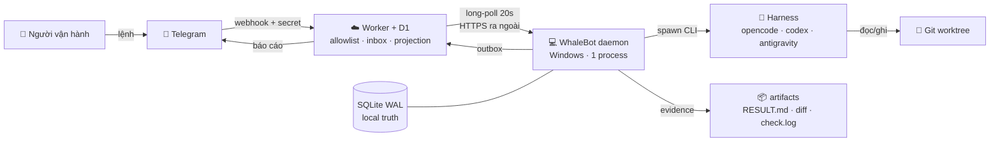
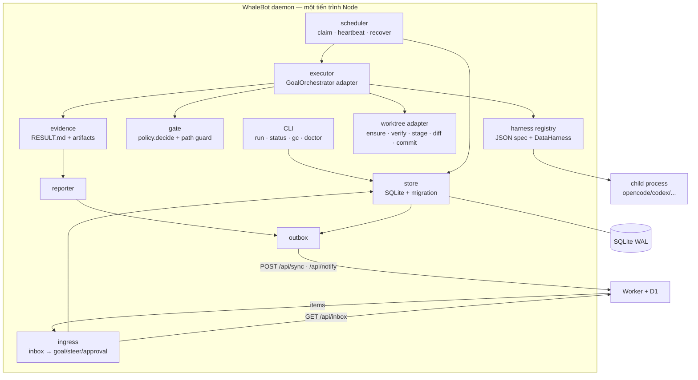
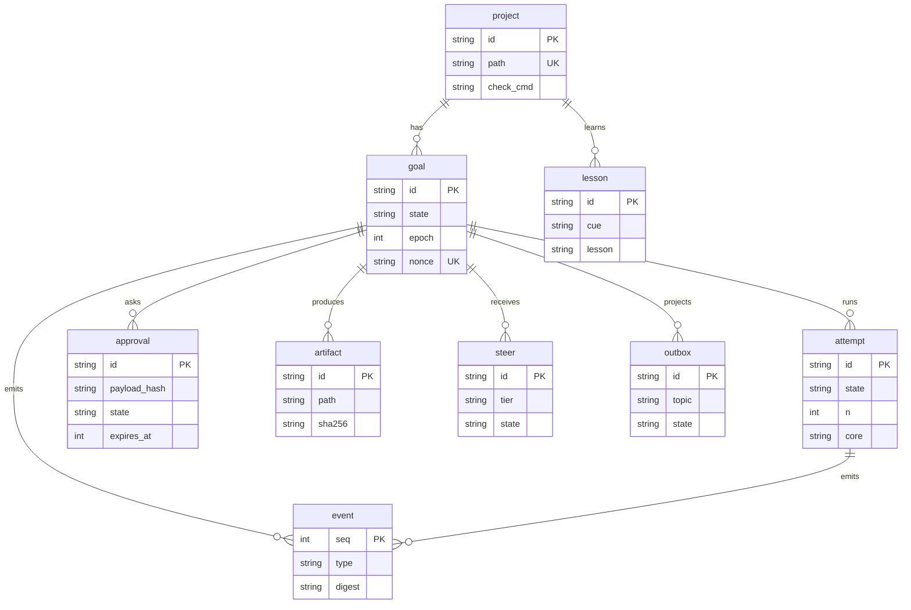
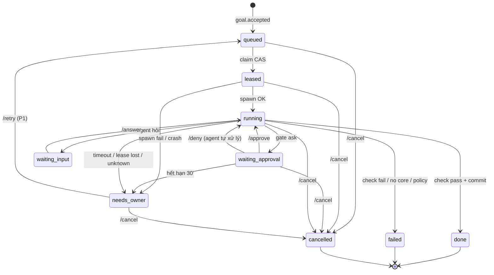
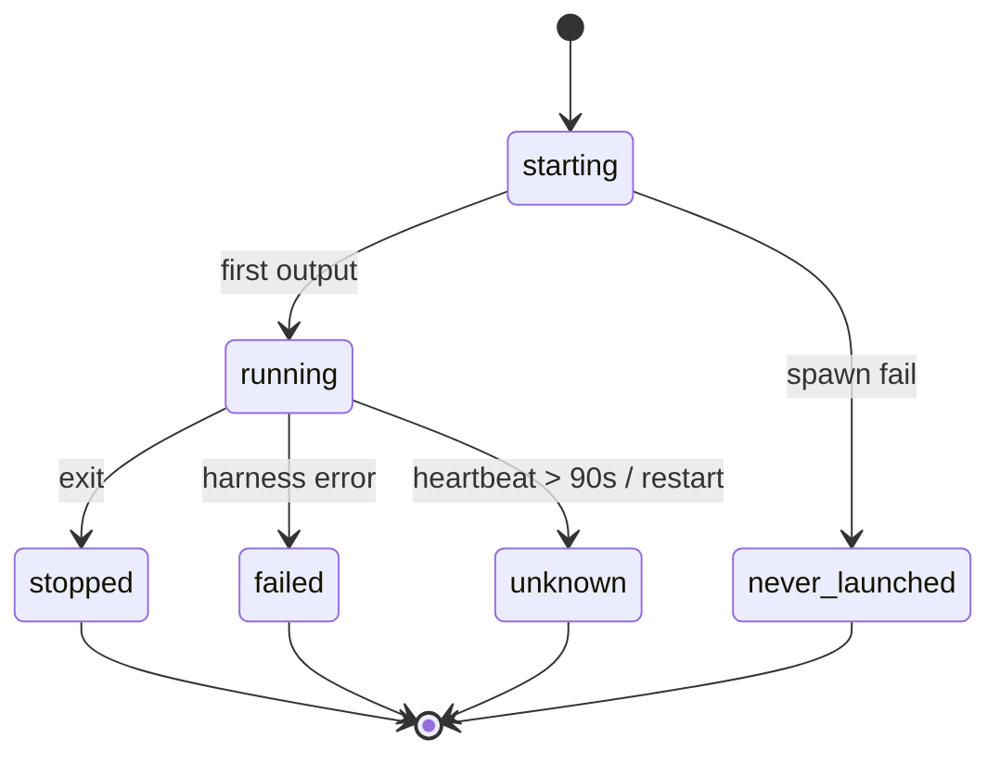
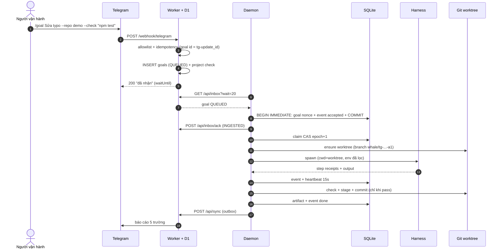
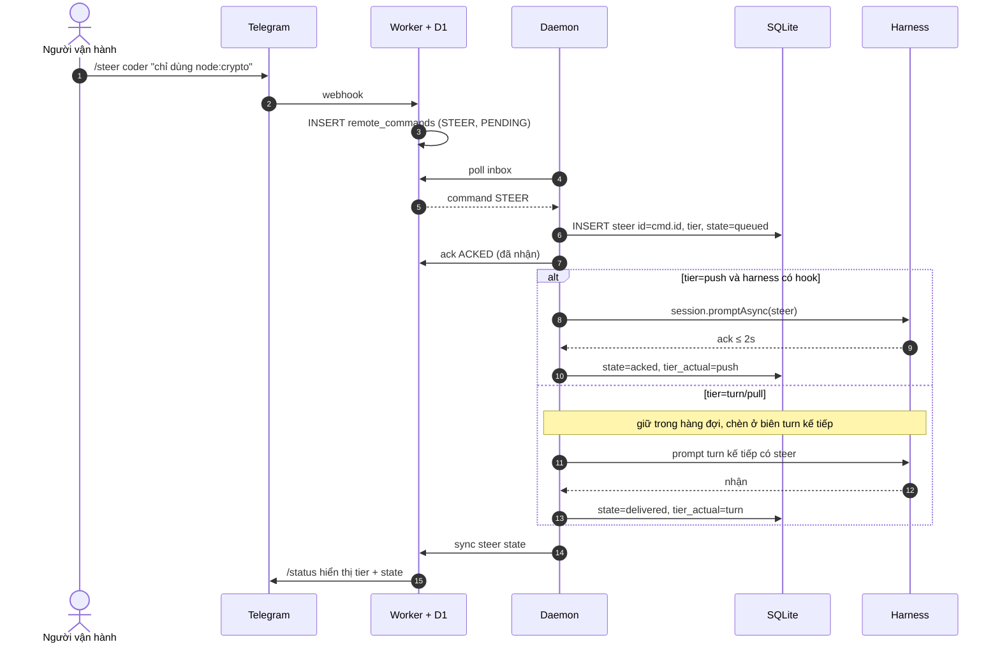
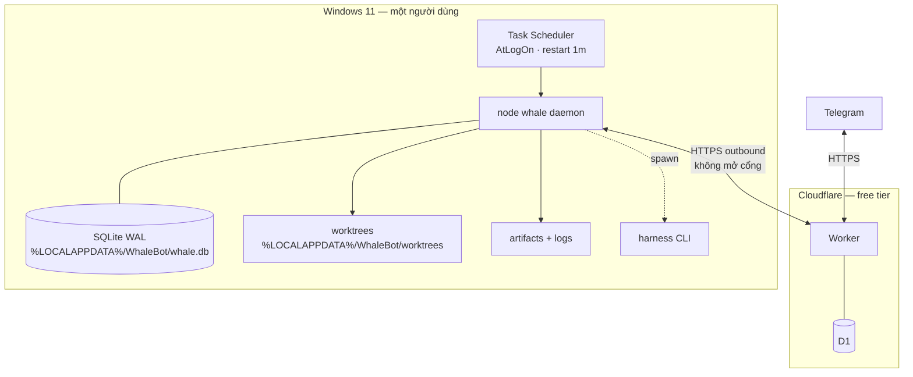

# WhaleBot — Kiến trúc hệ thống (Đề xuất v1.0)

| Thuộc tính | Giá trị |
|---|---|
| ID | `ARCH-001` |
| Trạng thái | `Proposal` — chờ duyệt, chưa có code |
| Ngày | 2026-10-21 |
| Phạm vi | MVP R01–R10 + seam P1/P2 |
| Nguồn | [`MVP.md`](../MVP.md) · [`REFERENCE-ARCHITECTURE.md`](./research/REFERENCE-ARCHITECTURE.md) · 5 repo OSS + Grok Bot |
| Engine | `D:\BotAutoTask` @ `1bd0b52` (ESM, không build) |
| Môi trường đo | Windows 11 26200 · Node 24.19.0 · SQLite 3.53.3 (`node:sqlite`) · git 2.55 |
| Người duyệt | Hướng |

> Tài liệu này **không sửa** `MVP.md`. Các điểm lệch với MVP được liệt kê ở §0.2 và chỉ có hiệu lực sau khi bạn duyệt.

---

## 0. TL;DR

1. **WhaleBot là control plane, không phải engine mới.** Nó dùng `GoalOrchestrator`, `HarnessRegistry`, `WorktreeManager`, `policy.decide`, `runCliProcess` của BotAutoTask; chỉ thêm lớp điều khiển: SQLite, scheduler, ingress, evidence, status, outbox.
2. **SQLite WAL là nguồn sự thật.** D1/Worker là inbox + projection. Đây là thay đổi lớn nhất so với MVP §5.3 (đang coi D1 là queue/lease).
3. **Một tiến trình, không mở cổng.** PC chỉ gọi ra Worker qua HTTPS; Telegram đi vào Worker. Không firewall inbound, không web UI.
4. **Không nói dối.** `attempt.unknown`, `goal.needs_owner`, status suy ra từ heartbeat + event, `/steer` theo tier. Xong chỉ khi có check pass + commit + diff + `core:model` + thời lượng.
5. **MVP thật không phải 250 dòng.** Ước tính ~550 dòng mới (dao động 500–650), vì MVP §5.3 bỏ sót persistence, recovery, ingress, status. Bản đầy đủ theo research ~840 dòng; tái dùng kernel cắt được ~250–300.

### 0.1. Một câu định nghĩa kiến trúc

> **Một daemon Windows sở hữu SQLite; mọi lệnh từ Telegram đi qua Worker/D1 vào inbox; mọi hành động nguy hiểm đi qua một cửa; mọi kết quả đi ra bằng evidence + outbox.**

**Cách đọc nhanh (10 phút):** §0 → §3 → §8.2 → §17 → §19.2. Các phần còn lại là chi tiết để review kỹ.

### 0.2. Sáu điểm lệch MVP cần duyệt

| # | MVP hiện tại | Đề xuất | Vì sao |
|---|---|---|---|
| **A** | D1 là queue + lease 90s, daemon lease qua HTTP (MVP §5.3) | SQLite local là truth; D1 là inbox/projection | Lease/CAS cần transaction; HTTP lease không fence được ghi local; mất mạng vẫn phải chạy đúng |
| **B** | `LocalDaemon` dùng nguyên trạng | Bỏ vỏ `LocalDaemon` (queue JSON), dùng `GoalOrchestrator` + `createRuntime` | `~/.botautotask/queue.json` không có CAS/event/attempt; file JSON không chịu được crash |
| **C** | `/steer` đến mọi core ≤15s (R06) | Tier-aware: push ≤2s ack/≤15s delivered; turn/pull đến ở biên kế tiếp, `/status` nói thật | Harness one-shot CLI không có kênh inject giữa process; hứa 15s là nói dối |
| **D** | ~250 dòng mới (MVP §5.3) | ~550 dòng (MVP lõi); ~700 dòng bản đầy đủ | 250 bỏ sót store, scheduler, recover, ingress, status — là phần đắt nhất |
| **E** | Node >=20 | Node >=24 (máy đang 24.19.0) | `node:sqlite` có sẵn, không cần native module; Node 20 không có |
| **F** | Mesh lead→coder→qa, dùng `runTeamMission` | W1–W2 một writer; W3 team executor **không merge** | `AgentMesh.runTeamMission` tự merge (`agent-mesh.js:751`), trái nguyên tắc “không merge tự động” |

Ngoài ra: `D:\WhaleBot` **chưa phải git repo**. Dogfood AC01 cần `git init` + commit đầu tiên trước.

---

## 1. Bối cảnh và ràng buộc

Chỉ giữ các ràng buộc **ảnh hưởng đến lựa chọn kiến trúc**. Yêu cầu chức năng nằm ở MVP §6.

| ID | Ràng buộc | Hệ quả kiến trúc |
|---|---|---|
| C-01 | Một người vận hành, một máy | Không auth đa người, không tenant, không billing |
| C-02 | Windows 11, Node >=24, Task Scheduler | Không systemd/Docker; liveness bằng file + PID; chạy at-logon |
| C-03 | Telegram là UI duy nhất | Không web server, không mobile app; mọi trạng thái phải nhét vào tin nhắn ≤15 dòng |
| C-04 | 0 ₫ | Model free; `billing=free` kiểm ở registry; không API key trả phí trong env con |
| C-05 | Tái dùng BotAutoTask @ `1bd0b52` | Import qua facade; không fork; patch nhỏ, backward-compatible |
| C-06 | Không auto-merge, không push | `WorktreeManager.merge()` bị ẩn khỏi adapter; commit chỉ trong worktree |
| C-07 | Cô lập worktree | 1 attempt = 1 worktree = 1 branch; nhánh chính chỉ người merge |
| C-08 | Xong phải có evidence | `check` + commit + `diff --stat` + `core:model` + thời lượng |
| C-09 | Không mở cổng inbound | PC → Worker outbound; Worker → Telegram; không nghe localhost |
| C-10 | 1 goal đồng thời (MVP), 25 phút/goal | Scheduler tuần tự; `max_concurrent=1`; timeout cứng |
| C-11 | Allowlist đúng một chat id | Worker từ chối 403 trước khi ghi D1; so sánh hằng thời gian |

**Điều kiện tiên quyết:** bot token + webhook secret + D1; `D:\WhaleBot` là git repo; `git config user.email` tồn tại; ít nhất một harness free chạy được (`opencode`, `codex`, `antigravity`).

---

## 2. Nguyên tắc kiến trúc

| # | Nguyên tắc | Cách thực thi |
|---|---|---|
| P1 | **Local truth, cloud transport** | SQLite WAL sở hữu goal/attempt/event; D1 chỉ giữ inbox và projection |
| P2 | **Một cửa cho side effect** | Commit/check/spawn/MCP đi qua `gate` + `approval`; `merge`/`push` bị từ chối |
| P3 | **Evidence thay cho lời khai** | `done` chỉ khi check pass + commit; status đọc dấu vết, không hỏi agent |
| P4 | **Unknown là trạng thái hợp lệ** | Crash/restart → `attempt.unknown`, `goal.needs_owner`; không auto-retry |
| P5 | **Tái dùng kernel, sở hữu control plane** | Không viết lại orchestrator/harness/worktree; chỉ thêm lớp điều khiển |
| P6 | **Một tiến trình, không cổng** | Lock file + PID; heartbeat file; CLI thay cho health endpoint |
| P7 | **Tối thiểu bề mặt** | 9 bảng local; 4 route Worker mới; 1 process; không queue thứ hai |

### 2.1. Copy / skip

| Nguồn | Lấy | Không lấy |
|---|---|---|
| BotAutoTask | `GoalOrchestrator`, `HarnessRegistry`, `WorktreeManager`, `policy.decide`, `runCliProcess`, `createRuntime` | `LocalDaemon` queue JSON; `AgentMesh.runTeamMission` auto-merge; `gitCheckpoint` từng step |
| GrokBot (đóng) | File-based liveness, permission engine, `unknown`/`dropped` semantics | Code, Electron UI, box migration, asset độc quyền |
| reason-network | Tier/ack, `doing` đọc từ transcript | Relay/network infra |
| neko | Nghĩa vụ ghi trước khi chạy, hash chain, không retry mù | Code AGPL, hạ tầng 192k dòng |
| openmuse | Lease/CAS, approval hash | Desktop app |
| orca | Worktree mỗi agent, adapter dialect | Hạ tầng IDE 1,46 GB |
| harness2 | Harness là dữ liệu, có version | Vòng A/B trong MVP |

---

## 3. Kiến trúc tổng thể

### 3.1. Context (C4 level 1)



**Không có mũi tên nào từ ngoài vào PC.** Daemon là client; Worker là điểm công khai duy nhất.

### 3.2. Container

| Container | Runtime | Trách nhiệm | State |
|---|---|---|---|
| Telegram | External | UI duy nhất; nhận lệnh, nhận báo cáo | Không |
| Worker | Cloudflare Workers free | Allowlist, parse, idempotency, inbox, projection, gửi Telegram | Stateless |
| D1 | Cloudflare D1 free | `goals` (inbox→projection), `journal_entries`, `remote_commands`, `projects`, `runtime_state`, `sent_messages` | Transport/projection |
| Daemon | Windows Node 24, 1 process | Ingest, schedule, execute, gate, evidence, report, recover | SQLite + files |
| SQLite | `%LOCALAPPDATA%\WhaleBot\whale.db` | Truth: project/goal/attempt/event/approval/artifact/steer/lesson/outbox | WAL |
| Harness | Child process (CLI) | Viết code trong worktree, chạy test, trả output | Ephemeral |
| Worktree | Git + filesystem | Cô lập 1 attempt; branch riêng | Git |
| Artifacts | Filesystem | `RESULT.md`, diff, check log, stdout | Files |

### 3.3. Component trong daemon



`LocalDaemon` **không** nằm trong sơ đồ. Lý do: vỏ của nó là queue JSON + lease D1 (`local-daemon.js:101-108`, `:147-149`), không đáp ứng CAS/event/attempt. Ta vẫn dùng `createRuntime()` của nó để dựng `registry` + `ranker` + config.

### 3.4. Quyền sở hữu dữ liệu (chống dual-write)

| Sự thật | Truth | Projection | Quy tắc xung đột |
|---|---|---|---|
| Lệnh chưa ingest | D1 `goals.status=QUEUED` / `remote_commands.status=PENDING` | — | D1 thắng cho đến khi daemon ack |
| Goal/attempt/event sau ingest | SQLite | D1 `goals`, `journal_entries` | D1 **không bao giờ** ghi đè local |
| Approval | SQLite | D1 (chỉ để hiển thị, P1) | Chỉ local quyết định; D1 không có quyền |
| Steer | SQLite `steer` | D1 `remote_commands.status` | D1 chỉ là trạng thái vận chuyển |
| Evidence | Filesystem + `artifact` | Tóm tắt trong báo cáo | File là bằng chứng gốc |
| Worktree | Git/filesystem | `attempt.worktree/branch` | DB chỉ trỏ; không chứa nội dung |
| Lesson | SQLite `lesson` | — | Không sync |

**Hai đường dữ liệu, không trộn:**

1. **Command path:** Telegram → Worker/D1 → daemon ingest (một transaction) → ack D1.
2. **Projection path:** local event/outbox → D1 upsert (idempotent) → `/status` đọc.

D1 là **hàng đợi có thời hạn** cho lệnh, và là **bản chiếu có thể trễ** cho trạng thái. Nó không phải nguồn sự thật thứ hai.

---

## 4. Module sâu và điểm ghép nối

### 4.1. Bảng module

| Module | Interface (seam) | Trách nhiệm ẩn bên trong | Tái dùng / mới | Test seam |
|---|---|---|---|---|
| `store` | `openStore(path)`, `tx(fn)`, `migrate()` | WAL, busy retry, `user_version`, foreign keys, event hash | Mới | Temp DB |
| `scheduler` | `tick()`, `claimNext()`, `heartbeat(id)`, `recover()` | CAS + epoch, lease 60s, timeout 25m, single-flight | Mới (ý tưởng lease từ `worker.js:587-630`) | 2 claim đồng thời |
| `ingress` | `poll()`, `accept(item)`, `ack()` | Long-poll, visibility 60s, idempotency, normalize goal/command | Mới (bảng D1 có sẵn) | Duplicate update_id |
| `executor` | `run(goalId)` | Worktree + orchestrator + check + commit + abort | Wrap `GoalOrchestrator` | Fake harness |
| `gate` | `decide(action, args, ctx)` | Path guard, command deny/ask, kill switch | Wrap `policy.decide` (`policy.js:49`) | allow/ask/refuse |
| `harness` | `load(spec)`, `candidates()` | JSON spec, argv array, env scrub, session per goal | Wrap `HarnessRegistry` + `runCliProcess` | Spec sai → fail |
| `worktree` | `ensure/verify/stage/diff/commit/cleanup` | TTL, branch riêng, **không expose merge** | Wrap `WorktreeManager` | Main sạch sau chạy |
| `evidence` | `bundle(attempt)` | `RESULT.md`, sha256, truncation, redaction | Mới | Snapshot |
| `reporter` | `render(goal)` | ≤15 dòng, 5 trường + 10 dòng check, chunk 3900 ký tự | Mới | Snapshot 5 trường |
| `outbox` | `enqueue(topic, payload)`, `flush()` | At-least-once, backoff, idempotency key | Mới | Gửi lặp không nhân đôi |
| `status` | `doing(attempt)`, `render(goal)` | Transcript/tool/git → `doing`; stale 90s; offline | Mới | Clock giả |
| `approval` | `propose/decide` | Hash payload, hạn 30', single-use, audit | Tái dùng semantics `agent-mesh.js:345-383` | Sai hash → từ chối |
| `steer` | `deliver(steer)` | Tier, ack, fallback, orphan | Mới | Không ack → báo thật |
| `cli` | `run/status/gc/doctor/...` | Không port; đọc DB/lock | Mới | Smoke |

**Gate deny-list:** `gate` chạy `policy.decide` trước, rồi chặn cứng các action *do Whale phát*: `git push`, `git merge`, `gh pr merge`, `sudo`, `format`, `rm -rf /`. Đây là guard của Whale, không phải năng lực của `policy.decide` (policy không có action push/merge). Nó không thấy tool call bên trong harness — residual risk §9.3.

### 4.2. Seam quan trọng nhất: `executor`

`GoalOrchestrator` đã có vòng lặp step + failover + acceptance (`orchestrator.js:91-201`). Nó **không** trả output của check, và **commit từng step** nếu `gitCheckpoint=true` (`orchestrator.js:30-43`, `:125-128`). Whale cần:

```js
// giả mã
const result = await orchestrator.runGoal(goal, journal);
// result: { status, stepsRun, journal, check? }
if (result.status === 'COMPLETED' && result.check?.ok) {
  worktree.stage(attempt);           // git add -A (để diff thấy file mới)
  const commit = worktree.commit(attempt, message);
  evidence.bundle({ check: result.check, commit, diff: worktree.diff(attempt) });
  finish('done');
} else if (result.status === 'COMPLETED_UNVERIFIED') {
  finish('needs_owner', 'no_acceptance');   // không có check = không được coi là xong
} else if (result.status === 'MAX_STEPS_REACHED') {
  const check = worktree.verify(attempt, goal.check_cmd); // lần cuối, lấy log
  if (check.passed) finish('needs_owner', 'max_steps_no_completion');
  else finish('failed', 'check_failed'); // không commit
} else if (result.status === 'PAUSED_LIMIT') {
  finish('failed', 'no_core');            // AC04: dừng, không mua key
} else {
  finish('needs_owner', result.status.toLowerCase());
}
```

**Đề xuất patch kernel (8 dòng):** `runGoal` trả thêm `check` `{ok, verified, output, durationMs}` (output tối đa 2KB, không phải 400 ký tự như `orchestrator.js:67`). Nếu bạn không muốn patch, executor chạy check lần hai sau khi `COMPLETED` — chậm hơn một lần test nhưng không đổi semantics.

`gitCheckpoint: false` bắt buộc. Lý do: AC03 yêu cầu check đỏ → **không commit**; commit từng step sẽ tạo commit rác và che mất trạng thái thất bại.

**Map sang kernel:** `repo_path` = worktree path, `acceptance_cmd` = `goal.check_cmd`, giữ `title`/`description`/`max_steps`/`preferred_core`. Check trong kernel hard-code timeout 5 phút (`orchestrator.js:59`); check dài hơn phải patch timeout hoặc chấp nhận fail. Tắt experience của kernel (`orchestrator.experience = { loadExperiences: () => [], saveExperience() {} }`) để không ghi file vào worktree; `lesson` do Whale quản.

Nếu `commit.committed === false` (agent không đổi file), **không** báo `done`: `needs_owner/no_changes`. Check pass trên cây sạch không chứng minh goal đã làm gì.

`WorktreeManager.verify()` dùng `spawnSync` (`worktree-manager.js:157-181`): check dài >90s sẽ **block event loop** và làm heartbeat stale. Adapter `verify` phải async (`runCliProcess`/`execFile`, timeout, cap output); method gốc chỉ dùng cho check ngắn.

### 4.3. Seam `worktree`: ẩn `merge`

`WorktreeManager` có `merge()` (`worktree-manager.js:237`) và `AgentMesh` gọi nó (`agent-mesh.js:751`, `:1108`). Whale **không** expose method này:

```js
class WorktreeAdapter {
  constructor(mgr) { this.mgr = mgr; }
  ensure(id) { return this.mgr.ensure(id); }
  verify(id, cmd) { return this.mgr.verify(id, cmd); }
  stage(id) { return this.mgr.stage(id); } // thêm 3 dòng public stage(): git add -A
  diff(id) { return this.mgr.diffWorking(id); } // HEAD..working tree, gồm file mới
  commit(id, msg) { return this.mgr.commit(id, msg); }
  cleanup(id) { return this.mgr.cleanup(id); }
  // KHÔNG có merge()
}
```

`WorktreeManager` hiện **chưa có** `stage()`; thêm 3 dòng public (`git add -A` trong worktree) hoặc adapter gọi `_runGit` (private, dễ vỡ). Chọn public. Stage trước khi `diff` để file mới (untracked) xuất hiện trong evidence khi check đỏ.

`WorktreeManager.diff()` chỉ diff `HEAD...branch` (committed; `worktree-manager.js:186-203`), **không thấy** thay đổi chưa commit. Vì check đỏ không commit, adapter phải có `diffWorking(id)` chạy `git diff HEAD` + `--stat` trong worktree (sau `stage`), hoặc thêm option `includeWorkingTree`; nếu không evidence rỗng.

Worktree root/branch đang hard-code trong constructor (`worktree-manager.js:23`) và `botautotask/agent-*`; thêm 4 dòng option `worktreesRoot` + `branchPrefix` (backward-compatible), hoặc adapter gán `mgr.worktreesRoot` + override `getBranchName`. Chọn option để không phụ thuộc private.

Test bắt buộc: `assert(!('merge' in adapter))` và grep `src/` không có `.merge(` trên worktree. Đây là deep module: bề mặt hẹp, hành vi nguy hiểm bị giấu.

### 4.4. Seam `harness`: dữ liệu, không `if (core)`

`HarnessRegistry` đã hỗ trợ `registerFromConfig` + `CustomCmdHarness` (`harness-registry.js:36-41`). Nhưng `CustomCmdHarness` dùng `commandTemplate` string + `exec` (`custom-cmd-harness.js:20,48-58`), không có argv array, `env_deny`, `signal`. Whale thêm `DataHarness` (~60 dòng) dùng `runCliProcess` (`spawn-cli.js:117`) — đã có kill process tree trên Windows (`:92-107`) và resolve `.cmd` shim (`:21-78`).

---

## 5. Mô hình dữ liệu

### 5.1. ER (9 bảng local)



### 5.2. Chín bảng

| Bảng | Mục đích | Ràng buộc chính | Vòng đời |
|---|---|---|---|
| `project` | Repo đã đăng ký | `path` unique; `check_cmd` bắt buộc (MVP) | Vĩnh viễn |
| `goal` | Một yêu cầu của người | `state` 9 giá trị; `nonce` unique; `check_cmd` snapshot | Vĩnh viễn (MVP; rất nhỏ) |
| `attempt` | Một lần chạy của goal | `UNIQUE(goal_id,n)`; 1 attempt running/goal | Vĩnh viễn (MVP) |
| `event` | Nhật ký append-only, hash chain | `seq` PK; trigger cấm UPDATE/DELETE | Vĩnh viễn |
| `approval` | Duyệt hành động nguy hiểm | `payload_hash`; `expires_at`; single-use | 30 ngày |
| `artifact` | File bằng chứng | `sha256`, `bytes`; path tương đối | 30–90 ngày |
| `steer` | Chỉ thị giữa chừng | `state`; `tier`; `source_command_id` | 30 ngày |
| `lesson` | Bài học theo repo | `cue`; `evidence`; `stale_at` | Vĩnh viễn |
| `outbox` | Gửi D1 ít nhất một lần | `idempotency_key` unique | 7 ngày sau `sent` |

**Cột bổ sung so với REFERENCE §6:** `goal.title`, `goal.check_cmd`, `goal.reason`; `attempt.exit_code`, `attempt.error_code`; `artifact.kind`; `steer.tier_actual`, `steer.source_command_id`; `approval.source_command_id`; `outbox.goal_id`. Vẫn **9 bảng**, không thêm bảng local.

`whale ledger` **không phải bảng**: nó là view tổng hợp từ `attempt` + `event` (thời gian, step, core, cost). Muốn sửa cách tính thì sửa query, không migration.

**Index bắt buộc:**

```sql
CREATE INDEX goal_ready ON goal(state, created_at);
CREATE UNIQUE INDEX attempt_one_running ON attempt(goal_id)
  WHERE state IN ('starting','running');
CREATE INDEX event_goal ON event(goal_id, seq);
CREATE INDEX steer_pending ON steer(state, created_at);
CREATE INDEX approval_pending ON approval(state, expires_at);
CREATE INDEX outbox_due ON outbox(state, next_try_at);
```

**Trigger bất biến:** `event` chỉ INSERT. Nếu cần sửa, ghi event mới; verify chain bằng `whale doctor --events`.

### 5.3. Migration

- `001_init.sql` tạo 9 bảng + index + trigger; `PRAGMA user_version=1`.
- Mỗi migration chạy trong transaction; trước đó `VACUUM INTO` bản backup.
- MVP chỉ có `001`; thay đổi sau dùng expand–contract (thêm cột → backfill → bỏ cột ở version sau).
- Không xoá `event`; chain sẽ gãy. Dung lượng event rất nhỏ (~100 byte/event).
- `PRAGMA journal_mode=WAL; foreign_keys=ON; busy_timeout=5000; synchronous=NORMAL`.

### 5.4. Map sang BotAutoTask

| Whale local | BotAutoTask hiện có | Cách dùng |
|---|---|---|
| `project` | Config `customHarnesses` + CLI `--path` | Mới; D1 có projection `projects` |
| `goal` | D1 `goals` | D1 `goals` là inbox trước ingest, projection sau |
| `attempt` | `journal_entries` + `goals.lease_*` | Tách attempt khỏi step; lease local |
| `event` | `journal_entries` + log | Local append-only; project bước sang D1 |
| `approval` | D1 `approvals` + `AgentMesh.approvals` | Local là truth; hash/expiry/single-use |
| `steer` | D1 `remote_commands` + `AgentMesh.pendingSteers` | Local queue; D1 là inbox |
| `lesson` | `Harness2Engine` experience files | Import dần; không bắt buộc MVP |
| `artifact` | — | Mới |
| `outbox` | — | Mới |

---

## 6. State machine

### 6.1. Goal (9 trạng thái)



**Luật chuyển:**

| Từ | Đến | Guard | Side effect |
|---|---|---|---|
| `queued` | `leased` | `UPDATE ... WHERE state='queued'` changes=1 | `epoch+1`, event |
| `leased` | `running` | spawn thành công | `attempt.started` |
| `running` | `done` | check pass + commit + diff | artifact, report |
| `running` | `failed` | check fail / no core / policy 3 lần | reason, report |
| `running` | `needs_owner` | timeout / lease lost / unknown | giữ worktree, report |
| `waiting_approval` | `running` | hash đúng + chưa hết hạn | single-use |
| `waiting_approval` | `running` | `/deny` | approval denied; 3 lần → `failed/policy` |
| `waiting_approval` | `needs_owner` | quá 30' | approval expired; report |
| `waiting_approval` | `cancelled` | `/cancel` | cleanup |
| `needs_owner` | `queued` | **chỉ** lệnh `/retry` (P1) | attempt mới |

**Nhãn AC:** báo cáo/API dùng nhãn mà MVP yêu cầu — `FAILED_CHECK` = `state=failed` + `reason=check_failed`; `NO_CORE_AVAILABLE` = `failed` + `reason=no_core`. State machine vẫn 9 trạng thái; nhãn chỉ là cách hiển thị/kiểm thử.

`waiting_input` để dành; harness headless không nên hỏi. Nếu hỏi, status hiện `waiting_input`, không tự trả lời.

### 6.2. Attempt (6 trạng thái)



**Recovery:** lúc khởi động, mọi attempt `starting|running` có PID chết hoặc heartbeat >90s → `unknown`; goal → `needs_owner`; event `attempt.recovered_unknown`. **Không auto-retry.** Đây là D-04.

`never_launched` tách khỏi `unknown`: binary thiếu/argv sai là lỗi cấu hình, không phải crash.

### 6.3. Approval & steer

| Thực thể | Trạng thái | Chuyển hợp lệ |
|---|---|---|
| `approval` | `pending → approved → executed` | hash đúng, chưa hạn, chưa dùng |
| | `pending → denied` | người từ chối |
| | `pending → expired` | quá 30' |
| `steer` | `queued → acked → delivered → read` | push ack / turn boundary |
| | `queued → orphan` | attempt chết trước khi giao |

### 6.4. Invariant (viết thành test)

| # | Invariant | Test |
|---|---|---|
| I1 | Không chạy gì khi chưa có goal + event accepted trong **cùng transaction** | Kill sau accept → restart → không có agent |
| I2 | Claim thắng CAS; 2 claim đồng thời → đúng 1 thắng | 2 tiến trình claim |
| I3 | Mất lease → mọi ghi bị từ chối | Xoá `lease_owner` giữa chừng → `LostLeaseError` |
| I4 | Restart khi attempt `running` → `unknown`, không auto-retry | Kill → start → `needs_owner` |
| I5 | Approval sai hash → từ chối | Sửa payload sau propose |
| I6 | `allow_paid=false` → không lệnh trả phí | Mock harness báo cost >0 |
| I7 | `/steer` push không ack ≤15s → status nói “chưa đến” | Mock không ack |
| I8 | `/status` không nói “running” khi heartbeat >90s | Set heartbeat cũ |
| I9 | **Không đường code nào gọi `WorktreeManager.merge`** | Adapter không có `merge`; grep |
| I10 | Command `DELIVERED` không ack 60s → giao lại; không mất | Kill sau fetch trước ack |
| I11 | Outbox gửi lặp không tạo goal/report trùng | Flush 2 lần |

---

## 7. Luồng chính

### 7.1. `/goal` happy path



### 7.2. `/steer` theo tier



**Không hứa quá tier.** Với harness one-shot, `tier_requested=push` nhưng `tier_actual=turn`; `/status` ghi rõ. Đây là cách duy nhất để R06 không thành lời nói dối.

### 7.3. Crash/restart → `unknown`

```mermaid
sequenceDiagram
    autonumber
    participant D as Daemon
    participant DB as SQLite
    participant W as Worker + D1
    participant TG as Telegram

    D->>DB: SELECT attempt WHERE state IN (starting,running)
    D->>D: PID còn sống? heartbeat < 90s?
    alt PID chết hoặc heartbeat cũ
        D->>DB: attempt=unknown; goal=needs_owner; event
        D->>W: sync
        W->>TG: "⚠️ cần bạn: unknown, không auto-retry"
    else còn sống
        D->>DB: giữ nguyên, tiếp tục heartbeat
    end
    Note over D: Không có auto-retry từ unknown
```

### 7.4. Approval

```mermaid
sequenceDiagram
    autonumber
    actor U as Người vận hành
    participant TG as Telegram
    participant W as Worker + D1
    participant D as Daemon
    participant DB as SQLite
    participant H as Harness/MCP

    H->>D: yêu cầu tool nguy hiểm (hook/MCP)
    D->>DB: approval pending + hash + hạn 30'
    D->>W: notify /approve id hash
    W->>TG: "Duyệt? /approve appr-1 a1b2c3"
    U->>TG: /approve appr-1 a1b2c3
    TG->>W: webhook
    W->>W: INSERT remote_commands (APPROVE)
    D->>W: poll
    D->>DB: kiểm hash + hạn + single-use
    alt hợp lệ
        D->>H: thực thi đúng payload một lần
        D->>DB: state=executed; event
    else sai hash
        D->>DB: giữ pending; event; không dùng hash
        D->>W: notify "hash sai, thử lại"
    else hết hạn
        D->>DB: state=expired; event
        D->>W: notify từ chối
    end
```

`/deny` → approval `denied`; goal về `running` để agent tự xử lý (không giết ngay). 3 lần deny trong cùng goal → `failed/policy`. Deny không xoá worktree; evidence giữ nguyên.

---

## 8. Giao diện và hợp đồng

### 8.1. Telegram

| Lệnh | Cú pháp | Ack | Hành vi |
|---|---|---|---|
| `/goal` | `/goal <mô tả> --repo <slug> [--check "..."] [--core ...]` | ≤3s “đã nhận” | Tạo D1 goal `tg-<update_id>`; thiếu repo → trả list, không tạo |
| `/status` | `/status [goal-id]` | ≤2s | Đọc projection; stale/offline nếu heartbeat cũ |
| `/steer` | `/steer <đích> <chỉ thị>` (`đích` = agent id hoặc goal id) | ≤2s “đã nhận” | Tier-aware; delivery báo sau |
| `/approve` | `/approve <id> <hash>` | ≤2s | Enqueue; local kiểm hash |
| `/deny` | `/deny <id> [lý do]` | ≤2s | Enqueue |
| `/cancel` | `/cancel <goal-id>` | ≤2s | Enqueue INTERRUPT; không sửa D1 trực tiếp |
| `/projects` | `/projects` | ≤2s | Đọc D1 `projects` |
| `/diff` | `/diff <goal-id>` | P1 | Async, ≤40 dòng |
| `/answer` | `/answer <goal-id> <text>` | P1 | Chuyển `waiting_input → running`; không tự trả lời |
| `/retry` | `/retry <goal-id>` | P1 | Attempt mới; không auto |
| `/help` | `/help` | ≤2s | Danh sách lệnh |

**Parser:** prompt tối đa 4000 ký tự; check tối đa 500; repo slug `[a-z0-9][a-z0-9-]{1,30}`; không `eval`, không shell interpolation. Tin nhắn không phải text/private/allowlist → bỏ qua, trả 200 (trừ chat lạ → 403).

### 8.2. Worker HTTP

| Method | Path | Auth | Mục đích | Idempotency |
|---|---|---|---|---|
| POST | `/webhook/telegram` | `X-Telegram-Bot-Api-Secret-Token` | Parse + allowlist + enqueue | Goal/command id = `tg-<update_id>` |
| GET | `/api/inbox?wait=20&limit=5` | Bearer | Trả goal QUEUED + command PENDING; claim command 60s | Visibility timeout |
| POST | `/api/inbox/ack` | Bearer | `{items:[{kind,id,status,error}]}` | CAS; ack lặp vô hại |
| POST | `/api/sync` | Bearer | Batch projection (goal/journal/steer/approval/runtime) | Natural key + `updated_at` |
| POST | `/api/notify` | Bearer | Gửi Telegram; chunk 3900 | `sent_messages.id` |
| GET | `/api/state?goalId=` | Bearer | Snapshot projection (debug/CLI) | — |
| POST | `/api/commands` | Bearer | Enqueue thủ công (test/CLI) | id |
| POST | `/api/lease/*` | Bearer | **Không dùng trong MVP**; để dành GHA fallback P2 | epoch |

**Inbox envelope:**

```json
{
  "kind": "goal",
  "id": "tg-123456",
  "prompt": "Sửa typo README",
  "repo": "demo",
  "check": "npm test",
  "core": "auto",
  "created_at": 1760000000000
}
```

```json
{
  "kind": "command",
  "id": "tg-123457",
  "type": "STEER",
  "goal_id": "tg-123456",
  "target_id": "coder",
  "payload": { "text": "chỉ dùng node:crypto" },
  "created_at": 1760000001000
}
```

**Command lifecycle:** `PENDING → DELIVERED (60s visibility) → ACKED` hoặc `EXPIRED` sau 5 lần. `DELIVERED` quá 60s không ack → giao lại; local idempotency xử lý trùng.

**D1 schema delta:**

- `goals`: thêm `doing TEXT`, `reason TEXT`, `attempt_id TEXT`, `last_event_at INTEGER`; `status` nhận `QUEUED|INGESTED|RUNNING|WAITING_APPROVAL|DONE|FAILED|NEEDS_OWNER|CANCELLED`.
- `remote_commands`: thêm `delivered_at`, `ack_at`, `attempts`, `last_error`; CHECK thêm `APPROVE`, `DENY`.
- Bảng mới: `projects(id,name,path,check_cmd,base_branch,updated_at)`; `runtime_state(id,last_seen,version,current_goal_id,paused)`; `sent_messages(id,sent_at)`.
- Migration `0003_whale_inbox.sql`; rebuild `remote_commands` để đổi CHECK, map dữ liệu cũ.

### 8.3. Harness spec

```json
{
  "id": "opencode",
  "version": 1,
  "bin": "opencode",
  "version_check": ["opencode", "--version"],
  "argv": ["run", "--pure", "--format", "json", "-m", "{model}", "{prompt}"],
  "resume": ["--session", "{session}"],
  "cwd": "{worktree}",
  "env_deny": ["TELEGRAM_BOT_TOKEN", "WHALE_DAEMON_TOKEN", "CLOUDFLARE_API_TOKEN", "GITHUB_PAT", "OPENAI_API_KEY", "ANTHROPIC_API_KEY"],
  "tier": "turn",
  "steer": { "how": "next_turn" },
  "status": { "source": "json_stream" },
  "cost": { "parser": "json.usage", "free": true },
  "timeout_min": 25,
  "max_steps": 15,
  "artifacts": ["RESULT.md"]
}
```

| Trường | Bắt buộc | Ý nghĩa |
|---|---|---|
| `id`, `version`, `bin` | Có | Định danh + binary |
| `version_check` | Có | `doctor` + cảnh báo CLI đổi |
| `argv` | Có | Mảng argv; placeholder `{model}`, `{prompt}`, `{worktree}`, `{session}` |
| `resume` | Không | Session resume; **mỗi goal một session** |
| `env_deny` | Có | Biến bị xoá khỏi env con |
| `tier` | Có | `push` / `turn` / `pull`; chỉ khai `push` nếu có hook thật |
| `steer.how` | Có nếu push | `plugin:*`, `http:*`, `next_turn` |
| `status.source` | Có | `json_stream` / `session_json` / `stdout` |
| `cost.free` | Có | `false` → registry từ chối load (D-10) |
| `timeout_min`, `max_steps` | Có | Ngân sách |

**Luật:** argv array, không shell string; spec sai → `doctor` fail, không chạy. `tier=push` phải kèm test ack; nếu không, hạ `turn`.

**Giới hạn prompt:** Telegram ≤4000 ký tự (giới hạn tin nhắn); CLI/file ≤24k. Windows giới hạn command line ~32k ký tự. `DataHarness` cap prompt 24k, journal chỉ tóm tắt các bước gần nhất + `--session`; harness không hỗ trợ file prompt thì từ chối goal quá dài, không cắt giữa lệnh.

### 8.4. CLI

| Lệnh | Mục đích |
|---|---|
| `whale daemon [--once]` | Chạy scheduler; `--once` cho test |
| `whale run "<prompt>" --repo <slug>` | Tạo goal local (không cần Telegram) |
| `whale status [goal] [--json]` | Trạng thái suy ra + stale |
| `whale projects add/list/remove` | Registry |
| `whale ledger [--week]` | Thời gian, step, core (R10) |
| `whale gc [--force]` | Worktree/artifact hết hạn |
| `whale doctor [--events]` | Node/git/DB/lock/task/harness/disk/secret |
| `whale recover [--dry-run]` | Quét attempt mồ côi → unknown |
| `whale sync [--rebuild]` | Flush/rebuild projection D1 |
| `whale backup` | `VACUUM INTO` + integrity check |
| `whale pause/resume` | Kill switch bằng file `PAUSED` |
| `whale logs --tail` | JSONL log |

### 8.5. Hợp đồng file

```
%LOCALAPPDATA%\WhaleBot\
  whale.db
  whale.db-wal
  daemon.lock
  PAUSED
  artifacts\<goal-id>\<attempt-id>\
    RESULT.md
    diff.patch
    check.log
    stdout.log
    meta.json
  worktrees\<repo-slug>\<goal-id>-a1\
  logs\whale-YYYYMMDD.jsonl
  backups\whale-YYYYMMDD-HHmm.db
```

`RESULT.md`:

```md
# Goal <id> — <title>
- State: done | FAILED_CHECK | NO_CORE_AVAILABLE | needs_owner
- Project: <slug> (<path>)
- Attempt: <n> · <core>:<model> · <duration>
- Commit: <sha> (branch whale/<goal>-a<n>) hoặc — (check đỏ: không commit)
- Check: `<cmd>` → exit 0 (12.3s)

## Diff
<diff --stat>

## What changed
- ...

## Evidence
- check.log
- diff.patch
- stdout.log

## Risks / next
- ...
```

`meta.json`: `schema_version`, `goal_id`, `attempt_id`, `core`, `model`, `branch`, `commit`, `check{cmd,exit,duration_ms}`, `started_at`, `ended_at`, `files[]`.

`state` trong báo cáo dùng nhãn AC (`done`, `FAILED_CHECK`, `NO_CORE_AVAILABLE`, `needs_owner`); state nội bộ vẫn là 9 trạng thái ở §6.1.

### 8.6. Cấu hình

| Biến | Nơi lưu | Ghi chú |
|---|---|---|
| `TELEGRAM_BOT_TOKEN` | Worker secret | **Không** lưu trên PC |
| `TELEGRAM_WEBHOOK_SECRET` | Worker secret | Header webhook |
| `WHALE_DAEMON_TOKEN` | Worker secret + `.env` PC | Bearer; rotate được |
| `TELEGRAM_ALLOWED_CHAT_ID` | Worker env | Một id |
| `WHALE_CLOUD_URL` | `.env` PC | `https://...workers.dev` |
| `WHALE_DB_PATH` | `.env`/config | Mặc định LOCALAPPDATA |
| `WHALE_ARTIFACT_ROOT` | `.env`/config | Mặc định LOCALAPPDATA |
| `WHALE_MAX_CONCURRENT` | config | MVP `1` |
| `WHALE_ALLOW_PAID` | config | `false`, không override |
| `GIT_CONFIG_COUNT` | env con | Tắt credential helper (`credential.helper=`) |

Thứ tự ưu tiên: CLI > env > `whale.config.json` > default. Secret không vào DB, không vào log, không vào prompt.

---

## 9. Bảo mật và mô hình tin cậy

### 9.1. Ranh giới

1. Telegram ↔ Worker: secret header + allowlist.
2. Worker/D1 ↔ daemon: TLS + bearer + idempotency.
3. Daemon ↔ harness: env scrub + cwd worktree + timeout + process-tree kill.
4. Harness ↔ workspace: **không có sandbox OS**; đây là giới hạn thật.
5. Daemon ↔ filesystem: ACL user hiện tại; không admin.

### 9.2. STRIDE

| Mối đe dọa | Biện pháp | Residual |
|---|---|---|
| **S**poofing webhook | Secret header + allowlist + `update_id` idempotent | Lộ secret → rotate |
| **T**ampering command/approval | TLS; approval hash canonical; event chain | DB local bị sửa bởi user là ngoài mô hình |
| **R**epudiation | Event append-only + log JSONL + approval audit | Không có chữ ký số |
| **I**nfo disclosure | Token chỉ ở Worker; env_deny; redaction; deny-read nếu harness hỗ trợ | Agent shell có thể đọc file user; xem 9.3 |
| **D**oS | Rate limit 10 lệnh/phút; queue ≤20; max 25'; output cap | Telegram/Worker free tier |
| **E**levation | `gate` refuse push/merge/sudo/format; worktree; no admin | Harness tự chạy shell → không chặn tuyệt đối |

### 9.3. Giới hạn thật của `gate`

Với harness one-shot CLI, WhaleBot **không thể** intercept mọi tool call bên trong process. `gate` chỉ enforce được:

- Hành động do Whale khởi tạo: spawn harness, chọn cwd, commit, check, cleanup.
- MCP tool đi qua `AgentMesh.executeMeshTool` (P1).
- Harness có hook/plugin thật (khai báo `steer.how`/permission).

**Không được viết trong tài liệu quảng cáo:** “agent không thể đọc `.env`” hoặc “không thể push”. Sự thật là:

- Env con bị lọc token; `GIT_CONFIG_COUNT` tắt credential helper; `GIT_TERMINAL_PROMPT=0`.
- Không có auto-merge; commit chỉ trong worktree; người review diff.
- Nếu agent đọc được `.ssh`/Credential Manager và push, đó là **residual risk**; P2 mới có sandbox (Windows Sandbox/WSL).
- Prompt injection từ repo: coi nội dung repo là dữ liệu; không auto-merge; deny-read nếu harness hỗ trợ; không cấp quyền admin.

### 9.4. Secret

- Worker giữ bot token; PC không có → giảm bề mặt.
- `.env` PC chỉ chứa daemon token + URL; ACL `icacls` chỉ user hiện tại.
- Log redaction: `Bearer`, `sk-`, `ghp_`, `xoxb-`, pattern bot token.
- `whale doctor` cảnh báo nếu token xuất hiện trong file ngoài `.env` hoặc trong log.

---

## 10. Độ tin cậy, trạng thái, quan sát

### 10.1. Nhịp

| Thành phần | Nhịp | Ngưỡng |
|---|---|---|
| Heartbeat local | 15s | Lease 60s; stale 90s |
| Runtime heartbeat D1 | 30s | Offline nếu >90s |
| Outbox flush | 2s (backoff 1→30s) | Pending >5 phút → cảnh báo |
| Progress check | 60s | Không output >10 phút → warning |
| Hard timeout | — | `max_minutes=25` → abort + `needs_owner` |
| GC | 24h | Worktree 7 ngày; artifact 30/90 ngày |

### 10.2. Startup

```
1. Mở lock (wx). Nếu lock tươi → exit 3.
2. PRAGMA quick_check (nhanh); migrate nếu user_version cũ. Full `integrity_check` chỉ trong `whale doctor`/backup.
3. recover(): attempt starting/running → unknown; goal needs_owner.
4. Nạp project + harness spec; doctor nhẹ.
5. Bắt đầu long-poll inbox + scheduler tick 2s.
6. Ghi daemon.started; runtime heartbeat.
```

Lock file: JSON `{pid, started_at, version, boot_id}`; mtime refresh 10s; stale nếu mtime >60s hoặc PID chết. Không dùng port.

### 10.3. `/status` contract

```
🟢 tg-123 · running · 12m
doing: edit src/foo.ts · step 3/15
core: opencode/deepseek-v4.1-flash-free
check: chưa chạy · heartbeat 4s
steer: 1 queued (turn)
```

- `stale` nếu heartbeat >90s: `🟡 stale 2m — daemon không cập nhật`.
- `offline` nếu runtime D1 >90s: `⚪ offline từ 3m — trạng thái cuối ...`.
- Không bao giờ hiện `running` khi state `leased`/`starting`; hiện `đang claim`/`đang khởi động`.
- `doing` từ tool call/transcript/git; không đọc được → `không rõ (harness không xuất transcript)`, không đoán.

### 10.4. Log & metric

JSONL: `ts, level, event, goal_id, attempt_id, core, model, error_code, duration_ms, msg`. Rotate 10MB × 7 ngày.

Metric snapshot `logs/metrics.json` (không port):

| Metric | Công dụng |
|---|---|
| `goals_total{state}` | Tỷ lệ done/failed/needs_owner |
| `goal_duration_seconds` | P50/P95 so với 25' |
| `check_fail_total` | Chất lượng |
| `steer_ack_seconds{tier}` | R06 thật |
| `outbox_pending` | Sức khỏe sync |
| `heartbeat_age_seconds` | Stale/offline |
| `core_switches_total` | Ngân sách failover |
| `disk_free_bytes` | GC |

### 10.5. Event chain

`digest = sha256(prev_digest + "\n" + canonical(payload))`; `prev_digest` của event đầu = 64 số 0. `whale doctor --events` verify từ seq 1; nếu gãy → cảnh báo, không tự sửa. Event không xoá.

---

## 11. Phân loại lỗi

| Code | Kích hoạt | Goal/Attempt | Auto? | Người làm gì |
|---|---|---|---|---|
| `E_UNAUTHORIZED` | Chat lạ / sai secret | Không tạo | — | Kiểm allowlist |
| `E_UNKNOWN_PROJECT` | `--repo` không có | Không tạo | — | `/projects` rồi gửi lại |
| `E_INGEST_DUP` | Trùng `update_id`/nonce | No-op | — | Không cần |
| `E_NO_CORE` | Tất cả core 429/không có | `failed/no_core` | Không | Chờ cooldown, chạy lại |
| `E_CHECK_FAILED` | Check exit ≠0 | `failed/check_failed` | Không | Xem 10 dòng log; sửa hoặc goal mới |
| `E_TIMEOUT` | >25' | `needs_owner/timeout` | Không | Xem worktree; goal mới |
| `E_POLICY_REFUSED` | 3 lần refuse | `failed/policy` | Không | Xem event; nới policy có chủ đích |
| `E_APPROVAL_EXPIRED` | Quá 30' | `needs_owner/approval` | Không | Duyệt lại bằng goal mới |
| `E_APPROVAL_HASH` | Sai hash | Giữ `waiting_approval` | Không | Gửi lại đúng hash |
| `E_LEASE_LOST` | CAS/epoch fail | `unknown` → `needs_owner` | Không | `whale recover` |
| `E_CRASH_UNKNOWN` | Restart/PID chết | `unknown` → `needs_owner` | Không | Xem diff; goal mới |
| `E_HARNESS_BROKEN` | Binary/argv/version sai | `failed/harness` | Failover rồi dừng | `whale doctor` |
| `E_DB_BUSY` | Busy >5s | Retry 3 lần | Có | Kiểm ổ/AV |
| `E_DISK_FULL` | <2GB | `needs_owner/disk` | Pause | `whale gc` |
| `E_OUTBOX_STALE` | Pending >5' | Không đổi goal | Retry | Kiểm Worker/mạng |

**Không auto-retry** cho `unknown`, `timeout`, `check_failed`, `policy`, `no_core`. Lý do: retry mù biến lỗi rõ thành lỗi mờ.

---

## 12. Triển khai trên Windows

### 12.1. Sơ đồ



### 12.2. Cài đặt

1. `git init` + commit đầu tiên ở `D:\WhaleBot` (dogfood).
2. `npm ci`; `npm link`/`file:../BotAutoTask`; kiểm `whale doctor`.
3. Tạo D1 + Worker (BotAutoTask `cloud-core` + migration Whale).
4. `wrangler secret put` 3 secret; `setWebhook` với secret.
5. `install.ps1`: tạo `%LOCALAPPDATA%\WhaleBot\{artifacts,worktrees,logs,backups}`; ACL; đăng ký task.
6. `whale projects add demo --path D:\WhaleBot --check "npm test"`.
7. `whale daemon --once` smoke; sau đó task.

Task Scheduler:

```powershell
$action  = New-ScheduledTaskAction -Execute (Get-Command node).Source `
  -Argument "D:\WhaleBot\src\cli.js daemon" -WorkingDirectory "D:\WhaleBot"
$trigger = New-ScheduledTaskTrigger -AtLogOn
$settings = New-ScheduledTaskSettingsSet -RestartCount 3 `
  -RestartInterval (New-TimeSpan -Minutes 1) -StartWhenAvailable `
  -WakeToRun -AllowStartIfOnBatteries -DontStopIfGoingOnBatteries
Register-ScheduledTask -TaskName "WhaleBot" -Action $action -Trigger $trigger `
  -Settings $settings -RunLevel Limited -Force
```

- `AtLogOn` vì harness dùng phiên đăng nhập local (zero-key). Boot mà chưa login → goal chờ, không mất. **AC06 hiểu là sau khi user đăng nhập**; muốn chạy trước login phải bật auto-login (rủi ro) hoặc chuyển sang Windows Service (mất phiên CLI) — không chọn trong MVP.
- `WakeToRun` chỉ đánh thức lúc task bắt đầu; sleep giữa goal vẫn có thể làm heartbeat hụt → `unknown`. Không giả vờ chống được sleep.
- Không mở cổng; không firewall rule inbound; không web UI.

### 12.3. Vận hành

| Việc | Lệnh / cơ chế |
|---|---|
| Health | `whale doctor`; lock + heartbeat; không port |
| Log | `whale logs --tail`; JSONL 10MB × 7 |
| Backup | `whale backup`; daily 03:00; giữ 7 + 4 tuần |
| Restore | stop task → thay DB → `whale doctor` → start |
| Update | `whale pause` → backup → `git pull` → `npm ci` → migrate → doctor → start |
| Rollback | `git checkout <tag>` + restore DB; BotAutoTask giữ commit cũ |
| Kill switch | `whale pause` tạo file `PAUSED`; scheduler ngừng claim; attempt đang chạy có thể abort |
| GC | `whale gc`; worktree 7 ngày, artifact 30/90 |
| Disk | <2GB → pause + notify |

**Không chạy 2 daemon:** lock `wx` + mtime; nếu lock tươi → exit 3. Không có port để health check; `whale doctor` đọc lock/PID.

---

## 13. Không nằm trong phạm vi

| # | Không xây | Vì sao | Khi nào mở |
|---|---|---|---|
| 1 | Auto-merge/push | Nguyên tắc #3; rủi ro cao | Không (trừ khi có approval + sandbox) |
| 2 | Paid model/API key | 0 ₫ | Không |
| 3 | Web UI/dashboard | Telegram đủ | Khi >5 thao tác/ngày không làm được qua chat |
| 4 | Mobile app | Telegram đã ở điện thoại | P3 |
| 5 | Multi-user/auth/billing | 1 người | Không |
| 6 | Vector DB/memory dài hạn | `lesson` theo repo đủ | >200 goal và keyword fail |
| 7 | Browser automation | Rủi ro | P3 + approval + egress policy |
| 8 | Tự viết agent loop | Đã có harness | Không |
| 9 | P2P/relay riêng | 1 máy | Telegram + Worker |
| 10 | Cloud execution/GHA fallback | MVP local | P2, sau khi local ổn |
| 11 | OS sandbox | Chi phí Windows | P2 (Windows Sandbox/WSL) |
| 12 | Improve loop A/B | Cần ≥10 goal | W4+ |

**Seam P2:** `goal.kind` (`code` / `video` / `post`), `executor.kind` (`single` / `team` / `pipeline`), `harness/*.json`, `lesson`. Không code P2 khi chưa chốt 3 quyết định MVP §11.

---

## 14. Truy vết MVP → kiến trúc → test

| REQ | AC | Thành phần | Test |
|---|---|---|---|
| R01 allowlist | AC05 | Worker guard | Unit chat lạ → 403, D1 không đổi |
| R02 thiếu repo | — | Worker `projects` + parser | Unit trả list, không tạo goal |
| R03 worktree, main sạch | AC01 | `worktree` adapter | Integration: `git status` main sạch |
| R04 FAILED_CHECK | AC03 | executor + check snapshot | Integration check `exit 1` → `failed/check_failed`, no commit |
| R05 báo cáo 5 trường | AC01 | evidence + reporter | Snapshot tin nhắn |
| R06 steer | AC02 | steer tier-aware | Integration mock; **đề nghị sửa R06** |
| R07 429/free | AC04 | `GoalOrchestrator` + registry | Unit mock 429; ledger 0đ |
| R08 restart | AC06 | Task Scheduler + recover | Manual kill/reboot + log |
| R09 stale | — | status | Unit clock giả |
| R10 ledger | — | `whale ledger` | Integration 3 goal |
| — | AC02 | steer + journal | Journal trước/sau steer |
| — | AC06 | recover + queue | Goal QUEUED chạy sau login |

**R06 đề nghị sửa thành:**

> Khi nhận `/steer`, hệ thống MUST ack ≤2s; MUST giao chỉ thị tới agent đang chạy theo tier đã khai. Với tier `push`, MUST có ack ≤15s hoặc `/status` MUST hiển thị “chưa đến”. Với `turn`/`pull`, MUST hiển thị tier và thời điểm giao thực tế; MUST NOT tuyên bố đã giao trước khi giao.

---

## 15. Design It Twice

| Tiêu chí | **A. Control plane trên kernel** | B. Mở rộng trong BotAutoTask | C. Greenfield TS | D. D1 là truth |
|---|---|---|---|---|
| Thời gian tới AC01 | 7–9 ngày | 5–7 ngày | 15–20 ngày | 4–5 ngày |
| Code mới | ~550 | ~450 | ~840+ | ~300 |
| Offline | Có | Có | Có | Không |
| Transaction/CAS | SQLite | SQLite | SQLite | HTTP, không transaction |
| Tái dùng | Cao | Cao | Thấp | Trung bình |
| Rủi ro chính | Seam 2 repo | Fork/coupling | Chậm, trùng lặp | Mất lệnh, lease ảo |
| Kết luận | **Chọn** | Khi seam 2 repo >2 ngày | Không | Không |

**Chọn A** vì giữ được sản phẩm `D:\WhaleBot` tách khỏi engine, nhưng không viết lại 300 dòng đã có. Điều kiện đổi sang B: nếu `file:../BotAutoTask` + facade gây >2 ngày ma sát hoặc phải patch >50 dòng, chuyển `src/whale/` vào BotAutoTask và giữ nguyên schema/CLI.

**Khi nào đổi sang C:** nếu BotAutoTask không còn được bảo trì hoặc license thay đổi. **Không chọn D** vì G1: lease HTTP + không transaction + offline.

---

## 16. Rollback và sự cố

### 16.1. Rollback

| Tình huống | Hành động | Mất gì |
|---|---|---|
| Code Whale lỗi | Stop task → `git checkout <tag>` → start | Không mất DB/worktree |
| Migration lỗi | Restore backup `VACUUM INTO` trước migration | Event sau backup |
| Projection D1 sai | `whale sync --rebuild` | Không (local truth còn) |
| D1 mất | Tạo lại schema; sync rebuild | Command chưa ingest |
| SQLite hỏng | Restore backup; worktree/artifact còn | Goal sau backup |
| Worktree hỏng | `whale gc --force`; goal `needs_owner` | Diff trong worktree |
| BotAutoTask update vỡ | Pin `1bd0b52`; revert patch | Không |
| Agent push/merge ngoài ý | Không auto-merge; review; revert commit trên remote | Tuỳ remote |

### 16.2. Runbook 6 bước

1. `/status` offline/stale → PC bật? Task Scheduler? `whale doctor`.
2. Daemon crash loop → `whale logs --tail`; lock cũ; `PRAGMA integrity_check`.
3. Goal `unknown` → xem worktree/diff; `whale recover --dry-run`; goal mới hoặc merge tay.
4. Approval kẹt → `/approve`/`/deny`; hết hạn 30' → goal `needs_owner`.
5. Worker/D1 down → local goal tiếp tục; outbox chờ; sửa Worker rồi `whale sync`.
6. Disk đầy → `whale gc --force`; xoá artifact cũ; kiểm AV.

**Nguyên tắc:** không sửa DB bằng tay khi daemon chạy; không xoá `event`; không retry mù.

---

## 17. Quyết định kiến trúc

### 17.1. Quyết định mới

| ID | Quyết định | Vì sao |
|---|---|---|
| **A-01** | BotAutoTask là dependency qua facade `src/index.js`, không fork | Tái dùng + pin commit; một bề mặt import |
| **A-02** | SQLite WAL là truth; D1 là inbox/projection | Transaction, offline, fencing |
| **A-03** | Bỏ vỏ `LocalDaemon`; dùng `GoalOrchestrator` + `createRuntime` | Queue JSON không đủ |
| **A-04** | 1 process; lock file + PID; không port | Windows, bảo mật, đơn giản |
| **A-05** | Whale sở hữu acceptance gate; commit chỉ sau check pass | AC03/R05; không commit rác |
| **A-06** | Telegram egress chỉ qua Worker | Token không nằm trên PC |
| **A-07** | Worktree/artifact ngoài repo (`LOCALAPPDATA`) | Tránh `git clean`, path dài, đầy repo |
| **A-08** | MVP một writer; team P1 không merge | AC01 nhanh; `runTeamMission` tự merge |
| **A-09** | `merge`/`push` **do Whale phát** bị refuse, không “ask”; harness tự push là residual risk | MVP không cần; giảm rủi ro |
| **A-10** | Approval hash + 30' + single-use | Chống duyệt A chạy B |
| **A-11** | Steer tier-aware; không hứa quá tier | Trung thực với CLI one-shot |
| **A-12** | D1 lease/GHA fallback tắt trong MVP | Tránh hai lease đánh nhau |
| **A-13** | Node >=24 | `node:sqlite` không native |
| **A-14** | Goal/command id của Telegram = `tg-<update_id>` | Idempotency Telegram miễn phí; CLI dùng id riêng |

**Patch kernel đề xuất (chỉ khi duyệt Q5):**

| # | File | Thay đổi | ~dòng | Nếu không patch |
|---|---|---|---|---|
| 1 | `src/index.js` (mới) | Facade export kernel | 10 | Whale deep-import; dễ vỡ hơn |
| 2 | `src/core/orchestrator.js` | `runGoal` trả `check` + `failureReason` | 8 | Executor chạy check lần hai |
| 3 | `src/core/worktree-manager.js` | Option `worktreesRoot`, `branchPrefix`; `stage()`; `diffWorking()` | 10 | Adapter gán property/private `_runGit` |
| 4 | `src/core/spawn-cli.js` (tuỳ chọn) | Cap output 2MB | 6 | Rủi ro RAM với output lớn |

Tổng ~34 dòng, backward-compatible. Không patch nào đổi hành vi mặc định của BotAutoTask.

### 17.2. Map D-01…D-12

| Research | Trạng thái | Cách làm |
|---|---|---|
| D-01 SQLite truth | **Adopt** | A-02 |
| D-02 goal/attempt/event | **Adopt** | §5 |
| D-03 CAS/epoch/heartbeat | **Adopt** | §6, scheduler |
| D-04 unknown/needs_owner | **Adopt** | §6.2 |
| D-05 harness là dữ liệu | **Adopt** | §8.3 (DataHarness) |
| D-06 tier/argv/resume/status | **Adopt** | §8.3 |
| D-07 `doing` từ dấu vết | **Adopt** | §10.3 |
| D-08 evidence bundle | **Adopt** | §8.5 |
| D-09 approval hash | **Adopt** | §7.4 |
| D-10 một cửa `llm/exec` | **Partial** | Registry `billing=free` + gate; harness shell residual |
| D-11 worktree TTL/gc | **Adopt** | §12.3 |
| D-12 improve loop | **Defer** | W4+; cần ≥10 goal |

---

## 18. Lát cắt thi công

| Slice | Việc | Done when | Ước |
|---|---|---|---|
| S0 | Git init WhaleBot; facade; config; `whale doctor` | `doctor` xanh; BotAutoTask import được | 0.5d |
| S1 | `store` + `001_init.sql` + hash chain | Test I1/I2/I11 trên DB tạm | 1d |
| S2 | `ingress` + `scheduler` + `/goal` + ack | Goal chạy xong trên repo demo; main sạch | 1.5d |
| S3 | `executor` + worktree + check + commit | AC03; check đỏ không commit | 1.5d |
| S4 | `evidence` + `reporter` + `/status` | AC01 báo cáo 5 trường; R09 | 1d |
| S5 | `recover` + unknown + stale | I4; restart không auto-retry | 0.5d |
| S6 | `steer` + `approval` + policy | AC02 tier-aware; I5/I7 | 1.5d |
| S7 | `outbox` + Worker routes + deploy | AC05/AC06; inbox không mất lệnh | 1d |

Tổng ~8.5 ngày công, gói trong W1–W3; W4 là 10 goal thật + đo MVP §8. Mỗi slice phải có test chạy được; không slice nào chỉ “hạ tầng”.

---

## 19. Rủi ro và câu hỏi mở

### 19.1. Rủi ro

| Rủi ro | Xác suất | Ảnh hưởng | Giảm thiểu |
|---|---|---|---|
| Seam 2 repo (file dep) vỡ | Trung bình | Không build | Pin `1bd0b52`; facade; doctor; đổi B nếu >2 ngày |
| D1/local lệch | Trung bình | Status sai | Outbox idempotent; `sync --rebuild`; stale |
| Command mất khi fetch→ack | Thấp | Goal không chạy | Visibility 60s + I10 |
| R06 không đạt 15s | Cao | AC02 fail | Sửa R06 tier-aware; push harness P1 |
| Agent đọc secret/push | Trung bình | Rò rỉ | Env scrub; credential helper off; no auto-merge; P2 sandbox |
| Harness CLI đổi | Cao | Adapter vỡ | `version_check`; `doctor`; smoke/tuần |
| Windows sleep | Trung bình | Goal treo | WakeToRun; heartbeat; unknown |
| Approval fatigue | Cao | Bỏ qua | Chỉ ask 3 loại; còn lại auto |
| Ổ đầy | Cao | Hỏng DB | TTL/gc; disk guard |
| WhaleBot chưa git | Chắc chắn | AC01 fail | `git init` trước S0 |
| Telegram token lộ | Thấp | Chiếm bot | Chỉ Worker; rotate; redaction |

### 19.2. Câu hỏi cần bạn quyết

| # | Câu hỏi | Mặc định đề xuất |
|---|---|---|
| Q1 | Chấp nhận SQLite là truth, D1 là inbox/projection? | **Có** (A-02) |
| Q2 | Nâng ràng buộc lên Node >=24? | **Có** (A-13) |
| Q3 | Sửa R06 thành tier-aware? | **Có** (A-11) |
| Q4 | W1–W2 một writer, team P1? | **Có** (A-08) |
| Q5 | Cho phép facade + 3–4 patch nhỏ (~34 dòng) trong BotAutoTask? | **Có** (A-01/A-05) |
| Q6 | Commit chỉ sau check pass (không commit từng step)? | **Có** (A-05) |
| Q7 | Worktree/artifact ngoài repo? | **Có** (A-07) |
| Q8 | `git init` WhaleBot để dogfood? | **Có** |

**Nếu bạn trả lời “duyệt mặc định”:** tôi sẽ (1) cập nhật `MVP.md` §5.3/§6/§13 theo A–F, (2) tạo `docs/DECISIONS.md` với A-01…A-14, (3) bắt đầu S0–S1. Chưa có dòng code nào được viết trước khi bạn duyệt.

---

## 20. Tài liệu tham chiếu

- [`MVP.md`](../MVP.md) — phạm vi, R01–R10, AC01–AC06.
- [`REFERENCE-ARCHITECTURE.md`](./research/REFERENCE-ARCHITECTURE.md) — D-01…D-12, schema gốc, 3 vòng lặp, invariant.
- [`research/reason-network-architecture.md`](./research/reason-network-architecture.md) — tier/ack, `doing`.
- [`research/neko-bot-architecture.md`](./research/neko-bot-architecture.md) — nghĩa vụ trước, không retry mù.
- [`research/orca-architecture.md`](./research/orca-architecture.md) — worktree, adapter dữ liệu.
- [`research/harness2-architecture.md`](./research/harness2-architecture.md) — harness có version, A/B.
- [`research/openmuse-architecture.md`](./research/openmuse-architecture.md) — lease/CAS, approval hash.
- [`research/grokbot-architecture.md`](./research/grokbot-architecture.md) — file-based liveness, permission engine.
- BotAutoTask @ `1bd0b52`: `src/core/orchestrator.js`, `src/core/policy.js`, `src/core/harness-registry.js`, `src/core/worktree-manager.js`, `src/core/agent-mesh.js`, `src/daemon/local-daemon.js`, `src/core/spawn-cli.js`, `cloud-core/worker.js`, `cloud-core/schema.sql`.
- Template: `write-design-doc/templates/docs/specs/_design-template.md` (Deep Modules & Seams, Design It Twice, STRIDE, rollback).

---

## 21. Tái lập bằng chứng

```powershell
git -C D:\BotAutoTask rev-parse --short HEAD
node -v
node -e "const s=require('node:sqlite');const db=new s.DatabaseSync(':memory:');console.log(db.prepare('select sqlite_version() v').get().v)"
Select-String -Path D:\BotAutoTask\src\core\agent-mesh.js -Pattern 'merge\('
Select-String -Path D:\BotAutoTask\src\daemon\local-daemon.js -Pattern 'queue.json'
node C:\Users\huong\AppData\Local\Temp\opencode\doccheck.js D:\WhaleBot\docs\ARCHITECTURE.md
```

Kết quả mong đợi: `1bd0b52`; `v24.19.0`; `3.53.3`; `agent-mesh.js:751` và `:1108`; `queue.json` ở `local-daemon.js:104/106/112` (hàm `101-108`); doccheck `BOM=false`, `CJK=0`, `fences` chẵn, `mermaid 10`, `broken=0`.
