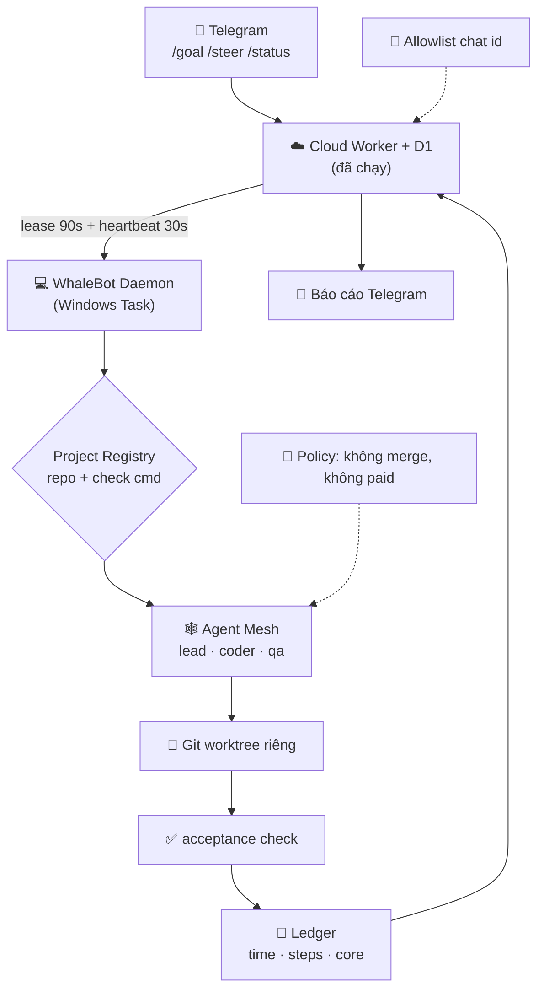

# WhaleBot — MVP (v0.1)

| Thuộc tính | Giá trị |
|---|---|
| ID | `MVP` |
| Trạng thái | `Draft` — chờ duyệt |
| Ngày | 2026-10-21 |
| Người vận hành | 1 người (Hướng) |
| Nền tảng | Windows 11 · Node >= 20 · Telegram |
| Engine tái sử dụng | `D:\BotAutoTask` (đã chạy thật) |
| Ngân sách mục tiêu | **0 ₫ / tháng** (model free + Cloudflare free tier) |

---

## 0. Một câu định nghĩa

> **WhaleBot là bộ điều hành để một người vận hành một doanh nghiệp AI nhiều phòng ban — bắt đầu bằng phòng Dev.**

MVP chứng minh đúng **một sợi dây**: bạn nhắn Telegram → bot chia việc → agent viết code trên máy bạn → có diff + test xanh → báo cáo về Telegram. Không có UI riêng, không có video, không có đăng bài, không có thuê bao.

**Định nghĩa "xong" của MVP:** từ điện thoại, ở ngoài đường, bạn gõ một câu, và 20 phút sau có một commit thật trong repo thật, kèm bằng chứng test — mà bạn không phải mở laptop.

---

## 1. Vì sao là bây giờ (và vì sao không xây lại từ đầu)

### 1.1. Vấn đề thật

| Triệu chứng | Hệ quả |
|---|---|
| Một người làm 5 vai: code, test, content, video, đăng bài | Không vai nào đủ sâu; luôn tắc ở khâu chuyển giao |
| Mỗi lần đổi ngữ cảnh (code → video → đăng bài) mất 20–40 phút | Năng suất thực tế ≈ 40% thời gian ngồi máy |
| Các dự án cũ (52Cast, SocialFlow, BotAutoTask) đều tự xây lại auth/queue/publish | Trùng lặp; không cái nào đủ để "chạy công ty" |

### 1.2. Tài sản đã có (không xây lại)

Đã kiểm chứng trên máy ngày 2026-10-21:

| Tài sản | Trạng thái thật | Dùng cho WhaleBot |
|---|---|---|
| Cloud Core `botautotask-cloud-core.huonghoang789hp.workers.dev` | ✅ sống, D1 có schema, `/api/state` trả `{goals:[],journal:[],commands:[]}` | Hàng đợi bền + điều khiển từ xa |
| Route Telegram trong Worker (`/goal /status /switch /mode /pause /cancel`) | ✅ code có, endpoint 200 | Cửa duy nhất để ra lệnh |
| 3 phiên đăng nhập 0-API-key | ✅ `codex` (ChatGPT OAuth), `opencode`, `antigravity` | Động cơ viết code miễn phí |
| Agent mesh `lead / coder / reviewer` | ✅ đủ 3, idle | Khung "phòng ban" |
| Worktree cách ly + kiểm tra `--check` | ✅ trong `src/core/worktree-manager.js` | Cô lập thay đổi, chặn "test đỏ" |
| Publisher đa nền tảng (Late API) + Remotion templates | ✅ có trong `52Cast` và `auviral-marketing-main/packages/remotion-templates` | Phòng Media (P2), không phải MVP |
| Bot Telegram token + webhook | ❌ chưa tạo | Việc đầu tiên phải làm |
| Daemon chạy nền | ❌ chưa đăng ký Scheduled Task | Việc thứ hai phải làm |

**Kết luận:** WhaleBot là **lớp điều hành mỏng** trên BotAutoTask, không phải sản phẩm mới. Mọi thứ "công ty" (phòng ban, ngân sách, phê duyệt, sổ cái) là thứ BotAutoTask **không có** — đó mới là phần ta viết.

---

## 2. Mô hình doanh nghiệp AI

```
                        BẠN (CEO) — Telegram
                               │
                     ┌─────────▼──────────┐
                     │  Chief of Staff    │  nhận lệnh, hỏi lại, chia việc, tổng hợp
                     └─────────┬──────────┘
          ┌────────────────────┼────────────────────┐
          │                    │                    │
   ┌──────▼──────┐     ┌───────▼──────┐     ┌───────▼──────┐
   │  PHÒNG DEV  │     │ PHÒNG MEDIA  │     │ PHÒNG PHÂN   │
   │  (MVP)      │     │  (P2)        │     │ PHỐI (P2)    │
   │ coder + qa  │     │ video gen    │     │ đăng bài     │
   └─────────────┘     └──────────────┘     └──────────────┘
          │                    │                    │
   ┌──────▼────────────────────▼────────────────────▼──────┐
   │ DỊCH VỤ DÙNG CHUNG: Project Registry · Ledger · Approval │
   └────────────────────────────────────────────────────────┘
```

**Quyết định phạm vi:** MVP chỉ mở **phòng Dev**. Media và Phân phối được *thiết kế chỗ cắm* nhưng **không viết code** — vì chúng cần 3 quyết định kinh doanh chưa có (§11).

### 2.1. Ba vai, không phải mười

| Vai | Trách nhiệm | Không được làm |
|---|---|---|
| **Chief** | Dịch câu nói của bạn thành goal có `repo`, `acceptance`, `deadline`; hỏi lại nếu thiếu; tổng hợp báo cáo cuối | Không tự code |
| **Dev** | Viết code trong worktree riêng, chạy test, tự sửa đến khi xanh | Không merge vào nhánh chính |
| **QA** | Chạy lại `--check`, đọc diff, bác bỏ nếu thiếu test hoặc sửa lén | Không sửa code của Dev |

---

## 3. Nguyên tắc thiết kế (bất khả xâm phạm)

1. **Một cửa.** Mọi lệnh vào qua Telegram. Không web UI riêng, không app desktop ở MVP.
2. **Không API key.** Chỉ dùng phiên đăng nhập đã có. Gặp 429 → đổi core, không mua key. `allow_paid_fallback = false`.
3. **Không merge tự động.** Bot đẩy worktree + báo cáo; bạn merge. Quyền ghi vào nhánh chính thuộc về người.
4. **Không có việc gì chạy mà không có bằng chứng.** Mỗi goal kết thúc bằng `diff --stat` + kết quả `--check` + commit hash. "Đã xong" mà không có 3 thứ đó = thất bại.
5. **Một người dùng, một máy.** Single-tenant: không auth, không billing, không multi-tenant. Đây là lý do MVP gọn được 10×.
6. **Tái dùng trước, viết sau.** Trước khi thêm file mới, phải trả lời: BotAutoTask đã có chưa? (xem §7).

---

## 4. Phạm vi MVP (MoSCoW)

### Must — có mới gọi là MVP

| # | Hạng mục | Ghi chú |
|---|---|---|
| M1 | Bot Telegram nhận lệnh, trả lời trong cùng chat | Token + webhook + allowlist chat id |
| M2 | Daemon chạy nền, tự bật khi đăng nhập, tự chạy lại khi lỗi | Scheduled Task, không cần `--once` |
| M3 | `/goal <mô tả> --repo <tên> [--check <cmd>]` chạy thật trên repo đã đăng ký | Dùng `repo_path`, không hardcode |
| M4 | Báo cáo cuối: `diff --stat`, test pass/fail, commit hash, thời gian, core đã dùng | Không báo "xong" chung chung |
| M5 | `/steer <agent> <chỉ thị>` — bẻ lái giữa lúc agent đang chạy | Khác biệt số 1 so với "chatbot" |
| M6 | `/status` đọc được trạng thái sống: đang chạy gì, bước mấy, agent nào | Không hiển thị "RUNNING" giả |
| M7 | Allowlist chat id duy nhất + từ chối mọi chat khác | Bắt buộc, không phải tuỳ chọn |
| M8 | Không tốn tiền: chạy 100% trên model free, ghi rõ core/model mỗi bước | Đo bằng ledger |

### Should — làm nếu còn thời gian

| # | Hạng mục |
|---|---|
| S1 | `/projects` — danh sách repo đã đăng ký kèm nhánh, test command |
| S2 | `/diff <goal-id>` — xem diff rút gọn ngay trong Telegram (≤ 40 dòng) |
| S3 | Ledger: thời gian + số step + core cho mỗi goal, tổng hợp tuần |
| S4 | `/undo <goal-id>` — xoá worktree + huỷ goal (không đụng nhánh chính) |
| S5 | Cảnh báo khi goal chạy > 30 phút không tiến triển |

### Won't — cố tình không làm ở MVP

| Hạng mục | Vì sao |
|---|---|
| Tạo video, dựng clip | Cần chốt model/ngân sách (§11) |
| Tự đăng TikTok/YouTube/Facebook | Rủi ro khoá tài khoản; cần cổng duyệt |
| Web dashboard riêng | Telegram + `/status` đã đủ cho 1 người |
| Multi-user, billing, subscription | Không phải sản phẩm bán; là công cụ cá nhân |
| Mobile app | Không cần |
| Vector DB / memory dài hạn | `DIRECTIVE.md` + journal đã đủ; thêm khi thấy thiếu thật |
| Auto-merge vào `main` | Nguyên tắc #3 |

---

## 5. Kiến trúc

### 5.1. Luồng chính (happy path)

```
[Bạn] --/goal--> [Worker: D1] --lease--> [Daemon trên PC] --spawn--> [Mesh]
   ▲                                        │                        │
   │                                        │                  lead → coder → qa
   └──────── báo cáo + diff --/status-------┘                        │
                                                              worktree + test
```

### 5.2. Sơ đồ khối



### 5.3. Phần nào là mới, phần nào là BotAutoTask

| Lớp | Nguồn | Viết mới? |
|---|---|---|
| Queue + lease + journal | BotAutoTask `cloud-core/worker.js`, D1 | Không |
| Telegram webhook | BotAutoTask `cloud-core/worker.js:426` | Không (thêm route `/steer`, `/projects`) |
| Daemon + failover | BotAutoTask `src/daemon/local-daemon.js` | Không |
| Mesh lead/coder/qa | BotAutoTask `src/core/agent-mesh.js` | Không (đổi roster/role prompt) |
| Worktree + check | BotAutoTask `src/core/worktree-manager.js` | Không |
| **Project Registry** | — | **Có** (~80 dòng + 1 file JSON) |
| **Ledger** | — | **Có** (~60 dòng + bảng D1 hoặc JSONL) |
| **`/steer` route** | — | **Có** (~30 dòng) |
| **Báo cáo có cấu trúc** | — | **Có** (~40 dòng) |

Tổng phần mới: **~250 dòng**. Đó là toàn bộ "công ty" ở MVP.

---

## 6. Yêu cầu (EARS)

| ID | Mức | Yêu cầu | Kiểm bằng |
|---|---|---|---|
| `MVP-R01` | MUST | Khi nhận tin nhắn từ chat id **không** nằm trong allowlist, hệ thống MUST từ chối và MUST NOT tạo goal. | Test gửi từ chat id lạ → 403, D1 không có row mới |
| `MVP-R02` | MUST | Khi nhận `/goal` thiếu `--repo`, hệ thống MUST trả về danh sách repo đã đăng ký và MUST NOT đoán repo. | Test đơn vị trên parser |
| `MVP-R03` | MUST | Khi một goal được lease, daemon MUST chạy trong worktree riêng và MUST NOT ghi vào nhánh chính của người dùng. | `git status` nhánh chính sạch sau khi chạy |
| `MVP-R04` | MUST | Khi `--check` trả mã khác 0, goal MUST kết thúc ở trạng thái `FAILED_CHECK` kèm log lỗi, MUST NOT báo thành công. | Chạy với check `exit 1` → trạng thái đúng |
| `MVP-R05` | MUST | Khi hoàn tất, báo cáo MUST chứa đủ: `diff --stat`, kết quả check, commit hash, thời lượng, `core:model`. | Snapshot tin nhắn trong test |
| `MVP-R06` | MUST | Khi nhận `/steer`, chỉ thị MUST đến đúng agent đang chạy trong ≤ 15 giây, MUST NOT làm mất journal. | Test mesh + đo thời gian |
| `MVP-R07` | MUST | Nếu một core trả 429/quota, daemon MUST chuyển core kế tiếp và MUST NOT gọi API trả phí. | Mock 429 → core thứ 2 chạy, ledger không có chi phí |
| `MVP-R08` | MUST | Daemon MUST tự chạy lại sau khi khởi động lại máy mà không cần thao tác tay. | Khởi động lại → goal trong queue vẫn được xử lý |
| `MVP-R09` | SHOULD | `/status` MUST hiển thị `stale` nếu không có cập nhật > 90 giây, thay vì hiện "đang chạy". | Test state stale |
| `MVP-R10` | SHOULD | Ledger MUST ghi được tổng thời gian và số goal/tuần bằng một lệnh. | `whale ledger --week` |

---

## 7. Điều kiện nghiệm thu (AC)

| ID | Cho | Khi | Thì | Tầng test |
|---|---|---|---|---|
| `MVP-AC01` | Bot đã cấu hình, chat id đúng | Gửi `/goal Sửa typo README --repo demo --check "npm test"` | ≤ 3s có tin "đã nhận"; kết thúc có báo cáo đủ 5 trường của `R05` | E2E thật (Telegram + daemon) |
| `MVP-AC02` | Goal đang chạy | Gửi `/steer coder "chỉ dùng node:crypto"` | Coder nhận chỉ thị ≤ 15s; journal vẫn còn bước trước đó | Integration (mesh + HTTP) |
| `MVP-AC03` | Repo có test đỏ sẵn | Chạy goal với `--check "npm test"` | Nhận `FAILED_CHECK` kèm 10 dòng log cuối, **không** có commit | Integration |
| `MVP-AC04` | Danh sách core đã cạn (mock 429 toàn bộ) | Chạy goal | Dừng với `NO_CORE_AVAILABLE`, không có lệnh gọi API trả phí nào trong log | Unit (mock fetch) |
| `MVP-AC05` | Chat id lạ | POST webhook giả lập | 403 + D1 không đổi | Unit (worker) |
| `MVP-AC06` | Máy vừa khởi động lại, còn 1 goal QUEUED | Chờ 2 phút | Goal được lease và chạy, không cần thao tác | Thủ công + log |

---

## 8. Số đo thành công (MVP)

| Chỉ số | Ngưỡng đạt | Cách đo |
|---|---|---|
| Thời gian lệnh → báo cáo đầu tiên | ≤ 25 phút (P50) | Ledger |
| Tỷ lệ goal có test xanh | ≥ 70% | Ledger |
| Chi phí API | **0 ₫** | Ledger, không có entry trả phí |
| Số thao tác tay sau khi gửi lệnh | **0** | Bạn không phải mở laptop |
| Số lần phải can thiệp `/steer` | ≤ 2 / goal | Journal |
| Thời gian bạn tiết kiệm / tuần | ≥ 5 giờ | Tự ghi, 4 tuần liền |

Nếu sau 4 tuần không đạt "≥ 5 giờ tiết kiệm", MVP thất bại — và đó là tín hiệu tốt: dừng, không xây phòng Media.

---

## 9. Kế hoạch 4 tuần (Tracer Bullet)

| Tuần | Việc | Kết quả kiểm được |
|---|---|---|
| **W1 — Sợi dây** | BotFather → secret → webhook → allowlist; Scheduled Task; `/goal` chạy 1 goal thật trên repo nhỏ nhất | `MVP-AC01`, `AC05`, `AC06` |
| **W2 — Không nói dối** | Báo cáo 5 trường; `FAILED_CHECK`; ledger; `/status` có stale | `AC03`, `R09` |
| **W3 — Điều khiển** | `/steer`; `/projects`; `/diff`; policy chặn merge/paid | `AC02`, `AC04` |
| **W4 — Tin được** | Chạy 10 goal thật liên tiếp; sửa cái gì hỏng; đo §8; viết `DECISIONS.md` | 10/10 có báo cáo đúng; số đo thật |

Nguyên tắc: **mỗi tuần phải có một thứ chạy được thật**, không tuần nào chỉ có "hạ tầng".

---

## 10. Rủi ro

| Rủi ro | Xác suất | Ảnh hưởng | Giảm thiểu |
|---|---|---|---|
| Model free đổi/ngừng giữa chừng | Cao | Bot đứng | 3 core đã có; failover tự động; cooldown 30' |
| Webhook công khai bị lạm dụng | Trung bình | Chạy lệnh lạ trên máy bạn | Allowlist chat id (bắt buộc) + từ chối mặc định |
| Agent sửa lung tung ngoài phạm vi | Trung bình | Mất code | Worktree riêng + không merge + `--check` |
| Telegram chặn bot / mất mạng | Thấp | Không ra lệnh được | Queue bền ở D1; lệnh chờ, không mất |
| Bạn thấy "chậm hơn tự làm" | Trung bình | Bỏ dự án | Đo §8 từ tuần 1, không đoán |
| Windows sleep giết daemon | Trung bình | Goal treo | `WakeToRun` + heartbeat + lease 90s |

---

## 11. Chỗ cắm cho giai đoạn 2 (chưa làm)

Phòng **Media** và **Phân phối** chỉ được thiết kế seam, không code:

```
goal_type: "code"  → executor: AgentMesh (hôm nay)
goal_type: "video" → executor: Remotion/pipeline (P2, chưa có)
goal_type: "post"  → executor: Late API adapter (P2, đã có mẫu ở 52Cast)
```

Ba quyết định **phải có trước khi viết dòng code P2**:

| # | Quyết định | Ảnh hưởng |
|---|---|---|
| P2-1 | Đăng ở đâu: TikTok / YouTube Shorts / Facebook Reels / cả 3? | Chọn API chính thức hay browser automation |
| P2-2 | Video tạo bằng gì: model API (tốn tiền) hay template (Remotion, free)? | Ngân sách và độ phức tạp |
| P2-3 | Tự đăng hay duyệt tay qua Telegram? | Rủi ro khoá tài khoản vs tốc độ |

Không chốt 3 điều này thì mọi thiết kế P2 đều là đoán.

---

## 12. Câu hỏi mở

| # | Câu hỏi | Đề xuất mặc định |
|---|---|---|
| Q1 | `[CẦN LÀM RÕ]` WhaleBot là **lớp trên BotAutoTask** hay **fork riêng**? | Lớp trên (import `dist/botautotask.mjs` hoặc gọi CLI). Fork = 2 codebase phải bảo trì |
| Q2 | `[CẦN LÀM RÕ]` Repo đầu tiên để test là repo nào? | `D:\WhaleBot` tự nó (dogfood: bot tự viết WhaleBot) |
| Q3 | `[CẦN LÀM RÕ]` Có cần lưu lịch sử chat Telegram (memory) ở MVP? | Không. Journal goal là đủ |
| Q4 | `[CẦN LÀM RÕ]` Ngưỡng chấp nhận rủi ro: bot được phép `git commit` trong worktree không? | Có, trong worktree. Không được `push`, không được merge |
| Q5 | `[CẦN LÀM RÕ]` Tên gọi phòng ban: Dev/Media/Distribution hay Code/Video/Publish? | Giữ Dev/Media/Distribution |

---

## 13. Bộ tài liệu sẽ viết tiếp

| File | Nội dung | Khi nào |
|---|---|---|
| `README.md` | Định vị, cách chạy 3 lệnh đầu tiên | Sau khi duyệt MVP |
| `AGENTS.md` | Luật làm việc cho agent trong repo WhaleBot | W4 |
| `docs/DECISIONS.md` | `D-01..D-0x` (lớp trên vs fork, single-tenant, không merge…) | W1 |
| `docs/SPEC-DEV.md` | Đặc tả phòng Dev (REQ/AC chi tiết hơn §6) | W1 |
| `docs/SPEC-OPS.md` | Vận hành: daemon, backup, sự cố, khôi phục | W2 |
| `docs/ROADMAP.md` | P2 Media + Distribution sau khi có 3 quyết định §11 | W4 |
| `docs/GLOSSARY.md` | Goal, lease, worktree, steer, ledger, core | W1 |

---

## 14. Việc làm ngay (sau khi bạn duyệt)

1. Tạo bot BotFather → token + chat id.
2. `wrangler secret put` 2 biến + `setWebhook`.
3. Đăng ký Scheduled Task cho daemon.
4. Chạy `MVP-AC01` trên repo `D:\WhaleBot`.
5. Chỉ khi AC01 xanh → mới viết `SPEC-DEV.md`.
