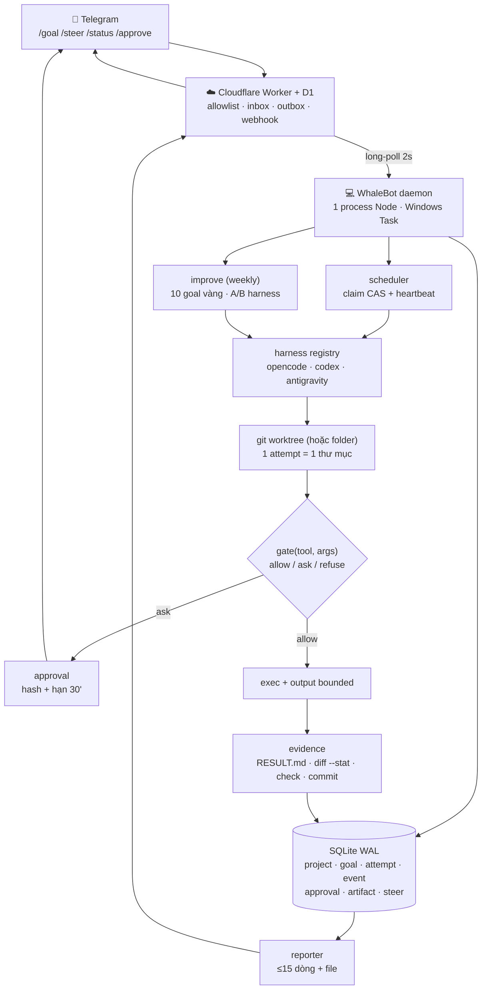

# Kiến trúc tham chiếu cho WhaleBot — tổng hợp 5 repo

| Thuộc tính | Giá trị |
|---|---|
| Ngày | 2026-10-21 |
| Đầu vào | `reason-network`, `neko-bot`, `orca`, `harness2`, `openmuse` |
| Đầu ra | Kiến trúc v0.2 + 12 quyết định + schema + lộ trình 4 tuần |
| Liên quan | [`MVP.md`](../../MVP.md) · [`reason-network`](./reason-network-architecture.md) · [`neko-bot`](./neko-bot-architecture.md) · [`orca`](./orca-architecture.md) · [`harness2`](./harness2-architecture.md) · [`openmuse`](./openmuse-architecture.md) · [`grokbot`](./grokbot-architecture.md) |
| Mục tiêu | Giữ MVP “một sợi dây” nhưng sửa 4 giả định sẽ vỡ khi chạy thật |

> **Cách đọc:** mỗi repo có báo cáo riêng. Tài liệu này chỉ chứa **quyết định**: lấy gì, bỏ gì, sửa gì, và tuần nào làm.

> **Ngoài bảng so sánh:** [`grokbot-architecture.md`](./grokbot-architecture.md) là sản phẩm đóng (không có LICENSE), không đưa vào ma trận 5 repo. Nó là **bằng chứng bổ sung** cho G1–G4: file thay heartbeat, `unknown`/`dropped` là trạng thái hợp lệ, quyền là dữ liệu, trạng thái suy ra từ dấu vết.

---

## 1. Năm repo trong một bảng

| | **reason-network** | **neko-bot** | **orca** | **harness2** | **openmuse** | **WhaleBot (đích)** |
|---|---|---|---|---|---|---|
| Bản chất | Danh bạ + bưu điện cho phiên agent | Trợ lý đa bot local-first | IDE điều phối đàn agent | Máy tự cải thiện harness | App agent cá nhân có task bền | Lớp điều hành 1 người |
| Ngôn ngữ | Rust | Go + Rust + TS + TSX | TS/Electron/Expo | Python | TS/Expo/Hono | **Node** |
| Quy mô | 14k dòng | 192k dòng | 38,6k file · 1,46 GB | 11,7k dòng | 36,4k dòng | **~1k dòng** |
| Store | SQLite 4 bảng | JSONL hash chain tự viết | SQLite orchestration | file + JSON | PGlite/Postgres, 1 bảng `records` | **SQLite WAL, 9 bảng** |
| Điểm mạnh nhất | `doing` + delivery tier | Nghĩa vụ trước, không retry mù | Worktree + adapter dialect | Harness là dữ liệu + vòng lặp cải thiện | Lease/CAS + approval có hash | — |
| Điểm chết người | P2P/roster cho team | 3 ngôn ngữ, 3 tầng | Khối lượng UI/hạ tầng | 4k rollout/task | PGlite + Expo + service ngoài | — |
| License | MIT/Apache | AGPL + không license | MIT | Apache-2.0 | MIT | Của bạn |
| Dùng được code? | Có | **Không** (`app/`) | Có (nhưng không nên) | Có | **Có, nên** | — |
| Bài học chính | Đọc dấu vết, không hỏi agent | Ghi nghĩa vụ trước khi chạy | Tách dispatch/attempt/outcome | Harness là file, không phải code | Lease + approval + `unknown` | — |

---

## 2. Bốn giả định của MVP sẽ vỡ

MVP hiện tại rất tốt về phạm vi. Nhưng đọc 5 repo xong, có 4 chỗ **sẽ fail khi chạy thật**, không phải vì code sai mà vì mô hình sai.

### G1 — D1 là “hàng đợi bền + lease 90s”

**Vấn đề:** lease/heartbeat qua HTTP mỗi 30s; không có transaction giữa `goal` + `attempt` + `event`; D1 là SQL nhưng worker chỉ chạy khi có request (hoặc cron tối thiểu 1 phút).

**Bằng chứng đối chiếu:**

- OpenMuse: lease + CAS + heartbeat + `LostLeaseError` nằm **cùng DB với task**, ~250 dòng (`worker.ts`).
- Neko: một writer, append-only, fsync trước ACK.
- Cả hai đều không dùng HTTP round-trip cho heartbeat.

**Sửa:** SQLite trên PC là **nguồn sự thật**. D1/Worker chỉ là **transport**: nhận webhook, giữ lệnh chờ, trả báo cáo. Daemon ghi SQLite, đồng bộ idempotent lên D1.

**Hệ quả:** bỏ được “lease 90s + heartbeat 30s” khỏi D1; thay bằng `UPDATE … WHERE lease_owner=? AND epoch=?` local, và một bảng `outbox` để sync.

### G2 — `/steer` ≤ 15 giây cho mọi core

**Vấn đề:** chỉ harness tier `push` mới làm được. `turn`/`pull` thì không — và đó là phần lớn harness (`DESIGN.md:226-239` của reason-network).

**Sửa:** `R06` thành hợp đồng có tier:

| Tier | Cam kết | Cách kiểm |
|---|---|---|
| push | ≤ 15s, có `ack` | đo từ `steer.created_at` → `steer.acked_at` |
| turn | tool call kế tiếp hoặc cuối lượt | `steer.delivered_at` do hook ghi |
| pull | lần `check_inbox` kế tiếp | `steer.read_at` |

`/steer` trả lời: `đã gửi → opencode (push), chờ ack…` hoặc `đã xếp → cursor (turn), sẽ đến ở tool call kế tiếp`. **Không bao giờ** nói “đã đến” khi chưa có ack.

### G3 — Goal chỉ có `RUNNING`, không có `unknown`

**Vấn đề:** daemon chết giữa lúc `git push` hoặc gọi API ngoài. Khởi động lại: goal vẫn `RUNNING`, hoặc bị retry → **đẩy 2 lần**.

**Bằng chứng:**

- Neko: `suspended` + “unknown or malformed shutdown cannot enable context refresh”.
- OpenMuse: restart → action `executing` chuyển `outcome_unknown` + *“Check the provider before creating another action”* (`db.ts:118-134`).
- README OpenMuse: *“No hidden retry occurs after an uncertain external write.”*

**Sửa:** thêm `attempt.state ∈ starting|running|stopped|unknown|never_launched|failed`; goal có `needs_owner`. `unknown` là trạng thái **hợp lệ**, không phải lỗi cần che.

### G4 — `/status` tin vào lời agent

**Vấn đề:** “RUNNING” là tự khai. Agent treo nhưng vẫn “RUNNING”; hoặc agent nói “đang sửa auth” trong khi đang đọc log.

**Sửa:** đọc dấu vết (reason-network `doing.rs`): title phiên + todo + tool cuối + file đã đổi + thời điểm output cuối. Không đọc được → `unknown`.

---

## 3. Kiến trúc v0.2



**Luồng một goal:**

1. Telegram → Worker: kiểm allowlist, tạo `command` trong D1, trả “đã nhận” ≤3s.
2. Daemon poll → ghi `goal` + `event accepted` trong **một transaction** SQLite.
3. Scheduler claim bằng CAS (`state=queued → leased`, `epoch+1`), tạo `attempt`.
4. Executor tạo worktree/folder, chạy harness với `--format json` (nếu có), ghi `last_output_at` mỗi event.
5. `gate()` chặn tool nguy hiểm; cần duyệt → `waiting_approval` + Telegram.
6. Kết thúc: thu evidence, chạy `--check`, ghi `attempt.state`, `goal.state`, `artifact`.
7. Reporter gửi ≤15 dòng + `RESULT.md`; ledger cập nhật.

**Luồng steer:**

```
/steer coder "chỉ dùng node:crypto"
  → steer row (tier từ harness registry)
  → push: gọi plugin/hook, chờ ack ≤15s → acked_at
  → turn: để trong inbox của attempt; hook ghi delivered_at
  → pull: chờ agent gọi check_inbox
  → /status hiện: "steer đã xếp, tier=turn, chờ tool call"
```

---

## 4. Mười hai quyết định

| ID | Quyết định | Vì sao | Nguồn |
|---|---|---|---|
| **D-01** | SQLite WAL là nguồn sự thật; D1 là transport | Lease/CAS cần transaction; heartbeat không nên qua HTTP | openmuse, neko |
| **D-02** | Tách `goal` / `attempt` / `event` | Một goal có nhiều lần chạy; gộp là mất khả năng chẩn đoán | orca, openmuse |
| **D-03** | Claim bằng CAS + `epoch`; heartbeat; mất lease → abort mọi ghi | Chống 2 daemon chạy cùng goal | openmuse, neko |
| **D-04** | `attempt.state` có `unknown`; goal có `needs_owner` | Crash/restart không được retry mù | neko, openmuse |
| **D-05** | Harness là **dữ liệu** (`harness/<id>.json` + cây file), không phải nhánh `if` | Thêm core không sửa mesh | orca (dialect), harness2 (surface) |
| **D-06** | Mỗi harness khai báo `tier` + `argv` + `resume` + `cost.parser` + `status.source` | `/steer` và `/status` cần biết sự thật | reason-network |
| **D-07** | `doing` đọc từ transcript/todo, không hỏi agent | Status không được nói dối | reason-network |
| **D-08** | Xong = evidence bundle (diff, check, commit, core:model, thời gian) | Chống “✅ DONE” rỗng | neko, openmuse |
| **D-09** | Approval = hash(payload) + hạn 30' + single-use + audit | Chống duyệt A chạy B | openmuse |
| **D-10** | Một cổng `llm()`/`exec()` duy nhất; `allow_paid=false` kiểm ở đó | Không thể lách chi phí ở nhánh khác | MVP §3.2 |
| **D-11** | Worktree 1 attempt; TTL 7 ngày; `whale gc`; không merge | Cô lập + không đầy ổ | orca + MVP §3.3 |
| **D-12** | Cải thiện harness theo tuần: 10 goal vàng, 2 biến thể, chọn bằng test | Bot giỏi lên mà không đổi model | harness2 |

**Điều quan trọng nhất trong bảng này là D-01 và D-04.** Hai quyết định còn lại đều có thể trì hoãn; hai cái này mà sai thì phải migrate dữ liệu.

---

## 5. Harness registry — thay cho `if (core === 'opencode')`

`harness/opencode.json`:

```json
{
  "id": "opencode",
  "bin": "opencode",
  "version_check": ["opencode", "--version"],
  "argv": ["run", "--format", "json", "--dir", "{worktree}", "{prompt}"],
  "resume": ["--session", "{session}"],
  "cwd": "{worktree}",
  "env_deny": ["ANTHROPIC_API_KEY", "OPENAI_API_KEY"],
  "tier": "push",
  "steer": { "how": "plugin:session.promptAsync", "ack": "session.execution.*" },
  "status": { "source": "session-json", "path": "{state}/session/{session}.json" },
  "cost": { "parser": "json.usage", "free": true },
  "artifacts": ["RESULT.md"],
  "timeout_min": 25
}
```

`harness/codex.json`:

```json
{
  "id": "codex",
  "bin": "codex",
  "argv": ["exec", "--json", "--cd", "{worktree}", "{prompt}"],
  "resume": ["--thread", "{session}"],
  "tier": "push",
  "steer": { "how": "codex queue --thread {session}", "ack": "PostToolUse" },
  "status": { "source": "session_index", "path": "~/.codex/session_index.jsonl" },
  "cost": { "parser": "json.usage", "free": true }
}
```

`harness/antigravity.json`: tier `turn` hoặc `pull` (tuỳ CLI), `status.source: "stdout"`.

**Quy tắc:** nếu một hành vi không khai báo được bằng dữ liệu, viết **một hàm** trong `harness/<id>.ts` và export cùng interface. Không tạo cây thư mục dialect như Orca.

---

## 6. Schema tối thiểu (SQLite, `node:sqlite`)

```sql
PRAGMA journal_mode = WAL;
PRAGMA foreign_keys = ON;
PRAGMA busy_timeout = 5000;

CREATE TABLE project (
  id TEXT PRIMARY KEY,                 -- slug
  name TEXT NOT NULL,
  path TEXT NOT NULL UNIQUE,
  check_cmd TEXT,                      -- "npm test"
  setup_cmd TEXT,                      -- "npm ci"
  worktree INTEGER NOT NULL DEFAULT 1, -- 0 = folder workspace
  max_minutes INTEGER NOT NULL DEFAULT 25,
  max_core_switches INTEGER NOT NULL DEFAULT 2
);

CREATE TABLE goal (
  id TEXT PRIMARY KEY,
  project_id TEXT NOT NULL REFERENCES project(id),
  prompt TEXT NOT NULL,
  state TEXT NOT NULL CHECK (state IN
    ('queued','leased','running','waiting_input','waiting_approval',
     'done','failed','needs_owner','cancelled')),
  epoch INTEGER NOT NULL DEFAULT 0,
  lease_owner TEXT, lease_until INTEGER,
  heartbeat_at INTEGER, last_progress_at INTEGER,
  attempt_id TEXT,
  origin TEXT NOT NULL DEFAULT 'telegram',
  nonce TEXT NOT NULL UNIQUE,
  created_at INTEGER NOT NULL, updated_at INTEGER NOT NULL
);
CREATE INDEX goal_ready ON goal (state, created_at);

CREATE TABLE attempt (
  id TEXT PRIMARY KEY,
  goal_id TEXT NOT NULL REFERENCES goal(id),
  n INTEGER NOT NULL,
  core TEXT NOT NULL, model TEXT, harness_ver TEXT,
  state TEXT NOT NULL CHECK (state IN
    ('starting','running','stopped','unknown','never_launched','failed')),
  pid INTEGER, worktree TEXT, branch TEXT,
  steps INTEGER NOT NULL DEFAULT 0,
  cost_usd REAL NOT NULL DEFAULT 0,
  stop_receipt TEXT,
  started_at INTEGER, ended_at INTEGER, last_output_at INTEGER,
  UNIQUE (goal_id, n)
);

CREATE TABLE event (            -- hash chain, 1 bảng
  seq INTEGER PRIMARY KEY,
  at INTEGER NOT NULL,
  type TEXT NOT NULL,           -- goal.accepted, attempt.started, tool.refused, ...
  goal_id TEXT, attempt_id TEXT,
  payload TEXT NOT NULL,
  prev_digest TEXT NOT NULL, digest TEXT NOT NULL
);

CREATE TABLE approval (
  id TEXT PRIMARY KEY,
  goal_id TEXT NOT NULL REFERENCES goal(id),
  kind TEXT NOT NULL,           -- push | post | paid | destructive
  payload TEXT NOT NULL,
  payload_hash TEXT NOT NULL,   -- sha256 canonical(payload)
  state TEXT NOT NULL CHECK (state IN ('pending','approved','denied','expired','executed')),
  expires_at INTEGER NOT NULL,
  decided_at INTEGER, created_at INTEGER NOT NULL
);

CREATE TABLE artifact (
  id TEXT PRIMARY KEY,
  goal_id TEXT NOT NULL REFERENCES goal(id),
  path TEXT NOT NULL, sha256 TEXT NOT NULL, bytes INTEGER NOT NULL
);

CREATE TABLE steer (
  id TEXT PRIMARY KEY,
  goal_id TEXT NOT NULL, attempt_id TEXT,
  body TEXT NOT NULL,
  tier TEXT NOT NULL,           -- push | turn | pull
  state TEXT NOT NULL CHECK (state IN ('queued','acked','delivered','read','orphan')),
  created_at INTEGER NOT NULL, acked_at INTEGER, delivered_at INTEGER, read_at INTEGER
);

CREATE TABLE lesson (
  id TEXT PRIMARY KEY,
  project_id TEXT NOT NULL REFERENCES project(id),
  goal_id TEXT, cue TEXT NOT NULL, lesson TEXT NOT NULL,
  evidence TEXT NOT NULL, harness_ver TEXT,
  created_at INTEGER NOT NULL, stale_at INTEGER
);

CREATE TABLE outbox (           -- ghi local trước, sync D1 sau (at-least-once)
  id TEXT PRIMARY KEY,
  topic TEXT NOT NULL,          -- goal.created | attempt.updated | report.sent
  payload TEXT NOT NULL,
  idempotency_key TEXT NOT NULL UNIQUE,
  state TEXT NOT NULL CHECK (state IN ('pending','sent','failed')),
  attempts INTEGER NOT NULL DEFAULT 0,
  next_try_at INTEGER, last_error TEXT,
  created_at INTEGER NOT NULL
);
CREATE INDEX outbox_due ON outbox (state, next_try_at);
```

**Chín bảng + 2 index.** Không có bảng `team`, `person`, `machine`, `federation` — vì không cần.

---

## 7. Ba vòng lặp

### 7.1 Vòng thực thi (mỗi goal)

```
claim → worktree → harness → gate → evidence → report → release
```

Điều kiện dừng:

| Điều kiện | Kết quả |
|---|---|
| `--check` exit 0 + có commit | `done` |
| `--check` exit ≠ 0 | `failed_check` (không commit) |
| Quá `max_minutes` | `needs_owner` (giữ worktree) |
| Đổi core > `max_core_switches` | `needs_owner` |
| Mất lease / daemon restart | attempt `unknown`, goal `needs_owner` |
| Tool bị `refuse` 3 lần | `failed_policy` |

### 7.2 Vòng điều khiển (mỗi tin nhắn)

| Lệnh | Đọc/ghi | Cam kết |
|---|---|---|
| `/status` | `goal` + `attempt` + `doing` | ≤ 2s; stale nếu `now - heartbeat > 90s` |
| `/steer` | `steer` + harness | tier + ack; không hứa quá tier |
| `/approve <id> <hash>` | `approval` | hash sai → từ chối |
| `/diff` | `artifact` | ≤ 40 dòng |
| `/undo` | worktree | không đụng nhánh chính |

### 7.3 Vòng cải thiện (mỗi tuần, harness2-lite)

```
10 goal vàng (có --check, đã từng chạy)
  → chạy base harness  → pass/time/interventions
  → chạy variant       → pass/time/interventions
  → adopt nếu: pass rate ≥ base
              và median time ≤ base × 1.10
              và không sửa file guardrail
  → ghi lessons/<repo>/EXPERIENCE.md
```

**Chi phí:** 20 lần chạy × ~10 phút = ~3,5 giờ máy. Với model free, tiền = 0; thời gian là chi phí thật. Chạy qua đêm.

**Luật chống tự lừa:**

- Prompt mô tả **công việc**, không mô tả **cách chấm** (harness2 `spec.py:111-126`).
- Guardrail map vào `gate()` là **code**, có hash; agent sửa file → `whale improve` từ chối.
- Không adopt nếu chỉ thắng nhờ sửa test hoặc xoá assertion → kiểm `diff` trên file test.

---

## 8. Bảng áp dụng: repo → cơ chế → file → công

| # | Cơ chế | Từ | Vào WhaleBot | Dòng |
|---|---|---|---|---|
| 1 | `doing` từ transcript/todo | reason | `src/status/doing.ts` | 80 |
| 2 | `tier` + ack cho steer | reason | `harness/*.json` + `src/steer.ts` | 50 |
| 3 | Loop guard (trần lượt agent↔agent) | reason | `src/mesh/run.ts` | 10 |
| 4 | Setup có backup + doctor | reason | `src/harness/wire.ts` | 120 |
| 5 | Worktree + TTL + gc | orca | `src/worktree/manager.ts` | 60 |
| 6 | Adapter dữ liệu | orca | `harness/*.json` | 60 |
| 7 | Skill do binary phục vụ | orca | `src/cli/skills.ts` | 40 |
| 8 | Harness là cây file + validator | harness2 | `harness/` + `src/improve/validate.ts` | 100 |
| 9 | Omitted-is-inherited | harness2 | `src/improve/propose.ts` | 20 |
| 10 | Thư viện bài học theo repo | harness2 | `lessons/<repo>/` + `src/lessons.ts` | 40 |
| 11 | Lease/CAS/heartbeat | openmuse | `src/queue/worker.ts` | 150 |
| 12 | Approval hash + expiry | openmuse | `src/approval/*.ts` | 80 |
| 13 | `outcome_unknown` khi restart | openmuse | `src/queue/recover.ts` | 30 |
| 14 | Evidence/Boundary | openmuse | `RESULT.md` template | 0 |
| 15 | Nghĩa vụ trước, không retry mù | neko | schema + policy | 0 |

**Tổng ~840 dòng** cho bản “đúng và không nói dối”. Nếu giữ đúng MVP §5.3 (~250 dòng), hãy làm **1, 2, 5, 11, 13, 14** trước — đó là 6 mục chặn lỗi đắt nhất (~370 dòng).

---

## 9. Nên cải tiến gì so với từng repo

Đây là phần “đừng copy y nguyên” — mỗi repo đều có một giả định không đúng với bạn.

| Repo | Giả định của họ | Cải tiến cho WhaleBot |
|---|---|---|
| **reason-network** | Tier là tuyên bố, không cần xác nhận | Thêm `acked_at` + timeout → fallback tier thấp hơn + báo người |
| | `doing` chỉ để hiển thị | Thêm `steps`, `files_touched`, `last_tool` → tiến độ thật |
| | Thư không gắn nghĩa vụ | Mọi `steer` gắn `goal_id`/`attempt_id`; attempt chết → `orphan` |
| | Không có ngân sách (vì là team người) | `max_minutes`, `max_core_switches`, `max_cost` |
| **neko-bot** | 3 ngôn ngữ cho ranh giới tin cậy | 1 process; ranh giới là **một hàm** `gate()` |
| | Tự viết journal | SQLite WAL + 1 bảng `event` |
| | 40 trạng thái | 9 trạng thái goal + 6 attempt |
| | 120 file nghiệm thu | 1 `RESULT.md`/goal + 1 `DECISIONS.md` |
| **orca** | UI là nguồn sự thật trạng thái | DB là nguồn sự thật; Telegram là view |
| | 30 agent × 5 nền tảng | 3–5 core; mỗi core 1 smoke test |
| | Worktree không TTL | TTL 7 ngày + `whale gc` |
| | Adapter cần PTY/screen | Headless + exit code + JSON |
| **harness2** | Không có ground truth → LLM chọn | WhaleBot có test → chọn bằng evidence; LLM chỉ phá hoà |
| | 4k rollout/task | 20 lần chạy/tuần |
| | Agent được sửa guardrails | Guardrail là code + hash; cấm sửa |
| | Không rollback | `harness/vN/` + `--rollback` |
| **openmuse** | PGlite + Postgres | 1 file SQLite + backup |
| | Lease 60s cố định | `lease_until` + `last_progress_at` tách rời |
| | CAS bằng JSON containment | `version` tăng đơn điệu (chống ABA) |
| | 1 bảng `records` | Bảng thật cho goal/attempt; JSON cho payload |
| | Approval chỉ email/calendar | Approval cho push/post/paid/destructive |

---

## 10. Bảy thứ không nên xây (dù repo kia có)

| # | Thứ | Vì sao không | Nếu sau này cần |
|---|---|---|---|
| 1 | P2P/iroh/relay riêng | 1 máy | Telegram + Worker; hoặc relay kiểu Orca |
| 2 | Desktop app (Electron/Tauri) | Telegram đủ | Chỉ khi có >5 thao tác/ngày không làm được qua chat |
| 3 | Mobile app | Telegram đã ở điện thoại | P3 |
| 4 | Multi-tenant/auth/billing | 1 người | Không bao giờ, nếu là công cụ cá nhân |
| 5 | Vector DB/memory dài hạn | `lesson` theo repo là đủ | Khi có >200 goal và tìm bằng từ khoá thất bại |
| 6 | Browser/computer tự động | Rủi ro cao, chưa cần | P3, có approval + egress policy |
| 7 | Tự viết agent loop | Đã có opencode/codex/antigravity | Không |

---

## 11. Lộ trình 4 tuần (sửa lại từ MVP §9)

| Tuần | Việc | AC | Thay đổi so với MVP |
|---|---|---|---|
| **W1 — Dây** | BotFather → secret → webhook → allowlist; Scheduled Task; `/goal` chạy 1 goal thật | AC01, AC05, AC06 | Thêm bảng `goal`/`attempt`/`event` + claim CAS **ngay từ đầu** (đừng đợi W2) |
| **W2 — Không nói dối** | `RESULT.md` evidence; `FAILED_CHECK`; `/status` có `doing` + stale; recover `unknown` | AC03, R09 | `doing` đọc từ harness, không tự khai; thêm `attempt.state=unknown` |
| **W3 — Điều khiển** | `/steer` theo tier + ack; `/approve`; budget guard; loop guard | AC02, AC04 | R06 sửa thành “theo tier”; approval có hash |
| **W4 — Tin được** | 10 goal thật; ledger; 1 thí nghiệm harness A/B; `DECISIONS.md` | §8 | Thêm vòng `improve` (chỉ 1 lần) |

**Nguyên tắc giữ nguyên:** mỗi tuần phải có một thứ chạy thật.

---

## 12. Tám invariant — viết thành test, không viết thành docs

| # | Invariant | Test |
|---|---|---|
| I1 | Không chạy gì khi chưa có `goal` + `event accepted` trong **cùng transaction** | Kill sau accept → restart → không có agent nào chạy |
| I2 | Claim phải thắng CAS; 2 claim đồng thời → đúng 1 thắng | 2 tiến trình claim cùng goal |
| I3 | Mất lease → mọi ghi bị từ chối | Xoá `lease_owner` giữa lúc chạy → `LostLeaseError`, không có write nào sau đó |
| I4 | Restart khi `attempt.state=running` → `unknown`, **không** auto-retry | Kill process → khởi động → goal `needs_owner` |
| I5 | Approval sai hash → từ chối | Sửa payload sau khi propose → approve fail |
| I6 | Không có lệnh gọi trả phí nào khi `allow_paid=false` | Mock provider cost > 0 → wrapper throw |
| I7 | `/steer` push phải có ack ≤15s, hoặc hiện “chưa đến” | Mock harness không ack → status nói thật |
| I8 | `/status` không bao giờ nói “running” khi heartbeat quá 90s | Set `heartbeat_at = now-120s` → hiện `stale` |

---

## 13. Rủi ro của kế hoạch này

| Rủi ro | Xác suất | Ảnh hưởng | Giảm thiểu |
|---|---|---|---|
| SQLite + D1 sync sai → mất lệnh | Trung bình | Goal không chạy | `outbox` + idempotency key + đối soát `/status` |
| Harness free đổi CLI/flag | Cao | Adapter vỡ | `version_check` + `doctor` + 1 smoke test/core/tuần |
| `doing` đọc sai định dạng transcript | Trung bình | Status sai | Không đọc được → `unknown`; không đoán |
| Approval bị bỏ qua vì bất tiện | Cao | Push/post sai | Chỉ bắt buộc với 3 loại; còn lại auto |
| Improve loop tốn thời gian vô ích | Trung bình | 3,5h/tuần | Chỉ chạy khi có ≥10 goal; dừng nếu 2 tuần không cải thiện |
| Windows sleep giết daemon | Trung bình | Goal treo | `WakeToRun` + lease + `unknown` |
| Worktree đầy ổ | Cao | Hết dung lượng | TTL + `whale gc` |
| Prompt injection từ repo | Trung bình | Đọc `.env`, gửi ra ngoài | Deny-read list + `gate` + không network cho goal lạ |

---

## 14. Bắt đầu từ đâu (tuần này)

1. **Chốt D-01**: SQLite là truth. Viết `src/db.ts` + migration `001_init.sql` (9 bảng ở §6). ~120 dòng.
2. **Chốt D-03/D-04**: `src/queue/worker.ts` theo OpenMuse, nhưng SQLite. ~150 dòng. Test I1–I4.
3. **Chốt D-05/D-06**: `harness/opencode.json` + `harness/codex.json`; sửa `agent-mesh.js` gọi registry. ~80 dòng.
4. **Chốt D-07**: `src/status/doing.ts` đọc session/todo; `/status` hiện `unknown` khi không đọc được. ~80 dòng.
5. **Chưa làm**: approval, improve, fan-out, sandbox. Đợi W3–W4.

Đúng như MVP §14: chỉ khi AC01 xanh mới viết `SPEC-DEV.md`. Nhưng **schema và lease phải làm ở W1**, vì đó là thứ không migrate rẻ được.

---

## 15. Câu hỏi mở (cần bạn quyết)

| # | Câu hỏi | Mặc định đề xuất |
|---|---|---|
| Q1 | Có chấp nhận SQLite là truth, D1 chỉ transport? | **Có** — nếu không, phải trả giá bằng lease HTTP + không transaction |
| Q2 | Core nào là `push` tier thật trên máy bạn? | Đo bằng thực nghiệm W1, đừng tin tài liệu |
| Q3 | Có cần approval cho `git push` ngay W3? | **Có** — push là hành động công khai đầu tiên |
| Q4 | Improve loop chạy tuần hay tháng? | Tuần, nhưng chỉ khi có ≥10 goal |
| Q5 | Worktree TTL bao lâu? | 7 ngày; goal `done` giữ 30 ngày nếu có commit |

---

## 16. Kết luận

Năm repo này không cho bạn một kiến trúc để copy. Chúng cho bạn **năm mảnh ghép đã được kiểm chứng**:

- **reason-network**: sự thật trạng thái đến từ dấu vết, không từ lời khai; giao thư phải biết tier.
- **neko-bot**: ghi nghĩa vụ trước khi chạy; không retry mù; xong phải có bằng chứng.
- **orca**: worktree là đơn vị cô lập; adapter là dữ liệu; dispatch ≠ attempt ≠ outcome.
- **harness2**: harness là file có version; cải thiện bằng thí nghiệm, không bằng cảm hứng.
- **openmuse**: lease/CAS/heartbeat; approval ràng buộc hash; `unknown` là trạng thái hợp lệ.

Ghép lại, chúng tạo thành **~800 dòng** đúng đắn cho một người — thay vì 192k dòng của Neko, 1,46 GB của Orca, hay 4k rollout của Harness².

Điều duy nhất còn lại là **chốt D-01** và bắt đầu viết `001_init.sql`.
