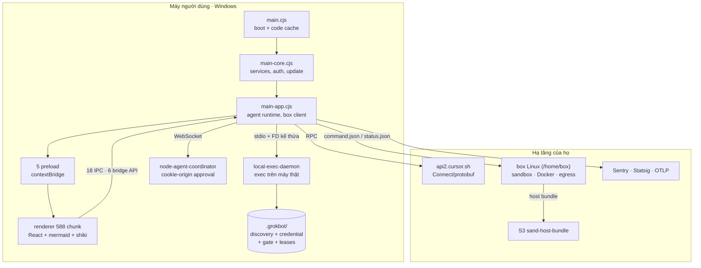

# Báo cáo kiến trúc: `Grok Bot` 0.71.2 (sản phẩm đóng)

| Thuộc tính | Giá trị |
|---|---|
| Đối tượng | Grok Bot desktop (`productName: "Grok Bot"`, tên nội bộ `sand`) |
| Phiên bản | **0.71.2**, build `2026-10-14T17:39:48Z` |
| Đường dẫn | `C:\Grok Bot\` · `resources\app.asar` 43.806.383 byte |
| Định danh | `sha256:68a8c906bdff14aa81b3d124c35d37d165684509a667226293a5b9c292abb955` |
| Phương pháp | REA `analyze_javascript_application` (graph + inventory) → trích ASAR → đọc tĩnh. **Không chạy app, không đăng nhập** |
| Quy mô | 639 file packed (+28 unpacked) · `dist/` 40,1 MB · 612 file liên quan, 596 file JS parsed · 7.216.574 AST node |
| Giấy phép | **Không có.** Sản phẩm đóng (`author: "SpaceXAI"`, stack `@anysphere/*` của Cursor). Chỉ học **cơ chế**, không sao chép mã |
| Bằng chứng runtime | `%APPDATA%\Grok Bot\desktop-structured-log-spill.v1.json` — 337 bản ghi, 4 lần khởi động, 19/10/2026 |
| Liên quan | [`REFERENCE-ARCHITECTURE.md`](./REFERENCE-ARCHITECTURE.md) · [`README.md`](./README.md) |

> **Cách đọc:** đây không phải repo OSS như 5 báo cáo trước. Không có `LICENSE`, không có source, mọi thứ dưới đây là **suy ra từ artefact đã ship**. Mỗi kết luận gắn `file:dòng` (bundle đã minify nên số dòng thô; kèm offset byte khi cần chính xác). Chỗ nào là suy luận sẽ ghi rõ *suy luận*.

---

## TL;DR

1. **Grok Bot là Cursor đội lốt.** `package.json` khai 45 package nội bộ `@anysphere/*` (`agent-core`, `agent-store-sync`, `local-exec`, `mcp-core`…), homepage `cursor.com`, backend `api2.cursor.sh`. Theo mọi dấu vết, đây là bản desktop của Cursor Agents khoác giao diện và model Grok.
2. **Hai chiếc máy tính.** Mọi tool chạy hoặc trên **box** (Linux VM do họ quản lý, `/home/box`) hoặc trên **máy của người dùng** qua `local-exec-daemon`. Hai bên có luật cấp quyền khác nhau.
3. **Không có cổng nào để tấn công.** Daemon local không mở socket: nó nhận **file descriptor kế thừa** + biến `SAND_LOCAL_EXEC_GENERATION`, rồi công bố trạng thái qua file JSON có credential mã hoá.
4. **Quyền là dữ liệu, không phải `if`.** `describes(action)` → scope (`global`/`setting`/`subject`/`call`), đối chiếu `ceiling`, `permission`, **approval record + danh sách đã thu hồi + standing grant**, và cờ `serverAuthoritative`.
5. **Câu từ chối là một phần của giao diện.** Mỗi lý do từ chối kèm chỉ dẫn "đừng thử lại, hãy làm X" — cùng triết lý "nghĩa vụ trước" của neko-bot, nhưng viết cho LLM đọc.
6. **Điều khiển box bằng file, không bằng RPC.** `/tmp/sand-supervisor/command.json` (+ `.part` → rename), `status.json`, `acks/`. Đây là bài học trực tiếp cho WhaleBot: file là transport rẻ và bền hơn HTTP nội bộ.
7. **Log của chính họ tố cáo điểm yếu trên Windows.** 129 `edge_failed`, trong đó **94 lần** ở leg `push|coordinator-port` trong một lần chạy. WhaleBot chọn long-poll là đúng.

---

## 1. Bản đồ hệ thống



Bốn cửa sổ Electron (`BrowserWindow`) và hai utility process, cộng một daemon thực thi, một coordinator, một box từ xa.

---

## 2. Khởi động và mô hình tiến trình

`main.cjs` chỉ làm ba việc: dựng **code cache** theo `buildId`, chạy `main-core` rồi `main-app`, và báo lỗi khởi động.

```js
// dist/electron-main/main.cjs:4 (rút gọn)
let t = e("main-core");
E(Ze(t.exports), "main-core.cjs does not export remainderDue and noteStartupFailed.");
let { remainderDue: r, noteStartupFailed: n } = t.exports;
return r.then(() => {
  let o = e("main-app");
  o.exports.reportMainCodeCache(t.codeCache);
  o.exports.reportMainCodeCache(o.codeCache);
}).catch(o => n(o));
```

Ba điểm đáng chú ý:

1. **Hợp đồng export được kiểm tra lúc chạy.** `main-core` phải export đúng hai hàm; sai → `SandInvariantViolation`, không fallback im lặng.
2. **`buildId` là khoá cache.** `buildId:"41293fa0-ee0c-4047-9034-d6ce50700913"` — đổi build là đổi cache, không có cache "lẫn" giữa hai phiên bản.
3. **Thông điệp invariant bị bóc trong bản đóng.** `"Invariant violation (message stripped in packaged builds; the stack identifies the site)"` (`main.cjs:2`). Họ giữ stack frame, bỏ nội dung — đánh đổi có chủ ý: bảo vệ IP, nhưng người dùng gặp lỗi chỉ thấy "invariant violation".

REA đo được bề mặt renderer: **4 browser window, 6 contextBridge API, 18 thao tác IPC, 6 handler ở main, 0 preload entrypoint được nhận diện theo tên** (preload thật nằm ở `dist/electron-preload/*.cjs`, 5 file). Con số nhỏ này gợi ý gần như mọi thứ đi qua **một** RPC layer thay vì hàng trăm kênh IPC.

---

## 3. Hai chiếc máy tính

Đây là mô hình khái niệm quan trọng nhất, và WhaleBot đang thiếu nó.

| | **Box** (máy của họ) | **Local computer** (máy người dùng) |
|---|---|---|
| Nơi chạy | Linux VM, `/home/box` | Windows/macOS của bạn, qua daemon |
| Công cụ | `Shell`, `Read`, `AwaitShell` **không** có `machineId` | cùng các tool đó **kèm** `machineId`, thêm `run-command`, `read-file`, `write-file`, `list-directory`, `send-input`, `use-app`; `CopyToBox`/`CopyFromBox` cũng đọc/ghi máy thật |
| Quyền mặc định | Rộng (đã sandbox) | Hẹp, theo từng action + người |
| Ai quyết định | Vòng lặp agent | **Người dùng**, qua setting `local tool access` (Never / …) |

Tool nào chạy ở đâu được nói thẳng trong thông điệp lỗi:

```js
// dist/local-exec-daemon/main.cjs:626
tv = `Local tools are turned off. The user has set local tool access to "Never", so
${Bt.Shell}, ${Bt.Read}, and ${Bt.AwaitShell} with machineId, plus ${Bt.CopyToBox}
and ${Bt.CopyFromBox}, cannot run on their computer. Do not retry them while this
setting remains "Never". Use your own computer instead ...`
```

Ngữ nghĩa ở đây đáng copy nguyên văn: **từ chối kèm (a) lý do, (b) phạm vi ảnh hưởng, (c) chỉ dẫn thay thế, (d) cấm thử lại.** Đó là cách biến một lỗi thành một hành vi đúng.

Đọc kỹ đại từ: `their computer` = máy người dùng, `your own computer` = box. Cùng một tool (`Shell`) đổi đích theo `machineId`; không có `machineId` thì chạy trên box (*suy luận*), không có hai tool trùng tên.

---

## 4. `local-exec-daemon`: thực thi trên máy thật

### 4.1 Bắt tay không qua mạng

Daemon nhận mọi thứ qua môi trường và file descriptor:

```js
// dist/local-exec-daemon/main.cjs:793
function Q8r(t){
  let e = zwe(t[N9]);            // N9 = "SAND_LOCAL_EXEC_INHERITED_FDS"
  delete t[N9];
  let r = t[Ypt] ?? null;        // "SAND_LOCAL_EXEC_FILE_KEY"
  delete t[Ypt]; delete t[_6e];
  let n = eSe(t, s0);            // fingerprint proxy
  let i = Number(t[g6e]);        // "SAND_LOCAL_EXEC_GENERATION"
  return { inheritedFds: e, preIpcFileKeyBase64: r != null && qX(r) ? r : null,
           generation: Number.isInteger(i) && i >= 0 ? i : void 0,
           proxyFingerprint: n?.fingerprint };
}
```

- **Không `listen()`.** Không có TCP, không có named pipe công khai. Quét toàn bundle: 0 hit `createServer`/`listen`.
- **`generation`** là **fencing token**: cha truyền qua env, con **công bố lại trong discovery** (`generation: t.generation`, `main.cjs:768`); bên đọc so sánh để biết daemon thuộc lần chạy nào. Cùng ý tưởng `epoch` trong [`REFERENCE-ARCHITECTURE.md`](./REFERENCE-ARCHITECTURE.md) §6, nhưng truyền qua env thay vì SQL. (Daemon **không** tự kill khi lỗi thời — enforcement nằm ở phía đọc.)
- **File key** để mã hoá credential đi kèm, không ghi ra đĩa dạng plaintext.

### 4.2 Bảy file trạng thái, không cổng nào

```js
// main.cjs:624-625
"local-exec-daemon-connection.json"      // credential backend + user computers
"local-exec-daemon.json"                 // discovery: pid, startedAt, servingAt, inflightCount, generation
"local-exec-daemon-credential.json"      // mã hoá bằng fileKey
"local-exec-supervisor.json"             // heartbeat { pid, at }
"local-exec-update-lease.json"           // { until } — không update khi đang bận
"local-exec-backend-return.json"         // { at }
"local-computer-use-gate.json"           // { isOn }
```

Kèm quy ước đọc rất cụ thể:

```js
// main.cjs:625 (nguyên văn)
var xxt = { pid: 0, at: 0 };
async function iQ(t = tQ())   { return await g1(t, B2(gxt()), { failOpen: !0 }) ?? xxt; }
async function Ixe(t, e = QX()) {
  return (await sQ(e, { failOpen: !0 }))?.pid !== t ? !1
       : (await XX.promises.rm(e, { force: !0 }), !0);   // xoá discovery nếu pid khớp
}
function oQ(t) { try { return process.kill(t, 0), !0 } catch (e) { return xn(e) === "EPERM" } }
async function Mxe(t = wxt()) { return (await g1(t, B2(yxt()), { failOpen: !0 }))?.isOn === !0; }
```

**Liveness = `kill(pid, 0)`**, không phải heartbeat qua HTTP. `EPERM` vẫn tính là sống (tiến trình tồn tại nhưng khác user). `kill(pid,0)` trả lời "còn sống không"; `local-exec-supervisor.json` trả lời "lần cuối phục vụ khi nào".

### 4.3 `cwd` không dùng `chdir`

Daemon sống lâu, nhiều phiên song song, nên `process.chdir()` là race. Họ giải bằng một wrapper shell:

```js
// main.cjs:25
AA = `cd "$1" || { printf %s 'cursor-fuse-cwd:cd'; exit 79; }; shift; exec "$@"`
// nhận diện marker trong stdout trước khi nhả output cho client
AX = "exec_daemon.spawn.cwd_hop"
CA = "exec_daemon.spawn.cwd_hop_cd_failed"
```

Đọc stdout, giữ 32 byte đầu, nếu khớp marker thì coi như `cd` thất bại (`exit 79`) thay vì chạy lệnh ở sai thư mục. **Đây là loại lỗi chỉ xuất hiện khi chạy thật** — và cách họ xử lý là một mẫu để copy.

---

## 5. Permission engine: quyết định bằng dữ liệu

Hàm `qQ` trong daemon là trung tâm của việc cấp quyền:

```js
// main.cjs:626 (diễn giải — biến đã đổi tên cho dễ đọc, nhánh giữ nguyên)
async function qQ(t){
  let { describes: e, permission: r } = t,
      n = e === void 0 ? "global" : FA(e.action),
      i = t.serverAuthoritative === !0;
  if (i) {
    if (Xbt(t.authorization, n)) return i6;             // approval | standing(global)
  } else {
    if (t.ceiling === "never") return JQ(tv);           // trần tuyệt đối
    if (r === "always" && n === "global") return i6;
    if (r === "never"  && n !== "global") return JQ(tv);
  }
  if (n === "setting") return t.messagesEnabled ? i6 : JQ(uTe);
  if (n === "subject" && e !== void 0 && await Qbt(t, e)) return i6;  // standing grant
  if (!STe(t) || e === void 0) return iv;               // không có approvalId → ask
  let s = (await Zbt(t.approvalsPath, t.retirementsPath)).get(t.approvalId);
  return s === void 0 || (i && (...scope mismatch...)) ? iv
       : dTe({ ...s, ...(s.action === "run-command" ? { resourcePath: t.terminalsFolder } : {}) }, e) ? i6 : iv;
}
```

Bảng scope — mỗi action thuộc đúng một mức:

```js
// main.cjs:625
Txt = { "run-command":"global", "send-input":"global", "read-file":"global",
        "list-directory":"global", "write-file":"global", "read-ai-tool-setup":"global",
        "read-messages":"setting", "send-imessage":"subject",
        "run-phone-tool":"call", "use-app":"subject" };
```

Bốn ý tưởng có thể bê nguyên:

| Cơ chế | Vì sao đáng |
|---|---|
| `describes(action)` | Quyền gắn với **hành vi được mô tả**, không gắn với tên tool. Tool đổi tên không phá policy. |
| `ceiling` | Trần cứng (ví dụ hạ tầng công ty đặt `never`), thắng mọi setting người dùng. |
| `approvalsPath` + `retirementsPath` | Approval **bị thu hồi sẽ bị loại khỏi tập hiệu lực** — không tái sử dụng. Khớp `approval` có hash + expiry của openmuse. |
| `serverAuthoritative` | Cùng một hàm chạy ở chế độ local và chế độ server. Không có hai nhánh code lệch nhau. |

### 5.1 Rule allowlist được kiểm tra độ rộng

Trước khi nhận một rule `executable:args`, họ từ chối rule vô nghĩa:

```js
// main.cjs:4
if (e.length === 0) return "Rule cannot be empty";
if (e.length > 512) return "Rule cannot exceed 512 characters";
if (dW(e))          return "Rule cannot match every command; be more specific than wildcards alone";
if (e.startsWith(":")) return "Colon rules need an executable before `:` (e.g. `aws:*s3 rm*`)";
// ...
return "Rule cannot match every command; narrow the executable or argument pattern";
```

`dW(t)` = "mọi ký tự đều là `*`". Đây chính là lỗ hổng phổ biến của mọi `allowlist`: người dùng thêm `*` cho xong. Grok Bot chặn ngay lúc nhập, kèm ví dụ đúng.

---

## 6. Sandbox và network policy

Spec sandbox là một object thuần, ghép từ **bốn tầng**: hardcoded → `perUser` → `perRepo` → `teamAdmin` (**team thắng**). Base do `Lke(workspaceDir)` dựng:

```js
// main.cjs:58 (Lke)
return { type: "workspace_readwrite",
         additionalReadonlyPaths: n,        // từ entry "absolute" và "home"
         writeProtectionMapping: Ckt(t),    // workspace/git/worktree → pattern
         ...(e && { networkPolicy: e }),    // Pkt() → { version:1, deny:[...Ike] }
         networkPolicyStrict: !0 };         // ép cứng, không phải default
```

Hàm `$ke` hợp nhất ba lớp override:

```js
// main.cjs:58 ($ke, rút gọn)
let a = Lke(o);                                  // base
let p = BS(n?.disableTmpWrite, i?.disableTmpWrite, s?.disableTmpWrite);        // OR
let m = BS(n?.networkPolicyStrict, i?.networkPolicyStrict,
           s?.networkPolicyStrict, a.networkPolicyStrict);                     // OR
let h = Ng(n?.readBoundary, i?.readBoundary, s?.readBoundary) ?? "system";    // last-wins
let P = QP(n?.networkPolicy, i?.networkPolicy, s?.networkPolicy, a.networkPolicy);
let b = s?.networkPolicy?.allow;                 // teamAdmin
b?.length && (P = { ...P, allow: [...b] });      // REPLACE, không cộng dồn
```

Ngữ nghĩa, đọc trực tiếp từ bốn hàm:

| Hàm | Nghĩa | Hệ quả |
|---|---|---|
| `BS(...)` | `some(x => x === true)` | chỉ cần một tầng bật là bật |
| `Ng(...)` | lấy giá trị **cuối** khác `undefined` | teamAdmin thắng perRepo, thắng perUser |
| `QP(...)` | `default:"deny"` ở bất kỳ tầng nào → deny; `deny`/`allow` cộng dồn | deny thắng allow |
| `Dke(t)` | không có policy → `{version:1, default:"deny"}` | fail-closed |

Bốn hệ quả đáng chú ý:

1. **`networkPolicyStrict` không tắt được.** `Lke` luôn trả `true`, `BS` là OR — user/repo/team đều không thể hạ.
2. **`teamAdmin` thu hẹp được quyền user.** `allowUserOverrideReadPaths === false` → chỉ dùng `additionalReadPaths` của team; `teamAdmin.networkPolicy.allow` **thay** danh sách allow.
3. **Loại policy không trộn.** `FS()` chọn đúng một: `teamAdmin.type ?? perRepo.type ?? perUser.type ?? "insecure_none"`.
4. **Network fail-closed, nhưng sandbox fail-open.** `Dke(undefined)` → `{default:"deny"}`; ngược lại `Eo()` trả `{policy:{type:"insecure_none"}}` khi workspace không có policy nào. Đây là chỗ **không** nên copy: WhaleBot phải fail-closed ở cả hai.

Các trục kiểm soát:

| Trục | Giá trị | Ghi chú |
|---|---|---|
| `type` | `workspace_readwrite` | workspace ghi được, ngoài workspace chỉ đọc |
| `readBoundary` | `"system"` (mặc định) | `"workspace"` thì giới hạn read path |
| `additionalReadPaths` | mảng | user + repo; team có thể chặn nới |
| `additionalReadonlyPaths` | mảng | hợp của mọi tầng + base |
| `disableTmpWrite` | boolean | OR — chặn ghi `/tmp` |
| `networkPolicy` | `{version, default, allow[], deny[]}` | default-deny; deny thắng allow |
| `networkPolicyStrict` | luôn `true` | hardcoded + OR |
| `allowUserOverrideReadPaths` | boolean | teamAdmin chặn user nới read path |
| `writeProtectionMapping` | map | workspace/git/worktree → pattern |

Thêm hai lớp ngoài sandbox:

- **Egress tunnel**: `SAND_EGRESS_TUNNEL_URL` + bearer + `x-anyrun-network-token`; `allowPrivateTargets` chỉ `true` khi `SAND_EGRESS_TUNNEL_ALLOW_PRIVATE === "1"` — mặc định chặn target private (`main.cjs:624`).
- **Box computer**: Docker (`SAND_BOX_COMPUTER_SHARED_DOCKER`, `SAND_BOX_COMPUTER_DOCKER_HOST`), `containerName` mặc định `cursor-box-shared`.

Điểm đáng học: **policy là dữ liệu có thứ tự ưu tiên**, không phải chuỗi `if`; **deny thắng allow**; **team thắng user khi thu hẹp**; **không cấu hình = deny**. WhaleBot hiện chưa có tầng nào trong bốn tầng này.

---

## 7. Box control plane: file là transport

Đường dẫn và giao thức:

```js
// dist/electron-main/main-app.cjs:4
ph  = "/tmp/sand-supervisor"
efe = `${ph}/command.json`          // desktop → box
l_t = `${efe}.part`                 // ghi tạm rồi rename
c_t = `${ph}/status.json`           // box → desktop
d_t = `${ph}/acks`                  // ack từng command
tfe = `${ph}/incoming-host-bundle.tgz`   // (+ .part)
p_t = `${ph}/desktop-health.json`
kx  = "/home/box/sand-data"
f_t = `${kx}/.sand-host-upgrade.json`
qz  = "/opt/sand/sand-host"         // host-main.cjs + version
afe = "sand-host-bundle"            // S3: public-asphr-vm-daemon-bucket/us-east-1
```

Vì sao đáng quan tâm:

1. **Không cần RPC để điều khiển máy từ xa.** Desktop ghi `command.json` (+ `.part` → rename) rồi đọc `status.json`/`acks/`; chiều box đọc/ghi do `host-main.cjs` đảm nhiệm — file đó **không nằm trong asar** (tải từ S3), nên phần chạy trên box là *suy luận từ tên file + vị trí*, không phải đọc được. Mất kết nối không mất lệnh — lệnh vẫn nằm trên đĩa.
2. **`.part` + rename** xuất hiện ở cả command và host bundle. Cùng một quy ước, áp dụng nhất quán.
3. **Host bundle tách khỏi app.** Desktop tải bundle từ S3, đẩy vào `incoming-host-bundle.tgz`; box cài vào `/opt/sand/sand-host` kèm file `version` và marker `.sand-host-upgrade.json`, cache 360 phút.
4. **`x-sand-box-park`** — header cùng họ `sand-box-*`, tên cho thấy cơ chế **park** (tạm dừng) box thay vì kill. Không thấy code box nên chưa xác nhận được vòng đời park/resume.

Đây là mô hình WhaleBot nên dùng cho `D:\WhaleBot`: **DB là sự thật, file là hộp thư giữa các tiến trình**, không phải HTTP nội bộ.

---

## 8. Độ tin cậy: từ vựng lỗi + log có bộ đếm

### 8.1 Mỗi kiểu hỏng có một tên

```js
// main-app.cjs:158
"sand.box_recreate_visible"  "sand.box_rebuild_stage"   "sand.box_rebuild_escalation"
"sand.box_rebuild_pending_stall" "sand.box_migration_watch" "sand.box_reachability"
"sand.box_dns_diagnostic"    "sand.agents_unreachable"  "sand.access_blocked"
"sand.transport.stream_down" "sand.desktop.coordinator_lifecycle" "sand.recovery_action"
"sand.replica.resync"        "sand.resync.completed"    "sand.send_journal.restore"
"sand.policy.stopped"        "sand.renderer.boundary_caught"
```

Không phải log tự do. Đây là **bảng chữ cái của các kiểu thất bại**, đủ hẹp để đếm và vẽ biểu đồ, đủ rộng để phủ: box chết, DNS sai, agent không tới được, transport đứt, policy chặn, renderer vượt ranh giới.

`box_rebuild` có **stage → escalation → pending_stall**: một state machine leo thang, không phải retry mù.

### 8.2 Log có checkpoint và bộ đếm thất bại

`desktop-structured-log-spill.v1.json` (141 KB, thật trên máy này):

```json
"checkpoint": {
  "counterId": "1233077a…",
  "counters": { "ship_failed": {"observed":13,"acknowledgedThrough":0},
                "overflow_evicted": {…}, "replay_expired": {…},
                "backend_dropped": {…}, "account_rotated": {…} },
  "records": [ … 337 … ]
}
```

Bốn tính chất:

| Tính chất | Cài đặt |
|---|---|
| Không mất log khi mạng hỏng | ghi ra file spill, ship sau, có `acknowledgedThrough` |
| Không phình vô hạn | `overflow_evicted` đếm số bản ghi bị đẩy |
| Không trộn tài khoản | `accountSlot: "logged-out"` — log chia theo account |
| Không đoán thời gian khởi động | mỗi phase có `duration_ms` riêng: `native_boot_ms`, `app_ready_wait_ms`, `main_handoff_ms`, `update_service_ms`, `auth_service_ms`, `renderer_hold_ms`, `experiments_ms`, `connector_ms`, `telemetry_ms`, `coordinator_ms`, `window_ms`, `renderer_ms` |

Đây là **instrumentation của một sản phẩm thật**, không phải "thêm vài console.log". WhaleBot hiện chưa có bất kỳ bộ đếm nào.

### 8.3 Bằng chứng runtime: điểm yếu trên Windows

Cùng file log, một lần chạy 19/10/2026:

| Sự kiện | Số lần | Chi tiết |
|---|---|---|
| `sand.desktop.edge_failed` | **129** | `push\|coordinator-port` **94**, `push\|host-settings` 29, `box-settings-list\|mcp-manager` 2, `install-backfill\|mcp-manager` 2, `quit-blur\|window-focus` 2 |
| `sand.box_migration_watch` | 198 | **cả 198** đều `phase: dropped`; `consecutive_failures` cao nhất **180** |
| `sand.update.check` | 4 | `flags_age_ms: 25140` — lấy feature flag trước khi check update |
| `sand.desktop.startup` | 4 | `os_sandbox: "true"`, `hw_accel: "unknown"` |

**Quan sát, không suy diễn nguyên nhân:** kênh push nội bộ (`coordinator-port`) hỏng 94 lần trong một phiên trên Windows 11. App vẫn khởi động được, nhưng phiên log này `signedIn: false` nên **không kiểm chứng được** có fallback hay không. Điều chắc chắn: **push nội bộ là leg hỏng nhiều nhất**, đúng như lý do WhaleBot chọn long-poll.

---

## 9. Multi-agent: hợp đồng subagent

Trong descriptor protobuf của agent client:

```js
// main.cjs:629 — SubagentArgs (nguyên văn descriptor, lược field không cần)
"SubagentArgs|1 tool_call_id 9|2 subagent_type 9|3 model_id 9|4 prompt 9|
 5 readonly 8|6 resume_agent_id 9?|7 run_in_background 8?|
 8 continuation_config #0|9 parent_conversation_id 9?|
 10 api_key_credentials #1|11 azure_credentials #2|12 bedrock_credentials #3|
 13 interrupt 8?|14 mode #4|15 fork_agent_id 9?|16 root_parent_conversation_id 9?|
 17 selected_context #5?|18 direct_meta_parent …"
```

Ngoài ra còn `ForceBackgroundSubagentArgs` (`tool_call_id`) — ép một subagent đang chạy xuống background, và `SubagentError` (`agent_id`, `error`).

Sáu thứ WhaleBot đang thiếu:

1. `readonly` — subagent chỉ đọc, chạy song song không sợ ghi đè.
2. `run_in_background` — không chặn lượt của cha.
3. `resume_agent_id` — nối lại agent đã dừng, không tạo mới.
4. `fork_agent_id` + `parent_conversation_id` + `root_parent_conversation_id` — **cây hội thoại**, không phải danh sách phẳng.
5. `interrupt` — dừng mềm, không kill.
6. `model_id` + `modelParameters` per-subagent — model khác nhau cho việc khác nhau.

Không có ACP trong bundle (0 hit `session/prompt`, `agent-client-protocol`). Họ dùng **Connect/protobuf + WebSocket** riêng. WhaleBot không cần theo: ACP/JSON-RPC của opencode là đủ, nhưng **hợp đồng subagent** thì nên copy ý tưởng.

---

## 10. Lấy gì cho WhaleBot

| # | Cơ chế | Từ | Vào WhaleBot | Dòng |
|---|---|---|---|---|
| 1 | Discovery + credential + liveness bằng file, không mở cổng | §4.2 | `src/daemon/handshake.ts` | 90 |
| 2 | `generation` fencing truyền qua env cho tiến trình con | §4.1 | `spawn` trong `src/queue/worker.ts` | 15 |
| 3 | `cwd hop` có marker, không `chdir` | §4.3 | `src/harness/spawn.ts` | 20 |
| 4 | `describes → scope → ceiling → approval + retirement` | §5 | `src/approval/decide.ts` | 120 |
| 5 | Rule `executable:args` + chặn rule quá rộng | §5.1 | `src/gate/rules.ts` | 40 |
| 6 | Câu từ chối kèm chỉ dẫn "đừng thử lại" | §3 | `src/gate/messages.ts` | 25 |
| 7 | Từ vựng sự kiện lỗi + stage/escalation | §8.1 | `src/events.ts` + `tests` | 60 |
| 8 | Log spill có checkpoint + bộ đếm | §8.2 | `src/log/*.ts` | 70 |
| 9 | Update lease (`{until}`) chặn restart giữa task | §4.2 | `src/daemon/lease.ts` | 25 |
| 10 | `command.json`/`status.json`/`acks` cho CLI ↔ daemon | §7 | `src/daemon/filebox.ts` | 80 |

**Tổng ~545 dòng.** Bản tối thiểu đáng làm trước: **1, 2, 4, 5, 7** (~325 dòng) — tất cả đều là chống "nói dối" và chống "cấp quyền quá rộng", đúng chỗ MVP yếu nhất.

### Grok Bot đối chiếu 4 giả định G1–G4

| Giả định MVP | Grok Bot làm gì | Kết luận |
|---|---|---|
| **G1** D1 là hàng đợi bền | Không có hàng đợi HTTP. File discovery + PID + `kill(0)` | Củng cố: SQLite local là sự thật |
| **G2** `/steer` ≤15s mọi core | Không có khái niệm steer; có `interrupt` + `resume_agent_id` | Củng cố: điều khiển là **theo tier**, không một SLA |
| **G3** Chỉ `RUNNING`, không `unknown` | `dropped`, `pending_stall`, `consecutive_failures`, `unknown` trong mọi enum | Củng cố mạnh: thiếu `unknown` là lỗi thiết kế |
| **G4** Tin agent tự khai | Trạng thái suy ra từ PID, file, event; `sand.policy.stopped` do host ghi | Củng cố: trạng thái là **dữ kiện quan sát**, không phải lời khai |

---

## 11. Không nên lấy

| Thứ | Vì sao không |
|---|---|
| Electron + React + 588 chunk (31 MB) | WhaleBot là Telegram bot; UI đã có sẵn |
| Connect/protobuf RPC tự định nghĩa | JSON-RPC/ACP của opencode đủ; protobuf sinh thêm 1,2 MB code |
| Box Linux từ xa + S3 host bundle | Không có hạ tầng, không cần |
| Sentry + Statsig + OTLP | Zero budget; log file + `jq` là đủ |
| OAuth connector registry (Google, HubSpot, x-money…) | Nghiệp vụ nhiều người dùng |
| Bóc thông điệp invariant trong bản đóng | WhaleBot là của chính bạn — **giữ nguyên thông điệp**, đừng bóc |
| Minify + mã hoá toàn bộ | Không cần bảo vệ IP; làm hỏng khả năng tự sửa |

---

## 12. Giới hạn của phân tích này

1. **Không chạy app.** 337 bản ghi log là từ một phiên `signedIn: false` ngày 19/10 — không có box, không có agent nào chạy. Mọi kết luận về *hành vi agent* là đọc code, không phải quan sát.
2. **Bundle đã minify.** Tên hàm là `qQ`, `Zbt`, `dTe`… Số dòng chỉ để định vị, không phải cấu trúc source.
3. **5 file `.node`/`.exe` không khớp integrity** (`cursor_proclist.node`, `sand_notification_settings.node`, `tree-sitter*.node`, `sand-webauthn-signer.exe`). REA đánh dấu "observed-untrusted"; chúng không được phân tích sâu.
4. **Không có source gốc**, nên không thể nói "họ *định* làm X". Chỉ nói được "mã ship lên *làm* X".
5. **Không có quyền tái sử dụng.** Đây là sản phẩm đóng; các đoạn trích ở trên chỉ để **chứng minh cơ chế**, không phải để dán vào WhaleBot.
6. **Box không nằm trong artefact.** `host-main.cjs` tải từ S3; mọi mô tả phía box (§7) là suy luận từ đường dẫn và tên file, không phải code đã đọc.

---

## 13. Lệnh tái lập

```powershell
# 1. Định danh artefact
Get-FileHash "C:\Grok Bot\resources\app.asar" -Algorithm SHA256

# 2. Phân tích bằng REA (graph + inventory + IPC/bridge)
rea-agents analyze-javascript-application "C:\Grok Bot\resources\app.asar" `
  --artifact-format asar --integrity-policy record-and-continue --format json

# 3. Trích ASAR để đọc source (chuẩn Electron)
npx -y @electron/asar extract "C:\Grok Bot\resources\app.asar" .\grokbot

# 4. Đọc log thật
node -e "const j=require(process.env.APPDATA+'/Grok Bot/desktop-structured-log-spill.v1.json');
const c={};for(const r of j.checkpoint.records)c[r.message]=(c[r.message]||0)+1;console.table(c)"
```

Kết quả kỳ vọng: `sha256:68a8c906…`, 639 file packed (+28 unpacked), và bảng đếm sự kiện trùng §8.3.

---

## 14. Kết luận

Grok Bot không phải "một bot Telegram thông minh". Nó là **một IDE agent thu nhỏ, chạy hai máy, có hợp đồng quyền bằng dữ liệu, và có hệ thống log đủ để biết mình hỏng ở đâu**.

Ba thứ WhaleBot nên vay ngay, vì chúng rẻ và sửa đúng chỗ yếu:

1. **Trạng thái suy ra từ dữ kiện quan sát** (PID, file, event) — không hỏi agent.
2. **Quyền là một hàm thuần trên dữ liệu** (`describes → scope → ceiling → approval`), không phải `if` rải rác.
3. **Từ vựng lỗi hẹp, có bộ đếm** — để `/status` nói được "hỏng ở đâu, hỏng mấy lần", thay vì "đang chạy".

Ba thứ **không** nên vay: Electron, box từ xa, và protobuf. Chúng là cái giá của một sản phẩm 40 MB phục vụ hàng trăm nghìn người; WhaleBot phục vụ một người và cần ~840 dòng.
