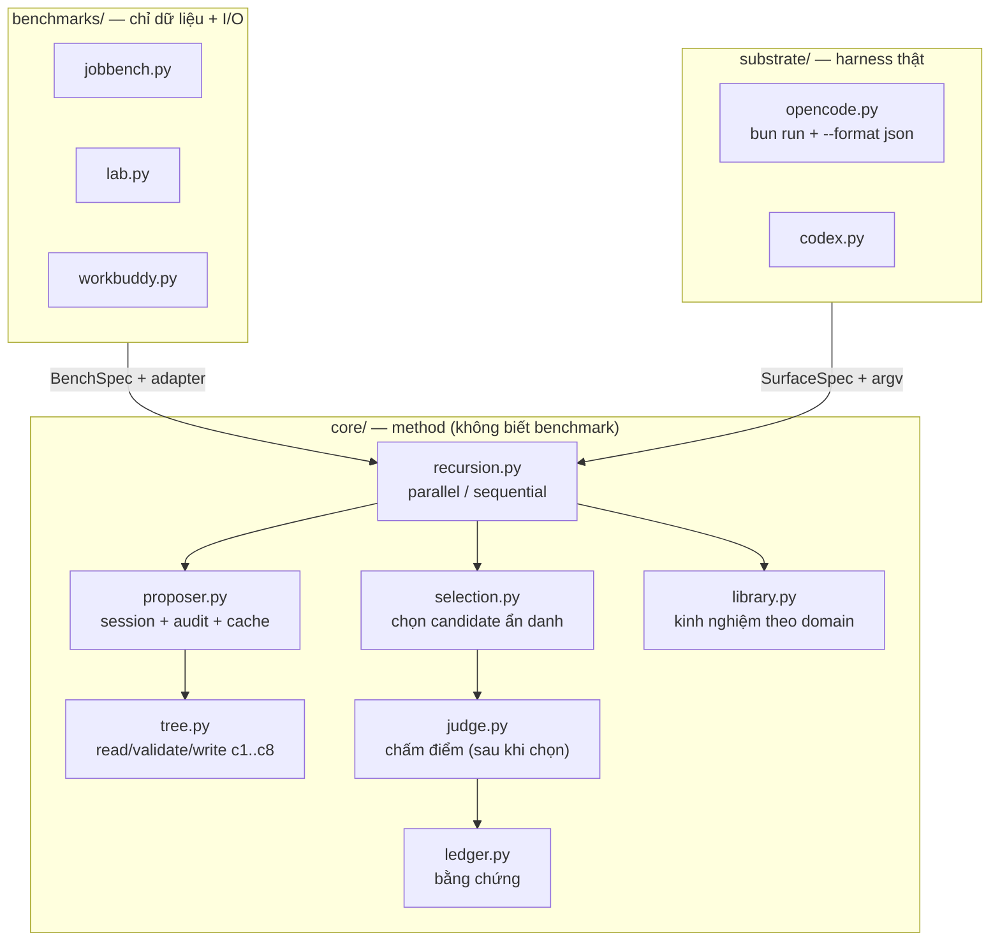

# Báo cáo kiến trúc: `google-research/harness2`

| Thuộc tính | Giá trị |
|---|---|
| Repo | https://github.com/google-research/harness2 |
| Commit phân tích | `1cfe254` ("Fix arXiv link") |
| Ngày phân tích | 2026-10-21 |
| Quy mô | 45 file `.py` · **~11.700 dòng** (chưa kể `dependencies/`, `third_party/`) · 5 file `.md` |
| Test | **1 file** `tests/test_workflow.py` (unittest) + demo deterministic không cần credential |
| Giấy phép | **Apache-2.0** (third_party/benchmark giữ license gốc) |
| Sao | ~15.672 · tạo 2026-10-06 · paper arXiv `2610.14224` |
| Kết luận 1 dòng | **Không phải bot — là bộ máy tự cải thiện “harness” (prompt, skill, tool guidance) quanh một model cố định. Đây là vòng lặp “bot tự giỏi lên” mà WhaleBot nên có, nhưng phải hạ xuống 1/100 chi phí.** |

> **Giới hạn báo cáo:** đọc code + docs tĩnh. Không chạy benchmark (cần Vertex AI, Docker, Pandoc, Poppler). Các con số về rollout/chi phí lấy từ code và docs, không phải đo thực tế.

---

## 0. TL;DR

**Luận điểm của Harness²:** với một model **không đổi**, chất lượng đầu ra phụ thuộc vào **harness** — system prompt, guardrails, memory, tool guidance, subagents, skills, scripts, plugins. Nếu bạn tối ưu harness **theo từng task**, model “tốt lên” mà không cần fine-tune.

Hai tầng đệ quy (`README.md:23-33`):

| Tầng | Việc | Cách |
|---|---|---|
| **Task-level** | Cải thiện harness cho **task hiện tại** | Propose → Probe → Compose, dựa trên **khác biệt hành vi** giữa các lần chạy, **không cần đáp án đúng** |
| **Harnessing-level** | Học từ task đã xong để hướng dẫn task sau | Thư viện theo domain: harness được chọn + bài học có bằng chứng |

**Ba ý tưởng đáng lấy:**

1. **Harness là dữ liệu, không phải code.** 8 thành phần, mỗi thành phần là file trên một “editable surface” có giới hạn kích thước và validator (`core/tree.py:15-21`, `core/spec.py:132-174`).
2. **Sửa harness theo kiểu “omitted-is-inherited”.** Proposal chỉ phát ra file thay đổi; phần không nhắc được kế thừa nguyên (`tree.py:18-20`). Diff nhỏ, review được, rollback được.
3. **Không có rubric vẫn chọn được candidate.** Ẩn danh candidate (A, B, C…), xáo bằng seed, cho một session đọc **trajectory** của từng cái rồi chọn + giải thích (`selection.py:40-76`).

**Ba thứ không đáng trả giá:**

1. **4k rollout + 3k improvement stage cho mỗi task** (`recursion.py:20-22`) — đây là nghiên cứu, không phải vận hành.
2. **Benchmark harness** (JobBench/LAB/WorkBuddy) + judge LLM + Vertex.
3. **Đệ quy đầy đủ** khi bạn còn chưa có 10 goal chạy thật.

---

## 1. Bản đồ hệ thống



**Ba trục tách bạch** (`core/spec.py:15-20`):

> *"Three axes stay separate — method (recursion, prompts, selection, library), substrate (the agent framework a solver rollout runs under) and benchmark (a `BenchSpec` value plus an adapter)."*

Đây là kiến trúc đáng học: **method không biết benchmark**, **benchmark không biết harness**, **harness chỉ cung cấp surface + argv**.

---

## 2. Cơ chế 1: 8 thành phần harness + giới hạn cứng

`README.md:70-73` liệt kê 8 thành phần:

| # | Thành phần | Vai trò |
|---|---|---|
| c1 | System prompt | Danh tính, cách làm việc |
| c2 | Guardrails | Điều không được làm |
| c3 | Memory | Bộ nhớ dài hạn |
| c4 | Tool guidance | Mô tả tool, khi nào dùng |
| c5 | Subagents | Việc giao cho context riêng |
| c6 | Skills | Workflow nạp theo nhu cầu |
| c7 | Scripts | Helper chạy được, tất định |
| c8 | Plugins | Can thiệp **bên trong** tool loop |

`substrate/opencode.py:26-76` khai báo surface:

```python
OPENCODE_SURFACE = SurfaceSpec(
    name="opencode",
    always_on=("systemprompt.md", "guardrails.md",
               "LongTermMEMORY.md", "tool_descriptions/tool_guidance.md"),
    always_on_max=24_000,
    always_on_cap_reason="every token here competes with the agent's own output budget",
    skill_dir="skills",
    subagent_requires_mode=True,
    plugin_dir="plugin",
    stubs=(...),
)
```

**Ba chi tiết đáng copy:**

1. **Trần 24.000 ký tự cho phần “always-on”**, kèm lý do bằng một câu. Không phải số ma thuật — nó bảo vệ ngân sách output của agent.
2. **Stub README** cho từng thư mục (`skills/README.md`, `plugin/README.md`…) nói rõ *cách thêm* một thành phần. Người đọc (hoặc agent) không phải đoán.
3. **`plugin` là lever duy nhất enforce được thứ model không thể bỏ qua** — vì nó chạy trong tool loop, không phải trong prompt.

**Áp dụng cho WhaleBot:** hiện tại “prompt của lead/coder/qa” nằm rải trong code JS. Chuyển thành:

```
harness/
  systemprompt.md
  guardrails.md
  memory/<repo>.md
  skills/goal/SKILL.md
  skills/review/SKILL.md
  sub_agents/qa/AGENT.md
  scripts/collect_evidence.py
```

Một thư mục, có version, có diff, có rollback. Đây là **điều kiện tiên quyết** để vòng lặp cải thiện ở §6 hoạt động.

---

## 3. Cơ chế 2: sửa harness bằng diff tối thiểu

`core/tree.py:18-20`:

> *"The edit contract is omitted-is-inherited: a proposal emits only what it changes."*

Cộng với `validate_tree()`: lỗi được **ném nguyên văn** làm feedback cho lần thử lại (`spec.py:242-245`):

> *"Raise ValueError listing all problems in actionable prose: the message is fed back verbatim as retry feedback."*

**Vì sao quan trọng:** agent sửa prompt rất dễ “viết lại cả file cho đẹp”, làm mất chi tiết quan trọng và không review được. Hợp đồng “chỉ phát ra thứ thay đổi” biến việc này thành một diff 5 dòng.

**Áp dụng:**

- `whale improve` chỉ được ghi file trong `harness/`.
- Mỗi proposal là `{file, content}`; file không có trong proposal = giữ nguyên.
- Validator kiểm: có `systemprompt.md`? skill có `description`? tổng always-on ≤ 24k? Nếu sai → trả lỗi cho agent, cho thử lại 1 lần, sau đó fallback về bản cũ (`recursion.py:20-22` nói đúng điều này: *"Invalid proposals receive one retry before inheriting the current harness"*).

---

## 4. Cơ chế 3: Propose–Probe–Compose không cần đáp án

Đây là phần khó nhất và cũng đáng học nhất.

**Vấn đề:** bạn muốn biết harness A hay B tốt hơn, nhưng không có rubric/đáp án cho task thật.

**Cách của Harness²:**

1. Chạy **base harness** trên task → lấy trajectory.
2. Đề xuất `k` candidate **general** (bất biến: prompt, guardrails) + `k` candidate **domain-specific** (skill, script).
3. Chạy từng candidate trên **cùng task** → lấy trajectory.
4. Một session “selector” đọc **các trajectory đã ẩn danh** (A/B/C), chọn cái tốt nhất, giải thích `<why>`, rút `<experience>`, và đề xuất `<edits>`.
5. “Composer” ghép các phần tốt nhất thành harness cuối.
6. Chạy lại harness cuối; nếu tốt hơn → adopt; không → giữ base.

Chi tiết đáng chú ý:

| Chi tiết | Bằng chứng | Vì sao |
|---|---|---|
| Ẩn danh + xáo bằng seed | `selection.py:63-76` | Chống thiên vị vị trí (A luôn thắng) |
| Selector **không thấy điểm** | `spec.py:176-187` (`RunView` “Never carries a score”) | Chọn theo hành vi, không theo số |
| Judge chạy **sau khi** chọn | `spec.py:247-250` | Không để điểm rò vào quá trình chọn |
| Prompt cấm nhắc “benchmark/rubric/score” | `spec.py:111-126` | Không để agent học cách đối phó phép đo |
| `obs_trunc < 10k` bị từ chối | `spec.py:163-167` | Cắt observation quá ngắn **tạo ra lỗi giả** |

### Áp dụng cho WhaleBot — nhưng đổi một chỗ

WhaleBot **có** ground truth mà Harness² không có: `--check` exit code, test pass/fail, diff. Vì vậy:

- **Bỏ** selector LLM. Chọn bằng bằng chứng cứng: pass rate → thời gian → số lần `/steer`.
- Giữ **Propose–Probe**: chạy base + 1 variant trên cùng 10 goal.
- Giữ **ẩn danh** khi bạn tự đọc kết quả (để không thiên vị), nhưng không cần LLM chọn.
- Chỉ dùng LLM selector khi hai variant **hoà** về test nhưng khác về chất lượng diff (ví dụ: ít file sửa hơn).

Đây là “Harness²-lite”: **1/100 chi phí, 80% giá trị** cho một người.

---

## 5. Cơ chế 4: thư viện kinh nghiệm theo domain

`core/library.py:16-25`:

```
<root>/<run-tag>/<mode>/<domain>/INDEX.md
<root>/<run-tag>/<mode>/<domain>/harnesses/<task>/harness/<rel>   # cây đầy đủ
<root>/<run-tag>/<mode>/<domain>/harnesses/<task>/EXPERIENCE.md   # vì sao chọn + bài học
```

Nguyên tắc:

- **Retrieval bằng cấu trúc**, không phải vector search: thư mục domain chỉ chứa entry cùng domain.
- **Mang cả cây harness**, không mang bản tóm tắt (`"The whole tree is carried, never a summary"`).
- **Chỉ đọc entry trước đó** (`EXPERIMENTS.md`: *"Tasks within a domain run in order and read only earlier entries"*) — chống rò thông tin tương lai.
- Tách theo `benchmark × executor × mode × budget × seed` — để so sánh không bị trộn.

**Áp dụng:**

```
lessons/
  D--WhaleBot/
    INDEX.md                 # 1 dòng / goal: ngày, kết quả, bài học
    harness/<goal-id>/       # harness đã dùng khi thắng
    EXPERIENCE.md            # vì sao thắng
  D--52Cast/
```

Với 1 người, “domain” = **repo**, không phải lĩnh vực pháp lý. Đơn giản hơn, và đúng thứ bạn cần: “repo này có đặc điểm gì”.

---

## 6. Cơ chế 5: executor substrate (cách gọi opencode/codex)

`substrate/opencode.py:200-230`:

```python
argv = [bun, "run", "--cwd", <opencode source>, "src/index.ts", "run", prompt,
        "--dir", <workspace>, "--model", model, "--title", title,
        "--format", "json"]
if agent:   argv += ["--agent", agent]
if variant: argv += ["--variant", variant]
if session: argv += ["--session", session]
```

Đáng chú ý:

| Chi tiết | Ý nghĩa |
|---|---|
| `--format json` | Đọc event stream có cấu trúc, không parse text |
| `--session` | **Resume** phiên, không restart từ đầu |
| `--agent` / `--variant` | Chọn subagent / biến thể model |
| `Proposer.call()` có `audit_dir`, cache theo fingerprint | Mọi lần gọi đều truy vết được; chạy lại không tốn tiền |
| `Reply.cost_usd`, `attempts`, `error` | Chi phí là **dữ liệu hạng nhất**, không phải log |
| `ProposerError` khi reply rỗng | Không bao giờ nuốt lỗi thành chuỗi rỗng (`proposer.py:15-18`) |

**Áp dụng cho WhaleBot:** `harness/<id>.json` phải có `argv`, `resume`, `cost.parser`, `error.pattern`. Không hardcode lệnh trong `agent-mesh.js`.

---

## 7. Số đo & chi phí

| Hạng mục | Số |
|---|---|
| Python | 45 file · ~11.700 dòng |
| Benchmark | 3 (JobBench, LAB, WorkBuddy-Bench) |
| Test | 1 file unittest + demo deterministic |
| Rollout / task | `4k` (parallel/sequential) |
| Improvement stage / task | `3k` |
| Task LAB đầy đủ | 1.143 |
| Model mặc định | Vertex AI (Gemini/Claude qua channel) |
| Chạy demo local | Không cần credential |

**Chi phí thật:** docs cảnh báo *"Model-backed runs incur API costs for executor rollouts and improvement stages"*. Với `k=3`, một task LAB có thể là hàng chục rollout. Đây là công cụ nghiên cứu, **không phải** thứ chạy mỗi lần bạn gõ `/goal`.

**Tỷ lệ đáng chú ý:** 11,7k dòng code nhưng chỉ **1 file test** — đây là code nghiên cứu, ưu tiên thí nghiệm hơn regression. Đừng copy thói quen này.

---

## 8. Nên copy gì, bỏ gì

### Copy

| # | Ý tưởng | Vào WhaleBot | Công |
|---|---|---|---|
| 1 | Harness là cây file có version | `harness/` + `harness/<core>.json` | ~40 dòng |
| 2 | `always_on_max` + validator + lỗi làm feedback | `whale improve` validator | ~60 dòng |
| 3 | Omitted-is-inherited | format proposal `{file, content}` | ~20 dòng |
| 4 | Probe 2 biến thể trên cùng task | `--variants 2` + so sánh | ~80 dòng |
| 5 | Thư viện bài học theo repo | `lessons/<repo>/INDEX.md` | ~30 dòng |
| 6 | Ẩn danh khi so sánh | đặt tên A/B khi review | 0 dòng |
| 7 | Cấm prompt nhắc “điểm/rubric” | rule trong `AGENTS.md` | 0 dòng |
| 8 | `obs_trunc` tối thiểu 10k | hằng số trong `evidence.ts` | 1 dòng |

### Bỏ

| Thứ | Vì sao |
|---|---|
| 4k rollout/task | Chi phí nghiên cứu |
| Judge LLM | WhaleBot có test thật |
| Benchmark adapter (JobBench/LAB/WorkBench) | Không phải công việc của bạn |
| Vertex AI, `gcloud`, Docker, Pandoc | Hạ tầng nặng |
| Đệ quy 2 tầng đầy đủ | Chưa có 10 goal thật |
| `selection.py` (LLM chọn) | Thay bằng bằng chứng cứng |
| Cache theo fingerprint phức tạp | SQLite + hash đơn giản là đủ |

### Cải tiến so với bản gốc

| Vấn đề của Harness² | Cải tiến cho WhaleBot |
|---|---|
| Không có ground truth → phải dùng LLM selector | Dùng `--check` + test + diff làm trọng tài; LLM chỉ phá hoà |
| Chi phí không bị chặn | Mỗi lần `improve` có trần `max_runs`, `max_minutes`, và **từ chối chạy nếu ước tính > 0 ₫** |
| Agent được sửa cả `guardrails.md` | **Cấm** sửa file map vào `gate()`; guardrail thực thi phải là code, không phải prompt (xem Orca: plugin nằm trong tool loop) |
| Không có rollback | Mỗi lần adopt tạo `harness/vN/`; `whale improve --rollback` |
| Không có review của người | Adopt chỉ khi người bấm `/approve` trên Telegram (trừ khi chênh lệch > ngưỡng và không sửa guardrail) |
| Library không có TTL | Bài học cũ hơn 30 ngày bị đánh dấu `stale` |

---

## 9. Rủi ro & giới hạn

| Mức | Vấn đề | Bằng chứng |
|---|---|---|
| P0 | **Không có test hồi quy** (1 file cho 11,7k dòng) | `tests/` |
| P1 | Chi phí model không giới hạn; dễ “nghiên cứu” thay vì ship | `recursion.py:20-22` |
| P1 | Phụ thuộc Vertex + `gcloud` + Docker + Pandoc/Poppler | `docs/SETUP.md` |
| P2 | Benchmark dataset tải tại thời điểm chạy, không pin commit (JobBench) | `EXPERIMENTS.md` |
| P2 | “Không có đáp án” nghĩa là chất lượng phụ thuộc judge/selector | `selection.py` |
| P3 | Code nghiên cứu, API nội bộ có thể đổi | repo mới 2 tuần |

**License:** Apache-2.0 — an toàn. Nhưng benchmark/dataset trong `dependencies/` giữ license gốc; đừng copy dữ liệu.

---

## 10. Nếu chỉ có 1 giờ

| Thứ tự | File | Vì sao |
|---|---|---|
| 1 | `README.md:68-79` + `:140-165` | 8 thành phần + 2 kiểu đệ quy, trong 40 dòng |
| 2 | `core/tree.py:15-21` + `substrate/opencode.py:26-76` | Surface + giới hạn + stub |
| 3 | `core/spec.py:89-127` | Cách viết prompt **về công việc**, không về phép đo |
| 4 | `core/selection.py:40-76` | Ẩn danh + seed, chống thiên vị |
| 5 | `core/library.py:16-33` | Thư viện theo domain, không vector DB |
| 6 | `core/recursion.py:20-22` | Chi phí thật của phương pháp |

---

## 11. Kết luận

Harness² trả lời một câu hỏi mà WhaleBot sẽ hỏi sau 4 tuần: **“làm sao bot tự giỏi lên mà không đổi model và không tốn tiền?”**

Câu trả lời đúng cho bạn không phải 4k rollout. Nó là:

1. **Harness là file**, có version, có diff, có rollback.
2. **Mỗi tuần một thí nghiệm**: 10 goal cố định, 2 biến thể, chọn bằng test thật.
3. **Bài học theo repo**, ghi lại sau mỗi lần thắng/thua.
4. **Không cho agent sửa luật chơi** (gate, quyền, ngân sách).

Bốn điều đó khoảng **250 dòng + 1 thư mục**, và chúng biến “bot chạy được” thành “bot tốt dần”.

---

## 12. Phụ lục: lệnh tái lập

```powershell
git clone --depth 1 https://github.com/google-research/harness2.git
git -C harness2 log -1 --oneline

(Get-ChildItem harness2 -Recurse -Filter *.py |
  Where-Object FullName -NotMatch 'third_party|dependencies' |
  ForEach-Object { (Get-Content $_.FullName | Measure-Object -Line).Lines } |
  Measure-Object -Sum).Sum

Get-Content harness2\harness2\core\tree.py -TotalCount 80
Get-Content harness2\harness2\substrate\opencode.py -TotalCount 90
Get-Content harness2\harness2\core\spec.py | Select-Object -Skip 88 -First 40
```
