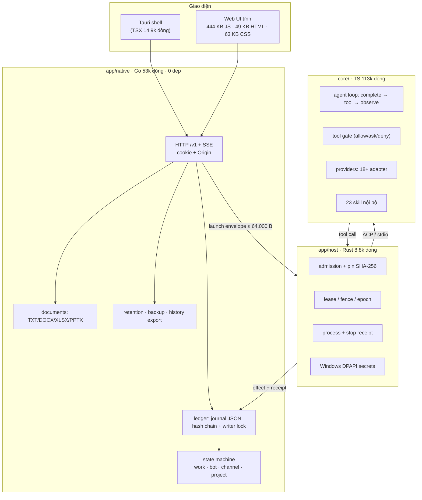
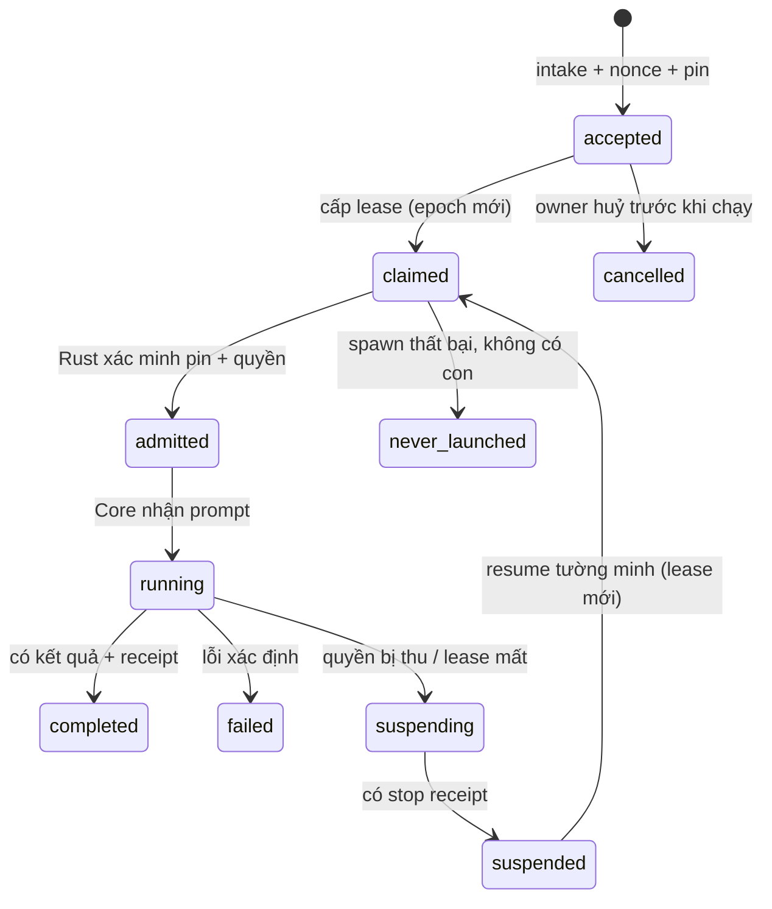
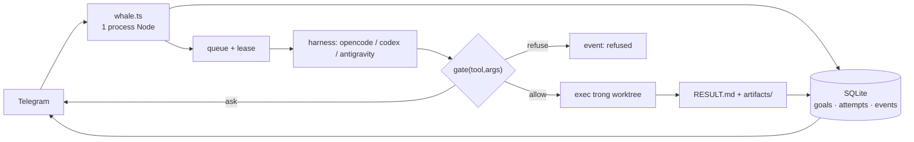

# Báo cáo kiến trúc: `meiiie/neko-bot`

| Thuộc tính | Giá trị |
|---|---|
| Repo | https://github.com/meiiie/neko-bot |
| Commit phân tích | `bc3def7` ("Polish neko-bot URLs and document alpha source milestone") |
| Nhánh | `main` |
| Ngày phân tích | 2026-10-21 |
| Quy mô | 16.6 MB · **192.153 dòng code** · 318 file `.md` (23.209 dòng) |
| Giấy phép | `core/` **AGPL-3.0-only** · `app/` **KHÔNG có LICENSE** · `wiii/` license riêng |
| Trạng thái tự khai | alpha, *"chưa phải sản phẩm production hoàn chỉnh"* |
| Kết luận 1 dòng | **Kỹ thuật xuất sắc, chi phí vận hành không phù hợp với một người. Học cơ chế, đừng copy code.** |

> **Giới hạn của báo cáo:** phân tích tĩnh (đọc code + docs). Không build, không chạy test — máy chưa có Go 1.27 và Rust MSVC toolchain. Mọi nhận định về hành vi runtime đều dẫn nguồn từ code/docs, không phải từ quan sát chạy thật.

---

## 0. TL;DR

**Neko Bot là gì:** trợ lý đa bot, đa kênh, local-first. Nhiều bot có danh tính riêng, kênh riêng/kênh chung, dự án và file theo scope, lịch sử bền vững, huỷ/ngắt giữa lúc chạy. Không phải SaaS, không phải app điện thoại.

**Ba tầng, ba ngôn ngữ:**

| Tầng | Ngôn ngữ | Dòng | Việc |
|---|---|---|---|
| `app/native/` | Go | 52.920 | Control plane: journal, API, state machine, bot/kênh/dự án/file |
| `app/host/` | Rust | 8.759 | Trusted boundary: admission, lease, process, DPAPI, stop receipt |
| `core/` | TypeScript/Bun | 112.680 | **Agent loop** (suy luận, tool, provider, skills, MCP) |
| `app/desktop/` | Tauri + TSX | 14.870 | Vỏ desktop |

**Ba ý tưởng đáng ăn cắp:**

1. **Nghĩa vụ trước, thực thi sau.** Mọi yêu cầu được ghi bền (accepted) *trước khi* có model nào chạy. Không có dòng journal thì không có quyền thực thi.
2. **Một người ghi.** Journal append-only + writer lock + fsync; replay kiểm hash chain; đuôi rách thì cắt, hỏng thật thì từ chối toàn bộ.
3. **Không bao giờ thử lại mù.** Lease có `epoch` + `fence`; kết quả không rõ thì giữ `UNKNOWN` và bắt người kiểm tra, không tự chạy lại effect bên ngoài.

**Ba chi phí không đáng trả:**

1. **3 ngôn ngữ / 4 process** cho một trợ lý cá nhân → mỗi feature sửa 3 nơi + 2 wire contract.
2. **Tự viết journal** thay SQLite → `validReplay()` tay ~700 dòng, không query, không index, migration PostgreSQL còn nợ.
3. **318 file docs / 23.209 dòng** → 38 file `local-*`, 29 file `ux-*`, 11 `delivery-*`. Tốt cho audit, chết cho solo dev.

**Rủi ro pháp lý — đọc trước khi định fork:**

- `core/` là **AGPL-3.0-only**. Dùng cá nhân thì ổn; nhúng vào sản phẩm bán ra mà không mở source là vi phạm.
- `app/` **không có LICENSE**. Repo công khai ≠ được dùng. Mặc định là *all rights reserved*. Bạn **không được** copy code Go/Rust vào WhaleBot.
- `core/sdk/` theo Apache-2.0 (xem `core/LICENSING.md`), nhưng README cảnh báo rõ: **không suy rộng** Apache sang phần còn lại.

---

## 1. Phương pháp & bằng chứng

| Việc đã làm | Chi tiết |
|---|---|
| Clone | `git clone --depth 1` → 16.6 MB, commit `bc3def7` |
| Đếm mã | theo đuôi file, loại `node_modules`/`.git` |
| Đọc tài liệu kiến trúc | `docs/architecture.md`, `docs/project-status.md`, `app/docs/adr-001-local-foundation.md`, `product-gap-matrix`, `local-executor-integration-contract`, `finite-collaboration-local`, `context-permissions-local`, `desktop-local-instance`, `local-sync-prefix` |
| Đọc mã nguồn | `ledger/store.go` (replay/commit), `api/server.go` (route), `host/src/executor.rs` (pin/lease), `core/src/core/completion-contract.ts`, `tool-runtime.ts` (gate) |
| Đo phụ thuộc | `app/native/go.mod` = **0 dependency** · `app/host/Cargo.toml` = **1** (`serde`) · `core/package.json` = **5** |
| Đếm test | **166** file `*_test.go` · **202** file test TS |

Điểm đáng chú ý ngay: mức kỷ luật dependency rất cao. Go thuần stdlib. Rust chỉ `serde`. Đây là dấu hiệu của người viết hiểu rằng dependency là nợ.

---

## 2. Bản đồ hệ thống



**Phân chia trách nhiệm (theo `docs/architecture.md:16-20`):**

- **Go** giữ *nghĩa vụ* và *trạng thái bền*. Không bao giờ gọi model. Không tự suy ra effect ngoài đã xong.
- **Rust** giữ *ranh giới tin cậy*: kiểm hash binary trước khi cho Core spawn, giữ process, phát receipt "đã dừng thật".
- **Core** giữ *vòng lặp ngữ nghĩa*. Không được quyền quyết định trạng thái bền.
- **UI** giữ *ý định và retry*. Không tự suy quyền từ metadata hiển thị.

**Vì sao 3 ngôn ngữ (suy luận có căn cứ):** Go cho durability/HTTP đơn giản; Rust cho thứ *không được phép sai* (spawn process, DPAPI, dừng process); TS vì ecosystem model/tool. Đây là lý do **hợp lý về kỹ thuật** nhưng **đắt về người**: một feature "bot tự chạy nền" phải sửa schema Go + wire Go↔Rust + Rust validation + Core adapter + UI. Đó chính là ~50% khối lượng docs bạn thấy.

---

## 3. Mô hình dữ liệu

Không có SQL. Trạng thái là **một file `transactions.jsonl`** cộng với các map trong RAM, dựng lại bằng replay.

| Thực thể | Vai trò | Ghi chú thiết kế |
|---|---|---|
| `owner` / `space` | Chủ sở hữu local | Một owner duy nhất (cookie local) |
| `bot` | Danh tính agent | ID ổn định + alias + revision + màu/tên |
| `conversation` | Lane riêng của bot | Tách khỏi channel |
| `channel` | Kênh chung/riêng | Thành viên + revision |
| `project` | Dự án + file | Có state riêng (`project.state_updated`) |
| `work` (request) | Nghĩa vụ thực thi | Có `epoch`, `clientNonce`, `revision` |
| `attempt` | Một lần chạy | Có `lease`, `fence`, `boot_id` |
| `event` | Bản ghi journal | Có `sequence`, `previous`, `digest` |
| `nonce` | Chống trùng | Lưu theo từng "product" (bot, channel, project…) |
| `account` | Tài khoản provider | `stored_unverified` — chưa từng xác thực thật |
| `plugin` / `adapter` | Năng lực cắm thêm | Có lifecycle + pin |
| `collaboration` | Nhóm bot hữu hạn | 2 bot, 3 stage, trần 5 phút |
| `report_delivery` | Giao kết quả sang kênh khác | Có provenance + receipt |

**Điểm mạnh:** mọi thực thể đều có `revision` (CAS) và mọi input đều có `nonce` (idempotency). Không có đường tắt nào để ghi đè mà không biết revision hiện tại.

**Điểm yếu:** `revision` + `nonce` + `epoch` + `fence` + `generation` + `pin version` là **sáu khái niệm gần giống nhau**. Người đọc mới phải giữ 6 biến trong đầu cho một thao tác "sửa tin nhắn".

---

## 4. Vòng đời một công việc



Điều quan trọng nhất nằm ở **`suspended`**: hệ thống không tự chạy lại. Nó giữ nguyên nghĩa vụ, giữ nguyên pin, chờ người quyết định. Đây là hành vi đúng cho thứ có **effect bên ngoài** (gửi tin, đăng bài, tiêu tiền) — và là bài học trực tiếp cho WhaleBot.

---

## 5. Bảy cơ chế cốt lõi

### 5.1. Journal append-only + hash chain

| | |
|---|---|
| **Vấn đề** | Cần durability mà không muốn kéo DB server vào app desktop |
| **Cách làm** | `transactions.jsonl`, mỗi record `{version, previous, digest, event{sequence,…}}`. Mở file bằng `writer.lock` (OS-exclusive). Ghi xong `fsync` mới ACK. Replay kiểm `previous == digest trước` + `sequence == n+1` |
| **Đuôi rách** | Nếu byte cuối không kết thúc bằng `\n` → `Truncate(offset)` + `Sync()` (chỉ khi không read-only) |
| **Hỏng thật** | Digest sai / field lạ / sequence nhảy → `ErrCorrupt`, **từ chối mở toàn bộ store** |
| **Bằng chứng** | `app/native/internal/ledger/store.go:280` (file), `:272` (lock), `:354-401` (replay), `:391` (kiểm chain), `:774` (commit) |
| **Giá phải trả** | `validReplayWithArchive()` tay hàng trăm dòng, mỗi event type một nhánh. Không `WHERE`, không index, không aggregate. Muốn báo cáo "tuần này chạy bao nhiêu goal" phải replay toàn bộ |

**Đánh giá:** đúng đắn cho mục tiêu của họ (desktop, một writer, không cần query). **Sai** cho WhaleBot, nơi bạn cần đếm chi phí/thời gian theo tuần — việc đó SQLite làm trong 1 dòng.

### 5.2. Nonce + CAS (idempotency)

Mọi endpoint nhận `clientNonce` + `expectedRevision`. Trùng nonce + input giống → trả lại receipt cũ (`duplicate: true`, HTTP 200). Trùng nonce + input khác → 409. Revision cũ → 409 trước khi commit.

Bằng chứng: `app/docs/finite-collaboration-local.md:26-32`.

**Vì sao quan trọng:** mạng chập chờn trên điện thoại tạo ra "gửi 2 lần" mà không ai biết. Đây là cơ chế rẻ nhất để chặn.

### 5.3. Lease + fence + epoch (chống 2 writer)

Rust giữ struct `Lease { executor_id, generation, boot_id, request_id, attempt_id, work_epoch, fence, expires_at_ms }` — `app/host/src/executor.rs:32-46`.

- Lease sống **tối đa 600.000 ms**, **không gia hạn** (`local-executor-integration-contract.md:7`).
- Mất lease → fence ngay prompt/admission/output/effect.
- Reconcile ghi `work.executor_suspended`, **tăng work epoch**, attempt → `suspending` (`:35`).
- Stop receipt phải có **PID + session thật** khớp binding hiện tại; receipt cũ bị từ chối.

**Bài học nguyên văn:** *"Unknown or malformed shutdown cannot enable context refresh."* Không rõ trạng thái = không được tiếp tục.

### 5.4. Admission: pin bằng SHA-256

Trước khi cho Core chạy, Rust kiểm:

```
neko-host --executor-probe --runtime CORE --supervisor SUPERVISOR --install-state-root STATE
```

Descriptor phải khớp chính xác `host_sha256`, `core_sha256`, `root_sha256`, `capabilities_sha256` với cấu hình của Go. Sai một byte → từ chối. Probe lại **mỗi 5 giây**, timeout 5s, cửa sổ readiness 15s (`:23-25`).

**Giá phải trả:** mỗi 5 giây đọc lại toàn bộ bytes của Core. Chính tài liệu thừa nhận đây là "intentionally bounded fixture cost" (`:25`) — tức là họ biết nó đắt và vẫn chấp nhận, vì mục tiêu là chống tráo binary.

**Cho WhaleBot: vô nghĩa.** Không ai tráo binary trên máy bạn. Đây là cơ chế cho sản phẩm phân phối cho người lạ.

### 5.5. Context pin + revoke + ancestry

Mỗi nguồn (source) có `context-access {granted, revision}`. Khi pin context cho một work, hệ thống lưu **revision của từng nguồn**. Nếu sau đó owner thu hồi:

- Work đang chờ → `suspended`
- Work đang chạy → `suspending`, đóng input của host, output/effect bị fence
- Crash giữa lúc thu hồi và ghi lifecycle → startup hoàn tất sự kiện treo

Và: **thu hồi không làm pin cũ hợp lệ trở lại** — regrant tăng revision, pin cũ vẫn chết (`app/docs/context-permissions-local.md:3-9`).

Đây là mô hình đúng cho "bot không được dùng tài liệu tôi đã rút". Rất đáng copy **ý tưởng**, không đáng copy **7 phiên bản pin**.

### 5.6. Finite collaboration (nhóm bot hữu hạn)

Không phải "để model tự bàn nhau". Đây là state machine cứng:

| Ràng buộc | Giá trị |
|---|---|
| Số bot | đúng 2, phải là thành viên kênh chung |
| Số stage | đúng 3 (coordinator đề xuất → bot kia phản biện → coordinator kết luận) |
| Trần thời gian | **5 phút** |
| Quyền ghi file | stage 1–2 **bị từ chối** trước khi ghi bất kỳ effect nào; chỉ stage 3 được |
| Kết quả | `completed` chỉ khi có đúng 3 kết quả không rỗng — **không chứng minh model đúng** |
| Thất bại | `needs_owner` khi thiếu context, hết giờ, kết quả rỗng |

Bằng chứng: `app/docs/finite-collaboration-local.md:26-54`.

**Nhận xét:** đây là cách duy nhất để "nhiều agent" không biến thành tiền đốt vô hạn. Nhưng nó **không scale**: 2 bot, 3 stage, 5 phút là hằng số hard-code. Muốn 3 bot → sửa schema + replay + test.

### 5.7. Sync envelope (UI local)

SSE + `GET /v1/sync` với cursor. Giới hạn cứng: **128 frame/trang**, **256 KiB**/envelope, **512 update**, object **16 KiB**, text work/reply/report **12 KiB**. Vượt → trả `sync_limit` tường minh, **không cắt cụt** state (`app/docs/local-sync-prefix-20261013.md:11`).

**Bài học:** "không bao giờ trả dữ liệu nửa vời" tốt hơn "trả càng nhiều càng tốt". Nhưng với 1 người dùng, 128 frame là con số không có ý nghĩa.

---

## 6. Thứ đáng học nhất không nằm ở code

Đây là phần mình cho là giá trị cao nhất của repo — **quy trình chứng minh**.

1. **ADR trước, code sau.** `adr-001-local-foundation.md` chốt: một writer, journal có checksum, "local dev store, explicitly not PostgreSQL", Rust từ chối Core không tương thích thay vì chạy tiếp. 13 dòng, không thể hiểu sai.

2. **Ba cột tách bạch trong mọi báo cáo:** *đã có đường chạy* / *thiếu code* / *còn gate nghiệm thu*. Xem `product-gap-matrix-20261011.md:11-24` — mỗi REQ đều có 3 cột này. Không có dòng nào "PASS toàn sản phẩm" chỉ vì fixture local xanh.

3. **RED trước GREEN, giữ lại cả hai.** `local-sync-prefix-20261013.md:17-22` liệt kê receipt `baseline-red-v1` (5 test đỏ) rồi `working-green-v1` (12 pass). Họ **giữ lại bằng chứng đỏ**.

4. **Ghi cả thất bại.** `desktop-local-instance-20261012.md:28`: *"Hai lượt working29 có launcher FAIL được giữ"* — kèm nguyên nhân (`&`/`LASTEXITCODE` làm cleanup chạy trước verifier).

5. **Không cho badge nói dối.** README: *"Repo hiện không có CI tự động ở root. Badge ở đầu trang là nhãn trạng thái/kiến trúc tĩnh, không phải kết quả CI."*

6. **Giới hạn phát ngôn có tên.** Mọi kết quả đều kèm câu *"fixture này không chứng minh model quality / cloud / phone"*.

**Đây là thứ nên copy nguyên xi vào WhaleBot.** Nó không tốn một dòng code nào, và nó là khác biệt giữa "bot tự nhận đã xong" và "bot chứng minh đã xong" — đúng vấn đề bạn sẽ gặp ở MVP.

---

## 7. Số đo & chi phí thật

| Hạng mục | Số |
|---|---|
| Go | 287 file · 52.920 dòng · **0 dependency** |
| TypeScript (core) | 497 file · 112.680 dòng · 5 dependency |
| TSX (desktop) | 37 file · 14.870 dòng |
| Rust (host) | 31 file · 8.759 dòng · 1 dependency (`serde`) |
| Tài liệu | 318 file `.md` · 23.209 dòng |
| Trong đó `app/docs/` | ~120 file thiết kế/nghiệm thu |
| Test | 166 file Go · 202 file TS |
| Provider adapter | 18+ (`anthropic`, `chatgpt`, `gemini-cli`, `codex-app-server`, `acp`, `mcp`…) |
| Skill nội bộ | 23 thư mục trong `core/skills/` |
| Web UI | 444 KB JS + 49 KB HTML + 63 KB CSS (vanilla, không framework) |

**Chi phí thêm một feature (ước lượng từ cấu trúc):**

| Loại feature | Số nơi phải sửa |
|---|---|
| Endpoint mới | Go route + ledger event + replay validation + snapshot + SSE + test + doc |
| Đổi hành vi execution | Go + wire envelope + Rust validation + Core adapter + receipt + doc |
| Đổi UI | HTML/JS/CSS + Tauri + test viewport + doc |

So sánh: BotAutoTask của bạn làm "thêm 1 route Telegram" = 1 file. Neko làm cùng việc đó = 4 file + 1 contract + 1 receipt.

---

## 8. Vấn đề & rủi ro (xếp theo mức)

| Mức | Vấn đề | Bằng chứng | Hệ quả |
|---|---|---|---|
| **P0** | `app/` không có LICENSE | không có `app/LICENSE` | **Không được copy code Go/Rust.** Chỉ học ý tưởng |
| **P0** | `core/` AGPL-3.0-only | `core/LICENSE` | Nhúng vào sản phẩm đóng = vi phạm |
| **P0** | Chưa có provider thật | `product-gap-matrix:23,51` — "Accounts remain stored_unverified" | Không chứng minh được "bot trả lời thật" |
| **P1** | 3 ngôn ngữ, 4 process | 192k dòng / 3 toolchain | Solo dev sửa 1 feature = 1 ngày |
| **P1** | Tự viết journal | `store.go:354-401`, `:402-600` | Không query, không index, migration còn nợ |
| **P1** | 120 file docs nghiệm thu | `app/docs/` | Người mới mất >1 ngày chỉ để định vị |
| **P2** | 6 khái niệm version gần nhau | `revision`, `epoch`, `fence`, `generation`, `pin.version`, `attempt` | Dễ hiểu sai, dễ viết sai |
| **P2** | Probe đọc bytes Core mỗi 5s | `local-executor-integration-contract:25` | Tốn I/O vô ích ở quy mô 1 người |
| **P2** | Không có CI ở root | README | Chất lượng phụ thuộc kỷ luật tay |
| **P2** | Wiii overlay không build độc lập | `wiii/` = 61 file | Không tái lập được |
| **P3** | Nhánh WIP lẫn archive | README mục "Các nhánh" | Khó biết cái nào là sự thật |

**Nhận xét thẳng:** repo này được viết như thể **sẽ có người thứ hai đọc và kiểm toán**. Đó là lý do nó có 23k dòng docs. Nhưng chính vì thế nó *chưa* là sản phẩm — nó là **bộ bằng chứng của một sản phẩm đang được xây**. Với mục tiêu "một người vận hành doanh nghiệp AI", đây là mô hình chi phí ngược lại với thứ bạn cần.

---

## 9. Đối chiếu ba hệ thống

| Khía cạnh | Neko Bot | BotAutoTask (của bạn) | WhaleBot (MVP đã viết) |
|---|---|---|---|
| Ngôn ngữ | Go + Rust + TS + TSX | Node ESM, 1 file bundle | Node (thừa hưởng) |
| Store | JSONL hash chain tự viết | JSON atomic + D1 (cloud) | Chưa có (đang dùng D1) |
| Agent loop | Tự viết (113k dòng) | **Mượn** opencode/codex/antigravity | Mượn (đúng) |
| Auth | Cookie local + Origin + DPAPI | Chat id Telegram + Bearer | Chat id Telegram (đúng) |
| UI | Tauri + web 550 KB | PWA 1 file | Telegram (đúng) |
| Đa agent | 2 bot / 3 stage / 5 phút | lead/coder/reviewer + worktree | 3 vai (đúng) |
| Effect ngoài | Bị chặn hoàn toàn (chưa làm) | Không có | P2, có approval |
| Giấy phép | AGPL + không license | Của bạn | Của bạn |
| LOC | 192k | ~8k | ~250 (dự kiến) |

**Đọc bảng này theo chiều dọc:** WhaleBot đang đi đúng hướng ở 5/9 dòng. Hai dòng cần học Neko là **store** và **effect boundary**. Một dòng cần tránh tuyệt đối: **tự viết agent loop**.

---

## 10. Thiết kế lại từ đầu cho WhaleBot

### 10.1. Năm nguyên tắc (thay cho 7 cơ chế của Neko)

1. **Một process, một ngôn ngữ.** Không có "trusted host" riêng. Ranh giới tin cậy là **một hàm** `gate()`, không phải một binary.
2. **SQLite là store, không tự viết journal.** Có transaction, có index, có `SUM()`.
3. **Nghĩa vụ trước, thực thi sau.** Giữ nguyên bài học Neko, nhưng cài bằng 2 bảng thay vì 1 state machine 40 trạng thái.
4. **Effect ngoài thì không tự retry.** `UNKNOWN` là trạng thái hợp lệ, không phải lỗi cần che.
5. **Bằng chứng trong 1 file, không phải 120.** Mỗi goal sinh 1 `RESULT.md`; mọi thứ khác là cột trong DB.

### 10.2. Kiến trúc



### 10.3. Schema tối thiểu (chạy được với `node:sqlite`)

```sql
PRAGMA journal_mode = WAL;
PRAGMA foreign_keys = ON;

CREATE TABLE project (
  id TEXT PRIMARY KEY,           -- slug
  name TEXT NOT NULL,
  path TEXT NOT NULL UNIQUE,
  check_cmd TEXT,                -- vd: "npm test"
  created_at INTEGER NOT NULL
);

CREATE TABLE goal (
  id TEXT PRIMARY KEY,
  project_id TEXT NOT NULL REFERENCES project(id),
  prompt TEXT NOT NULL,
  state TEXT NOT NULL CHECK (state IN
    ('queued','leased','running','done','failed','needs_owner','cancelled')),
  epoch INTEGER NOT NULL DEFAULT 0,
  lease_owner TEXT,
  lease_until INTEGER,
  attempt_id TEXT,
  nonce TEXT NOT NULL UNIQUE,
  created_at INTEGER NOT NULL,
  updated_at INTEGER NOT NULL
);

CREATE TABLE attempt (
  id TEXT PRIMARY KEY,
  goal_id TEXT NOT NULL REFERENCES goal(id),
  n INTEGER NOT NULL,
  core TEXT, model TEXT,
  state TEXT NOT NULL CHECK (state IN
    ('starting','running','stopped','unknown','never_launched')),
  pid INTEGER, stop_receipt TEXT,
  started_at INTEGER, ended_at INTEGER,
  UNIQUE (goal_id, n)
);

CREATE TABLE event (            -- hash chain, nhưng là 1 bảng
  seq INTEGER PRIMARY KEY,
  at INTEGER NOT NULL,
  type TEXT NOT NULL,
  goal_id TEXT,
  payload TEXT NOT NULL,
  prev_digest TEXT NOT NULL,
  digest TEXT NOT NULL
);

CREATE TABLE approval (
  id TEXT PRIMARY KEY, goal_id TEXT NOT NULL,
  kind TEXT NOT NULL,           -- 'post' | 'push' | 'paid'
  payload TEXT NOT NULL,
  state TEXT NOT NULL CHECK (state IN ('pending','approved','rejected','expired')),
  created_at INTEGER NOT NULL
);

CREATE TABLE artifact (
  id TEXT PRIMARY KEY, goal_id TEXT NOT NULL,
  path TEXT NOT NULL, sha256 TEXT NOT NULL, bytes INTEGER NOT NULL
);
```

**Sáu bảng thay cho ~40 file ledger.** Không mất tính chất nào quan trọng: vẫn có idempotency (`nonce UNIQUE`), vẫn có fencing (`epoch` + `WHERE epoch=?`), vẫn có audit (`event` + hash chain). Bảng `steer` và `outbox` đến từ reason-network (xem [`REFERENCE-ARCHITECTURE.md`](./REFERENCE-ARCHITECTURE.md) §6).

### 10.4. Bốn invariant (viết thành test, không viết thành docs)

| # | Invariant | Test |
|---|---|---|
| I1 | Không chạy gì khi chưa có row `goal` + `event work.accepted` trong **cùng transaction** | Kill process sau `accept`, restart → không có agent nào chạy |
| I2 | Claim phải tăng `epoch` bằng CAS; writer cũ không ghi được | Giả lập 2 claim đồng thời → đúng 1 thắng |
| I3 | Effect ngoài ở `unknown` thì **không** tự retry | Mock timeout → state `needs_owner`, không gọi lần 2 |
| I4 | Không có `approval=approved` thì không có hành động công khai | Gọi post khi chưa duyệt → `refused` |

### 10.5. Bảng quyết định: giữ / bỏ / thay

| Từ Neko | Quyết định | Lý do |
|---|---|---|
| Obligation-before-execution | **Giữ** | Nền tảng của mọi thứ |
| Single writer + append-only | **Giữ ý tưởng, thay cách** | SQLite WAL + 1 process |
| Hash chain audit | **Giữ** (1 bảng `event`) | Rẻ, chứng minh được thứ tự |
| Nonce + CAS | **Giữ** | 1 cột `UNIQUE` + 1 `UPDATE … WHERE epoch=?` |
| Fence + stop receipt | **Giữ, giản lược** | 1 cột `stop_receipt`; không cần chữ ký |
| Context pin + revoke | **Giữ ở mức 1 bảng** | `context_pin(goal_id, path, sha256, revoked_at)` |
| Completion contract | **Giữ** | Đây là lý do bot không nói dối |
| 3 ngôn ngữ | **Bỏ** | Không có người thứ hai để bảo trì ranh giới |
| Tự viết journal | **Bỏ** | Đã trả giá này ở BotAutoTask rồi |
| 6 loại version | **Bỏ** | Chỉ cần `epoch` + `nonce` |
| Probe 5 giây / pin SHA binary | **Bỏ** | Không có ai tráo binary của bạn |
| 128 frame / 256 KiB / 64 KB envelope | **Bỏ** | 1 người dùng, không có multi-tenant |
| Finite collaboration 2 bot/3 stage | **Bỏ** | Thay bằng cây task `parent_id` |
| Tauri + web UI | **Bỏ** | Telegram đã đủ |
| Wiii overlay | **Bỏ** | Không build được độc lập |

### 10.6. Lộ trình 3 lát cắt

| Lát | Nội dung | Dòng ước lượng | Tiêu chí dừng |
|---|---|---|---|
| **S1 — Dây** | Telegram → `goal` → harness → `RESULT.md` | ~400 | 1 goal thật, 0 API key, có diff + test |
| **S2 — Tin được** | `attempt` + `stop_receipt` + I1/I2 + `gate()` | ~300 | Kill giữa lúc chạy → không retry mù |
| **S3 — Kiểm soát** | `approval` + `/steer` + ledger tuần | ~250 | 10 goal liên tiếp, ≥70% xanh |

**Tổng ~950 dòng** để có 80% giá trị mà Neko đạt được với 192.000 dòng. Phần chênh lệch đó là **chi phí của việc phục vụ người lạ, nhiều máy, và kiểm toán độc lập** — ba thứ WhaleBot không có.

---

## 11. Nếu chỉ có 1 giờ để đọc repo này

| Thứ tự | File | Vì sao |
|---|---|---|
| 1 | `app/docs/adr-001-local-foundation.md` (13 dòng) | Toàn bộ triết lý trong 1 trang |
| 2 | `app/docs/product-gap-matrix-20261011.md` (60 dòng) | Cách họ nói thật về cái chưa xong |
| 3 | `app/native/internal/ledger/store.go:354-401` | Replay + hash chain, đọc 50 dòng là hiểu |
| 4 | `app/host/src/executor.rs:22-46` | Lease/fence/epoch trong 25 dòng struct |
| 5 | `app/docs/finite-collaboration-local.md:26-54` | Cách giới hạn đa agent |
| 6 | `core/src/core/completion-contract.ts:1-40` | Cách định nghĩa "xong" có bằng chứng |

---

## 12. Kết luận

**Neko Bot không phải hình mẫu để copy. Nó là hình mẫu để *đọc*.**

Ba thứ nên mang sang WhaleBot ngay, vì chúng rẻ và chặn được lỗi đắt:

1. **Ghi nghĩa vụ trước khi chạy** — biến "bot treo" thành "bot chờ", không mất việc.
2. **Không retry mù effect ngoài** — bảo vệ tài khoản mạng xã hội ở giai đoạn 2.
3. **Báo cáo 3 cột: đã có / thiếu / chưa nghiệm thu** — chống chính bạn tin nhầm bot.

Ba thứ phải tránh, vì chúng là chi phí thuần:

1. Nhiều ngôn ngữ cho một người.
2. Tự viết storage.
3. Biến mỗi slice thành một tài liệu nghiệm thu.

Và một điều cần chốt trước khi viết dòng code nào: **repo này không cho phép bạn dùng lại code `app/`** (không LICENSE) và **`core/` là AGPL**. Nếu WhaleBot chỉ *gọi* Neko Core qua HTTP như một harness độc lập thì ranh giới license sạch hơn — nhưng đó là quyết định pháp lý, không phải kỹ thuật, và nên hỏi người có chuyên môn trước khi thương mại hoá.

---

## 13. Phụ lục: lệnh tái lập

```powershell
git clone --depth 1 https://github.com/meiiie/neko-bot.git
git -C neko-bot log -1 --oneline

# đếm mã
Get-ChildItem neko-bot -Recurse -File -Include *.go,*.rs,*.ts,*.tsx,*.js |
  Where-Object FullName -NotMatch '\\(node_modules|\.git)\\' |
  Group-Object Extension |
  ForEach-Object { "{0} {1} files {2} lines" -f $_.Name, $_.Count,
    (($_.Group | ForEach-Object { (Get-Content $_.FullName | Measure-Object -Line).Lines } |
      Measure-Object -Sum).Sum) }

# schema/journal
Select-String neko-bot\app\native\internal\ledger\store.go -Pattern "truncate|digestRecord|ErrCorrupt"

# giấy phép
Get-Content neko-bot\core\LICENSE -TotalCount 3
Test-Path neko-bot\app\LICENSE   # → False
```
