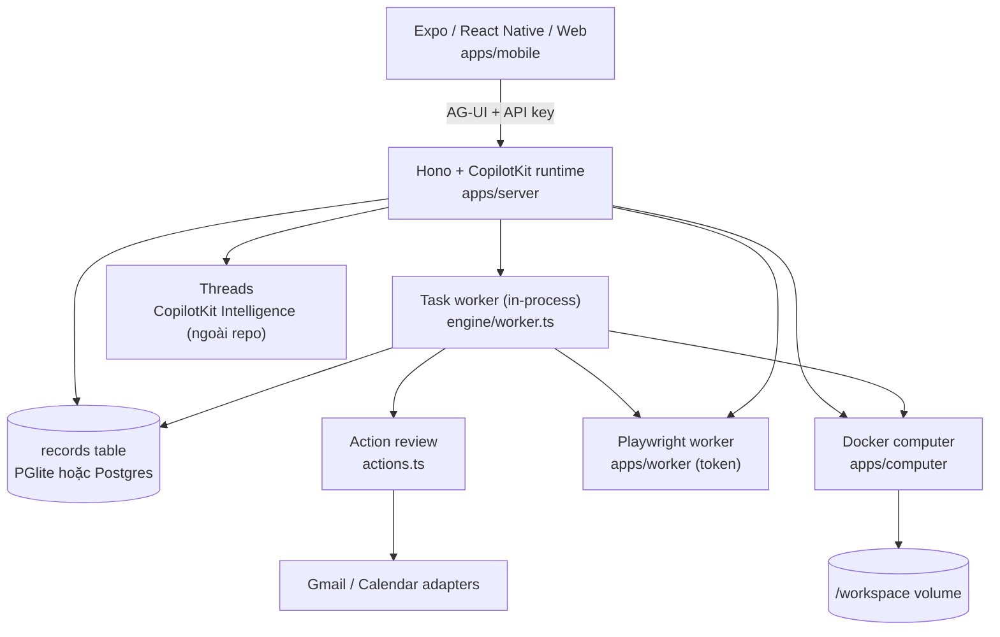

# Báo cáo kiến trúc: `CopilotKit/openmuse`

| Thuộc tính | Giá trị |
|---|---|
| Repo | https://github.com/CopilotKit/openmuse |
| Commit phân tích | `1ac68f3` ("perf(server): scope refreshIdeas status queries") |
| Ngày phân tích | 2026-10-21 |
| Quy mô | 159 file TS/TSX · **36.404 dòng** · 19 file `.md` |
| Test | 60 file test · bản release ghi **154 test pass** (`docs/VERIFICATION.md:7`) |
| Giấy phép | **MIT** (CopilotKit Intelligence là service riêng, không thuộc repo) |
| Sao | ~5.364 · tạo 2026-09-15 · đẩy code 2026-10-20 |
| Trạng thái tự khai | alpha, self-hosting; *"what is verified"* có bảng riêng |
| Kết luận 1 dòng | **Đây là repo gần nhất với thứ WhaleBot cần: một agent cá nhân có task bền, lease, duyệt hành động, bằng chứng. Code MIT, nhỏ hơn Neko 5 lần — nhưng đừng copy nguyên stack mobile/PGlite.** |

> **Giới hạn báo cáo:** đọc code + docs tĩnh; không chạy app (cần Node 24, pnpm, CopilotKit key). Các khẳng định về hành vi dẫn `file:dòng` hoặc docs.

---

## 0. TL;DR

**OpenMuse là gì:** app agent cá nhân (iOS/Android/web) có:

- **Chat** streaming AG-UI, card kết quả inline.
- **Agent computer**: Chromium bền + Linux container tuỳ chọn (terminal, files, PDF).
- **Activity**: task bền có plan, tiến độ, yêu cầu input, pause/resume/cancel/retry, **approval**, receipt.
- **Goals/Tracking**: theo dõi trang web theo lịch, cảnh báo khử trùng lặp.
- **Documents/Finance/Gmail/Calendar**.

**Ba ý tưởng đáng lấy (và lấy được code vì MIT):**

1. **`TaskWorker` ~250 dòng**: lease + CAS + heartbeat + `LostLeaseError`. Đây đúng là thứ WhaleBot đang thiếu, nhỏ hơn nhiều so với tự viết.
2. **Action review có ràng buộc hash**: proposal bất biến, approve phải kèm đúng hash, hết hạn 30 phút, idempotency key. Đây là cổng duyệt cho P2 (đăng bài/trả tiền).
3. **“Không retry mù sau ghi ngoài không chắc chắn”** (`README.md:188`), cài bằng trạng thái `outcome_unknown` khi restart (`db.ts:118-134`). Cùng bài học với Neko, nhưng rẻ hơn.

**Ba thứ không đáng trả giá:**

1. **PGlite (Postgres nhúng) + Postgres** cho hai chế độ → 512 MB RAM mới đủ (`README.md:130`), không chia sẻ được giữa process (`README.md:186`).
2. **Expo React Native + CopilotKit Intelligence** — phụ thuộc service ngoài cho chat persistence.
3. **Browser worker + E2B desktop** — hạ tầng cho “agent dùng máy tính”, chưa cần ở MVP.

---

## 1. Bản đồ hệ thống



| Thư mục | Việc | Dòng đáng chú ý |
|---|---|---|
| `apps/server` | API, CopilotKit runtime, task engine, review, files, DB | `engine/service.ts` 1.198 · `computer.ts` 767 · `engine/worker.ts` 256 |
| `apps/worker` | Playwright + Chromium, profile bền | ~? (token-protected) |
| `apps/computer` | Image Linux nonroot + files helper | — |
| `apps/mobile` | Expo iOS/Android/web | — |
| `packages/domain` | Kiểu + validation (zod) | `agent.ts` 165 |
| `packages/integrations` | Google, browser protocol | — |
| `packages/backends` | Adapter OpenBot (tắt) | — |
| `tests` | Workflow, persistence, auth, provider contract | 60 file |

---

## 2. Cơ chế 1: TaskWorker — lease, CAS, heartbeat, mất lease

`apps/server/src/engine/worker.ts` là file đáng đọc nhất repo. Toàn bộ vòng đời:

```ts
// 1. Quét task đến hạn
t.status === "queued"
|| (t.status === "scheduled" && nextRunAt <= now)
|| (t.status === "running" && leaseUntil <= now)   // ← nhận lại task chết
|| t.status === "waiting_approval"

// 2. Claim bằng CAS, không phải UPDATE trần
compareAndSwap(owner, "tasks", id,
  { status: previous.status, leaseId: previous.leaseId ?? null },
  { status: "running", leaseId, leaseUntil: now + 60_000, attempts: +1 })
// → null = người khác đã claim, bỏ qua

// 3. Heartbeat mỗi lease/3; CAS fail → abort
setInterval(() => compareAndSwap(..., {leaseId, status:"running"},
                                   {leaseUntil: now + leaseMs}))
  .then(v => { if (!v) controller.abort(); })

// 4. Mọi bước ghi đều kiểm lease
guard()   → latest.leaseId !== leaseId → throw LostLeaseError
checkpoint(patch) → CAS theo {leaseId, status:"running"} → fail = LostLeaseError
```

**Xử lý lỗi (`worker.ts:204-260`):**

| Tình huống | Hành vi |
|---|---|
| `LostLeaseError` / bị abort | Task về `queued`, xoá lease — **không** đánh fail |
| Lỗi thật | Task `failed` + `error`, ghi `run-events` |
| Restart giữa lúc `executing` | `db.ts:118-134` đổi action → `outcome_unknown` với message *"Check the provider before creating another action"* |
| Task `waiting_approval` | Chỉ chạy nếu action không còn `awaiting_review`/`executing`; action hết hạn → `expired` |
| Đồng thời | Trần **3 task** in-flight/worker; mỗi task một `AbortController` |

**Vì sao đây là bài học lớn:** WhaleBot MVP dùng D1 + lease 90s qua HTTP. Mỗi heartbeat là một round-trip; không có transaction giữa `goal`, `attempt`, `event`; và không có khái niệm “mất lease thì dừng ghi”. OpenMuse cho thấy phiên bản đúng chỉ cần **một bảng + một cột lease + một hàm CAS**.

**Cải tiến so với OpenMuse:**

| Vấn đề | Cải tiến |
|---|---|
| Lease 60s cố định, task code có thể chạy 20 phút | Lease ngắn (30s) + heartbeat; nhưng **tách** “lease còn sống” khỏi “task còn tiến triển” (thêm `last_progress_at`) |
| CAS bằng JSON containment (`data @> expected`) | Thêm cột `version INTEGER` tăng mỗi lần ghi; CAS theo `version` để tránh ABA |
| Trần 3 task cứng | Cấu hình theo goal: 1 goal nặng = 1 slot; 3 goal nhẹ = 3 slot |
| Không có ngân sách | Thêm `cost_usd`, `steps`, `max_steps` vào task; vượt → `needs_owner` |

---

## 3. Cơ chế 2: Action review — duyệt có ràng buộc

`apps/server/src/actions.ts`:

```ts
// idempotency: key → sha256 → id; đã có thì trả lại, không tạo mới
const id = idempotencyKey ? sha256(idempotencyKey) : randomUUID();

// hash ràng buộc toàn bộ ngữ cảnh
hash = sha256(JSON.stringify({ input, connection, target, targetVersion }));

// hết hạn 30 phút
expiresAt = now + 30 * 60_000;
```

Trạng thái: `awaiting_review → approved | denied | expired | executing`.

**Ba tính chất quan trọng:**

1. **Approve phải kèm hash** (`decide(owner, id, hash, decision)`) — nếu proposal bị sửa (đổi người nhận email, đổi giờ họp), hash cũ không khớp → từ chối. Đây là chống “duyệt A, chạy B”.
2. **Idempotency key** biến “bấm gửi 2 lần” thành một proposal.
3. **Target version** (ETag của calendar event) — chống ghi đè thay đổi người khác đã thực hiện.

**Áp dụng cho WhaleBot:**

| Hành động | Cần approval? | Ràng buộc hash |
|---|---|---|
| `git commit` trong worktree | Không | — |
| `git push` | **Có** | `{repo, branch, commit_sha}` |
| Đăng bài / gửi email | **Có** | `{platform, body, media_sha}` |
| Gọi API tốn tiền | **Có** + chặn cứng nếu `allow_paid=false` | `{provider, model, max_usd}` |
| Xoá worktree | Không (có `/undo`) | — |

Hiện MVP chưa có bảng `approval`. Thêm bây giờ tốn ~40 dòng schema + ~80 dòng code; thêm sau khi P2 chạy sẽ tốn gấp 3 vì phải migrate.

---

## 4. Cơ chế 3: một bảng `records` cho mọi thứ

`db.ts:177`:

```sql
-- Postgres / PGlite, không chạy trên SQLite (jsonb, timestamptz, now())
CREATE TABLE records (
  owner text NOT NULL,
  kind  text NOT NULL,      -- 'tasks' | 'actions' | 'runs' | 'run-events' | ...
  id    text NOT NULL,
  data  jsonb NOT NULL,
  updated_at timestamptz NOT NULL DEFAULT now(),
  PRIMARY KEY (owner, kind, id)
);
```

Truy vấn đặc biệt: `data->>'goalId'`, `data->>'status'`, và CAS bằng `data @> $expected`.

**Điểm mạnh:** thêm loại dữ liệu mới = thêm một `kind`, không migration. Rất hợp giai đoạn alpha.

**Điểm yếu:** không index theo `kind` + status (phải scan), không ràng buộc kiểu, CAS bằng containment có thể trúng trạng thái cũ nếu field trùng. Với 1 người thì ổn; với 10k task thì không.

**Áp dụng:** WhaleBot nên dùng **bảng thật** cho `goal`/`attempt` (vì cần index + đếm + join), và **JSON** cho `payload`/`result`. Đừng dùng một bảng `records` cho tất cả — đó là tối ưu cho tốc độ phát triển, không phải cho truy vấn.

---

## 5. Cơ chế 4: biên giới sandbox — nói thật về giới hạn

`docs/COMPUTER.md:99-114` và `apps/worker/README.md:60-64` là hình mẫu của “công bố giới hạn”:

| Môi trường | Được gì | Không được gì |
|---|---|---|
| Docker computer | nonroot, read-only root, dropped caps, no host mounts, **no network**, 30s/command, 128 KB output | không phải VM; volume không có quota |
| E2B desktop | VM riêng, GUI, network | **mọi port nghe đều public**, có sudo, network không bị review |
| Browser worker | chỉ public 80/443; kiểm DNS; **kết nối đúng IP đã kiểm** (chống rebinding); HTTPS tunnel chỉ 443 | không phải kernel firewall; Chromium sandbox tắt |

Câu chốt đáng copy nguyên văn:

> *"This is application-enforced egress policy, not a kernel firewall or a guarantee against a Chromium exploit."* (`apps/worker/README.md:64`)

**Áp dụng cho WhaleBot:** agent chạy trên máy bạn, có quyền đọc/ghi rộng. Bạn không cần Docker cho MVP, nhưng cần **3 dòng chính sách**:

1. **Deny-read**: `.env`, `~/.ssh`, `~/.aws`, `%APPDATA%`, `%LOCALAPPDATA%`, state home (danh sách này Reason Network đã có sẵn — `DESIGN.md:181`).
2. **Deny-net** cho goal không tin cậy (hoặc ít nhất: không cho `curl`/`Invoke-WebRequest` khi goal đến từ nguồn lạ).
3. **Deny-exfil**: không cho gửi file ra ngoài qua Telegram/HTTP nếu file nằm trong deny-read.

Đây là “gate” của Neko, nhưng viết bằng 3 mảng hằng số.

---

## 6. Cơ chế 5: Verification matrix — cách báo cáo không nói dối

`docs/VERIFICATION.md:25-42` là bảng 3 cột:

| Area | Evidence | Boundary |
|---|---|---|
| Durable work | “Real PGlite restart, two-worker lease races, expired-lease recovery…” | “The server host must remain running. PGlite cannot be shared across processes.” |
| Gmail/Calendar | “Real adapter code with controlled HTTP fixtures…” | “No live Google credentials were supplied.” |
| Browser | “Actual Chromium screenshots… on iPhone and web” | “No automatic booking/payment or hostile-tenant isolation.” |

**Vì sao đáng copy:** WhaleBot sẽ có xu hướng báo “✅ DONE” sau một lần chạy may mắn. Bảng này buộc mỗi dòng có **bằng chứng** và **biên giới**. Nó cũng là thứ bạn dán vào báo cáo tuần mà không phải viết lại.

**Áp dụng:** `RESULT.md` của mỗi goal có 2 mục:

```md
## Evidence
- check: `npm test` → exit 0 (log: artifacts/check.log)
- diff: 3 files, +42/-7 (artifacts/diff.stat)
- commit: abc1234
- core: opencode/free-x, 0 ₫

## Boundary
- Không chạy E2E trên Telegram thật.
- Chưa kiểm Windows sleep/resume.
```

---

## 7. Số đo & chi phí

| Hạng mục | Số |
|---|---|
| TS/TSX | 36.404 dòng · 159 file |
| Test | 60 file · 154 test (release 2026-09-16) |
| Server | Hono + CopilotKit runtime + task worker in-process |
| DB | PGlite (nhúng) hoặc PostgreSQL |
| Worker | Playwright/Chromium, profile bền |
| Computer | Docker nonroot hoặc E2B desktop |
| Mobile | Expo iOS/Android/web |
| RAM tối thiểu deploy | 1 GB (PGlite) (`README.md:130`) |

**Chi phí thêm một loại task:** 1 handler + 1 kiểu domain + 1 test + (nếu có action) 1 review adapter. Khoảng **100–200 dòng**. Đây là mức trưởng thành — và lý do repo này đáng đọc hơn Neko.

---

## 8. Nên copy gì, bỏ gì

### Copy (MIT, lấy được)

| # | Ý tưởng / code | Vào WhaleBot | Công |
|---|---|---|---|
| 1 | `TaskWorker` lease/CAS/heartbeat/`LostLeaseError` | `src/queue/worker.ts` | ~150 dòng (viết lại SQLite) |
| 2 | `ActionService` hash + expiry + idempotency | `src/approval/service.ts` | ~80 dòng |
| 3 | `outcome_unknown` khi restart | `attempt.state` + startup sweep | ~30 dòng |
| 4 | Trần 3 task in-flight + AbortController | daemon config | ~20 dòng |
| 5 | Command bound 30s/128KB (khi cần sandbox) | `exec.ts` | ~15 dòng |
| 6 | Egress allowlist 80/443 + DNS check (P3) | browser tool | ~60 dòng |
| 7 | Bảng Evidence/Boundary | `RESULT.md` template | 0 dòng |
| 8 | “No hidden retry after uncertain external write” | policy + test | 0 dòng |

### Bỏ

| Thứ | Vì sao |
|---|---|
| PGlite + Postgres dual | 512 MB RAM, không share process; SQLite WAL là đủ |
| Expo mobile | Telegram là client |
| CopilotKit Intelligence | Service ngoài, key riêng, không thuộc MIT |
| Google OAuth/Gmail/Calendar | P2 mới cần |
| Browser worker + E2B | Hạ tầng nặng, rủi ro cao |
| Một bảng `records` cho tất cả | Không index/không join; hợp alpha, không hợp vận hành |
| `owner` multi-tenant | 1 người |

### Cải tiến so với bản gốc

| Vấn đề của OpenMuse | Cải tiến cho WhaleBot |
|---|---|
| Lease 60s cho task có thể chạy 20 phút | `lease_until` + `last_progress_at` riêng; không có tiến triển 3 phút → cảnh báo, 10 phút → `needs_owner` |
| CAS bằng JSON containment | `version` tăng đơn điệu |
| Không có ngân sách/thời gian theo task | `max_steps`, `max_minutes`, `max_cost` |
| Approval chỉ cho email/calendar | Approval cho `push`, `post`, `paid` |
| Không có “undo” cho action đã chạy | Ghi `receipt` + `reversible: false`; không hứa undo |
| Task worker chạy trong API process | WhaleBot tách daemon; API/Worker chỉ là transport |

---

## 9. Rủi ro & giới hạn

| Mức | Vấn đề | Bằng chứng |
|---|---|---|
| P0 | Alpha; *"Live model and Google-account acceptance remain outside this recording"* | `VERIFICATION.md:16` |
| P1 | Phụ thuộc CopilotKit Intelligence cho chat persistence | `README.md:190-194` |
| P1 | PGlite không chia sẻ được giữa process; 1 GB RAM | `README.md:130,186` |
| P1 | Single owner bằng access key dùng chung, không phải auth đa người | `README.md:150` |
| P2 | Docker computer không phải VM; E2B có network + port public | `COMPUTER.md:99-114` |
| P2 | Browser egress là app-level, không phải kernel firewall | `apps/worker/README.md:64` |
| P3 | OpenBot adapter chưa nối thật | `VERIFICATION.md:41` |

**License:** MIT. CopilotKit Intelligence và benchmark/dataset bên thứ ba thì không.

---

## 10. Nếu chỉ có 1 giờ

| Thứ tự | File | Vì sao |
|---|---|---|
| 1 | `apps/server/src/engine/worker.ts` (256 dòng) | Toàn bộ lease/CAS/heartbeat, đọc 1 lần là hiểu |
| 2 | `apps/server/src/actions.ts:1-110` | Approval có hash + expiry + idempotency |
| 3 | `apps/server/src/db.ts:57-140` | CAS, insertIfAbsent, `outcome_unknown` khi restart |
| 4 | `docs/VERIFICATION.md:25-42` | Cách báo cáo Evidence/Boundary |
| 5 | `apps/worker/README.md:60-64` | Egress policy và giới hạn của nó |

---

## 11. Kết luận

OpenMuse là **bản thiết kế gần nhất** với WhaleBot trong 5 repo, vì nó giải đúng ba bài toán vận hành:

1. Task bền, có lease, có thể chết và nhận lại.
2. Hành động nguy hiểm phải duyệt, duyệt phải ràng buộc nội dung.
3. Ghi ngoài không chắc chắn thì **dừng và báo**, không retry.

Nhưng nó trả giá bằng **PGlite/Postgres + Expo + browser worker + CopilotKit service**. WhaleBot nên lấy **~250 dòng lõi** (worker + approval + outcome_unknown), bỏ toàn bộ stack, và thay bằng **một file SQLite + Telegram**.

---

## 12. Phụ lục: lệnh tái lập

```powershell
git clone --depth 1 https://github.com/CopilotKit/openmuse.git
git -C openmuse log -1 --oneline

(Get-ChildItem openmuse\apps,openmuse\packages,openmuse\tests -Recurse -Include *.ts,*.tsx |
  Where-Object FullName -NotMatch 'node_modules' |
  ForEach-Object { (Get-Content $_.FullName | Measure-Object -Line).Lines } |
  Measure-Object -Sum).Sum

Get-Content openmuse\apps\server\src\engine\worker.ts -TotalCount 260
Get-Content openmuse\apps\server\src\db.ts | Select-Object -Skip 55 -First 90
Get-Content openmuse\docs\VERIFICATION.md | Select-Object -Skip 24 -First 20
```
