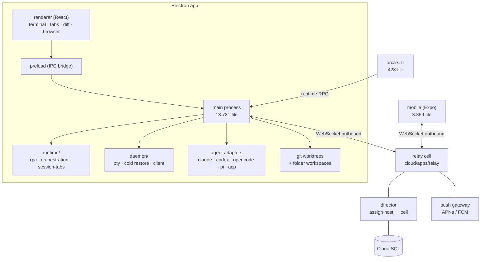

# Báo cáo kiến trúc: `stablyai/orca`

| Thuộc tính | Giá trị |
|---|---|
| Repo | https://github.com/stablyai/orca |
| Commit phân tích | `dda855e` |
| Ngày phân tích | 2026-10-21 |
| Quy mô | **38.635 file** theo dõi · ~1,46 GB · 30.932 `.ts` + 3.927 `.tsx` · 200 `.md` |
| Test | **14.047 file** `*.test.ts(x)` (≈36% tổng số file) |
| Giấy phép | **MIT** (kể cả `cloud/`) |
| Sao | ~99.915 · tạo 2026-03-17 · đẩy code 2026-10-21 |
| Kết luận 1 dòng | **Đây là “IDE điều phối đàn agent” đã thương mại hoá. Học cách nó mô hình hoá worktree / adapter / lease qua relay; tuyệt đối không copy khối lượng.** |

> **Giới hạn báo cáo:** repo 1,46 GB, tôi chỉ checkout thưa (`docs/`, `skills/`, `cloud/`) và đọc module map từ git tree. Không đọc hết 30k file `src/`. Mọi kết luận về hành vi UI/Electron là suy ra từ README + AGENTS.md + cấu trúc thư mục, không phải từ chạy app.

---

## 0. TL;DR

**Orca là gì:** một desktop app (Electron) + mobile app (Expo) + CLI + relay cloud. Bạn mở một “fleet” agent — Claude Code, Codex, Grok, opencode, Cursor, Copilot… — mỗi agent chạy trong **worktree riêng**, có terminal riêng, có trạng thái riêng, và bạn điều khiển tất cả từ một chỗ (kể cả từ điện thoại).

**Con số biết nói:**

| Khu vực | Số file |
|---|---|
| `src/` | 30.917 |
| `mobile/` | 3.859 |
| `tests/` | 1.160 |
| `config/` | 1.124 |
| `cloud/` | 662 |
| `docs/` | 534 |
| `native/` | 74 |
| `skills/` + `skill-guides/` | 35 |

**Ba ý tưởng đáng lấy:**

1. **Worktree là đơn vị cô lập, không phải “nhánh”.** Mỗi agent một worktree; fan một prompt ra 5 agent; so sánh; merge cái thắng (`README.md:49-57`).
2. **Adapter theo “dialect”, không theo `if/else`.** `src/main/acp/acp-dialects/` có `grok-dialect.ts`, `opencode-dialect.ts`, `antigravity-dialect.ts`… Mỗi harness khác nhau ở *cách nói chuyện*, không phải ở *kiến trúc*.
3. **Desktop không mở cổng vào.** Mobile và desktop **cùng dial ra** relay; relay ghép cặp; push đi qua gateway riêng (`cloud/README.md:1-20`). Đây là mô hình đúng nếu WhaleBot sau này muốn app điện thoại thay Telegram.

**Ba thứ không đáng trả giá:**

1. **Electron + React + Expo + native modules** cho một người.
2. **14k file test** — dấu hiệu của team 20+ người ship hàng ngày, không phải mục tiêu của bạn.
3. **Relay/director/cell/Terraform/Cloud SQL** — hạ tầng cho hàng trăm nghìn người dùng.

---

## 1. Bản đồ hệ thống (suy ra từ cây thư mục + docs)



**Đọc từ `README.md` + `cloud/README.md` + tree:**

| Lớp | Vai trò | Ghi chú |
|---|---|---|
| `src/main` | Electron main: PTY, git, agent adapters, IPC, orchestration | Nặng nhất (13,7k file) |
| `src/renderer` | UI React | 12,8k file |
| `src/shared` | Kiểu dùng chung main/renderer | 3,6k file |
| `src/cli` | CLI cho agent điều khiển Orca | 428 file, `handlers/` 148 |
| `src/main/acp` | ACP — Agent Client Protocol, đa dialect | 194 file |
| `src/main/runtime/orchestration` | Coordinator, DAG, decision gate, dispatch | 328 file |
| `cloud/` | Relay + push + ops + Terraform | workspace pnpm riêng |

---

## 2. Cơ chế 1: worktree-per-task + fan-out

`README.md:49-57`:

> *"Fan one prompt across five agents, each in its own isolated git worktree — compare the results and merge the winner."*

Điều đáng học không phải “dùng git worktree” (WhaleBot đã có), mà là **worktree là đơn vị quản lý UI và trạng thái**:

- Mỗi worktree có tab, terminal, agent, diff, trạng thái riêng.
- Agent **không bao giờ** chạy trong thư mục gốc; mọi thứ diễn ra trong worktree.
- Có cả **folder workspace** (không phải git) — vì không phải công việc nào cũng là code (`AGENTS.md` mục *Folder Workspaces*).

**Áp dụng cho WhaleBot:**

| Việc | Hiện tại (MVP) | Nên thêm |
|---|---|---|
| Cô lập | `git worktree` trong `worktree-manager.js` | Giữ |
| Fan-out | Không có | `/goal --variants 3` → 3 worktree, 3 agent, so sánh diff + test, chọn 1 |
| Non-git | Không có | P2 Media cần “folder workspace” (thư mục dự án video), đừng ép git |
| Vòng đời | Tạo → chạy → báo cáo | Thêm `keep` / `discard` / `promote` tường minh |

**Cải tiến so với Orca:** Orca giữ worktree đến khi người dùng đóng app. WhaleBot nên có **TTL** (mặc định 7 ngày) + `whale gc` để không đầy ổ sau 50 goal. Orca không cần vì có UI nhắc; bạn thì cần.

---

## 3. Cơ chế 2: adapter dạng “dialect”

`src/main/acp/` có:

```
acp-dialects/
  acp-dialect.ts        ← interface chung
  grok-dialect.ts
  opencode-dialect.ts
  antigravity-dialect.ts
  omp-dialect.ts
```

Cộng với các adapter riêng: `src/main/claude`, `codex`, `opencode`, `pi`, `acp` — mỗi cái vài trăm file.

**Ý tưởng:** phần lõi (spawn, PTY, đọc output, trạng thái) là chung; phần khác biệt (cách gửi prompt, cách nhận event, cách resume, cách lấy usage) nằm trong dialect.

**Đối chiếu WhaleBot:** hiện `agent-mesh.js` gọi 3 core bằng 3 nhánh code. Thêm core thứ 4 = sửa mesh + thêm test + có thể vỡ core khác.

**Cải tiến:** registry dạng dữ liệu, không phải class. Xem [`REFERENCE-ARCHITECTURE.md`](./REFERENCE-ARCHITECTURE.md) §5 — mỗi harness là một JSON khai báo `argv`, `resume`, `steer.tier`, `status.source`, `cost.parser`. Dialect chỉ cần khi hành vi thật sự khác (ví dụ parse event stream), và khi đó viết **một hàm** trong `harness/<id>.ts`, không phải cả cây thư mục.

---

## 4. Cơ chế 3: orchestration bền (DAG, gate, circuit breaker)

`src/main/runtime/orchestration/`:

| File | Việc |
|---|---|
| `coordinator.ts` | Vòng lặp điều phối |
| `coordinator-dag-convergence.ts` | DAG hội tụ |
| `coordinator-decision-gates.ts` | Cổng quyết định (chờ người/điều kiện) |
| `coordinator-task-dispatch.ts` | Giao việc cho worker |
| `db/dispatch-context/dispatch-circuit-breaker.ts` | Cầu dao khi dispatch lỗi liên tục |
| `db/federation/*` | Đồng bộ giữa nhiều runtime |
| `db/attempt-outcome-projection.ts` | Chiếu kết quả attempt |

Đây là **cùng bài toán** WhaleBot sẽ gặp ở P2: nhiều agent, nhiều bước, có cổng duyệt, có retry, có “worker chết giữa đường”.

**Bài học rẻ nhất:** tách **dispatch** (ý định giao việc) khỏi **attempt** (một lần chạy) khỏi **outcome** (kết quả). Ba thứ này không được gộp vào một cột `status`.

WhaleBot MVP đang gộp: `goal.state = RUNNING`. Khi chết, không biết đang ở bước nào. Xem `openmuse` để có bản ~250 dòng của cùng mô hình.

**Không nên copy:** `federation`, `coordinator-runs` store, `decision-gate` đầy đủ. Đó là cho nhiều máy/nhiều runtime.

---

## 5. Cơ chế 4: relay cho mobile (desktop không mở cổng)

`cloud/README.md:1-8`:

> *"Phones and desktops never talk to each other directly: each opens an outbound WebSocket to a relay cell, the relay pairs the two sessions, and it splices frames between them. A director assigns hosts to cells and coordinates migrations."*

Và push (`cloud/README.md:12-20`):

- Desktop xác thực với gateway bằng **X25519 key**, trả lời challenge mã hoá → session 24h.
- Gateway giữ APNs key/FCM; phone **không** giữ credential của Orca.
- Mỗi notification là một event bền; token bị Apple/Google báo unregistered thì retire ngay.

**Vì sao đáng quan tâm dù WhaleBot dùng Telegram:**

Telegram webhook của bạn là **cổng vào công khai**. Orca chọn **outbound-only**: không có cổng nào mở trên máy bạn. Nếu sau này bạn muốn app riêng (hoặc bỏ Telegram), mô hình relay là đường đúng — và nó cũng là cách giảm bề mặt tấn công của webhook hiện tại (chỉ Worker nhận, daemon gọi ra).

**Không cần làm bây giờ.** Nhưng đừng thiết kế daemon theo kiểu “phải có IP công khai”.

---

## 6. Cơ chế 5: hợp đồng chất lượng trong `AGENTS.md`

`AGENTS.md` của Orca là một trong những file đáng đọc nhất repo, vì nó định nghĩa **thứ không được phép hy sinh**:

| Luật | Nội dung | Vì sao đáng copy |
|---|---|---|
| Reuse before reimplement | “Before writing new logic at any scale … check whether an existing implementation already does the job” | Đúng triết lý WhaleBot §3.6 |
| Không tên file mơ hồ | Cấm `helpers`, `utils`, `common`, `misc` | Giữ repo 1 người vẫn đọc được sau 6 tháng |
| Type assertion phải có `SAFETY:` | Không `as` bừa | Giảm bug runtime |
| First-class | Cross-platform, remote, mobile, folder workspace | **Mỗi feature phải trả lời 4 câu này** |
| Test có giá trị | “Avoid adding low-value tests” | Chống test rác |

**Cải tiến cho WhaleBot:** copy 4 mục đầu vào `AGENTS.md` của bạn (W4). Mục “first-class” thì **cắt xuống 1**: cross-platform Windows (vì bạn chỉ chạy Windows). Đừng copy mobile/remote khi chưa có.

---

## 7. Cơ chế 6: skill do binary phục vụ (version-matched docs)

`skills/orchestration/SKILL.md:27-40`:

> *"This file is a discovery stub, not the usage guide. The full, version-matched Orca orchestration reference is served by the `orca` binary itself — kept out of this file on purpose so it can never drift from the binary that will actually run your commands."*

Cách làm:

- `SKILL.md` chỉ nói **khi nào dùng** + cách lấy hướng dẫn.
- Hướng dẫn thật: `orca skills get orchestration` → in ra từ binary, đúng version.
- Có `--reference <file>` cho nhánh điều kiện (remote placement, uncertain release recovery…).

**Đây là ý tưởng rất hay cho WhaleBot.** Bạn sẽ có nhiều skill (`/goal`, `/steer`, `deploy`, `video`), và chúng sẽ lệch với code. Thay vì viết `docs/SKILL.md` dài, hãy để `whale skills get <name>` in ra từ code/JSON — một nguồn sự thật.

Chi phí: ~40 dòng. Lợi: không bao giờ có “docs nói A, bot làm B”.

---

## 8. Số đo & chi phí thật

| Hạng mục | Số |
|---|---|
| Tổng file | 38.635 |
| TypeScript | 30.932 `.ts` + 3.927 `.tsx` |
| Test | 14.047 file (~36%) |
| Docs | 200 `.md` |
| Cloud | 662 file (relay 266, push 80, ops 40, fence-broker 13) |
| Agent hỗ trợ | ~30 CLI (README:171-212) |
| Nền tảng | macOS · Windows · Linux · iOS · Android |
| Build | Electron + Vite + pnpm workspace + Expo + Terraform |

**Chi phí thêm một tính năng (ước từ cấu trúc):**

- Đổi UI → renderer + preload + IPC + mobile parity + test + docs.
- Thêm agent → adapter + dialect + skill + test + docs.
- Đổi hành vi chạy → main + runtime + daemon + relay contract + test.

So sánh: WhaleBot thêm một route Telegram = 1 file. Đây là **khoảng cách 2 bậc độ phức tạp**, và là lý do Orca không thể là nền của bạn.

---

## 9. Nên copy gì, bỏ gì

### Copy

| # | Ý tưởng | Vào WhaleBot | Công |
|---|---|---|---|
| 1 | Worktree là đơn vị cô lập + fan-out có so sánh | `/goal --variants N` (P2) | ~120 dòng |
| 2 | Adapter là dữ liệu (argv/resume/steer/cost) | `harness/*.json` | ~60 dòng |
| 3 | Tách dispatch / attempt / outcome | schema `goal` + `attempt` | ~30 dòng |
| 4 | Circuit breaker khi dispatch lỗi liên tục | `daemon` đếm fail → tạm dừng core | ~25 dòng |
| 5 | Skill do binary phục vụ | `whale skills get` | ~40 dòng |
| 6 | AGENTS.md: reuse, đặt tên, SAFETY, test có giá trị | `AGENTS.md` W4 | 0 dòng code |
| 7 | Outbound-only relay (khi cần mobile) | P3, chưa làm | — |

### Bỏ

| Thứ | Vì sao |
|---|---|
| Electron + React + 12,8k file renderer | Telegram là UI của bạn |
| Expo mobile + 3,8k file | Không cần app |
| 14k file test | Không có team để chạy |
| Relay/director/cell/Terraform | Hạ tầng cho 100k người dùng |
| ACP đầy đủ + 30 adapter | Bạn cần 3–5 |
| PTY/Ghostty/terminal rendering | Agent chạy headless |
| Computer-use desktop | P3, rủi ro cao |

### Cải tiến so với bản gốc

| Vấn đề của Orca | Cải tiến cho WhaleBot |
|---|---|
| UI là nguồn sự thật trạng thái | DB là nguồn sự thật; Telegram chỉ là view |
| Worktree không có TTL | `whale gc` + TTL 7 ngày |
| Adapter phụ thuộc PTY/screen | Headless + exit code + parse JSON, không screen-scrape |
| 30 agent hỗ trợ → ma trận test nổ | Chỉ hỗ trợ core bạn thật sự dùng; mỗi core có 1 test smoke |
| Mobile cần relay proprietary | Telegram + Cloudflare Worker đã đủ; đừng xây relay |

---

## 10. Rủi ro & giới hạn

| Mức | Vấn đề | Bằng chứng |
|---|---|---|
| P0 | **Không thể fork** vì khối lượng (1,46 GB, 38k file, 3 toolchain) | tree |
| P1 | Phụ thuộc Electron/native/PTY → build Windows phức tạp | `native/`, `daemon/` |
| P1 | UI là nguồn trạng thái; headless hoá phải viết lại | `src/main/runtime` |
| P2 | 30 agent × Nền tảng = ma trận test không thể tự duy trì | README:171-212 |
| P2 | Relay cloud là MIT nhưng hạ tầng Terraform/GCP không portable | `cloud/` |
| P3 | Ship hàng ngày → API nội bộ đổi liên tục | commit `dda855e` |

**License:** MIT, kể cả `cloud/`. Về pháp lý có thể copy code. Về kỹ thuật thì không.

---

## 11. Nếu chỉ có 1 giờ

| Thứ tự | File | Vì sao |
|---|---|---|
| 1 | `README.md:49-57` + `:147-157` | Mô hình worktree + CLI điều khiển agent |
| 2 | `AGENTS.md` | Hợp đồng chất lượng, 4 mục first-class |
| 3 | `cloud/README.md:1-20` | Relay + push: cách desktop không mở cổng |
| 4 | `skills/orchestration/SKILL.md:27-40` | Skill do binary phục vụ |
| 5 | tree `src/main/runtime/orchestration/*` | Tên file đã kể hết câu chuyện: coordinator, gate, dispatch, breaker |

---

## 12. Kết luận

Orca chứng minh một điều: **“điều phối đàn agent” là một sản phẩm UI + hạ tầng, không phải một script**. Giá trị của nó với WhaleBot nằm ở **mô hình hoá**, không ở code:

- worktree là đơn vị cô lập;
- adapter là dialect, không phải nhánh `if`;
- dispatch ≠ attempt ≠ outcome;
- desktop dial ra, không mở cổng.

Bốn câu đó, viết lại trong ~250 dòng, cho bạn 80% giá trị mà không kéo theo 38.000 file.

---

## 13. Phụ lục: lệnh tái lập

```powershell
git clone --depth 1 --filter=blob:none --no-checkout https://github.com/stablyai/orca.git
git -C orca sparse-checkout set --cone docs skills skill-guides cloud
git -C orca checkout
git -C orca log -1 --oneline

git -C orca ls-tree -r HEAD --name-only |
  Group-Object { [IO.Path]::GetExtension($_) } |
  Sort-Object Count -Descending | Select-Object -First 10

Get-Content orca\AGENTS.md
Get-Content orca\cloud\README.md -TotalCount 40
git -C orca ls-tree -r HEAD --name-only | Select-String 'acp-dialects'
```
