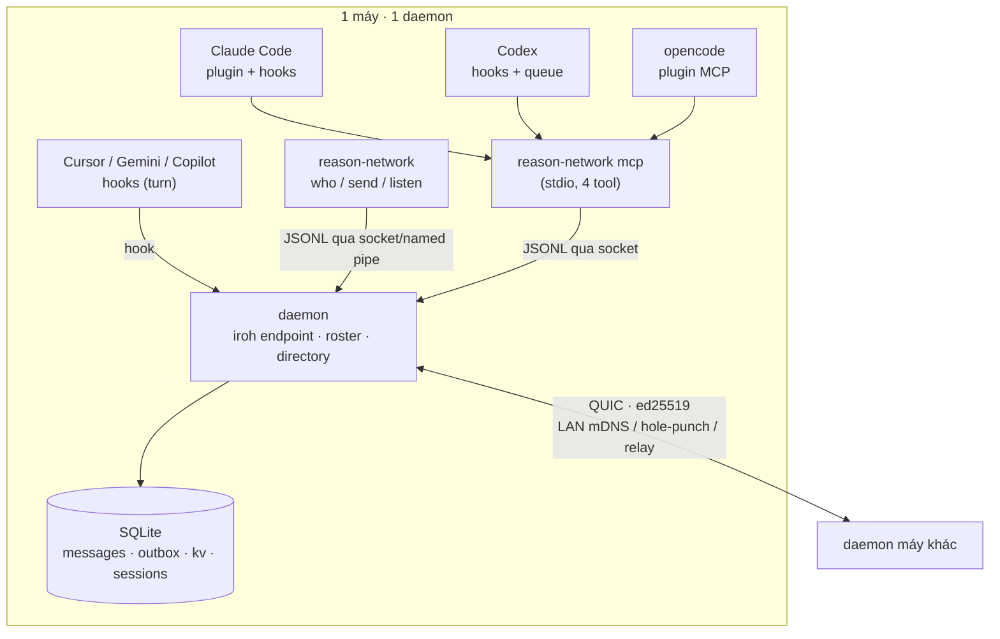

# Báo cáo kiến trúc: `reason-machines/reason-network`

| Thuộc tính | Giá trị |
|---|---|
| Repo | https://github.com/reason-machines/reason-network |
| Commit phân tích | `6f18a70` ("Merge #59: ask_user and send --notify…") |
| Ngày phân tích | 2026-10-21 |
| Quy mô | 34 file `.rs` · **14.167 dòng** · 5 file `.md` · 7 script E2E Python (1.263 dòng) |
| Test | 21 module có `#[cfg(test)]` inline + 7 kịch bản E2E 2 máy thật |
| Giấy phép | **MIT OR Apache-2.0** (dùng thương mại được) |
| Sao | ~725 · tạo 2026-10-16 · đẩy code 2026-10-21 |
| Trạng thái tự khai | M0–M3 xong và đã test trên macOS; **M4 chưa bắt đầu** (`DESIGN.md:10`) |
| Kết luận 1 dòng | **Không phải bot, mà là “danh bạ + bưu điện” cho các phiên agent đang sống. Đây là lời giải đúng cho `/status` và `/steer` của WhaleBot — nhưng chỉ nên lấy mô hình dữ liệu, không lấy hạ tầng P2P.** |

> **Giới hạn báo cáo:** phân tích tĩnh (đọc code + DESIGN.md). Không build Rust, không chạy 2 máy. Mọi khẳng định về hành vi đều dẫn `file:dòng`, không dựa trên quan sát runtime.

---

## 0. TL;DR

**Vấn đề nó giải:** một team có nhiều người, mỗi người nhiều máy, mỗi máy nhiều phiên agent (Claude Code, Codex, Cursor, Gemini, opencode, Grok…). Làm sao để agent A biết agent B đang làm gì và gửi đúng người — không broadcast, không qua server.

**Câu trả lời:** một daemon/máy, một binary Rust tĩnh. Daemon giữ:

1. **Directory** — phiên nào đang sống, của ai, máy nào, repo@branch, busy/idle, đang làm gì.
2. **Mailbox** — thư đến được lưu trước, gửi sau (kể cả khi người nhận offline).
3. **Delivery tier** — mỗi harness nhận thư theo một trong ba cách: `push` (chèn giữa lượt, đánh thức phiên idle), `turn` (chèn ở tool call kế tiếp / cuối lượt), `pull` (chỉ khi agent tự gọi `check_inbox`).

**Ba ý tưởng đáng lấy nguyên xi:**

1. **Không hỏi agent “mày đang làm gì”.** Đọc thứ nó vốn đã ghi: tiêu đề phiên + todo list + transcript (`src/doing.rs:1-8`). Đây là cách duy nhất để `/status` không nói dối.
2. **Tier là thuộc tính của harness, không phải của tin nhắn.** Cùng một lệnh `/steer`, Claude Code nhận trong <1s, Cursor nhận ở tool call sau, DeepSeek Harness nhận khi tự kiểm inbox (`DESIGN.md:226-239`). WhaleBot phải công bố tier thay vì hứa “≤15 giây” cho mọi core.
3. **Thư phải sống lâu hơn phiên.** Phiên chết → thư nằm trong mailbox theo tên phiên; phiên mới cùng tên cùng agent **thừa kế tên cũ + thư chưa đọc** (`DESIGN.md:56-58`). Đây chính là “goal không mất khi daemon restart”.

**Ba thứ không đáng trả giá cho một người:**

1. **iroh + relay + roster ký ed25519** — hạ tầng cho team nhiều người, nhiều máy, qua Internet.
2. **Invite link, proof JWS, name takeover** — nghiệp vụ của sản phẩm nhiều người dùng.
3. **File transfer với 10 giới hạn** (10 file, 256 KB/file, 512 KB tổng, allowlist thư mục…) — hữu ích cho team, vô nghĩa khi bạn gửi file cho chính mình.

---

## 1. Bản đồ hệ thống



**Thành phần thật (đọc từ `DESIGN.md:72-86`):**

| Thành phần | Vai trò | Ghi chú thiết kế |
|---|---|---|
| `daemon` | Chủ sở hữu endpoint iroh, roster, directory, mailbox | Tự bật khi subcommand khác gọi; hoặc service OS |
| `mcp` | MCP server stdio do agent spawn | **Phải phục vụ nhiều phiên trong 1 process** (Codex/opencode/Cursor dùng chung) |
| `hook <agent>` | Nhận sự kiện start/prompt/tool/stop/end | Là đường tiêm thư vào phiên |
| CLI | who/send/listen/status/init/invite/join/setup/doctor | Người dùng cuối |
| SQLite | 4 bảng: `messages`, `outbox`, `kv`, `sessions` | `src/store.rs:49-92` |

**Vì sao Rust:** iroh 1.x + `rmcp` chỉ có hệ sinh thái Rust chạy được ngay (`DESIGN.md:85-86`). Đây là lý do hợp lý — nhưng cũng là lý do **không** copy: WhaleBot không cần iroh.

---

## 2. Mô hình dữ liệu: 4 bảng, không hơn

`src/store.rs:49-92`:

```sql
PRAGMA journal_mode = WAL;

CREATE TABLE messages (
  id TEXT PRIMARY KEY,
  sender TEXT NOT NULL, sender_agent TEXT, sender_repo TEXT,
  recipient TEXT NOT NULL, via TEXT, reply_to TEXT,
  body TEXT NOT NULL, wake INTEGER NOT NULL,
  sent_at INTEGER NOT NULL, read_at INTEGER,
  held INTEGER NOT NULL DEFAULT 0
);
CREATE INDEX messages_unread ON messages (recipient, read_at);

CREATE TABLE outbox (          -- thư chưa gửi được, chờ máy đích sống lại
  id TEXT PRIMARY KEY, target TEXT NOT NULL, msg TEXT NOT NULL, created_at INTEGER NOT NULL
);

CREATE TABLE kv (key TEXT PRIMARY KEY, value TEXT NOT NULL);

CREATE TABLE sessions (
  name TEXT PRIMARY KEY,
  key TEXT NOT NULL,          -- <agent>:<session id> hoặc proc:<pid>
  agent TEXT NOT NULL, cwd TEXT NOT NULL,
  repo TEXT, branch TEXT, doing TEXT,
  tier TEXT NOT NULL,         -- push | turn | pull | none
  last_seen INTEGER NOT NULL
);
CREATE INDEX sessions_key ON sessions (key);
```

**Nhận xét quan trọng:** không có bảng `team`, `person`, `machine` trong SQLite. Roster là **state đồng bộ giữa các máy**, không phải bảng quan hệ. Với WhaleBot (1 người, 1 máy) điều này càng đúng: danh bạ chỉ cần `sessions` + `goals`.

---

## 3. Cơ chế 1: “đang làm gì” đọc từ dấu vết, không phải từ lời khai

`src/doing.rs:1-8` nói thẳng:

> *"What a session is doing, read from what its agent records anyway, so agents never have to report it: the session's title … and the task in progress on its own todo list."*

Cách làm:

| Nguồn | Lấy gì | Ở đâu |
|---|---|---|
| Claude Code | entry `ai-title` trong transcript | `doing.rs` `visit()` |
| Codex | tên thread trong `~/.codex/session_index.jsonl` | `codex_title()` |
| Todo lists | Claude tasks / TodoWrite, Codex `update_plan`, Gemini `write_todos`, Cursor `todo_write`, opencode todos | `doing.rs:60-110` |
| Hook payload | `transcript_path`, `session_id` | `proto.rs` `HookCall` |

Kết quả là **một dòng** `<title> — <task in progress>`, cắt ở 120 ký tự (`MAX_LEN`), chỉ đọc phần transcript **mới thêm** kể từ lần trước (`FIRST_READ = 2 MB`, sau đó `seek`).

### Vì sao đây là bài học đắt nhất cho WhaleBot

MVP của bạn có `MVP-R09`: *“`/status` MUST hiển thị `stale` nếu không có cập nhật > 90 giây, thay vì hiện ‘đang chạy’”*. Nhưng “stale” vẫn là **tự khai**. Nếu agent không báo gì (hoặc báo sai), bạn vẫn hiển thị “RUNNING”.

`doing.rs` đưa ra tiêu chuẩn cao hơn:

- **Nếu đọc được dấu vết** → hiện `title — task`.
- **Nếu không đọc được** → hiện `unknown`, không đoán.
- **Nếu phiên chết** → hiện `last seen 14m`, không hiện “running”.

Với WhaleBot, ba nguồn rẻ nhất:

| Core | Dấu vết | Cách đọc |
|---|---|---|
| opencode | session JSON + todo | `opencode` lưu session dưới `~/.local/share/opencode` (hoặc `--dir` state); đọc title + todo cuối |
| codex | `~/.codex/session_index.jsonl` | dòng cuối của thread đang chạy |
| antigravity | log/CLI output | parse stdout đã bắt sẵn |

Nếu chưa làm được cả ba: **hiện `unknown`**. Đó là cải tiến trung thực hơn mọi badge “RUNNING”.

---

## 4. Cơ chế 2: delivery tier — hợp đồng giao thư theo từng harness

`DESIGN.md:218-239`:

| Tier | Nghĩa | Cơ chế thật |
|---|---|---|
| **push** | Chèn giữa lượt + **đánh thức phiên idle** | Claude Code: ghi vào `CLAUDE_CODE_MESSAGING_SOCKET`; Codex: `codex queue --thread`; opencode: plugin `client.session.promptAsync`; pi: extension `sendUserMessage({deliverAs:"steer"})` |
| **turn** | Chèn ở tool call kế tiếp hoặc cuối lượt; phiên idle **chờ người** | Cursor `postToolUse.additional_context` + `stop.followup_message`; Gemini `AfterTool`; Copilot `postToolUse`; Grok `PostToolUse` |
| **pull** | Chỉ khi agent tự gọi `check_inbox` | Mọi MCP client; mỗi tool result kèm “có thư chưa đọc” |

Và một câu chốt rất quan trọng:

> **MCP notifications are not a delivery path: no client passes them to the model (checked Oct 2026).** (`DESIGN.md:241`)

Tức là: **không có cách “chuẩn MCP” nào để đẩy tin vào model.** Phải có kênh riêng của từng harness. Đây là lý do Orion/Neko/Orca đều phải viết adapter.

### Áp dụng vào `/steer` của WhaleBot

MVP `MVP-R06` viết: *“`/steer` … MUST đến đúng agent đang chạy trong ≤ 15 giây”*. Với dữ liệu trên, yêu cầu này **không thể đúng cho mọi core**:

- opencode / Claude Code / Codex (push) → 15s là khả thi.
- Cursor / Gemini / Grok (turn) → không thể; phải đợi tool call hoặc hết lượt.
- Bất kỳ harness chỉ MCP (pull) → phải đợi agent hỏi.

**Sửa R06 thành:** `/steer` MUST báo được **tier** và **thời điểm dự kiến đến**; với tier `push` phải đến ≤ 15s; với `turn`/`pull` phải hiện “sẽ đến ở tool call kế tiếp / khi agent kiểm inbox”, MUST NOT báo “đã gửi” như đã đến.

Đây là thay đổi spec, không phải thay đổi code — và nó cứu bạn khỏi AC02 fail oan.

---

## 5. Cơ chế 3: mailbox bền + kế thừa tên phiên

- Thư đến → `store.insert(..., held)` **lưu trước**, rồi mới ack `stored | delivered | held | refused` (`DESIGN.md:169-175`).
- Máy đích offline → thư nằm ở `outbox` của máy gửi, tự gửi lại khi máy đích sống (`store.rs` `outbox_add/outbox_for/outbox_done`).
- Thư cho phiên offline → nằm ở mailbox **theo tên phiên**, 1 ngày; phiên mới cùng tên/agent **thừa kế** (`DESIGN.md:56-58`, `173-175`).
- `held` = chính sách inbound `hold` của người nhận: thư phải được người duyệt mới hiện (`DESIGN.md:308-313`).

**Bài học cho WhaleBot:** goal đến từ Telegram khi daemon đang tắt phải nằm ở D1 (đúng như MVP đã thiết kế). Nhưng **kết quả/steer đi ngược lại** cũng phải bền: nếu daemon chết giữa lúc chạy, lần khởi động sau phải thấy `attempt` cũ ở trạng thái `unknown` và **không tự chạy lại** — xem `openmuse` và `neko`.

---

## 6. Cơ chế 4: vòng lặp an toàn cho đa agent

Hai thứ rất rẻ, rất nên copy:

1. **Loop guard**: rate limit theo người gửi + **trần số tin agent↔agent liên tiếp không có người xen vào** (`DESIGN.md:314-315`).
2. **Group guard**: agent **không được** gửi `*`, `person/*`, `repo:`; chỉ người ở terminal mới được (`DESIGN.md:316-320`).

WhaleBot có mesh `lead → coder → qa`. Nếu cả ba đều là model, vòng “qa bác → coder sửa → qa bác” có thể chạy vô hạn. Trần 6 lượt không có người duyệt là **một dòng code**, chặn được một hóa đơn/thời gian vô hạn.

---

## 7. Cơ chế 5: cài đặt vào nhiều harness (setup)

`setup.rs` là một trong những file đáng đọc nhất:

- Phát hiện agent bằng `agent::find_bin("claude")` **hoặc** thư mục config tồn tại (`setup.rs:227-228`, `314-317`).
- Sửa file config theo từng agent: `claude mcp add`, `~/.codex/config.toml` + `hooks.json`, `~/.cursor/mcp.json`, `~/.gemini/settings.json`, opencode plugin + MCP, Copilot `mcp-config.json`, `~/.grok/config.toml` (`DESIGN.md:338-341`).
- **Backup trước khi sửa**: `path.bak-reason`, không ghi đè backup cũ (`setup.rs:108-117`).
- `setup --remove` gỡ sạch; `doctor` kiểm tra daemon + kết nối + từng agent (`DESIGN.md:390-402`).

**Áp dụng:** WhaleBot hiện hardcode 3 core. Chỉ cần biến việc này thành **dữ liệu** (`harness/<id>.json`) + một hàm `ensureWired(harness)` có backup/`--remove`, là thêm core mới không phải sửa code. Xem [`REFERENCE-ARCHITECTURE.md`](./REFERENCE-ARCHITECTURE.md) §5.

---

## 8. Số đo & chi phí

| Hạng mục | Số |
|---|---|
| Rust | 34 file · 14.167 dòng |
| Test inline | 21 module `#[cfg(test)]` |
| E2E | 7 script Python · 1.263 dòng (2 máy thật qua iroh) |
| Docs thiết kế | `DESIGN.md` 403 dòng — **một file**, không phải 120 file |
| Binary | 1 static binary + subcommand |
| Bảng SQLite | 4 |

**Chi phí thêm một harness mới** (ước từ code): 1 nhánh trong `setup.rs` + 1 dòng trong bảng tier + 1 hook/plugin + 1 test. Khoảng **100–200 dòng**. Đây là con số WhaleBot nên nhắm tới.

**Tỷ lệ docs/code:** 403 dòng thiết kế cho 14k dòng code ≈ 3%. So với Neko (23k docs / 192k code ≈ 12%). Đây là mức tài liệu đúng cho solo dev.

---

## 9. Đối chiếu với WhaleBot

| Khía cạnh | Reason Network | WhaleBot (MVP) | Kết luận |
|---|---|---|---|
| Người dùng | Team nhiều người | 1 người | Bỏ roster/invite/proof |
| Máy | Nhiều máy, P2P | 1 máy + Cloudflare | Bỏ iroh/relay |
| Danh bạ | Session sống | Goal/attempt | **Lấy ý tưởng `doing`** |
| Giao thư | Mailbox + outbox + tier | D1 queue + lease | **Lấy tier + outbox** |
| “Đang làm gì” | Đọc transcript/todo | Poll status tự khai | **Sửa theo `doing.rs`** |
| An toàn | Inbound policy + loop guard | Allowlist chat id | **Thêm loop guard** |
| Store | 4 bảng SQLite | D1 | **Chuyển truth về SQLite** |
| License | MIT/Apache | Của bạn | Không vướng |

---

## 10. Nên copy gì, bỏ gì

### Copy (rẻ, chặn lỗi đắt)

| # | Ý tưởng | Vào WhaleBot ở đâu | Công |
|---|---|---|---|
| 1 | `doing` đọc từ transcript/todo, không tự khai | `src/status/doing.ts` + `/status` | ~80 dòng |
| 2 | `tier: push/turn/pull` là thuộc tính harness | `harness/<id>.json` + `/steer` response | ~30 dòng + 1 field |
| 3 | Outbox + thư sống lâu hơn phiên | `goal`/`attempt` + retry policy | ~40 dòng |
| 4 | Loop guard: trần lượt agent↔agent | `mesh.run()` | ~10 dòng |
| 5 | Setup có backup + `--remove` + `doctor` | `whale doctor`, `harness` registry | ~120 dòng |
| 6 | Address theo session, không theo role | `goal.assigned_attempt` | miễn phí (đã có) |

### Bỏ (chi phí thuần)

| Thứ | Vì sao |
|---|---|
| iroh, QUIC, hole-punching, relay | 1 máy, không cần P2P |
| Roster ký, invite link, JWS proof | Không có người thứ hai |
| Name takeover / verified person | Nghiệp vụ multi-tenant |
| File transfer 10 giới hạn | Gửi file qua Telegram/Worktree đơn giản hơn |
| `/50 máy` full mesh | Không scale tới đó, cũng không cần |
| Menu bar icon macOS | Windows + Telegram |

### Cải tiến so với bản gốc

| Vấn đề của Reason | Cải tiến cho WhaleBot |
|---|---|
| Tier là **tuyên bố** của harness, không có xác nhận | Thêm `steer_ack` (harness trả về “đã nhận”) + timeout → fallback sang turn/pull và **báo người** |
| `doing` chỉ đọc, không suy ra tiến độ | Thêm `last_tool`, `files_touched`, `step_count` từ cùng transcript → `/status` có “bước 3/8” |
| Gửi thư không gắn với nghĩa vụ | Mọi `steer` gắn `goal_id` + `attempt_id`; hết attempt thì thư thành `orphan`, không treo |
| Không có ngân sách | Mỗi goal có `max_steps`, `max_minutes`; vượt → `needs_owner` (Reason không cần vì là team người) |

---

## 11. Rủi ro & giới hạn

| Mức | Vấn đề | Bằng chứng |
|---|---|---|
| P1 | Adapter phụ thuộc hành vi không chính thức của harness (socket nội bộ Claude, `codex queue`) | `DESIGN.md:226-239` |
| P1 | MCP notification không tới được model → “pull” là mặc định thật | `DESIGN.md:241` |
| P2 | Roster “vì bạn bè”, không chống được máy bị chiếm | `DESIGN.md:126` |
| P2 | File transfer có 10 giới hạn và deny-list dài → dễ hiểu sai | `DESIGN.md:177-195` |
| P3 | M4 chưa làm: không có anchor/history | `DESIGN.md:10`, `197-198` |

**Không có rủi ro license.** MIT/Apache-2.0, dùng được.

---

## 12. Nếu chỉ có 1 giờ

| Thứ tự | File | Vì sao |
|---|---|---|
| 1 | `DESIGN.md:218-302` | Bảng tier + 3 tool + cách agent nhìn thấy thư. Đây là toàn bộ bài học. |
| 2 | `src/doing.rs:1-70` | Cách lấy “đang làm gì” mà không hỏi agent |
| 3 | `src/store.rs:49-92` | 4 bảng là đủ cho một mailbox bền |
| 4 | `src/setup.rs:227-350` | Cách wire nhiều harness, có backup |
| 5 | `DESIGN.md:304-321` | Trust & safety: loop guard, group guard, inbound policy |

---

## 13. Kết luận

Reason Network không phải hình mẫu để copy kiến trúc — nó là hình mẫu để copy **hai hợp đồng**:

1. **Hợp đồng “sự thật”**: trạng thái agent được đọc từ dấu vết nó để lại, không phải từ lời nó khai.
2. **Hợp đồng “giao nhận”**: mỗi harness có một tier, và người gửi phải biết tier trước khi hứa “đã đến”.

Hai hợp đồng này giải đúng hai yêu cầu khó nhất trong MVP của bạn (`R06`, `R09`) mà không cần một dòng hạ tầng mạng nào.

---

## 14. Phụ lục: lệnh tái lập

```powershell
git clone --depth 1 https://github.com/reason-machines/reason-network.git
git -C reason-network log -1 --oneline

(Get-ChildItem reason-network\src -Recurse -Filter *.rs |
  ForEach-Object { (Get-Content $_.FullName | Measure-Object -Line).Lines } |
  Measure-Object -Sum).Sum

Select-String reason-network\src\store.rs -Pattern "CREATE TABLE"
Select-String reason-network\src\doing.rs -Pattern "fn of|ai-title|todos"
Get-Content reason-network\DESIGN.md | Select-Object -Skip 217 -First 90
```
